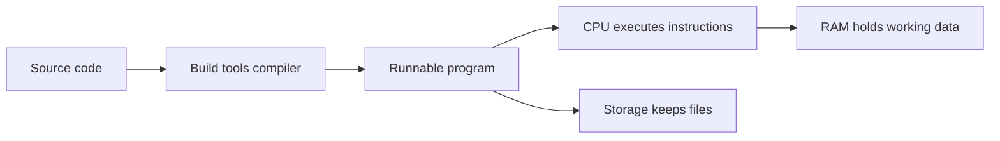
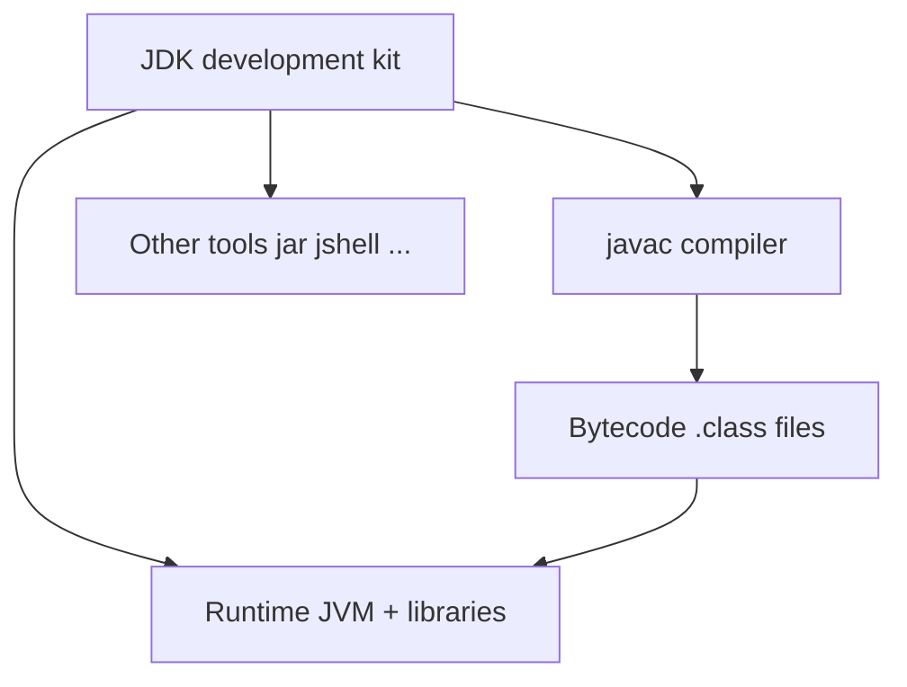
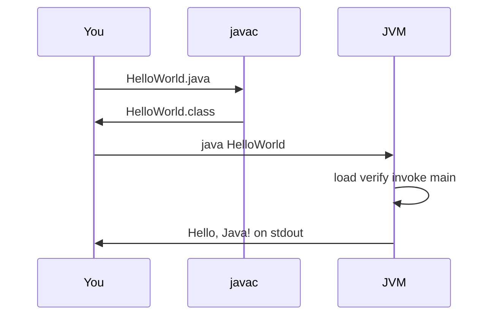
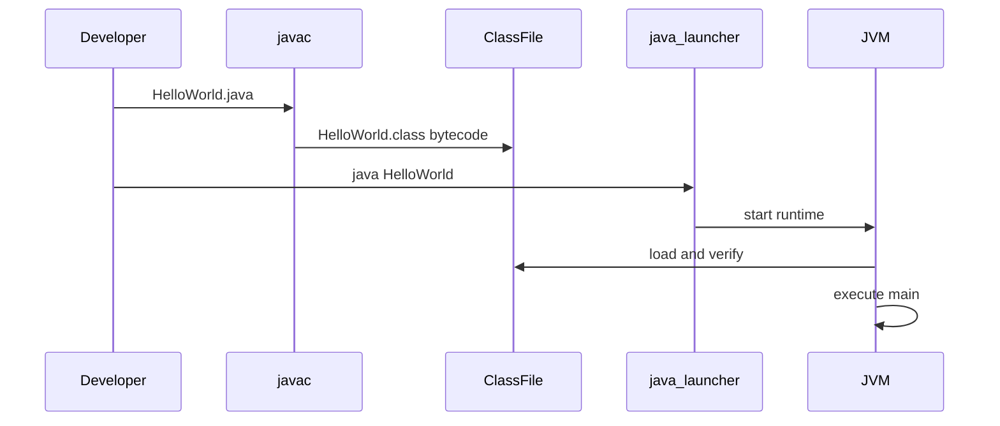

# What Is Programming and What Is Java?

> **Status:** Completed  
> **Module:** 00 — Programming Foundations  
> **Target Java version:** 21  
> **Last reviewed:** 2026-11-10  
> **Chapter profile:** Conceptual  
> **Depth target:** Levels 1–2 (programming and Java platform vocabulary)  
> **Examples verified with:** Temurin JDK 21.0.12.1 (`javac 21.0.12.1`)

## 1. Learning Objectives

After completing this chapter, you should be able to:

- Explain what programming is in plain language, without unexplained jargon.
- Describe how a computer roughly turns instructions into useful work (CPU, memory, programs).
- Distinguish source code, compilation, bytecode, and execution in the Java world.
- Explain what Java is, why it was created, and what JDK, JRE, and JVM mean.
- Compile and run a minimal Java program with `javac` and `java`.
- Recognize common beginner misconceptions and common gaps for experienced developers.
- Know which later handbook modules deepen each idea.

## 2. Prerequisites

- None. This is the starting chapter for Track A (complete beginners).
- Track B (experienced Java developers): skim conceptual sections, then use **Revision and Mastery**.

Optional orientation:

- [LEARNING-ROADMAP.md](../LEARNING-ROADMAP.md) — both learning tracks
- [appendix/java-version-history.md](../appendix/java-version-history.md) — why this handbook targets Java 21

Follow-up chapters:

- [02-how-computers-execute-programs.md](02-how-computers-execute-programs.md)
- [03-algorithms-and-problem-solving.md](03-algorithms-and-problem-solving.md)
- Module 01: JDK/JRE/JVM tooling, installation, IDE and CLI workflow

## 3. Why This Concept Exists

Before you can learn Java syntax, types, or Spring Boot, you need a stable mental model of three questions:

1. **What is a program?**
2. **How does a computer run one?**
3. **Where does Java fit in that picture?**

Without those answers, later chapters feel like memorizing spells. With them, every new feature attaches to a reason: the compiler catches mistakes early; the JVM runs bytecode; the JDK gives you tools to build software.

This chapter exists to build that foundation carefully for beginners, and to give experienced developers a precise vocabulary for teaching and revising fundamentals.

## 4. Conceptual Explanation

### 4.1 What programming is

**Programming** is the craft of writing precise instructions that a computer can follow to solve a problem or perform a task.

Those instructions are written as **source code**—text in a programming language. A programming language is a compromise between human readability and machine precision. English is too ambiguous for computers (“put that over there” depends on shared context). Machine code (raw processor instructions) is too tedious for humans. High-level languages like Java sit in between.

A useful beginner analogy:

| Everyday activity | Programming counterpart |
|-------------------|-------------------------|
| A recipe | An **algorithm** (step-by-step method) |
| The written recipe card | **Source code** |
| Cooking according to the recipe | **Executing** the program |
| A burnt dish from a wrong step | A **bug** (incorrect behavior) |

Programming is not magic, and it is not primarily about memorizing keywords. It is about **clear problem-solving expressed with exact rules**.

### 4.2 What a computer is doing (gentle model)

You do not need an electronics degree. You do need this model:



- **CPU (processor):** performs calculations and follows instructions very quickly.
- **RAM (memory):** short-term working space for the running program’s data.
- **Storage (disk/SSD):** long-term files, including your source code and installed tools.
- **Operating system (OS):** Windows, macOS, or Linux software that manages hardware and runs programs.

When a program “runs,” the OS loads it, the CPU executes instructions, and RAM holds the program’s current **state** (the data it is working with). The next chapter in this module introduces a minimal **stack, heap, and thread** picture; later handbook modules add JVM detail. For now, remember: **programs manipulate data over time according to rules you wrote.**

### 4.3 Algorithms and problem solving

An **algorithm** is a finite, unambiguous sequence of steps to solve a problem.

Example problem: “Is a number even?”

1. Obtain the number.
2. Divide by 2 and look at the remainder.
3. If the remainder is 0, it is even; otherwise it is odd.

That algorithm can be written in Java, Python, or pseudocode. **The language is a vehicle; the thinking comes first.** Module 00 will expand algorithms, pseudocode, and complexity. Here, the point is: good programmers spend time clarifying the problem before typing code.

### 4.4 Compiled vs interpreted (and where Java sits)

Broadly:

| Approach | Idea | Rough examples |
|----------|------|----------------|
| **Compiled** | Translate source into another form before running | C, Go (to machine code); Java (to bytecode) |
| **Interpreted** | Read and execute source (or an intermediate form) more directly at run time | Many scripting workflows |

These categories blur in practice. Java’s important story is:

1. You write `.java` **source files**.
2. The **Java compiler** (`javac`) translates them into **bytecode** stored in `.class` files.
3. A **Java Virtual Machine (JVM)** loads that bytecode and executes it—often mixing interpretation and Just-In-Time (JIT) compilation to machine code (**HotSpot** does this; that is an implementation detail).

So Java is commonly described as “compiled to bytecode, then run on a virtual machine.” That design is central to Java’s portability story.

**What bytecode is.** Bytecode is a compact instruction set defined for the JVM—not for a particular CPU family. Each `.class` file holds bytecode plus metadata (constant pool, type information). The JVM’s job is to load those instructions and carry them out safely on whatever machine you are using. You do not need to memorize opcodes in this chapter; think of bytecode as the **portable middle layer** between your Java source and the CPU’s native machine code.

**What the JVM does for you (high level).** When you run `java HelloWorld`, the JVM typically:

1. **Loads** class files from disk (and may load more classes as your program needs them).
2. **Verifies** bytecode so obviously unsafe instructions are rejected before execution (platform safety).
3. **Executes** bytecode—often by interpreting it at first, then **JIT-compiling** frequently used code to native machine code on HotSpot.
4. **Manages memory** through **garbage collection** (reclaiming objects your program no longer uses—see §10.2).
5. **Provides runtime services** such as threading support, reflection, and access to the standard library.

Exact JIT tiers and default GC algorithms are **HotSpot choices**, not something every JVM must duplicate identically—but every conforming JVM must execute verified bytecode per the JVM Specification.

### 4.5 What Java is

**Java** is:

- A **programming language** (syntax and rules),
- A **standard library** (packages like `java.lang`, `java.util`),
- A **platform** centered on the **JVM**,
- Delivered to developers primarily through the **JDK** (Java Development Kit).

Official documentation and the Java Language Specification define the language. The JVM Specification defines requirements for virtual machines that run Java bytecode. Popular JVMs such as **HotSpot** (in Oracle JDK / OpenJDK builds) implement those ideas with additional engineering choices. This handbook will keep saying when something is language law versus HotSpot behavior.

Java was designed in the 1990s with goals that still matter:

- **Portability:** write programs that run on many operating systems via the JVM (“write once, run anywhere” as a goal—with real-world caveats).
- **Safety and productivity:** automatic memory management (garbage collection), strong typing, and a large standard library.
- **Networked and large-system software:** Java became a major language for servers, enterprise systems, Android (historically/related ecosystem), big data tooling, and more.

**Strengths (high level):** mature ecosystem, strong tooling, huge hiring/market presence for backend work, excellent libraries and frameworks (including Spring), solid concurrency and networking libraries, long-term support releases.

**Limitations (honest):** verbosity compared to some newer languages; memory and startup characteristics differ from native binaries; enterprise stacks can become complex; you must learn both the language *and* the runtime to be a strong engineer.

### 4.6 JDK, JRE, and JVM

Beginners meet three acronyms immediately. Keep them straight:

| Acronym | Full name | Role |
|---------|-----------|------|
| **JVM** | Java Virtual Machine | Runs bytecode; provides runtime services (memory management, etc.) |
| **JRE** | Java Runtime Environment | Historically: what you need to *run* Java apps (JVM + core libraries). Packaging names vary by vendor and era. |
| **JDK** | Java Development Kit | What you need to *develop* Java apps: compiler (`javac`), tools, libraries, and a runtime |

**Practical rule for this handbook:** install a **JDK 21**. That gives you `javac`, `java`, and the tools used in examples.



### 4.7 Your first mental model of a Java program

A tiny Java program usually:

1. Declares a **class**—a named container that groups related code. In Java, nearly all executable code lives inside a class. A class name starts with an uppercase letter by convention (`HelloWorld`).
2. Declares a **`main` method**—the **entry point** the JVM looks for when you start the program with `java ClassName`. If `main` is missing or has the wrong signature, the program cannot start the way you expect.
3. Executes **statements** inside `main` (for example, printing text), one after another in order unless control flow changes that (covered in the Control Flow module, `03-control-flow`).

You will soon learn variables, types, and objects in depth (Module 02 and beyond). For this chapter, running “Hello, Java!” proves your toolchain works and connects the vocabulary above to something real.

## 5. Mechanism and Execution Flow

This section traces **what happens in order** when you compile and run HelloWorld—separate from the vocabulary in §4.

### 5.1 Compile-time vs run-time responsibilities

| Phase | Tool | Input | Output |
|-------|------|-------|--------|
| Compile | `javac` | `.java` source | `.class` bytecode (or compiler errors) |
| Run | `java` launcher + JVM | class name on classpath | OS process, side effects, exit code |

`javac` never executes your logic; it only checks and translates. The JVM never repairs bad source—you must recompile after edits.

### 5.2 Run-time sequence for `java HelloWorld`

1. The OS starts a process for the `java` launcher.
2. The launcher starts a JVM and passes the class name `HelloWorld`.
3. **Class loading** locates `HelloWorld.class` on the classpath.
4. **Linking / verification** checks bytecode safety (JVMS requirements).
5. The JVM resolves `public static void main(String[] args)` and invokes it on the `HelloWorld` class.
6. `System.out.println` runs through standard-library bytecode; output goes to **standard output**.
7. `main` returns; with only this thread active, the JVM typically exits the process.



### 5.3 What `main` looks like as bytecode

After `javac`, `javap -c HelloWorld` shows `main` as JVM instructions: load the string constant, obtain `System.out`, `invokevirtual` `println`, then `return`. The JVM **interprets** those instructions first; on HotSpot, frequently executed methods may later be **JIT-compiled** to native machine code. You do not need opcode fluency yet—only the idea that `main` is a normal method the JVM calls by contract.

### 5.4 Heap allocation and garbage collection on this run

The literal `"Hello, Java!"` is represented as an object on the **heap** (managed memory for objects and arrays). Local slots in `main`'s stack frame hold references to that object while `println` runs. When `main` ends, those references disappear; the `String` becomes **unreachable**, so a **garbage collection** cycle may reclaim its heap space. You never call `free`—dropping references and leaving scope is how Java expresses “done with this object.” Exact GC timing is **HotSpot policy**, not something you control per object in beginner code.


## 6. Terminology

| Term | Meaning |
|------|---------|
| Source code | Human-readable program text (`.java` files) |
| Bytecode | Platform-neutral instructions in `.class` files |
| Compiler (`javac`) | Translates `.java` → `.class` |
| JVM | Runtime that executes bytecode |
| JDK | Development kit including compiler and tools |
| Algorithm | Step-by-step method to solve a problem |
| Bug | Incorrect program behavior relative to what you intended |
| HotSpot | A widely used JVM implementation |

See also [GLOSSARY.md](../GLOSSARY.md).

## 7. Syntax and Language Rules (first contact)

You do not need the whole language yet. You need enough to read the first program.

### 7.1 A minimal program

```java
public class HelloWorld {
    public static void main(String[] args) {
        System.out.println("Hello, Java!");
    }
}
```

Read the program line by line:

| Piece | What it means | Why it is there |
|-------|----------------|-----------------|
| `public` | **Access modifier:** this class is visible outside its own file/package (within the rules Java defines). For a small program in the default package, you use `public` on the class so the JVM can load it when you run `java HelloWorld`. | A non-`public` top-level class can exist, but then the file naming rules differ; beginners almost always use one `public` class per file matching the file name. |
| `class` | Keyword introducing a **class**—the unit that holds fields and methods. | Java organizes code into classes; even `main` must live inside a class. |
| `HelloWorld` | The class name (PascalCase by convention). | Must match `HelloWorld.java` for a `public` class. |
| `public static void main(String[] args)` | The program **entry point** (see below). | The JVM searches for this exact signature to start execution. |
| `System.out.println(...)` | Calls the standard library to print a line to **standard output** (your terminal). | Shows output without building a GUI. |
| `{ ... }` | **Block:** statements grouped under the class or method. | Defines what belongs together. |
| `;` | Ends a statement (Java syntax rule). | The compiler expects it after most statements. |
| `"Hello, Java!"` | A **string literal**—constant text data in double quotes. | The message you want to print. |

**The `main` method signature, word by word:**

| Part | Meaning |
|------|---------|
| `public` | The JVM (outside this class) must be allowed to call `main`. |
| `static` | Belongs to the **class**, not to an object instance. The JVM starts the program before any objects exist, so it calls `main` on the class itself. |
| `void` | This method does not **return** a value to its caller (contrast with methods that return `int`, `String`, etc.). |
| `main` | Conventional name for the entry point (required for this startup contract). |
| `String[] args` | **Command-line arguments:** an array of text strings passed when you run `java HelloWorld arg1 arg2`. Empty `args` if you pass none (see §8.2). |

**Packages and more modifiers** (private fields, multiple classes per file, `protected`) are part of everyday Java, but you can run HelloWorld without them. Modules **02** (types and syntax), **04** (methods), and **05** (classes and objects) deepen each keyword with rules, edge cases, and design practice.

### 7.2 Compile and run commands

From the directory containing `HelloWorld.java`:

```bash
javac HelloWorld.java
java HelloWorld
```

- `javac` produces `HelloWorld.class` (bytecode).
- `java HelloWorld` launches the JVM and loads that class (note: no `.class` suffix in the command).

## 8. Step-by-Step Examples

### 8.1 Minimal example — HelloWorld

Runnable copy: [examples/beginner/hello-world/](../examples/beginner/hello-world/)

**Compile and run (Verified — Temurin JDK 21.0.12.1):**

```bash
javac HelloWorld.java
java HelloWorld
```

**Verified output (Temurin JDK 21.0.12.1):**

```text
Hello, Java!
```

**What happens, step by step:**

1. You create source text in `HelloWorld.java`.
2. `javac` checks basic language rules and emits `HelloWorld.class`.
3. `java HelloWorld` starts a JVM, loads the class, and calls `main`.
4. `println` writes characters to standard output (your terminal).
5. `main` ends; the program exits.

### 8.2 Realistic beginner variant — personalized greeting

Still tiny, but closer to “a program that uses input data.” Command-line arguments appear in `args`.

```java
public class Greeting {
    public static void main(String[] args) {
        String name;
        if (args.length > 0) {
            name = args[0];
        } else {
            name = "friend";
        }
        System.out.println("Hello, " + name + "!");
    }
}
```

Example runs (illustrative pattern; try it after Module 01 tooling is comfortable):

```bash
javac Greeting.java
java Greeting
java Greeting Ada
```

Possible output:

```text
Hello, friend!
Hello, Ada!
```

This introduces **decisions** and **data**:

- `String name;` declares a variable that can hold text (`String` is Java’s text type).
- `if (args.length > 0) { ... } else { ... }` is a **decision:** if the condition in parentheses is true, the first block runs; otherwise the `else` block runs. Here, `args.length` counts how many command-line strings you passed.
- `name = args[0];` assigns the first argument string to `name`.

The Control Flow module (`03-control-flow`) covers every form of branching and looping; here the lesson is: programs combine **data + decisions + actions**.

### 8.3 Conceptual “advanced for this chapter” — the portability idea

Suppose you compile on Windows and run the same `.class` files on Linux with a compatible JDK/JRE:

- You do **not** recompile for each OS the way you often must for pure native machine code.
- You **do** need a JVM for that OS and a compatible Java version.
- Native libraries, file paths, and OS assumptions can still break portability—hence “write once, run anywhere” is a goal with engineering caveats.

Module 26 (JVM internals) and Module 01 (tooling) expand this.

## 9. Real-World Use Cases

Why learn Java for real work?

- **Backend HTTP APIs** and microservices (often with Spring Boot—later, after core Java).
- **Business and enterprise systems** that must run for years with LTS JDKs.
- **Data and streaming infrastructure** (many tools in the ecosystem are JVM-based).
- **Android** historically used Java language syntax (modern Android also uses Kotlin; still valuable overlapping knowledge).
- **Large existing codebases** that need maintainers who understand language *and* runtime.

This handbook’s long-term goal is professional Java backend engineering—not only toy programs.

## 10. Internal Behavior

### 10.1 From source to running process (overview)



At a high level (details in Module 26):

1. **Compilation** produces bytecode and constant pool information in a class file.
2. **Class loading** brings the class into the JVM.
3. **Verification** checks that bytecode is well-formed (safety feature of the platform).
4. **Execution** interprets and/or JIT-compiles hot code (**HotSpot**-specific strategy).

**Labeling:** The idea that Java programs compile to class files and run on a JVM is platform architecture. Exact JIT tiers and GC defaults are **HotSpot implementation details** unless the JVMS requires a behavior.

### 10.2 Automatic memory management (preview)

In languages such as C, programmers often call `free` (or similar) when data is no longer needed. Java takes a different path: you allocate objects (and arrays) as you need them; the **JVM** decides when memory can be reclaimed.

**Garbage collection (GC)** is the runtime process that **finds objects your program can no longer reach** and frees their memory so it can be reused. “No longer reachable” means no live variable, field, or call chain still points at that object. When nothing references an object, it is eligible for collection (exact timing is implementation-dependent on HotSpot).

| Aspect | Beginner takeaway |
|--------|-------------------|
| **What** | Automatic reclaim of unused heap memory |
| **Why Java needs it** | Objects and arrays live on the **heap**; manual `free` would be error-prone in large apps with many references |
| **What you do** | Drop references (set variables to `null` or leave scope); avoid keeping unneeded objects in collections |
| **What you do not do** | Call `delete`/`free` on Java objects—there is no standard way |

GC is a major reason Java feels productive, but it is not free: **pauses** while the collector runs, **memory footprint**, and **retained references** (logical leaks) still matter in production. Modules **25–27** cover heap layout, collectors, and tuning; for now, remember: **create objects when you need them; let the JVM reclaim what you truly abandon.**

## 11. Edge Cases and Limitations

- **Wrong file name / class name:** For a `public` class, the file name must match the class name (`HelloWorld.java`).
- **Wrong directory when running:** `java HelloWorld` needs the class on the classpath (for this example, run from the directory containing the `.class` file).
- **Using `java HelloWorld.java`:** Newer JDKs can launch single-file source programs in some cases; this handbook still teaches the classic `javac` then `java` workflow first because it matches how real multi-file projects behave.
- **Version mismatch:** Bytecode major versions must be supported by the runtime. Compiling with a newer JDK and running on an older one can fail.
- **Portability caveats:** File separators, encodings, native dependencies, and container resource limits still matter in production.

## 12. Common Mistakes

### Incorrect — treating Java like a pure scripting one-liner without structure

Beginners sometimes expect “just type commands” with no class/`main`. Java’s classic entry point is structured. (JSHell exists for exploration—Module 01.)

### Incorrect — running `java HelloWorld.java` when you meant the class name after compiling

After `javac`, run `java HelloWorld` (class name), not necessarily the source file name form, depending on workflow.

### Incorrect — installing only a vague “Java” browser plugin mental model

Modern backend development needs a **JDK**, not an old browser plugin story.

### Corrected mindset

1. Install JDK 21.
2. Write source in `.java` files.
3. Compile with `javac`.
4. Run with `java`.
5. Learn tools (IDE, build systems) after the mental model is solid.

## 13. Best Practices

- Start with the command line once, even if you love IDEs—so you understand what the IDE automates.
- Keep first programs tiny; add one concept at a time.
- Read error messages from the top; the first compiler error often causes later noise.
- Prefer clarity over cleverness while learning.
- Track your JDK version (`java -version`) when following tutorials; this handbook standardizes on **Java 21**.

## 14. Design Trade-offs

| Choice | Benefit | Cost |
|--------|---------|------|
| JVM + bytecode | Portability and rich runtime services | Extra runtime layer vs pure native binary |
| Static typing | Many errors caught before production | More upfront ceremony than some dynamic languages |
| Large ecosystem | Libraries for almost every backend need | Must learn to choose dependencies wisely |
| LTS releases (21, 25, …) | Stable production targets | Feature releases move faster; stay aware |

## 15. Performance Considerations

Do not optimize yet. Do know:

- First-run “warm-up” can matter on the JVM because HotSpot may JIT-compile hot methods over time.
- Startup time and memory footprint differ from languages that ship a single native binary by default.
- For HelloWorld, performance is irrelevant; for services, Module 28 matters.

## 16. Security Considerations

Even HelloWorld teaches a habit: **do not trust input**. Later, `args`, files, network data, and SQL must be validated. Java’s platform has security features and also historical pitfalls (for example, insecure deserialization—Module 43). For this chapter: run only code you trust; download JDKs from official vendors.

## 17. Java Version and Compatibility Notes

- **Primary handbook version:** Java 21 LTS.
- **This chapter’s features:** basic `main` and `println` — available for many releases; validated on **21.0.12.1**.
- **Latest LTS at research time (Nov 2026):** Java 25 — documented in [appendix/java-version-history.md](../appendix/java-version-history.md); not required for this chapter.
- **Latest feature release (awareness):** Java 27 (non-LTS).
- Preview/incubator features are out of scope here.

## 18. Related Language Comparisons

Comparisons help experienced polyglot developers; they are **not** required to learn Java.

- Planned: [appendix/java-vs-go.md](../appendix/java-vs-go.md), Java vs C#, Java vs Python.
- High-level contrast: Go often ships a native binary with an embedded runtime; Java typically ships bytecode run by a JVM installed or bundled with the app image. Both can build excellent backends; the operational stories differ.

## 19. Revision and Mastery

For developers who already write Java:

### What you should already understand

- JDK vs JVM vs language vs bytecode
- `main` as an entry point and the role of `javac`/`java`
- That HotSpot JIT/GC details are not identical to “the Java language”

### Common knowledge gaps

- Explaining portability caveats precisely
- Separating JLS/JVMS guarantees from HotSpot behavior
- Teaching beginners without skipping the “why”
- Knowing which LTS you target in production and why (21 vs 17 vs 25)

### Frequently misunderstood details

- “Java is interpreted” (oversimplified—bytecode execution + JIT is richer)
- “JRE vs JDK” packaging differences across vendors and versions
- Class file version compatibility between compile and run JDKs

### Advanced concepts worth studying next

- Class loading and bytecode (`javap`) — Module 26
- Build tools (Maven/Gradle) — Module 29
- How Spring sits on top of language features — Modules 36–37

### Questions you should be able to answer

1. What artifacts does `javac` produce, and what loads them?
2. Why might a program compile on one machine and fail to run on another?
3. What does LTS mean for a team choosing a JDK?

### Practical exercises for mastery

- Explain JDK/JRE/JVM to a beginner in five minutes without buzzwords.
- Use `javap -c HelloWorld` and read a few bytecode instructions (preview of Module 26).
- List three production risks of “works on my machine” for JVM apps.

## 20. Exercises

Attempt these before reading **Solutions**.

### Beginner

1. In your own words, what is the difference between source code and bytecode?
2. Install or locate a JDK. Run `java -version` and `javac -version`. Write down the results.
3. Compile and run [HelloWorld](../examples/beginner/hello-world/). Change the message and rerun.

### Intermediate

4. Why does Java use a JVM instead of only compiling directly to machine code like some languages?
5. What breaks the naive slogan “write once, run anywhere” in real projects?
6. Predict what happens if you rename `HelloWorld.java` but keep `public class HelloWorld` inside (then try it).

### Advanced

7. Using official docs, identify whether a claim is about the language, the SE API, the JVM specification, or HotSpot.
8. Research one difference between Java 21 and Java 25 that would matter to a production team. Cite your source.

## 21. Interview Questions

1. **What is the JVM?** — Runtime that loads and executes Java bytecode (and other JVM languages’ bytecode), providing services such as memory management.
2. **JDK vs JRE vs JVM?** — JVM executes; JRE historically meant runtime distribution; JDK includes development tools (compiler, etc.). Exact product packaging varies; developers generally install a JDK.
3. **What is bytecode?** — Intermediate instruction format in class files, designed for execution by a JVM.
4. **Is Java compiled or interpreted?** — Source is compiled to bytecode; execution may involve interpretation and JIT compilation depending on the JVM implementation.
5. **Why is Java used for backend systems?** — Portability, ecosystem, tooling, libraries/frameworks, strong typing, concurrency support, long-term LTS support—trade-offs included.

## 22. Solutions

1. Source code is human-readable text you edit. Bytecode is the compiled form in `.class` files that the JVM executes.
2. Results vary by machine. This handbook’s Phase 1 validation machine reported `java version "21.0.12.1"` and `javac 21.0.12.1`.
3. After changing the string, recompile (`javac`) before expecting `java` to show the new message—otherwise you may run old bytecode.
4. The JVM provides portability, safety checks, and runtime services (GC, etc.) at the cost of an extra layer and operational considerations.
5. Native dependencies, OS assumptions, file systems, encodings, container limits, and incompatible JDK versions.
6. A public top-level class must be declared in a matching filename; the compiler rejects the mismatch.
7. Example framing: language rules → JLS; class library → Java SE API docs; VM requirements → JVMS; GC ergonomics defaults → HotSpot docs/release notes.
8. Example direction: check Oracle’s support roadmap and release notes for Java 25 LTS vs 21; cite Oracle documentation (do not invent features).

## 23. Chapter Summary

- Programming means writing precise instructions; algorithms come before syntax fluency.
- Computers execute programs using CPU, memory, storage, and an OS.
- Java programs are typically compiled to bytecode and executed on a JVM.
- The JDK provides the tools to develop Java software; this handbook targets **Java 21**.
- Your first success criterion is compiling and running HelloWorld and explaining what happened.

## 24. Key Terminology

Programming · source code · algorithm · compiler · bytecode · JDK · JRE · JVM · HotSpot · `main` method

## 25. References and Further Reading

- [Oracle Java Downloads](https://www.oracle.com/java/technologies/downloads/)
- [Oracle Java SE Support Roadmap](https://www.oracle.com/java/technologies/java-se-support-roadmap.html)
- [Java SE Documentation](https://docs.oracle.com/en/java/javase/)
- [Java Language Specification / JVM Specification hub](https://docs.oracle.com/javase/specs/)
- [JDK 21 API](https://docs.oracle.com/en/java/javase/21/docs/api/)
- Handbook: [REFERENCES.md](../REFERENCES.md), [GLOSSARY.md](../GLOSSARY.md)

## 26. Next Steps

- Continue Module 00 foundations (computers, algorithms) **or**
- Go to Module 01 for JDK installation, environment variables, IDE vs CLI, and project structure—recommended next for most beginners after running HelloWorld:

**Next chapter:** [02-how-computers-execute-programs.md](02-how-computers-execute-programs.md)  
After Module 00: `01-java-getting-started/01-jdk-jre-jvm-and-tooling.md`

## Review Checklist

**Mandatory Depth Review:** Levels 1–2 for Conceptual profile — platform vocabulary with real HelloWorld run.

- [x] Learning objectives covered
- [x] Prerequisites identified and briefly refreshed
- [x] Chapter profile **Conceptual** and depth target **Levels 1–2** recorded
- [x] Depth gate passed (definitions, progressive examples, mistakes, trade-offs)
- [x] Mandatory Depth Review (Levels 1–4) passed for this topic
- [x] Mechanism and execution flow (Section 5) with compile/run sequence diagram
- [x] Complex relationships illustrated (JDK/JVM diagram in §4.6)
- [x] First-appearance concepts explained (main, bytecode, GC preview)
- [x] Terminology defined before use
- [x] HelloWorld example **Verified** on Temurin JDK 21.0.12.1
- [x] Spec vs implementation labeled (HotSpot in §10)
- [x] References support important claims
- [x] Solutions explain reasoning
- [x] No filler sections
- [x] Standalone readability
- [x] Revision and Mastery included
- [x] Conditional omissions recorded below

**Omissions (section → reason):**

- **Language comparisons** — omitted; not required for first Java mental model.
- **Advanced in-chapter bytecode listing** — `javap` deferred to Module 26; mechanism section summarizes.
