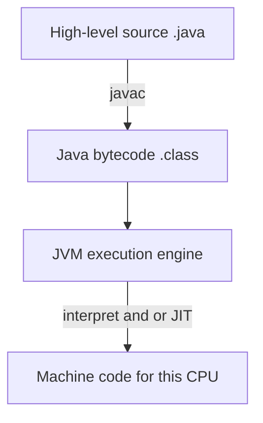

# How Computers Execute Programs

> **Status:** Completed  
> **Module:** 00 — Programming Foundations  
> **Target Java version:** 21  
> **Last reviewed:** 2026-11-10  
> **Chapter profile:** Conceptual  
> **Depth target:** Levels 1–2 (CPU, OS, JVM execution model)  
> **Examples verified with:** Temurin JDK 21.0.12.1 (`javac 21.0.12.1`)

## 1. Learning Objectives

After completing this chapter, you should be able to:

- Explain the roles of CPU, RAM, storage, and the operating system in running a program.
- Distinguish machine code, assembly, high-level source, and Java bytecode.
- Describe sequential execution, method calls, and the idea of a call stack at a beginner level.
- Explain stack versus heap and a single thread of execution at a beginner level.
- Trace a small Java program’s statement order and relate it to bytecode inspected with `javap`.
- Separate language/platform ideas from HotSpot implementation details.
- Connect this foundation to later JVM, memory, and concurrency modules.

## 2. Prerequisites

- Required: [01-what-is-programming-and-what-is-java.md](01-what-is-programming-and-what-is-java.md)
- Comfortable compiling and running HelloWorld with `javac` / `java`

## 3. Why This Concept Exists

If “the computer runs my code” remains a black box, later topics—stack overflows, memory leaks, threads, the JVM—feel arbitrary. This chapter opens the box just enough:

- What hardware and OS pieces participate
- What “an instruction” means at different layers
- How Java’s bytecode layer fits between source and the CPU

You do not need to become a hardware engineer. You need a durable mental model.

## 4. Conceptual Explanation

### 4.1 Hardware pieces that matter to programmers

| Piece | Role | Programmer-facing intuition |
|-------|------|-----------------------------|
| **CPU** | Executes instructions | The worker that follows steps |
| **RAM** | Fast temporary storage for running programs | The desk where current papers sit |
| **Storage** | Durable files (SSD/HDD) | The filing cabinet |
| **OS** | Manages hardware, processes, files, permissions | The supervisor that starts your program |

A **process** is a running instance of a program managed by the OS: its own memory space (from the program’s point of view), open files, and at least one **thread** of execution. Details vary by OS; the idea is universal.

### 4.2 From high-level source to the CPU



- **Machine code:** numbers the CPU understands directly (architecture-specific: x86-64, ARM, …).
- **Assembly:** human-readable mnemonics for machine instructions (still CPU-family specific).
- **High-level languages:** Java, Python, etc.—designed for people.
- **Java bytecode:** portable instructions for a **JVM**, not for a particular CPU brand.

**Labeling:** That Java programs compile to class files and run on a JVM is platform architecture. *How* HotSpot mixes interpretation and JIT tiers is a **HotSpot implementation detail** (Module 26–28).

### 4.3 Sequential execution

Unless you use concurrency (much later), a single thread executes **one statement after another** in order—except when control flow jumps (`if`, loops, method calls, exceptions).

Method calls temporarily transfer control:

1. Pause the caller.
2. Run the callee.
3. Return to the caller with a result (or void).

That nesting is tracked with a **call stack**: each active method call has a **stack frame** holding its local variables and return address (conceptual model; Module 04 and 25 deepen this).

### 4.4 The operating system’s job at startup

When you type `java ExecutionOrder`:

1. The OS starts a **process** for the Java launcher.
2. The launcher starts a **JVM** inside that process.
3. The JVM loads your class file, finds `main`, and begins executing bytecode.
4. Your prints go to **standard output**, which the OS connects to your terminal.

You are never “talking to the CPU” directly from Java source; layers of software mediate.

### 4.5 Compiled vs interpreted revisited

| Layer | What happens |
|-------|----------------|
| `javac` | Compiles source → bytecode (ahead of running, for normal projects) |
| JVM | Executes bytecode; may interpret and/or compile hot methods to machine code |

Saying “Java is interpreted” is an oversimplification. Prefer: **compiled to bytecode, executed by a virtual machine that may JIT-compile**.

### 4.6 Stack, heap, and threads (minimum viable model)

When a Java process runs, the JVM divides memory usage into ideas you will see in stack traces and memory chapters:

| Region | What lives there (intuition) | Example in this chapter |
|--------|------------------------------|-------------------------|
| **JVM stack** (per thread) | Nested **method calls**: local variables, parameters, and “where to return” for each active call | While `greet` runs, its parameter `name` and bookkeeping sit in a **stack frame** |
| **Heap** | **Objects and arrays** created at run time; shared across threads subject to Java’s concurrency rules | Any `String` you pass to `greet`; array objects in later chapters |
| **Thread** | One **sequential** stream of execution inside a process | Default Java apps start with one thread running `main` |

```text
Process: java HelloWorld
  Thread "main"
    Call stack (top = currently running):
      | greet frame     |  ← executing now
      | main frame      |
    Heap: String objects, arrays, ...
```

**Stack frames** push when a method is called and pop when it returns—that is why `main` “waits” during `greet`. **Primitives** such as `int` in local variables typically live in the frame; **reference types** often store a pointer in the frame while the actual object data sits on the heap.

**Threads:** A process may have many threads (parallel execution paths). Until you use concurrency APIs, assume **one thread** runs your statements in order. Module **24** covers Java threads; Module **25** maps stack/heap to Java variables and object lifetimes in detail.

## 5. Mechanism and Execution Flow

This section ties the **numbered prints** in `ExecutionOrder` to JVM execution—stack growth, calls, and returns.

### 5.1 Statement order vs call nesting

A single thread in `main` runs statements top to bottom until a **method call** suspends the caller:

1. Print `1. main starts` (`main` frame active).
2. Enter `greet`: push a **stack frame**, print `2. inside greet`, pop frame, return to `main`.
3. Print `3. main continues…` (`main` still has locals from before the call).
4. Enter `add`: push frame, print `4. inside add`, compute `a + b`, pop frame, return `5` to `main`.
5. Print `5.` and `6.` then `main` returns.

The caller never “skips ahead” while a callee runs—control is strictly nested.

### 5.2 Stack, heap, and thread (execution view)

```text
Thread "main" (one sequential stream of bytecode)
  JVM call stack:
    | greet frame  |  <- executing while print 2 runs
    | main frame   |
  Heap: String "Ada", constant strings, any allocated objects
```

| Location | During `greet("Ada")` |
|----------|-------------------------|
| **Stack (per thread)** | `main` frame kept underneath; `greet` frame holds parameter `name` and local bookkeeping |
| **Heap** | `String` content for `"Ada"` and message fragments |
| **Thread** | One **program counter** per thread advancing through bytecode |

Primitives such as `int` in `add` usually live in stack slots; reference types store a **handle in the frame** pointing at heap objects.

### 5.3 Why `static` helpers sit beside `main`

`main` is `static`, so the JVM can start without constructing an `ExecutionOrder` object. **`static` methods** on the same class (`greet`, `add`) are invoked with `invokestatic`—no instance required. That keeps this chapter about **call order and frames**, not object construction (Module **05**). When you later call **instance** methods, the receiver object also lives on the heap and a reference to it typically appears in the callee frame.


## 6. Terminology

| Term | Meaning |
|------|---------|
| Process | OS-managed running program instance |
| Thread | Sequence of execution within a process |
| Machine code | CPU-native instructions |
| Bytecode | JVM instructions in `.class` files |
| Call stack | Nested method-call tracking structure |
| Stack frame | One method call’s locals + bookkeeping |
| Heap | Storage for objects and arrays at run time |
| Instruction pointer / PC | “Which instruction is next?” (JVM has a PC per thread—JVMS concept) |

## 7. Syntax and Language Rules

This chapter is mostly conceptual. The Java rules you need:

- Statements in `main` and other methods run in textual order unless control flow changes.
- A method must be **called** to run; defining it is not enough.
- `return` ends a method and (for non-`void`) provides a value to the caller.

### 7.1 Helper methods and `static`

The example below defines `greet` and `add` beside `main` in the same class:

```java
static void greet(String name) { ... }
static int add(int a, int b) { ... }
```

| Keyword / idea | Meaning in this chapter |
|----------------|-------------------------|
| **Method** | A named block of code with parameters and optionally a return type. |
| **`static`** | Belongs to the class, not an instance. `main` calls `greet(...)` without creating an `ExecutionOrder` object. |
| **`void`** | No return value (`greet` only prints). |
| **`int`** | Returns a 32-bit integer (`add` returns `a + b`). |
| **Call syntax** | `greet("Ada")` and `add(2, 3)` run the method and then execution continues in `main`. |

Module **04** (methods) covers overloads, instance methods, and `return` semantics in full. Here, `static` helpers keep the focus on **call order and the stack**, not object construction.

## 8. Step-by-Step Examples

### 8.1 Minimal — ordered prints and calls

Runnable: [examples/beginner/execution-order/](../examples/beginner/execution-order/)

```java
public class ExecutionOrder {
    public static void main(String[] args) {
        System.out.println("1. main starts");
        greet("Ada");
        System.out.println("3. main continues after greet returns");
        int total = add(2, 3);
        System.out.println("5. add returned: " + total);
        System.out.println("6. main ends");
    }

    static void greet(String name) {
        System.out.println("2. inside greet: Hello, " + name);
    }

    static int add(int a, int b) {
        System.out.println("4. inside add");
        return a + b;
    }
}
```

**Verified output (Temurin JDK 21.0.12.1):**

```text
1. main starts
2. inside greet: Hello, Ada
3. main continues after greet returns
4. inside add
5. add returned: 5
6. main ends
```

Notice numbers 2 and 4 happen *inside* called methods. The caller does not continue until the callee returns.

### 8.2 Realistic — mental stack frames

While `greet` runs, `main` is still “in progress” underneath. Sketch:

```text
| greet frame (name = "Ada") |  ← top (active)
| main frame                 |
+----------------------------+
```

When `greet` returns, its frame pops; `main` resumes.

### 8.3 Advanced for this level — peek at bytecode with `javap`

After `javac ExecutionOrder.java`:

```bash
javap -c ExecutionOrder
```

Verified excerpt from `main` (Temurin JDK 21.0.12.1): calls appear as `invokestatic` to `greet` and `add`, and prints as `invokevirtual` on `PrintStream.println`. You do not need to memorize opcodes yet—Module 26 treats bytecode seriously. The point: **your source becomes a sequence of JVM instructions**.

## 9. Real-World Use Cases

- Reading stack traces in production (“which method called which?”).
- Understanding why infinite recursion crashes with `StackOverflowError`.
- Reasoning about performance: CPU-bound vs waiting on disk/network.
- Operating containers: process memory limits affect the JVM process.

## 10. Internal Behavior

### 10.1 JVM execution engine (overview)

Per the JVM Specification, each thread has its own JVM stack and a program counter. The execution engine carries out bytecode. **HotSpot** commonly interprets first and JIT-compiles hot paths—implementation strategy, not a language requirement that every JVM must JIT.

### 10.2 Why portability works

The same `.class` file can run on JVMs for Windows, Linux, or macOS because each JVM translates/executes bytecode on that platform. Caveats from Chapter 01 still apply (native code, OS assumptions, class-file version).

## 11. Edge Cases and Limitations

- Multiple threads break the “one step after another” story globally—each thread has its own order (Module 24).
- Asynchronous I/O and callbacks can make “what runs next?” harder; foundations first.
- `javap` output depends on compiler version and source constructs (for example string concatenation may use `invokedynamic` on modern JDKs).

## 12. Common Mistakes

### Incorrect

“The CPU runs my `.java` file directly.”

### Corrected

The CPU runs machine code. For Java, a JVM process executes bytecode derived from your source (often after JIT to machine code).

### Incorrect

“Defining a method means it already ran.”

### Corrected

Methods run only when called (or when the JVM invokes `main` at startup).

## 13. Best Practices

- Trace execution on paper for small programs before using a debugger.
- Learn to read the top of a stack trace early—it names the active call chain.
- Keep a clear picture of process vs thread vs JVM vs your classes.

## 14. Design Trade-offs

| Approach | Benefit | Cost |
|----------|---------|------|
| JVM bytecode | Portability, safety, rich runtime | Extra layer vs pure native |
| Direct native compilation (other languages) | Simple deployment story sometimes | Rebuild per OS/CPU; different tooling |
| Deep hardware knowledge for every app | Optimal low-level control | Slow delivery; rarely needed for business apps |

## 15. Performance Considerations

- Waiting on disk/network often dominates CPU for beginners’ programs.
- HotSpot optimization over time means short microbenchmarks mislead (Module 28).
- Stack depth has limits; deep recursion is a design choice with risk.

## 16. Security Considerations

- The OS enforces permissions: your process may not read arbitrary files.
- Bytecode verification is part of the JVM’s safety story (Module 26).
- Do not run untrusted bytecode/programs with your full user privileges.

## 17. Java Version and Compatibility Notes

- Concepts apply across modern Java; examples validated on **Java 21.0.12.1**.
- `javap -c` details can change with compiler improvements; treat listings as snapshots.

## 18. Related Language Comparisons

Native-compiled languages skip a JVM bytecode step and emit machine code ahead of time (with their own runtimes sometimes embedded). Java’s model emphasizes a portable intermediate form. Details belong in appendix comparisons later—not required to proceed.

## 19. Revision and Mastery

### What you should already understand

Process vs thread; bytecode vs machine code; that `main` is an entry point.

### Common knowledge gaps

- Confusing OS threads with Java `Thread` API details too early
- Believing all JVMs behave identically at the JIT/GC level
- Misreading stack traces (bottom vs top)

### Questions to answer

1. What does the OS create when you launch `java`?
2. What sits between Java source and the CPU?
3. What happens to the call stack on method enter/return?

### Practical exercise

Run `javap -c` on HelloWorld and ExecutionOrder; explain three instructions in your own words.

## 20. Exercises

### Beginner

1. List CPU, RAM, storage, OS in one sentence each.
2. Run [ExecutionOrder](../examples/beginner/execution-order/) and number the call stack depth at the moment `greet` prints.

### Intermediate

3. Add another method `shout` called from `greet`. Predict print order, then verify.
4. Explain why `java ExecutionOrder.java` (source-launch form on newer JDKs) still does not mean the CPU executes `.java` text directly.

### Advanced

5. Use `javap -c -p ExecutionOrder` and map each `println` in source to an `invokevirtual`.
6. Research (docs only): what the JVMS says a thread’s PC register is for.

## 21. Interview Questions

1. **What is bytecode?** — Portable JVM instructions in class files.  
2. **Process vs thread?** — Process: OS program instance; thread: execution path within it.  
3. **Does the CPU execute Java source?** — No; ultimately machine code, via JVM execution of bytecode (often JIT).  
4. **What is a stack frame?** — Data for one active method call (locals, return info).  

## 22. Solutions

1. CPU executes; RAM holds working data; storage keeps files; OS manages resources/processes.  
2. Depth at least 2: `main` + `greet` (exact counting depends whether you count only Java frames).  
3. Order includes `shout` between entering `greet` and leaving it—verify by running.  
4. A launcher/compiler still turns source into bytecode executed by the JVM.  
5. Match `ldc`/`getstatic`/`invokevirtual` sequences to each print.  
6. Cite JVMS: PC holds address of JVM instruction being executed (per thread).

## 23. Chapter Summary

Computers run processes under an OS; CPUs execute machine instructions; Java inserts a bytecode + JVM layer for portability and safety. Single-threaded programs run step by step, with method calls nesting on a call stack. Peeking with `javap` makes that layer visible.

## 24. Key Terminology

CPU · RAM · process · thread · machine code · bytecode · call stack · stack frame · JVM execution engine · HotSpot

## 25. References and Further Reading

- [JVM Specification](https://docs.oracle.com/javase/specs/)
- [Java SE Documentation](https://docs.oracle.com/en/java/javase/)
- `javap` tool docs in the JDK Tool Specifications
- Next depth: Modules [26](../26-jvm-internals/README.md), [25](../25-java-memory-model/README.md)

## 26. Next Steps

- Next in Module 00: [03-algorithms-and-problem-solving.md](03-algorithms-and-problem-solving.md)
- Later: Module 01 tooling; Module 04 methods and stack frames in Java detail

## Review Checklist

**Mandatory Depth Review:** Levels 1–2 for Conceptual profile — execution order and stack intuition.

- [x] Learning objectives covered
- [x] Prerequisites identified and briefly refreshed
- [x] Chapter profile **Conceptual** and depth target **Levels 1–2** recorded
- [x] Depth gate passed
- [x] Mandatory Depth Review (Levels 1–4) passed for this topic
- [x] Mechanism and execution flow (Section 5) tied to ExecutionOrder
- [x] Stack/heap/thread illustrated in §4.6 and §5.2
- [x] `static` helpers explained in §6.1 and §5.3
- [x] ExecutionOrder output **Verified** on Temurin JDK 21.0.12.1
- [x] Spec vs HotSpot labeled
- [x] Revision and Mastery included
- [x] Exercises/solutions separated
- [x] References valid
- [x] Conditional omissions recorded below

**Omissions (section → reason):**

- **Full JVMS stack frame layout** — conceptual frames only; Module 04/25 deepen.
