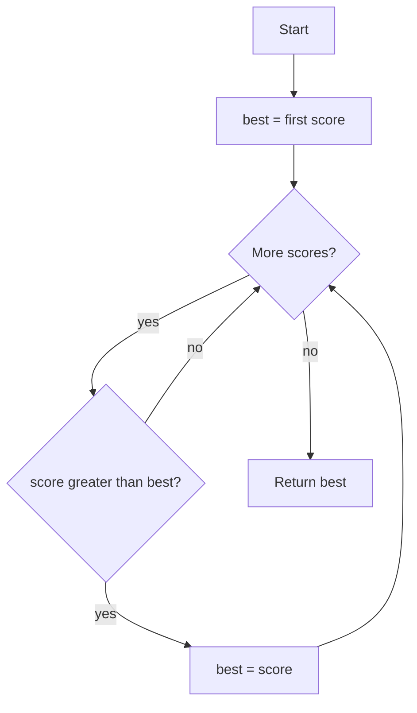

# Algorithms and Problem Solving

> **Status:** Completed  
> **Module:** 00 — Programming Foundations  
> **Target Java version:** 21  
> **Last reviewed:** 2026-11-10  
> **Examples verified with:** Oracle JDK 21.0.9 (`javac 21.0.9`)

## 1. Learning Objectives

After completing this chapter, you should be able to:

- Define algorithm, pseudocode, and flowchart at a beginner level.
- Break a problem into inputs, outputs, and steps before coding.
- Express a simple algorithm in pseudocode and then in Java.
- Trace a linear scan (find maximum) by hand and in code.
- Recognize common problem-solving techniques: decomposition, pattern recognition, debugging-as-thinking.
- Explain why algorithm choice matters before optimizing Java syntax.

## 2. Prerequisites

- [01-what-is-programming-and-what-is-java.md](01-what-is-programming-and-what-is-java.md)
- [02-how-computers-execute-programs.md](02-how-computers-execute-programs.md)
- Willingness to use basic `for` / `if` (explained gently here; Module 03 deepens control flow)

## 3. Why This Concept Exists

Typing Java without a plan produces fragile programs. Professional work starts with:

1. Understanding the problem
2. Designing a method (algorithm)
3. Only then encoding it in a language

This chapter builds that habit before syntax becomes the main focus.

## 4. Conceptual Explanation

### 4.1 What an algorithm is

An **algorithm** is a finite, unambiguous sequence of steps that solves a problem or computes a result.

Properties that matter:

| Property | Meaning |
|----------|---------|
| Finite | It stops (for the cases we care about) |
| Unambiguous | Each step is clear—no “sort of do this” |
| Effective | Steps are doable with available operations |
| Input / output | Takes data in; produces a result or effect |

Example problem: “Given a list of test scores, what is the highest score?”

### 4.2 Pseudocode

**Pseudocode** is structured plain language for algorithms—not real Java, but close enough to translate.

```text
FIND-MAX(scores):
  if scores is empty, signal an error
  set best to the first score
  for each remaining score s:
    if s > best:
      set best to s
  return best
```

Pseudocode lets you think without fighting braces and types.

### 4.3 Flowcharts (optional visual)

A **flowchart** shows steps and decisions as shapes and arrows. Useful for beginners; professionals often prefer pseudocode or clear functions. Use whichever helps you reason—then delete the ceremony and keep the clarity.



### 4.4 Problem-solving techniques

1. **Restate the problem** in your own words; list inputs/outputs/constraints.
2. **Work a tiny example by hand** (three scores: 5, 9, 2 → max 9).
3. **Decompose** into smaller steps (validate input; scan; return).
4. **Recognize patterns** (scanning, counting, searching, transforming).
5. **Implement the simplest correct idea first** (“make it work”).
6. **Test edge cases** (empty list, one element, duplicates).
7. **Improve** only after correctness (Modules 05+ and 28).

### 4.5 Programming paradigms (preview)

| Paradigm | Idea | Java relevance |
|----------|------|----------------|
| Imperative | Step-by-step commands | Everyday Java |
| Object-oriented | Model with objects | Core of Java style (Module 05+) |
| Functional | Compose transformations | Lambdas/streams (Module 16–17) |

You will mostly write imperative Java at first. Algorithms exist independently of paradigm.

## 5. Terminology

| Term | Meaning |
|------|---------|
| Algorithm | Finite clear steps to solve a problem |
| Pseudocode | Informal structured algorithm description |
| Trace | Step through with concrete values |
| Edge case | Unusual but valid input (empty, tiny, huge) |
| Decomposition | Breaking a problem into parts |
| Correctness | Produces the right result for required cases |

## 6. Syntax and Language Rules

Minimal Java used here (full rules later):

- `int[] scores = { ... };` — array of integers
- `scores.length` — number of elements
- `scores[i]` — element at index `i` (indexes start at **0**)
- `for (int i = 1; i < scores.length; i++)` — loop
- `if (condition) { ... }` — decision

**Pitfall:** The first index is `0`, not `1`. Off-by-one errors are classic (Chapter 05).

## 7. Step-by-Step Examples

### 7.1 Minimal — hand trace

Scores: `72, 91, 85`

| Step | best | looking at | action |
|------|------|------------|--------|
| start | 72 | — | initialize |
| 1 | 72 | 91 | 91 > 72 → best = 91 |
| 2 | 91 | 85 | 85 > 91? no |
| done | 91 | | return 91 |

### 7.2 Realistic — Java implementation

Runnable: [examples/beginner/find-max/](../examples/beginner/find-max/)

```java
public class FindMax {
    public static void main(String[] args) {
        int[] scores = {72, 91, 85, 91, 60};
        int maximum = findMax(scores);
        System.out.println("Maximum score: " + maximum);
    }

    static int findMax(int[] values) {
        int best = values[0];
        for (int i = 1; i < values.length; i++) {
            if (values[i] > best) {
                best = values[i];
            }
        }
        return best;
    }
}
```

**Verified output:**

```text
Maximum score: 91
```

Duplicates (`91` twice) are fine: “greater than” does not require unique values.

### 7.3 Advanced for this level — empty input

The code above **assumes** a non-empty array. Empty input would throw when reading `values[0]`. A production algorithm must define behavior: throw a clear exception, return an `Optional`, or document the precondition. Module 14 covers exceptions; Module 18 covers `Optional`.

**Design trade-off:** preconditions vs defensive checks—document one and test it.

## 8. Real-World Use Cases

- Pricing: find minimum eligible rate
- Monitoring: maximum latency in a sample window
- Games: high score
- Data pipelines: scan batches for anomalies

Same algorithmic pattern; different domains.

## 9. Internal Behavior

A linear scan visits each element about once. On typical JVMs this is a simple loop in bytecode (`goto`/`if_icmpgt` patterns). Exact bytecode is not required yet; complexity thinking deepens in Chapter 05.

## 10. Edge Cases and Limitations

| Case | Issue |
|------|--------|
| Empty array | `values[0]` fails |
| Single element | Loop body may not run; answer is that element |
| All equal | Still correct |
| Negatives | `>` still works for signed integers |
| Unsorted vs sorted | Scan works unsorted; sorted data allows faster strategies later |

## 11. Common Mistakes

### Incorrect

Start coding before stating inputs/outputs.

### Corrected

Write one sentence: “Given non-empty `int[]`, return the largest value.”

### Incorrect

Initialize `best` to `0` always.

### Corrected

That fails if all scores are negative. Initialize from the first element (or use a proper empty policy).

### Incorrect

Confuse “algorithm” with “whatever code compiled.”

### Corrected

Many programs compile and still implement the wrong algorithm.

## 12. Best Practices

- Hand-trace before and after coding.
- Name methods after the problem (`findMax`), not vague verbs (`doStuff`).
- Test edges: empty (if allowed), one element, duplicates, negatives.
- Prefer clear loops over clever tricks while learning.

## 13. Design Trade-offs

| Choice | Benefit | Cost |
|--------|---------|------|
| Simple linear scan | Easy to prove, few bugs | Slower on huge data than specialized structures |
| Sort then take last | Uses library sort | Extra work if you only need max |
| Keep a running max as data arrives | Online/streaming friendly | Must handle first value carefully |

## 14. Performance Considerations

For `n` elements, linear max is proportional to `n` (Chapter 05: big-O intuition). For classroom sizes, clarity beats micro-optimization.

## 15. Security Considerations

If scores come from users/files/network, validate size and ranges before trusting them. Algorithms on hostile input need limits (Module 43).

## 16. Java Version and Compatibility Notes

Array loops and `if` used here are long-standing Java. Validated on **21.0.9**.

## 17. Related Language Comparisons

Pseudocode → code is universal. Python might express the same algorithm with `max(scores)`; Java’s standard library also has utilities later—learning the loop builds transferable skill.

## 18. Revision and Mastery

### What you should already understand

How to specify preconditions; how to prove a loop invariant informally (“`best` is max of elements seen so far”).

### Common gaps

- Shipping code without edge-case tests
- Mixing problem statement with implementation accidents
- Jumping to “optimal” algorithms before measuring need

### Questions

1. What is the loop invariant for `findMax`?
2. How do you handle empty input in an API you design?
3. When is sorting before finding max justified?

## 19. Exercises

### Beginner

1. Write pseudocode for “count how many scores are >= 60”.
2. Hand-trace `findMax` on `{ -3, -9, -1 }`.

### Intermediate

3. Implement `findMin` similarly; verify with a small main.
4. Modify `findMax` to return the **index** of the maximum (first index if ties).

### Advanced

5. Write two algorithms for “are all elements unique?”—one nested loop, one with a strategy you’ll learn later (`Set`). Compare clarity.
6. Specify and implement behavior for empty arrays without crashing unexpectedly.

## 20. Interview Questions

1. **What is an algorithm?** — Finite unambiguous steps to solve a problem.  
2. **Why pseudocode?** — Design without language noise.  
3. **How do you find a max in an unsorted array?** — Linear scan; track best-so-far.  
4. **What is an edge case?** — Unusual but valid input that often breaks naive code.  

## 21. Solutions

1. Initialize `count = 0`; for each score, if `score >= 60` increment; return count.  
2. best starts -3; -9 no; -1 yes → answer -1.  
3. Same structure with `<` instead of `>`.  
4. Track `bestIndex`; update when `values[i] > values[bestIndex]`.  
5. Nested compare all pairs O(n²); `HashSet` add-and-check later in Module 12.  
6. e.g. throw `IllegalArgumentException` if `values.length == 0`, documented in Javadoc.

## 22. Chapter Summary

Algorithms are clear step sequences. Use pseudocode, hand traces, and decomposition before Java syntax. Linear scan for maximum is a foundational pattern with important edge cases.

## 23. Key Terminology

Algorithm · pseudocode · flowchart · trace · edge case · decomposition · precondition · correctness

## 24. References and Further Reading

- Any standard intro CS text on algorithms (conceptual)
- Next: [04-data-and-basic-structures.md](04-data-and-basic-structures.md), Module 03 control flow
- Later: Module 12 collections; Module 52 interview algorithms

## 25. Next Steps

Continue to data representation: [04-data-and-basic-structures.md](04-data-and-basic-structures.md)

## Review Checklist

- [x] Learning objectives covered
- [x] Prerequisites identified
- [x] Depth gate passed
- [x] FindMax verified on JDK 21.0.9
- [x] Revision and Mastery included
- [x] Exercises/solutions separated
