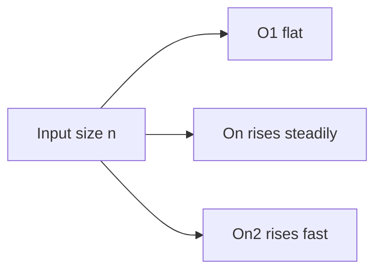

# Complexity and Debugging Mindset

> **Status:** Completed  
> **Module:** 00 — Programming Foundations  
> **Target Java version:** 21  
> **Last reviewed:** 2026-11-10  
> **Chapter profile:** Technical  
> **Depth target:** Levels 2–3 (complexity intuition and debugging process)  
> **Examples verified with:** Temurin JDK 21.0.12.1 (`javac 21.0.12.1`)

## 1. Learning Objectives

After completing this chapter, you should be able to:

- Explain **time** and **space** complexity in plain language (including big-O intuition).
- Compare constant, linear, and quadratic growth with tiny examples.
- Apply a systematic debugging process: reproduce → locate → understand → fix → prevent.
- Diagnose a classic off-by-one loop bug in Java and fix it.
- Distinguish compiler errors, runtime exceptions, and logic bugs.
- Carry a professional attitude: bugs are information, not personal failure.

## 2. Prerequisites

- Module 00 chapters [01](01-what-is-programming-and-what-is-java.md)–[04](04-data-and-basic-structures.md)
- Comfort running `javac` / `java` and reading simple loops

## 3. Why This Concept Exists

Two skills separate struggling beginners from growing engineers:

1. **Predicting cost** — will this approach still work when data grows?
2. **Finding defects** — when behavior is wrong, how do you hunt the cause?

You do not need heavy mathematics yet. You need instincts and a process.

## 4. Conceptual Explanation

### 4.1 What “complexity” means here

**Complexity** (in algorithms) describes how resource use grows as input size grows—usually **time** (how much work) and **space** (how much memory).

We care about **growth rate**, not exact nanoseconds on your laptop. Exact timing depends on CPU, JVM warmup, and load (Module 28). Growth rate is about the idea: “if input is 10× larger, does work become ~10× larger, ~100× larger, or barely change?”

**Input size `n`.** In this module, `n` usually means “how many elements you process” (array length, number of records, and so on). Complexity statements describe how **steps or extra memory** scale when `n` grows, not the constant overhead of starting the JVM.

**Space complexity** counts memory beyond the input itself—for example, extra variables (`best` in `findMax` uses O(1) extra space) or a second array copy (often O(n)). Time and space trade off: storing a hash map can turn a slow search into a fast one at the cost of more memory (Modules **12** and **28** revisit this in production).

### 4.2 Big-O intuition (beginner-friendly)

**Big-O** notation classifies growth. For this handbook’s start:

| Name | Written | Intuition | Example |
|------|---------|-----------|---------|
| Constant | O(1) | Work barely depends on `n` | Read `array[0]` |
| Linear | O(n) | Work proportional to `n` | `findMax` scan |
| Quadratic | O(n²) | Work proportional to `n×n` | Compare every pair |



Say `n` is the number of elements:

- Finding max by one pass ≈ **linear**
- Checking all pairs for duplicates with nested loops ≈ **quadratic**
- Returning a stored length field ≈ **constant**

**How to read the notation (enough for now).** “O(n)” is read “order n” or “big-O of n.” It is an **upper-bound style** classification: we ignore fixed setup costs and focus on the dominant term as `n` becomes large. We are not proving theorems here— we are building intuition so you can spot a nested loop over an entire array and ask “is this quadratic?”

| Symbol | Plain language |
|--------|----------------|
| O(1) | Doubling input barely changes work (read one cell, return cached size) |
| O(n) | Doubling input about doubles work (single pass) |
| O(n²) | Doubling input about quadruples work (all pairs) |

Formal definitions, logarithmic classes (O(log n)), and **amortized** analysis (some operations are “cheap on average”) come with collections (Module **12**) and interview prep (Module **52**).

### 4.3 Time vs space trade-offs

Sometimes you spend memory to save time (caching a result) or spend time to save memory. Neither is always “better.” Production systems choose based on constraints (Modules 42, 46).

### 4.4 Categories of bugs

| Kind | When you notice | Example |
|------|-----------------|---------|
| **Compile-time error** | `javac` fails | Missing `;`, unknown symbol |
| **Runtime failure** | Program crashes/throws | `ArrayIndexOutOfBoundsException` |
| **Logic bug** | Program runs but answer is wrong | Off-by-one sum returns 10 instead of 15 |

Logic bugs are often the hardest: no red compiler error, only wrong behavior.

### 4.5 A debugging process

1. **Reproduce** — get a reliable failing case (`n = 5` should be 15).
2. **Reduce** — smallest input that still fails.
3. **Observe** — print carefully, or use a debugger (Module 31).
4. **Hypothesize** — “loop might skip `n`.”
5. **Test the hypothesis** — check loop bounds; trace `i` values.
6. **Fix** — change one thing that addresses the root cause.
7. **Verify** — rerun failing and nearby cases.
8. **Prevent** — add a test or clearer names/comments so it does not return.

Debugging is scientific method applied to code.

### 4.6 Reading symptoms: compiler, exception, logic

| Symptom | What to read first | Typical fix mindset |
|---------|-------------------|---------------------|
| **Compiler error** | First `javac` message and line number | Syntax, types, missing symbol—code does not compile yet |
| **Exception + stack trace** | Exception **type** (e.g. `ArrayIndexOutOfBoundsException`) and **top stack frame** | Illegal state at run time—often bounds, `null`, or bad input |
| **Wrong output, no crash** | Compare expected vs actual on the **smallest** input | Logic bug—loop bounds, wrong operator, wrong variable |

A **regression** is when a change fixes one thing but breaks behavior that used to work—hence rerunning old tests after each fix. **Reproduce** means you can trigger the bug reliably; without reproduction, you are guessing.

When a program **throws**, read the **stack trace** from the top: the first frame in *your* code (not only JDK frames) is usually where the bad access happened—for example `ArrayIndexOutOfBoundsException` at a specific line. For **logic bugs** with no exception, **breakpoints** and selective `println` traces (show `i` and running `sum` each iteration) replace guesswork. Teams often attach a **minimal reproducer** to bug tickets so another engineer can see failure in under a minute.

## 5. Mechanism and Execution Flow

### 5.1 Counting work for growth rates

For input size `n`:

| Pattern | Loop structure | Comparisons / updates (order of magnitude) |
|---------|----------------|--------------------------------------------|
| Constant | Read one field | O(1) |
| Linear | Single loop `0 … n-1` | O(n) |
| Quadratic | Nested loops over all pairs | O(n²) |

The JVM may **optimize** a specific loop, but **algorithm shape** remains: comparing every pair still requires Θ(n²) pair examinations unless you change the algorithm (for example with a `HashSet`).

### 5.2 Debugging as an execution trace

Treat debugging like tracing a faulty program counter:

1. **Reproduce** — same inputs, same build (re-run `javac` if source changed).
2. **Reduce** — shrink `n` until the failure is obvious (`n=1` for the sum bug).
3. **Observe** — print `i` and partial `sum`, or read the **stack trace** top frame on exceptions.
4. **Hypothesize boundary** — if the loop stops before `n`, inspect whether the condition uses `i < n` or `i <= n`.
5. **Fix and verify** — one intentional change; compare **Verified** outputs before/after.

Vocabulary that shows up in teams: **regression** (old behavior breaks again), **root cause** (the wrong bound, not the print statement), **minimal reproducer** (smallest program that still fails).

### 5.3 Off-by-one mechanism

`for (int i = 1; i < n; i++)` evaluates the condition **before** each body run. For `n=5`, values `1…4` enter the sum, but `5` never does—the loop exits when `i` becomes `5` because `5 < 5` is false. Changing to `i <= n` includes the final addend—see §8.2 **Verified** outputs.

## 6. Terminology

| Term | Meaning |
|------|---------|
| Time complexity | How work grows with input size |
| Space complexity | How memory use grows with input size |
| Big-O | Classification of asymptotic growth |
| Off-by-one | Loop/index wrong by a single boundary |
| Reproduce | Make the bug happen again on purpose |
| Regression | A fix (or change) that reintroduces an old bug |
| Root cause | The underlying mistake (wrong bound), not the symptom (wrong print) |
| Minimal reproducer | Smallest program/input that still shows the bug |
| Stack trace | Runtime list of active method frames when an exception is thrown |
| Breakpoint | Debugger pause at a line so you can inspect variables (Module 31) |

## 7. Syntax and Language Rules

Loop bounds are where off-by-one errors live:

```java
// includes 1..n
for (int i = 1; i <= n; i++) { ... }

// includes 0..n-1 (n elements)
for (int i = 0; i < n; i++) { ... }
```

Mixing these patterns without care causes logic bugs that still compile.

## 8. Step-by-Step Examples

### 8.1 Minimal — growth intuition

For `findMax` on `n` elements: about `n` comparisons → linear.  
For nested `for i / for j` over all pairs: about `n²` comparisons → quadratic.

If `n` goes from 1,000 to 10,000:

- Linear work ~10×  
- Quadratic work ~100×  

That is why nested loops over huge data hurt.

### 8.2 Realistic — the lying sum

Runnable buggy program: [examples/beginner/debug-off-by-one/OffByOneBug.java](../examples/beginner/debug-off-by-one/OffByOneBug.java)

Intent: sum `1 + 2 + ... + n`. For `n = 5`, correct answer is **15**.

**Verified output — buggy (Temurin JDK 21.0.12.1):**

```text
sumUpTo(5) = 10
```

Why? Loop used `i < n`, so it added `1+2+3+4` and skipped `5`.

Fixed version: [OffByOneFixed.java](../examples/beginner/debug-off-by-one/OffByOneFixed.java)

**Verified output — fixed (Temurin JDK 21.0.12.1):**

```text
sumUpTo(5) = 15
```

```java
for (int i = 1; i <= n; i++) {
    sum += i;
}
```

### 8.3 Debugging transcript (how to think)

| Step | Action | Result |
|------|--------|--------|
| Reproduce | Run with `n=5` | Prints 10 |
| Expected | Formula `n(n+1)/2` → 15 | Mismatch |
| Reduce | Try `n=1` | Buggy returns 0; fixed should return 1 |
| Hypothesize | Loop excludes `n` | Check condition `i < n` |
| Fix | Use `i <= n` | `n=1`→1, `n=5`→15 |
| Prevent | Name method clearly; add comment or test | Future you is safer |

Alternative closed form `n * (n + 1) / 2` avoids the loop—but watch integer overflow for large `n` (later numeric topics).

## 9. Real-World Use Cases

- Choosing nested loops vs maps for deduplication
- Explaining latency spikes when input size grows
- Production incidents: reproduce with the same request payload
- Code review: spot accidental O(n²) in hot paths

## 10. Internal Behavior

Complexity counts abstract steps. JVM JIT may optimize loops heavily, but **quadratic algorithms remain quadratic**—JIT does not turn “compare all pairs” into a free lunch. Label performance folklore carefully (Module 28).

## 11. Edge Cases and Limitations

- Big-O hides constants: O(n) with huge constants can lose to O(n²) for tiny `n`.
- Worst/average/best cases differ (sorting algorithms later).
- I/O and network dominate many backend costs more than CPU loops.

## 12. Common Mistakes

### Incorrect

Change many things at once until the bug “goes away.”

### Corrected

Change one hypothesis at a time; keep the reproduction case.

### Incorrect

“It compiles, so it’s correct.”

### Corrected

Logic bugs compile fine.

### Incorrect

Optimize to O(1) before the program is correct.

### Corrected

Correct → clear → then fast if needed.

## 13. Best Practices

- Write the expected result before running.
- Keep a small notebook of failing inputs.
- Prefer meaningful print messages: `System.out.println("i=" + i + ", sum=" + sum);` while debugging; remove or use a logger later.
- Add regression tests once you know Module 30 tooling.

## 14. Design Trade-offs

| Approach | Benefit | Cost |
|----------|---------|------|
| Extra logging | Faster diagnosis | Noise, possible secrets in logs |
| Clever one-liners | Short | Harder to debug |
| Simpler O(n²) for small n | Clear | Won’t scale |

## 15. Performance Considerations

Measure before blaming the JVM. For foundations: count loops mentally. For production: profilers and JMH (Module 28).

## 16. Security Considerations

Debug logs can leak passwords, tokens, or personal data. Never log secrets. In production incidents, follow data-handling rules (Module 43).

## 17. Java Version and Compatibility Notes

Loop semantics shown are stable across modern Java. Validated on **21.0.12.1**.

## 18. Related Language Comparisons

Off-by-one and O(n²) nested loops appear in every C-family language. The debugging process transfers; APIs and tooling differ.

## 19. Revision and Mastery

### Should already know

Amortized complexity; difference between big-O / Theta / Omega; how to read flame graphs.

### Common gaps

- Calling everything “optimized” without measurements
- Fixing symptoms (special-case `if (n==5)`) instead of causes
- Ignoring space costs of caching

### Questions

1. Why did `n=1` expose the sum bug faster than `n=5`?
2. Is `findMax` O(n) time and O(1) extra space? Why?
3. When is quadratic code acceptable in production?

## 20. Exercises

### Beginner

1. Run OffByOneBug and OffByOneFixed; record outputs.
2. Classify: missing semicolon — compile, runtime, or logic?

### Intermediate

3. Introduce an `ArrayIndexOutOfBoundsException` on purpose; read the stack trace top frame.
4. Estimate complexity of nested loops `for i in 0..n` / `for j in 0..n`.

### Advanced

5. Fix the bug using the formula `n*(n+1)/2`; test `n=0` and `n=5`. Discuss overflow risk for large `n`.
6. Write a debugging journal for a bug you invent in Scoreboard (mismatched lengths).

## 21. Interview Questions

1. **What does O(n) mean?** — Work grows proportionally to input size.  
2. **Compile-time vs logic bug?** — Compiler catches the first; wrong answers mark the second.  
3. **How do you debug?** — Reproduce, reduce, hypothesize, fix, verify, prevent.  
4. **Example of off-by-one?** — Using `i < n` when `1..n` inclusive was required.  

## 22. Solutions

1. Bug prints 10; fixed prints 15.  
2. Missing `;` → compile-time.  
3. Top frame shows the method/line; that is your first look.  
4. ≈ O(n²).  
5. For `n=5` → 15; `n=0` → 0; large `n` may overflow `int`.  
6. Journal should include reproduction, hypothesis, fix, verification.

## 23. Chapter Summary

Complexity describes how cost grows with input size; start with O(1)/O(n)/O(n²) intuition. Debugging is a disciplined loop from reproduction to prevention. Off-by-one errors show how tiny boundary mistakes become wrong answers without crashing.

## 24. Key Terminology

Time complexity · space complexity · big-O · off-by-one · logic bug · reproduce · regression

## 25. References and Further Reading

- Module 12 (collection complexity tables)
- Module 28 (measurement and JMH)
- Module 31 (debuggers, dumps)
- Module 52 (algorithm interviews)

## 26. Next Steps

Module 00 complete → begin Module 01: [../01-java-getting-started/README.md](../01-java-getting-started/README.md)  
Assessment: [../assessments/module-assessments/00-programming-foundations-assessment.md](../assessments/module-assessments/00-programming-foundations-assessment.md)

## Review Checklist

**Mandatory Depth Review:** Levels 2–3 for Technical profile — complexity intuition and debugging vocabulary.

- [x] Learning objectives covered
- [x] Chapter profile **Technical** and depth **Levels 2–3** recorded
- [x] Depth gate passed
- [x] Mandatory Depth Review passed for this topic
- [x] Mechanism and execution flow (Section 5): work counting + debug trace
- [x] OffByOneBug/Fixed **Verified** on Temurin JDK 21.0.12.1 (bug 10, fixed 15)
- [x] Stronger debugging vocabulary in §4.6 and §5.2
- [x] Revision and Mastery included
- [x] Conditional omissions recorded below

**Omissions (section → reason):**

- **Formal big-O proofs** — intuition only; Module 52 deepens.
