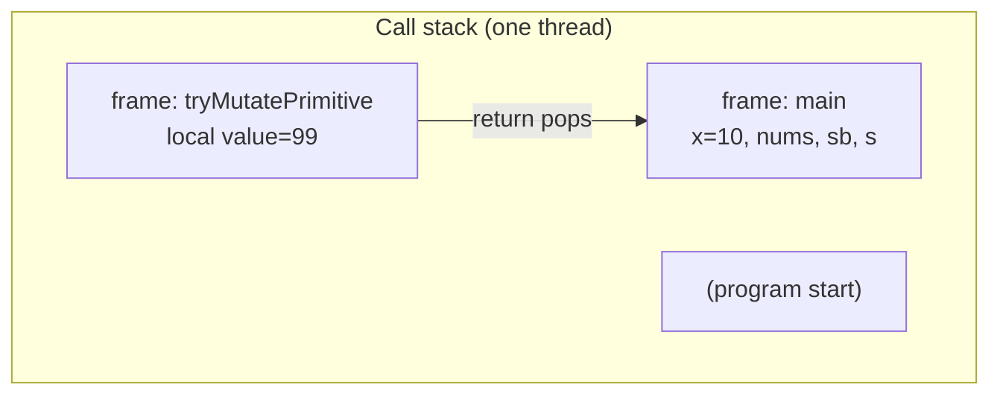

# Pass-by-Value and Stack Frames

> **Status:** Completed  
> **Module:** 04 — Methods and Functions  
> **Target Java version:** 21  
> **Last reviewed:** 2026-11-10  
> **Chapter profile:** Technical / Deep-dive  
> **Depth target:** Levels 3–4 (pass-by-value semantics; stack frames; JLS/JVMS/HotSpot labeled)  
> **Examples verified with:** Temurin JDK 21.0.12.1 (`javac 21.0.12.1`)

**Section policy:** Sections are **conditional unless marked mandatory**. Include a section when it adds meaningful learning value. Do **not** manufacture content to fill headings. For omitted sections, record the reason in the Review Checklist.

| Mandatory for most chapters | Conditional |
| --------------------------- | ----------- |
| Learning objectives | Internal behavior |
| Prerequisites | Performance |
| Why this exists | Security |
| Conceptual explanation | Language comparisons |
| Mechanism and execution flow *(or merge note)* | Advanced examples |
| Terminology | Real-world use cases |
| Examples | Design trade-offs *(strongly encouraged for Technical / Deep-dive)* |
| Common mistakes | Compatibility details |
| Summary and references | — |

## 1. Learning Objectives

After completing this chapter, you should be able to:

- State precisely that Java **always** passes method arguments **by value**.
- Predict caller-visible effects when passing primitives vs reference types.
- Distinguish **mutating object state** through a copied reference from **reassigning** a parameter name.
- Debunk the myth that Java is “pass-by-reference” in the C++/C# sense.
- Describe **stack frames** at a language/JVM level and relate them to nested calls and recursion depth.
- Walk through each scenario in `PassByValueDemo` and explain the verified output line by line.

## 2. Prerequisites

- **Methods and calls** — You invoke methods from `main` and earlier modules; Module 04 Ch.01 formalizes declarations and signatures.
- **Primitives vs references** — [Module 02 Ch.01](../02-java-fundamentals/01-variables-and-types.md): primitives store values directly; reference variables hold a reference (a “handle”) to an object on the heap (or `null`).
- **Scope** — [Module 02 Ch.03](../02-java-fundamentals/03-scope-naming-and-comments.md): parameters are locals in the callee’s scope.
- **Call stack preview** — [Module 00 Ch.02](../00-programming-foundations/02-how-computers-execute-programs.md): nested calls push/pop frames conceptually.

## 3. Why This Concept Exists

Misunderstanding parameter passing causes real bugs: “I reassigned the list in the helper—why didn’t the caller see it?” or “I changed the object—why did that work?” Interviewers probe this constantly because it reveals whether you understand **names**, **values**, and **objects** as separate ideas.

Java’s rule is simple once stated correctly: **every argument is copied before the callee runs**. What gets copied depends on the type—bits for an `int`, a reference value for an `int[]` or `StringBuilder`—but the mechanism is one rule, not two parallel “modes.”

## 4. Conceptual Explanation

### 4.1 Pass-by-value (the only mechanism)

**Pass-by-value** means the callee receives a **copy** of the value the caller had at the call site. The callee’s parameter is a **new local variable** initialized with that copy. Assigning to the parameter never changes the caller’s variable—only the callee’s local binding.

The Java Language Specification (JLS) describes method invocation such that argument expressions are evaluated and their values are passed into the new activation (stack frame). There is no language-level pass-by-reference for parameters.

### 4.2 Primitives: copy of the bits

For a primitive such as `int`, the copy is the numeric value itself. If the callee does `value = 99`, it changes only its local copy; the caller’s `x` is unchanged.

### 4.3 Reference types: copy of the reference, not the object

For a reference type, the “value” being copied is the **reference** (pointer/handle) to an object. After the call:

- **Callee and caller can refer to the same object** through their respective references (caller’s variable + callee’s parameter).
- **Mutating the object** through the parameter (e.g. `arr[0] = 100`, `builder.append('!')`) is visible to the caller because the object is shared.
- **Reassigning the parameter** (e.g. `arr = new int[]{...}`) updates only the callee’s local copy of the reference; the caller’s variable still points at the original object.

Java does **not** pass “the object itself” nor a C++-style alias to the caller’s variable.

### 4.4 Immutability adds a wrinkle (Strings)

`String` is **immutable**: methods like concatenation create **new** `String` objects. Code such as `text = text + "!"` binds the parameter to a new string; the caller’s variable still references the original `"hello"`. That looks like “pass-by-value wins even for references”—and it does—while `StringBuilder` mutation shows that shared **mutable** objects still allow cooperative change.

### 4.5 Myth: “Java is pass-by-reference”

In languages with true pass-by-reference, the callee can rebind the **caller’s** variable (e.g. swap two `int` variables in the caller). Java cannot do that through parameters. Colloquial “pass-by-reference” for Java usually means “the reference is copied,” which is still **pass-by-value of the reference**.

| Phrase people use | Accurate Java statement |
|-------------------|-------------------------|
| “Primitives by value, objects by reference” | Misleading—**all** arguments are by value; reference **values** are copied |
| “Java passes objects by reference” | False in the formal sense; object **identity** is shared via copied handles |
| “I need pass-by-reference to swap variables” | Use a holder object, array slot, or return values—not parameter aliasing |

### 4.6 Stack frames (preview)

Each active call has an **activation** (stack frame) holding parameters, locals, and return linkage. §5 traces invocation, value copying, and frame push/pop—including the diagram used with `PassByValueDemo`.

## 5. Mechanism and Execution Flow

### 5.1 Invocation: evaluate, copy, enter

For every method call (JLS §15.12):

1. Evaluate argument expressions **left-to-right**.
2. Copy each result **value** into the callee’s parameter locals (**pass-by-value**—§4.1–4.4).
3. Create a new **frame** and run the body.
4. On `return`, discard the frame and resume the caller with the return value (if any).

Primitives copy bits; references copy handles—never the object wholesale.

### 5.2 `PassByValueDemo` frame trace (conceptual)

When `main` calls `tryMutatePrimitive(x)`:

1. `main`’s frame holds `x = 10`.
2. Callee receives **`value = 10`** (copy). Assignment `value = 99` touches only callee locals.
3. Return pops callee; `main` still prints `x = 10`.

When `main` calls `mutateArrayContents(nums)`, both `main.nums` and parameter `arr` reference the **same array object**; `arr[0] = 100` mutates shared state. When `reassignArrayParameter` runs, `arr = new int[]{9,9,9}` rebinds only the **parameter copy**—`main.nums` is unchanged.



### 5.3 JVMS frame contents vs HotSpot limits

Each frame holds (JVMS §2.6, conceptual):

- **Local variable array** — parameters in the first slots (slot 0 often `this` on instance methods), then other locals
- **Operand stack** — bytecode evaluation stack
- **Return address** — where to resume in the caller

**JLS guarantee:** Value semantics for arguments. **JVMS guarantee:** One frame created per invocation, destroyed on return. **HotSpot (implementation):** Frames live on a per-thread stack; default max depth is platform-dependent and tunable with `-Xss<size>`. `StackOverflowError` means the thread exhausted that stack—common with unbounded recursion (Ch.02), not a language-defined frame count.

**Recursion depth** is therefore “how many frames fit under `-Xss`,” not a number in the JLS.

## 6. Terminology

| Term | Meaning |
|------|---------|
| Pass-by-value | Callee receives a copy of the argument value |
| Reference (value) | Handle to an object on the heap; copying it duplicates the handle, not the object |
| Mutate | Change object state in place (`arr[0]=`, `append`) |
| Reassign | Change which object a **variable** refers to (`arr = new …`) |
| Stack frame | Data for one active method invocation on a thread’s call stack |
| Activation record | Synonym for stack frame in many textbooks |

## 7. Syntax and Language Rules

Parameters are listed in the method signature; at each call site, argument expressions are evaluated **left to right**, then their values are copied into the callee’s parameter slots:

```java
void demo(int n, int[] data) { /* n and data are locals */ }
```

- `final` on a parameter prevents reassignment of the **local** parameter variable inside the callee; it does **not** make the referred object deeply immutable.
- Varargs (Module 04 Ch.02) still pass by value—the varargs array reference is copied like any other reference.

## 8. Step-by-Step Examples

Runnable demo: [examples/core-java/pass-by-value-demo/](../examples/core-java/pass-by-value-demo/)

```bash
javac PassByValueDemo.java
java PassByValueDemo
```

### 8.1 Full demo walk-through

Source (key methods):

```java
static void tryMutatePrimitive(int value) {
    value = 99; // only local copy
}

static void mutateArrayContents(int[] arr) {
    arr[0] = 100; // mutates shared array object
}

static void reassignArrayParameter(int[] arr) {
    arr = new int[] {9, 9, 9}; // local parameter only
}

static void appendToBuilder(StringBuilder builder) {
    builder.append('!');
}

static void reassignBuilder(StringBuilder builder) {
    builder = new StringBuilder("NEW");
}

static void tryReassignString(String text) {
    text = text + "!"; // new String; caller unchanged
}
```

**Verified (Temurin JDK 21.0.12.1):**

```text
after tryMutatePrimitive, x = 10
after mutateArrayContents, nums[0] = 100
after reassignArrayParameter, nums[0] = 100
after appendToBuilder, sb = Hi!
after reassignBuilder, sb = Hi!
after tryReassignString, s = hello
```

| Line after call | What happened |
|-----------------|---------------|
| `x = 10` | Primitive copy; `value = 99` never affects `main`’s `x`. |
| `nums[0] = 100` | Same array object; element 0 mutated through copied reference. |
| `nums[0] = 100` | `arr = new int[]{9,9,9}` only changed callee’s `arr`; `main`’s `nums` still `{1,2,3}` (index 0 still 100 from prior step). |
| `sb = Hi!` | `append` mutates shared `StringBuilder`. |
| `sb = Hi!` | Reassigning `builder` in callee does not change `main`’s `sb`. |
| `s = hello` | `text = text + "!"` points parameter at new immutable string; caller’s `s` unchanged. |

### 8.2 Minimal — primitive

```java
void setZero(int n) { n = 0; }
// caller's variable unchanged
```

### 8.3 Realistic — service mutates a DTO

A method that fills fields on a shared configuration object mutates caller-visible state; a method that does `config = new Config()` inside the callee does not replace the caller’s reference unless the caller assigns the **return value**.

### 8.4 Advanced — mental picture for `reassignArrayParameter`

Before call: `main.nums` → `int[]{1,2,3}`; parameter `arr` receives copy of that reference → same object.

Inside callee after `arr = new int[]{9,9,9}`: `arr` → new array; `main.nums` → still `{1,2,3}` (with `[0]==100` from earlier).

## 9. Real-World Use Cases

- **Collections:** Pass a `List` to a method that `add`s elements—caller sees changes; pass a list and assign `list = new ArrayList<>()` inside—caller does not.
- **Builders and buffers:** Shared `StringBuilder` for efficient string assembly across helpers.
- **Out-parameters:** Java idioms use return values, small holder objects, or `Optional` rather than reference parameters.
- **Defensive copying:** APIs sometimes copy collections on ingress/egress to avoid unintended mutation through shared references (Module 36+ design).

## 10. Internal Behavior

**JLS guarantee:** Argument evaluation and value passing are defined by the language; behavior above follows from value semantics.

**JVMS:** Each invocation pushes a frame with local slots for parameters (slot 0 often `this` for instance methods) and locals; `return` discards the frame.

**HotSpot:** Frame size depends on bytecode (local count, stack depth). Deep recursion can throw `StackOverflowError`; increasing `-Xss` trades memory for depth—this is tuning, not a correctness fix for infinite recursion.

## 11. Edge Cases and Limitations

- **`null` reference:** Copying `null` is legal; mutating throws `NullPointerException`.
- **Arrays are objects:** Same rules as `StringBuilder`; length is object state—cannot grow array by reassigning caller’s variable without return/wrapper.
- **Wrapper types (`Integer`):** Pass-by-value copies the reference to the **immutable** wrapper; `Integer x = 5; change(x)` cannot make caller’s box refer to another `Integer` without reassignment in caller.
- **`final` parameter:** Cannot reassign parameter; can still mutate mutable referred object unless reference is to immutable type.

## 12. Common Mistakes

### Incorrect — expecting reassignment in callee to update caller

```java
void replace(int[] a) {
    a = new int[10]; // caller still has old array
}
```

### Corrected — return new array or use holder

```java
int[] replace(int[] a) {
    return new int[10];
}
// caller: nums = replace(nums);
```

### Incorrect — believing `String` change in callee updates caller

```java
void fix(String s) {
    s = s.trim(); // new String assigned to local parameter only
}
```

### Corrected

```java
String fix(String s) {
    return s.trim();
}
```

## 13. Best Practices

- Name methods to signal mutation (`fill`, `append`) vs replacement (`create`, `buildNew`).
- Document whether a method mutates arguments.
- Prefer returning new data over out-parameters when clarity matters.
- When teaching, say “copy of the reference” instead of “passes the object.”

## 14. Design Trade-offs

| Approach | Pros | Cons |
|----------|------|------|
| Mutate shared object | Fewer allocations, clear single instance | Hidden side effects |
| Return new value/object | Explicit data flow | More allocation / plumbing |
| Holder / array slot | Multiple outputs | Awkward API |

Java chose uniform pass-by-value for simplicity and predictable scoping; other languages offer references at the cost of harder reasoning.

## 15. Performance Considerations

Copying a reference is cheap (one machine word). Copying large primitives (`long`, `double`) is still cheap. Unnecessary defensive cloning of large collections costs CPU and memory—balance clarity and safety.

## 16. Security Considerations

Mutable objects passed into untrusted code can be modified in place; wrap with unmodifiable views or copy when exposing internal state (Module 39).

## 17. Java Version and Compatibility Notes

Pass-by-value semantics are unchanged since Java 1.0. Verified on **21.0.12.1**.

## 18. Related Language Comparisons

- **C++:** Can pass by reference with `&`; Java has no equivalent for parameters.
- **C#:** `ref`/`out` parameters alias caller storage; Java has no direct equivalent.
- **Python:** Names are bindings; reassignment vs mutation confusion sounds similar but semantics differ—compare carefully in interviews.

## 19. Revision and Mastery

**You should already know:** primitives vs references, heap vs stack locals (Module 00/02).

**Common gaps:**

- Treating “reference type” as “pass-by-reference.”
- Forgetting that array reassignment is local-only.
- Assuming `String` behaves like `StringBuilder`.

**Answer these:**

1. After `mutateArrayContents(nums)`, why is `nums[0]` 100 in `main`?
2. After `reassignArrayParameter(nums)`, why is `nums[0]` still 100 (not 9)?
3. What would change if Java passed by true reference?

**Exercise drill:** For each method in `PassByValueDemo`, draw caller/callee variable arrows before and after the call.

## 20. Exercises

### Beginner

1. Predict then run `PassByValueDemo`; explain each output line without looking at this chapter.
2. Write `void increment(int n)` and show it cannot increment the caller’s variable.

### Intermediate

3. Implement `swap` that fails with parameters only, then succeed with `int[]` of length 2 (mutation) and discuss trade-offs.
4. Add a method that clears a `List` via `list.clear()` vs `list = new ArrayList<>()`; compare caller visibility.

### Advanced

5. Skim JLS section on method invocation (argument evaluation order). When can evaluation order matter?
6. Run a deep recursion until `StackOverflowError`; retry with a larger `-Xss`. Record observations—not a production pattern.

## 21. Interview Questions

1. **Is Java pass-by-reference?** — No; all arguments pass by value; references are copied.
2. **Can a method change the caller’s `int`?** — Not through the parameter; return or holder/array element.
3. **Why does `append` on `StringBuilder` work but `String` concat in callee does not?** — Mutable shared object vs new immutable string bound locally.
4. **What lives in a stack frame?** — Parameters, locals, return linkage (conceptually); JVMS defines exact layout.

## 22. Solutions

1. Matches verified block in §8.1.
2. Caller `n` unchanged; only local copy changes.
3. Parameter swap cannot rebind caller vars; `holder[0]`/`holder[1]` mutation works because object is shared.
4. `clear()` empties shared list; reassignment is local-only.
5. Side effects in argument expressions (e.g. `i++` in multiple args) rely on left-to-right evaluation.
6. `StackOverflowError` is resource limit; `-Xss` increases stack memory per thread.

## 23. Chapter Summary

Java always passes arguments **by value**. Primitives copy data; references copy handles. Mutating a shared object is visible; reassigning a parameter is not. Each call pushes a **stack frame** (JVMS); recursion depth is bounded by stack size (HotSpot `-Xss`).

## 24. Key Terminology

Pass-by-value · reference copy · mutate vs reassign · stack frame · call stack · activation · `StackOverflowError`

## 25. References and Further Reading

- [JLS — Method Invocation Expressions](https://docs.oracle.com/javase/specs/jls/se21/html/jls-15.html#jls-15.12)
- [JVMS — Frames](https://docs.oracle.com/javase/specs/jvms/se21/html/jvms-2.html#jvms-2.6)
- [HotSpot `-Xss` documentation](https://docs.oracle.com/en/java/javase/21/docs/specs/man/java.html) (thread stack size)
- [Module 00 Ch.02](../00-programming-foundations/02-how-computers-execute-programs.md) — call stack introduction
- [Module 25](../25-jvm-internals/) — deeper frame and stack analysis (planned)

## 26. Next Steps

- [04-static-instance-and-method-references.md](04-static-instance-and-method-references.md) — `static` vs instance behavior and `this`
- Module 04 Ch.01–02 — method declarations, overloading, recursion (stack depth in practice)

## Review Checklist

**Mandatory Depth Review:** Technical / Deep-dive profile; pass-by-value and frames at **Level 3** with **Level 4** on invoke/copy/frame mechanism (§5).

- [x] Learning objectives covered
- [x] Prerequisites identified and briefly refreshed
- [x] Chapter profile and depth target recorded and appropriate
- [x] Depth gate passed (detailed definitions; progressive examples)
- [x] Mandatory Depth Review (Levels 1–4) passed for this topic
- [x] Mechanism and execution flow explained where applicable (§5; stack diagram)
- [x] Complex relationships illustrated with diagrams where useful (§5.2 mermaid)
- [x] First-appearance concepts explained now (not deferred away)
- [x] Terminology defined before use
- [x] Examples include sufficient context to compile and run (or labeled Illustrative)
- [x] Verification status accurately labeled (**Verified** on Temurin JDK 21.0.12.1 for PassByValueDemo)
- [x] Explanations distinguish specification guarantees from implementation details (JLS/JVMS/HotSpot)
- [x] References support important technical claims
- [x] Solutions explain reasoning, not just final answers
- [x] No artificial sections, filler, or unexplained jargon
- [x] Chapter can be understood without repeatedly consulting other chapters
- [x] Conditional omissions recorded below
- [x] Revision and Mastery included when profile requires
- [x] `PROGRESS.md` updated honestly (standards-alignment pass 2026-11-10; Temurin re-verify)

**Omissions (section → reason):**

- **§ Language comparisons** — retained at §18; interview-oriented only.

**Verification note:** PassByValueDemo output matches Temurin JDK 21.0.12.1 re-run 2026-11-10 (`x=10`, `nums[0]=100`, `sb=Hi!`, `s=hello`).
