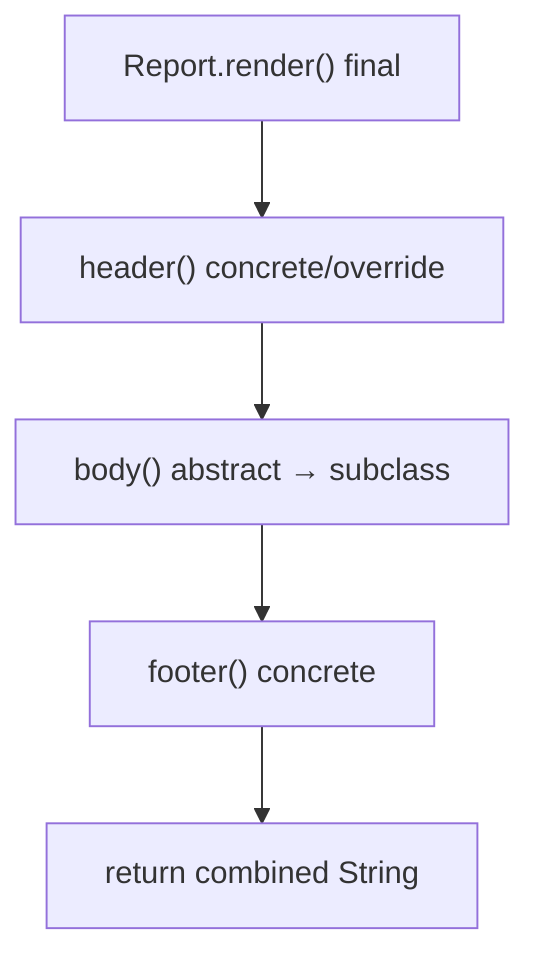

# Abstract Classes

> **Status:** Completed  
> **Module:** 07 — Inheritance and Polymorphism  
> **Target Java version:** 21  
> **Last reviewed:** 2026-11-11  
> **Chapter profile:** Technical  
> **Depth target:** Levels 2–3 (abstract classes, template method at Level 3)  
> **Examples verified with:** Temurin JDK 21.0.12.1 (`javac 21.0.12.1`)

**Section policy:** Sections are **conditional unless marked mandatory**. Include a section when it adds meaningful learning value. Do **not** manufacture content to fill headings. For omitted sections, record the reason in the Review Checklist.

| Mandatory for most chapters | Conditional |
| --------------------------- | ----------- |
| Learning objectives | Internal behavior |
| Prerequisites | Performance |
| Why this exists | Security |
| Conceptual explanation | Language comparisons |
| Mechanism and execution flow *(or merge note)* | Advanced examples |
| Terminology | Real-world use cases |
| Examples | Design trade-offs *(strongly encouraged for Technical / Deep-dive)* |
| Common mistakes | Compatibility details |
| Summary and references | — |

## 1. Learning Objectives

After completing this chapter, you should be able to:

- Declare **`abstract` classes** and **`abstract` methods** and explain when instantiation is illegal.
- Contrast **abstract classes** with **interfaces** and **concrete** classes at a design level (interfaces deepen in Module 08).
- Implement the **Template Method** pattern with a **`final`** algorithm skeleton and overridable hooks.
- Combine **`abstract`** types with concrete fields, constructors, and non-abstract methods.
- Choose abstract classes vs interfaces vs composition for shared behavior.

## 2. Prerequisites

- **Ch.01** — inheritance, `protected`, `final` methods, overriding.
- **Module 05 Ch.01** — classes, methods, fields.
- **Module 06 Ch.01** — constructors and `super(...)`.

Brief refresher: an **abstract method** has no body in the declaring class; a **concrete subclass** must implement it (unless that subclass is also abstract). You cannot write `new AbstractType()`—the compiler rejects instantiating abstract classes.

## 3. Why This Concept Exists

Some supertypes are **incomplete by design**: `Report` is not a report format—it is shared scaffolding. Subclasses supply **Pdf** vs **Csv** bodies. Without **`abstract`**, you might ship a concrete superclass with empty `body()` stubs that callers forget to override—runtime bugs instead of compile-time enforcement.

**Abstract classes** excel when:

- Several subclasses share **state** (title field, counters) and **code** (header/footer).
- You want a **fixed workflow** with customizable steps—**template method**.

**Interfaces** (Module 08) excel when multiple unrelated classes share a **contract** without shared fields. Many modern APIs lead with interfaces; abstract classes remain common in frameworks and document export pipelines.

## 4. Conceptual Explanation

### 4.1 What `abstract` means

| Kind | Can `new`? | Must implement missing methods? |
|------|------------|----------------------------------|
| Concrete class | Yes | N/A |
| Abstract class | No | Subclass must implement abstract methods (if concrete) |
| Abstract method | — | Declared in abstract (or concrete) class without body |

```java
abstract class Report {
    abstract String body();
}
```

Any **non-abstract** subclass must provide `body()` or be a compile error.

### 4.2 Partial implementation

Abstract classes may contain:

- **Fields** and **constructors** (initialize shared state).
- **Concrete methods** with full bodies (`header()`, `footer()`).
- **Abstract methods** subclasses must specialize (`body()`).
- **`final` methods** that must not change (`render()` orchestration).

This mixes **shared implementation** with **required specialization**—interfaces cannot hold instance state (except `default` methods without fields tied to instance in the same way—Module 08).

### 4.3 Template Method pattern

**Template method** = one **public or protected `final`** method defines the algorithm steps; **hooks** are overridden in subclasses.

In the demo, `render()` is **`final`**:

```java
final String render() {
    return header() + "\n" + body() + "\n" + footer();
}
```

Subclasses cannot skip the footer or reorder steps by overriding `render()`. They only fill `body()` (and may override `header()` if made overridable—in the demo `header` is concrete with optional override via `protected`).

Benefits:

- **DRY** shared logic.
- **Invariant order** enforced by `final`.
- New formats add a class, not copy-paste pipelines.

### 4.4 Abstract class vs interface (preview)

| Factor | Abstract class | Interface (Module 08) |
|--------|----------------|------------------------|
| Instance fields | Yes | No (only `public static final` constants historically) |
| Constructor | Yes | No instance ctor |
| Multiple inheritance | One class parent | Many interfaces |
| `abstract` methods | Yes | Implicitly abstract before `default` |
| Best when | Shared state + template | Capability plug-in across unrelated types |

From Java 8+, interfaces can have **`default` methods**—overlap increased. Rule of thumb: use **abstract class** when **shared mutable state** or a **rigid workflow** dominates; use **interface** for **capability** and testing seams.

### 4.5 Abstract + `sealed`

Java 17+ **sealed** abstract classes restrict permitted subclasses (Ch.04)—useful for fixed report families or AST node sets.

## 5. Mechanism and Execution Flow

An **abstract class** is a normal class that forbids direct instantiation (JLS §8.1.1.1). The **template method** pattern turns that restriction into a **fixed algorithm** with controlled variation.

### 5.1 Why `new Report()` is rejected

When the compiler sees `new PdfReport("Q1")`, it:

1. Confirms `PdfReport` is a **concrete** class with no remaining abstract methods.
2. Emits construction bytecode that eventually runs `PdfReport` → `Report` constructors.

`new Report()` fails at **compile time** because `Report` is `abstract`—there is no legal constructor chain that produces a complete instance of that exact class.

### 5.2 Template method execution (`render()`)

For `pdf.render()` in **AbstractClassesDemo**:

1. **Dispatch** — runtime type `PdfReport`; `render()` is **`final` on `Report`**, so dispatch uses `Report.render` (cannot be overridden).
2. **Steps inside `render()`** — calls `header()` (may override in subclass if overridable), **`body()`** (abstract hook → `PdfReport.body()` via dispatch), then `footer()`.
3. **String assembly** — `final` method concatenates pieces in a fixed order; subclasses cannot skip `footer()` or reorder without changing `Report` itself.
4. **Return** — caller receives one composite `String`; shared scaffolding stays in the superclass.



### 5.3 Abstract method satisfaction

The compiler checks each concrete subclass at **compile time**: every inherited **abstract** method without a `default` body must be implemented, or the class must be declared `abstract`. That check happens before bytecode emission—runtime never encounters a “half object” missing `body()`.

## 6. Terminology

| Term | Meaning |
|------|---------|
| **Abstract class** | Class declared `abstract`; cannot be instantiated |
| **Abstract method** | Method without body; subclass provides implementation |
| **Concrete subclass** | Non-abstract class that fills in abstract methods |
| **Template method** | `final` method defining algorithm with override hooks |
| **Hook method** | Overridable step called by template method |

## 7. Syntax and Language Rules

```java
abstract class Base {
    private final String title;
    Base(String title) { this.title = title; }

    final void run() {        // template
        step1();
        step2();
    }

    protected void step1() { }          // optional hook (default)
    protected abstract void step2();    // required hook
}

class Impl extends Base {
    Impl(String t) { super(t); }
    @Override protected void step2() { ... }
}
```

- Abstract class **may** have **zero** abstract methods—legal but rare; usually a marker or restriction via `protected` constructors.
- **Cannot** mark `static`, `private` (until Java 9+ private abstract is not allowed), or `final` methods as **abstract**.
- Subclass visibility when overriding **cannot be weaker**.

## 8. Step-by-Step Examples

### 7.1 Minimal abstract method

```java
abstract class Animal {
    abstract String speak();
}
class Dog extends Animal {
    @Override String speak() { return "woof"; }
}
```

### 7.2 Realistic: report rendering

Runnable: [abstract-classes-demo](../../../examples/core-java/abstract-classes-demo/).

**Verified output:**

```text
REPORT:Q1
pdf-body
END
REPORT:Q1
csv-body
END
```

`PdfReport` and `CsvReport` only implement `body()`. Shared title flows through `Report(String title)` and `header()` / `footer()`.

### 7.3 Advanced: mixed hooks

```java
abstract class Parser {
    public final Result parse(InputStream in) throws IOException {
        validate(in);
        return doParse(in);
    }
    protected void validate(InputStream in) { /* default no-op */ }
    protected abstract Result doParse(InputStream in) throws IOException;
}
```

Subclasses may override `validate`; must implement `doParse`.

## 9. Real-World Use Cases

- **Spring** `AbstractController` / various `*Support` base classes (legacy patterns).
- **Servlet API:** `HttpServlet` with `doGet` / `doPost` hooks (similar template idea).
- **Export pipelines:** PDF/Excel/CSV share metadata headers.
- **JUnit 4** `TestCase` (legacy); JUnit 5 favors composition and extensions.
- **InputStream** hierarchy: abstract `read()` with shared `skip`, `close` helpers (JDK itself).

## 10. Internal Behavior

No special JVM opcode for abstract types—abstractness is **compile-time**. At runtime, objects are instances of **concrete** classes. Virtual dispatch on hooks behaves like normal overrides (Ch.03).

## 11. Edge Cases and Limitations

- **Constructor on abstract class** — still runs when subclass is constructed; abstract class can enforce invariants in ctor.
- **All methods abstract** — class is like an interface with single inheritance cost; consider interface instead.
- **Cannot instantiate anonymous subclass** missing abstract methods unless you implement them in the anonymous body.
- **Diamond issues** — still only one superclass; abstract does not change that.

## 12. Common Mistakes

### Incorrect: instantiating abstract class

```java
Report r = new Report("Q1"); // compile error
```

### Corrected

```java
Report r = new PdfReport("Q1");
```

### Incorrect: concrete class leaves abstract method unimplemented

```java
class Broken extends Report { } // compile error: body() missing
```

### Incorrect: overriding `final render()`

```java
class Evil extends Report {
    @Override final String render() { return "hacked"; } // compile error
}
```

## 13. Best Practices

- Keep template methods **`final`**; name hooks clearly (`buildBody`, `validateInput`).
- Minimize **`protected`** surface—only true extension points.
- Prefer **small abstract hierarchies**; export **interfaces** for public API when possible.
- Document which hooks **must** call `super` if base changes state.

## 14. Design Trade-offs

| Choice | Benefit | Cost |
|--------|---------|------|
| Abstract class base | Shared fields + template | Subclasses locked to one hierarchy |
| Interface + helper class | Flexible | Split between contract and code |
| All-concrete base with empty defaults | Easy start | Forgetting to override—runtime bugs |
| `final` template | Safe workflow | Subclasses cannot reorder for valid variant flows |

## 15. Performance Considerations

Abstract indirection is ordinary virtual calls. Template method often enables **single place** for logging/timing—cheap compared to duplicated pipeline code.

## 16. Security Considerations

If hooks run **untrusted subclass code** in a plugin architecture, the **`final` template** should perform authorization **before** hooks—not inside overridable methods only. Abstract base in **same security domain** as app is usually fine.

## 17. Java Version and Compatibility Notes

- Abstract classes since Java 1.0.
- **Sealed abstract classes** (17+)—Ch.04.
- **Records** cannot extend arbitrary classes—usually not abstract bases for records.

## 18. Related Language Comparisons

C++ **pure virtual** (`= 0`) parallels abstract methods. Python ABC module enforces abstract methods at instantiation time—Java enforces at **subclass compile** time for concrete children.

## 19. Revision and Mastery

- **Gaps:** thinking abstract class must be all abstract methods; forgetting constructor on abstract parent when subclass needs title.
- **Advanced:** when `default` interface methods replace abstract bases; mixing sealed + abstract for ASTs.
- **You should answer:** Why mark `render()` `final`? When is interface better than abstract class?

## 20. Exercises

### Beginner

1. Add `HtmlReport` to the demo with `body()` returning `html-body`.
2. Why does `new PdfReport("Q1")` compile but `new Report("Q1")` does not?

### Intermediate

3. Move header format to `protected abstract String header();` with default in concrete middle class—sketch class diagram.
4. Implement `abstract class Validator` with `final boolean validate(String s)` calling `checkNotBlank` (concrete) and `checkFormat` (abstract).

### Advanced

5. Compare template method here to **Strategy** pattern with composed `BodyRenderer` interface—one paragraph trade-off.

## 21. Interview Questions

1. Can an abstract class have a constructor?
2. Difference between abstract class and interface in Java 21?
3. What is the Template Method pattern?
4. Can abstract methods be `private`?
5. Why combine `abstract` with `final` on different methods?

## 22. Solutions

1. Same output pattern with third format block when run after pdf/csv.
2. `Report` is abstract—no complete implementation to instantiate; `PdfReport` is concrete.
3. Middle `TaggedReport extends Report` implements default header; `PdfReport extends TaggedReport`.
4. `validate` returns `checkNotBlank(s) && checkFormat(s)` with abstract `checkFormat`.
5. Template method fixes flow in inheritance; Strategy swaps behavior via field—favors composition, easier testing, no fragile base.

## 23. Chapter Summary

**Abstract classes** capture **shared state and workflow** while forcing subclasses to supply missing pieces. The **`final` template method** protects algorithm structure; **hooks** customize steps. The report demo shows **one abstraction, many outputs**. Next: **dynamic dispatch** and **Liskov Substitution**—why overrides must respect superclass promises.

## 24. Key Terminology

Abstract class · abstract method · concrete subclass · template method · hook method

## 25. References and Further Reading

- [JLS §8.1.1.2 — Abstract Class Declarations](https://docs.oracle.com/javase/specs/jls/se21/html/jls-8.html#jls-8.1.1.2)
- [Template Method — Gang of Four](https://en.wikipedia.org/wiki/Template_method_pattern) (concept)
- Effective Java — Item on interfaces vs abstract classes

## 26. Next Steps

- [03-dynamic-dispatch-and-lsp.md](03-dynamic-dispatch-and-lsp.md)
- Module 08 — interfaces, `default` methods, multiple inheritance of type

## Review Checklist

**Mandatory Depth Review:** Technical profile; abstract classes and template method at **Levels 2–3**.

- [x] Learning objectives covered
- [x] Prerequisites identified and briefly refreshed
- [x] Chapter profile and depth target recorded and appropriate
- [x] Depth gate passed (detailed definitions; progressive examples)
- [x] Mandatory Depth Review (Levels 1–4) passed for this topic
- [x] Mechanism and execution flow explained where applicable (§5)
- [x] Complex relationships illustrated with diagrams where useful
- [x] First-appearance concepts explained now (not deferred away)
- [x] Terminology defined before use
- [x] Examples include sufficient context to compile and run (or labeled Illustrative)
- [x] Verification status accurately labeled (**Verified** on Temurin JDK 21.0.12.1)
- [x] Explanations distinguish specification guarantees from implementation details where relevant
- [x] References support important technical claims
- [x] Solutions explain reasoning, not just final answers
- [x] No artificial sections, filler, or unexplained jargon
- [x] Chapter can be understood without repeatedly consulting other chapters
- [x] Conditional omissions recorded below
- [x] Revision and Mastery included when profile requires
- [x] `PROGRESS.md` updated honestly (standards-alignment pass 2026-11-11; Temurin re-verify)

**Omissions (section → reason):**

- **§14 Performance Considerations** — omitted; string concatenation in demos is not production reporting.
- **§15 Security Considerations** — omitted; template method trust boundaries covered briefly in §15 of source (now §16).

**Verification note:** AbstractClassesDemo: `REPORT:Q1` pdf/csv blocks with `END` on Temurin JDK 21.0.12.1 (2026-11-11).
