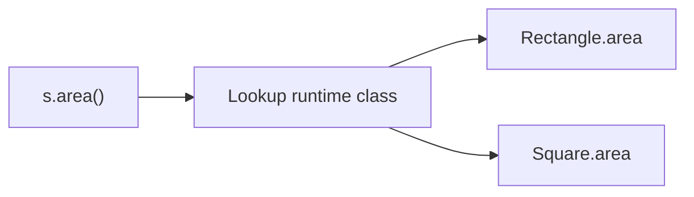

# Dynamic Dispatch and LSP

> **Status:** Completed  
> **Module:** 07 — Inheritance and Polymorphism  
> **Target Java version:** 21  
> **Last reviewed:** 2026-11-10  
> **Examples verified with:** Temurin JDK 21.0.12.1 (javac 21.0.12.1)

## 1. Learning Objectives

After completing this chapter, you should be able to:

- Explain **dynamic dispatch** (virtual method invocation) for instance methods in Java.
- Relate **compile-time reference type** vs **runtime class** when calling overridden methods.
- State the **Liskov Substitution Principle (LSP)** and detect violations in hierarchies.
- Contrast LSP-safe **Square extends Shape** vs the classic **Square extends Rectangle** anti-pattern.
- Use polymorphic collections and single call sites that behave correctly for every subtype.

## 2. Prerequisites

- **Module 05 Ch.03** — intro polymorphism, `@Override`.
- **Ch.01** — overriding vs hiding; `static` is not polymorphic.
- **Module 04 Ch.01** — methods and receivers.

Brief refresher: **Polymorphism** means a variable declared as a supertype can refer to objects of subtypes. For **instance methods**, the JVM picks the **most specific override** based on the **runtime type** of the object—not the variable’s declared type.

## 3. Why This Concept Exists

Polymorphism only helps when **substitution is safe**: every `Shape` in a loop must honor what callers expect of `Shape`—computing area without surprising side effects on unrelated dimensions. Without **LSP**, a `Rectangle` reference pointing to a `Square` that mutates width when height changes breaks layout code.

**Dynamic dispatch** implements the promise: one call `s.area()` reaches the right override. Understanding dispatch explains **why** `@Override` matters, **why** field hiding is not polymorphic, and **how** to design substitutable types—foundation for interfaces (Module 08), testing with mocks, and framework callbacks.

## 4. Conceptual Explanation

### 4.1 Compile-time vs runtime type

```java
Shape s = new Rectangle(3, 4);
```

| | Value |
|---|-------|
| Compile-time type of `s` | `Shape` |
| Runtime class of object | `Rectangle` |
| Legal calls at compile time | Methods on `Shape` (and `Object`) |
| Method executed at run time | `Rectangle.area()` if overridden |

The compiler checks **reference type**; the JVM dispatches **instance methods** on **actual class** (after overriding rules).

### 4.2 What dynamic dispatch applies to

| Member | Polymorphic? |
|--------|----------------|
| Instance method (override) | Yes |
| `static` method | No (compile-time) |
| Field | No (compile-time slot) |
| `private` / `final` instance methods | No further override; `private` not virtual in the override sense |

### 4.3 Dispatch mechanics (conceptual)

**JLS:** Virtual method invocation uses the **dynamic method** matching signature and runtime class.

**HotSpot (implementation):** typically **vtable**-based; JIT may **inline** monomorphic calls. Behavior is specified by JLS, not a particular vtable layout.



### 4.4 Liskov Substitution Principle (LSP)

**Informal LSP:** if `S` is a subtype of `T`, objects of type `T` in a program should be replaceable with objects of type `S` **without breaking** correctness.

Consequences for Java overrides:

- **Preconditions** cannot be **strengthened** in the subclass (cannot demand stricter inputs than superclass).
- **Postconditions** cannot be **weakened** (cannot return less than superclass promises).
- **Invariants** of superclass must remain true for subclass objects when used as superclass.
- **No surprising exceptions** or side effects beyond what callers of the supertype expect.

### 4.5 Classic violation: Square extends Rectangle

If `Rectangle` has **independent** `setWidth` / `setHeight` and `Square` forces width == height, code that does:

```java
void grow(Rectangle r) {
    r.setWidth(r.getWidth() + 1);
    r.setHeight(r.getHeight() + 1);
}
```

…may break when `r` is a `Square`—area and dimension invariants no longer match “mutable rectangle” mental model. **Fix:** model `Square` and `Rectangle` as **siblings** under `Shape` with **immutable** sides (demo approach).

### 4.6 Covariant returns

An override may return a **more specific type** (Java 5+). Dispatch still selects the override; callers see the narrowed return when reference is the subclass.

## 5. Terminology

| Term | Meaning |
|------|---------|
| **Dynamic dispatch** | Runtime choice of overridden instance method |
| **Virtual call** | Synonym for instance method subject to override |
| **LSP** | Substitutability rule for subtypes |
| **Contract** | Preconditions, postconditions, invariants of a type |
| **Subtype** | Subclass or subinterface |

## 6. Syntax and Language Rules

Polymorphic loop:

```java
Shape[] shapes = { new Rectangle(3, 4), new Square(5) };
for (Shape s : shapes) {
    System.out.println(s.name() + " area=" + s.area());
}
```

Each iteration: `s` compile-time `Shape`, runtime `Rectangle` or `Square`; `area()` and `name()` dispatch accordingly.

Casting (`((Rectangle) s)`) is only valid when runtime type matches—`ClassCastException` otherwise (Module 05 intro).

## 7. Step-by-Step Examples

### 7.1 Minimal dispatch

```java
class A { String who() { return "A"; } }
class B extends A { @Override String who() { return "B"; } }
A ref = new B();
System.out.println(ref.who()); // B
```

### 7.2 Realistic: shapes

Demo: [dispatch-lsp-demo](../../../examples/core-java/dispatch-lsp-demo/).

**Verified output:**

```text
Rectangle area=12
Square area=25
poly area=4
```

- `Rectangle(3,4)` → area 12 via `width * height`.
- `Square(5)` → area 25.
- `Shape squareAsShape = new Square(2)` — polymorphic reference; `area()` 4.

### 7.3 Broken design sketch (do not ship)

```java
class BadSquare extends MutableRectangle {
    @Override void setWidth(int w) { super.setWidth(w); super.setHeight(w); }
}
```

Callers treating `BadSquare` as `MutableRectangle` may double-increment height in `grow()`—LSP violation.

## 8. Real-World Use Cases

- **Collections of handlers:** `List<PaymentMethod>` with `charge()` dispatch per implementation.
- **Stream pipelines:** `Stream<Animal>` with `speak()` per runtime type.
- **Test doubles:** mock implements interface; production code polymorphic on interface (Module 41).
- **UI frameworks:** paint loop over `Component` hierarchy (legacy pattern).

## 9. Internal Behavior

- **invokevirtual** / **invokeinterface** bytecodes for virtual calls; **invokespecial** for `super.m()`, private, constructors.
- Deoptimization may occur if runtime types multiply (polymorphic inline limits)—rare concern without profiling.

## 10. Edge Cases and Limitations

- **`final`** methods: dispatch stops at declaring class—no further override.
- **`private` methods:** not inherited; no override—subclass method with same signature is separate.
- **Overload vs override:** dispatch is per **exact signature**; overload resolution is compile-time.
- **`Object` methods:** `equals` / `hashCode` / `toString` participate in dispatch—must honor contracts (Module 06 Ch.04).

## 11. Common Mistakes

### Incorrect: assuming fields polymorph

```java
class Parent { int x = 1; }
class Child extends Parent { int x = 2; }
Parent p = new Child();
System.out.println(p.x); // 1
```

### Incorrect: Square extends mutable Rectangle

Already discussed—use sibling types under abstraction.

### Incorrect: swallowing exceptions in override

```java
@Override void save() throws IOException { /* ignore */ }
```

Weakens contract if superclass documented failure modes—LSP / contract issue for callers.

## 12. Best Practices

- Design **sibling** abstractions for unrelated dimensions (`Shape`), not forced is-a (`Square` is-a `Rectangle`).
- Prefer **immutability** for value shapes—mutations and LSP interact badly.
- Document **expected** behavior superclass callers rely on before subclasses override.
- Run **behavioral tests** using supertype references only—catch LSP breaks early.

## 13. Design Trade-offs

| Approach | LSP | Flexibility |
|----------|-----|-------------|
| Mutable Rectangle hierarchy | Risky with Square child | Familiar geometry tutorial |
| Immutable siblings under Shape | Strong | Less “set dimension” API |
| Interface + records (Java 16+) | Strong | Less shared code in superclass |

## 14. Performance Considerations

Megamorphic virtual calls can inhibit inlining; fix only when profiled. Algorithmic cost dominates typical business logic.

## 15. Security Considerations

If a security check lives in superclass `public` method, subclass override must not **bypass** checks—prefer `final` public wrapper with `protected` hooks (Ch.02).

## 16. Java Version and Compatibility Notes

- Dispatch rules stable for decades.
- **Pattern matching `instanceof`** (16+) and **sealed types** (17+) make type-safe dispatch alternatives in `switch`—Ch.04.

## 17. Related Language Comparisons

C++ `virtual` functions; Python always dispatches dynamically on methods—fields still class-dependent. Smalltalk full dispatch.

## 18. Revision and Mastery

- **Gaps:** static `@Override` “polymorphism”; confusion with overloading.
- **Advanced:** CHA (class hierarchy analysis) for devirtualization in JIT.
- **You should answer:** Why does `Shape s = new Square(2); s.area()` print 4? State LSP in one sentence.

## 19. Exercises

### Beginner

1. Add `Triangle` to the demo; predict loop output order and areas.
2. Without running, output of `A ref = new B(); ref.who()` from minimal example?

### Intermediate

3. Write `void printAreas(Shape... shapes)` and call with mixed types.
4. List two symptoms when LSP breaks in a payment hierarchy.

### Advanced

5. Explain why `Collection.sort` accepting `Comparator` relies on behavioral substitutability of comparator implementations.

## 20. Interview Questions

1. How does Java choose which `area()` runs?
2. What is LSP?
3. Why is Square extends Rectangle problematic for mutable rectangles?
4. Are static methods polymorphic?
5. Difference between overload and override for dispatch?

## 21. Solutions

1. Add override returning name `Triangle` and area formula; third loop line appears.
2. `B`.
3. Loop prints each `name()` and `area()` via dispatch.
4. Unexpected totals; `ClassCastException` in downstream code; tests passing concrete types only while production uses supertype references.
5. Comparator `compare` must be reflexive/antisymmetric/transitive per contract—violations break sort even if code compiles.

## 22. Chapter Summary

**Dynamic dispatch** makes polymorphism work: overridden **instance methods** follow the **runtime object**. **LSP** keeps substitutable hierarchies honest—prefer **sibling** types and **immutable** models over forced **is-a** when dimensions differ. The shape demo shows safe **`Shape`** references for both **Rectangle** and **Square**.

## 23. Key Terminology

Dynamic dispatch · virtual method · runtime type · compile-time type · LSP · substitutability · contract

## 24. References and Further Reading

- [JLS §15.12.4.4 — Runtime Evaluation of Method Invocation](https://docs.oracle.com/javase/specs/jls/se21/html/jls-15.html#jls-15.12.4.4)
- Liskov & Wing, *A Behavioral Notion of Subtyping*
- Effective Java — Item on favor composition; `@Override`

## 25. Next Steps

- [04-sealed-classes.md](04-sealed-classes.md) — restricted hierarchies and exhaustive switches
- Module 08 — interface polymorphism and default methods

## Review Checklist

- [x] Dispatch + LSP depth gate
- [x] DispatchLspDemo verified Temurin 21.0.12.1
- [x] Square/Rectangle anti-pattern explained
- [x] Revision, exercises, references
