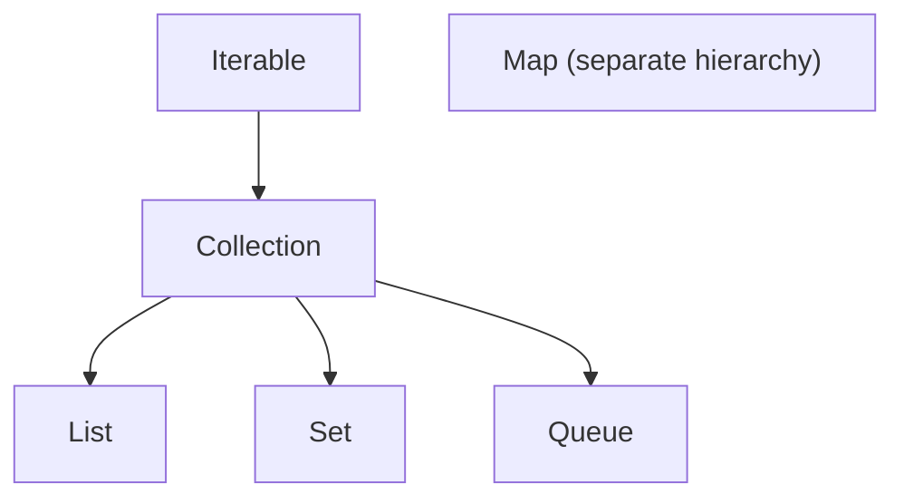

# Collection Hierarchy

> **Status:** Completed  
> **Module:** 12 — Collections Framework  
> **Target Java version:** 21  
> **Last reviewed:** 2026-11-11  
> **Chapter profile:** Technical
> **Depth target:** Level 3 (`Collection`, `List`, `Set`, `Map` contracts)
> **Examples verified with:** Temurin JDK 21.0.12.1 (`javac 21.0.12.1`)

**Section policy:** Sections are **conditional unless marked mandatory**. Include a section when it adds meaningful learning value. Do **not** manufacture content to fill headings. For omitted sections, record the reason in the Review Checklist.

| Mandatory for most chapters | Conditional |
| --------------------------- | ----------- |
| Learning objectives | Internal behavior |
| Prerequisites | Performance |
| Why this exists | Security |
| Conceptual explanation | Language comparisons |
| Mechanism and execution flow *(or merge note)* | Advanced examples |
| Terminology | Real-world use cases |
| Examples | Design trade-offs *(strongly encouraged for Technical / Deep-dive)* |
| Common mistakes | Compatibility details |
| Summary and references | — |

## 1. Learning Objectives

After completing this chapter, you should be able to:

- Name the core **`java.util`** interfaces: **`Iterable`**, **`Collection`**, **`List`**, **`Set`**, **`Queue`**, and **`Map`**.
- Explain why **`Map`** is not a **`Collection`** yet belongs to the same mental model.
- Program to interface types (`Collection<String>`, `List<Integer>`) with concrete implementations chosen at construction.
- Use **`add`**, **`remove`**, **`contains`**, **`size`**, and enhanced **`for`** over any **`Collection`**.
- Distinguish **ordered** lists from **unordered** sets and preview **key–value** maps.

## 2. Prerequisites

- **Module 03** — enhanced `for` loops.
- **Module 10** — reference types, polymorphism, generics preview (`List<String>`).
- **Module 11** — arrays; `ArrayList` grows like a resizable array compared to fixed `int[]`.

Brief refresher: a **reference variable** typed as `List<String>` can hold any object that **implements** `List` (for example `ArrayList<String>`). The compiler checks calls allowed on `List`; the JVM uses the **runtime class** of the object for behavior.

## 3. Why This Concept Exists

Applications manipulate **groups** of values: cart line items, active sessions, tags on a post, usernames blocked from login. Without a shared framework, every library would invent its own bag, list, and dictionary types.

The **Java Collections Framework** (since Java 1.2, evolved through Java 21) standardizes:

- **Abstractions** — small interfaces describing what you can do (`add`, `get`, `put`).
- **Implementations** — concrete classes tuned for different access patterns (`ArrayList`, `HashSet`, `HashMap`).
- **Algorithms** — static helpers on **`Collections`** (sort, binary search, unmodifiable wrappers).

You learn the **shape** of the framework first; later chapters fill in **lists**, **sets**, **queues**, **maps**, and **performance choices**.

## 4. Conceptual Explanation

### 4.1 Iterable and the enhanced for loop

Anything **`Iterable<T>`** exposes `iterator()` so you can traverse elements. **`Collection`** extends **`Iterable`**, which is why you can write:

```java
for (String s : collection) {
    System.out.println(s);
}
```

The compiler desugars this to an **`Iterator`** loop (Module 12 Ch.05 revisits safe removal).

### 4.2 Collection — bulk operations

**`Collection<E>`** is the root for **single-element** groupings (not maps). Common operations:

| Operation | Meaning |
|-----------|---------|
| `add(e)` | Insert element (optional by contract for some sets) |
| `remove(o)` | Remove matching element if present |
| `contains(o)` | Whether an equal element is present |
| `size()` | Element count |
| `isEmpty()` | Whether count is zero |
| `clear()` | Remove all elements |

**`contains`** uses **`equals`** on elements (or **`==`** for null handling rules), not reference identity—important for `String` and for value types (Module 06 Ch.04).

### 4.3 Main branches



- **`List`** — **indexed**, **ordered** sequence; duplicates allowed; positional access `get(i)`.
- **`Set`** — **no duplicate** elements by `equals`/`hashCode` rules; one general `add` per value.
- **`Queue`** — **FIFO** (or priority) processing; `offer`/`poll`/`peek`.
- **`Map`** — **keys** to **values**; not a `Collection`, but every key set can be viewed as a `Set`.

### 4.4 Maps sit beside Collection

**`Map<K,V>`** does not extend **`Collection`** because an entry is a **pair**. You still store maps alongside collections in the same applications—for example `Map<String, User>` plus `List<Order>`.

### 4.5 Generics on collection types

`List<String>` means “a list whose **elements** are `String` references.” The compiler rejects `list.add(42)` on a `List<String>`. **Type erasure** (Module 10 Ch.03, deep dive Module 13) removes type parameters in bytecode, but compile-time checking still protects you at call sites.

## 5. Mechanism and Execution Flow

The collections framework separates **contract** (interface type you declare) from **implementation** (concrete class you construct).

### 5.1 Declare interface, construct implementation

```java
List<String> names = new ArrayList<>();
```

1. **Compile-time** type is **`List<String>`**—call sites may use only `List` methods unless cast.
2. **Runtime class** of the object is **`ArrayList`**—`getClass()` reports implementation.
3. **`CollectionsHierarchyDemo`** exercises **`Collection`**, **`List`**, and **`Set`** views through the same polymorphic patterns as Module 07 dispatch.

### 5.2 `Collection` operations pipeline

For `collection.add(x)` / `contains(x)`:

1. The JVM dispatches to the **concrete implementation** (`ArrayList`, `HashSet`, …).
2. Complexity and side effects (**ordering**, **uniqueness**) are **implementation-defined** within the interface contract.
3. **`size()`** and **`isEmpty()`** are O(1) for standard JDK collections shown in this module (document exceptions per implementation in later chapters).

### 5.3 `Map` sits beside `Collection`

`Map` is **not** a `Collection`, but **`entrySet()`**, **`keySet()`**, **`values()`** expose **collection views** backed by the map—mutations through views affect the map when the contract allows.

## 6. Terminology

| Term | Meaning |
|------|---------|
| **Framework** | Coordinated set of interfaces, implementations, and utilities in `java.util` |
| **Interface type** | Declared type used in APIs (`List`, `Set`, `Map`) |
| **Implementation** | Concrete class (`ArrayList`, `HashSet`, `HashMap`) |
| **Mutable collection** | You can add/remove after creation |
| **Unmodifiable view** | Cannot change through that reference (`List.of`, `Collections.unmodifiableList`) |
| **Structural modification** | Change that affects size or reindexes (add/remove); distinct from replacing `list.set(i, x)` on some lists |

## 7. Syntax and Language Rules

```java
import java.util.ArrayList;
import java.util.Collection;
import java.util.HashSet;
import java.util.List;
import java.util.Set;

Collection<String> c = new ArrayList<>();
c.add("a");
c.add("b");

List<String> fixed = List.of("x", "y");   // immutable list factory (Java 9+)
Set<String> unique = new HashSet<>(fixed);
unique.add("x");   // duplicate — set unchanged
```

- **Diamond operator** — `new ArrayList<>()` infers type arguments from the left-hand side (Java 7+).
- **`List.of` / `Set.of` / `Map.of`** — compact **immutable** instances; null elements forbidden.
- **Wildcards** — use `Collection<?>` when you only read elements (Module 13).

## 8. Step-by-Step Examples

### 8.1 Minimal — polymorphic collection variable

```java
Collection<Integer> nums = new ArrayList<>();
nums.add(10);
System.out.println(nums.size());  // 1
```

The variable type is **`Collection`**; the object is **`ArrayList`**. Callers that only need bulk add/size can accept `Collection`.

### 8.2 Realistic — CollectionsHierarchyDemo

Full source: [`CollectionsHierarchyDemo.java`](../../examples/core-java/collections-hierarchy-demo/CollectionsHierarchyDemo.java).

```bash
javac CollectionsHierarchyDemo.java && java CollectionsHierarchyDemo
```

**Verified output (Temurin 21.0.12.1):**

```text
collectionSize=2
listSize=2
setSize=2
containsY=true
```

**Important lines:**

- `Collection<String> c = new ArrayList<>()` — program to **`Collection`**, construct **`ArrayList`**.
- `List.of("x", "y")` — fixed two-element list; **`listSize`** stays 2 even after building a set from it.
- `set.add("x")` — duplicate of existing `"x"`; **`setSize=2`** (not 3).
- `set.contains("y")` — membership via **`equals`** on strings.

### 8.3 Advanced — choosing declared type at API boundaries

```java
public void ingest(Collection<String> names) {
    for (String n : names) {
        // works for ArrayList, HashSet (iteration order differs), etc.
    }
}
```

Prefer **`Collection`** when indexing is not required; prefer **`List`** when callers need order and index; **`Set`** when uniqueness matters (Ch.03).

## 9. Real-World Use Cases

- **REST layer** — deserialize JSON array into `List<Dto>`; dedupe tags into `Set<String>` before persist.
- **In-memory indexes** — `Map<Id, Entity>` for lookup plus `List<Id>` for display order.
- **Batch jobs** — drain a `Queue<Task>` workers poll from.
- **Testing** — assert on `List` contents with `assertEquals(expected, actual)` using value equality of elements.

## 10. Internal Behavior

Interfaces carry **no** instance fields; behavior lives in implementations. **`ArrayList`**, for example, holds a growable **object array** (Ch.02). **`HashSet`** wraps a **`HashMap`** where each element is a map key (Ch.03).

**`Collections`** utility methods (synchronized wrappers, unmodifiable views) delegate to backing collections—wrappers affect **which reference** you may use to mutate.

Label: interface contracts are Java SE API; array growth and hash tables are OpenJDK implementation details unless stated as specifications.

## 11. Edge Cases and Limitations

- **`null` elements** — allowed in `ArrayList` and `HashSet` by default; forbidden in `List.of` / `Set.of`.
- **Concurrent mutation** — structurally modifying a collection while iterating without **`Iterator.remove`** causes **`ConcurrentModificationException`** (fail-fast iterators; Ch.05).
- **Raw types** — `List list` without generics compiles with warnings and loses type safety; avoid in new code.
- **Covariant pitfalls** — arrays are covariant; generics collections are **invariant** (Module 10 Ch.03)—do not confuse the two.

## 12. Common Mistakes

### Incorrect — confusing interface with implementation

```java
List<String> list = new List<>();  // compile error — cannot instantiate interface
```

### Corrected

```java
List<String> list = new ArrayList<>();
```

### Incorrect — expecting set size to grow on duplicate add

```java
Set<String> s = new HashSet<>();
s.add("a");
s.add("a");
// size is 1, not 2
```

### Corrected — treat return value of `add` on `Set` as signal (optional)

```java
if (s.add("a")) {
    // newly added
}
```

## 13. Best Practices

- Declare **`List`**, **`Set`**, **`Map`** (or narrower needs) on fields and parameters; construct with a known implementation.
- Use **`List.of` / `Set.of`** for small **immutable** constants shared across threads.
- Import concrete classes only where you **construct** (`new ArrayList<>()`), not across the whole codebase.
- Name variables by domain (`activeUsers`, `skuById`), not implementation (`hashMap` unless discussing internals).

## 14. Design Trade-offs

| Choice | Benefit | Cost |
|--------|---------|------|
| Interface-typed API | Swap implementation without caller changes | Callers cannot use implementation-only methods without casting |
| `ArrayList` as default `List` | Fast random access | Slower middle inserts at huge sizes |
| `HashSet` as default `Set` | O(1) expected membership | No meaningful iteration order |
| Immutable factories | Safe sharing, concise literals | Cannot add after creation; no nulls |

## 15. Performance Considerations

Interface dispatch on `add`/`get` is cheap compared to **algorithmic** cost: scanning an unsorted `List` is O(n); **`HashSet.contains`** is O(1) average. Pick structure by access pattern (Ch.05)—not by habit.

## 16. Security Considerations

Collections often hold **user-controlled data**. Size limits on ingested lists/maps prevent denial-of-service via huge payloads. Do not expose internal mutable collections through getters without wrapping (defensive copies or unmodifiable views).

## 17. Java Version and Compatibility Notes

**`Collection`** since 1.2. **`Iterable`** as superinterface since 1.5. **`List.of` / `Set.of` / `Map.of`** since Java 9. **Sequenced collections** (`SequencedCollection`, `SequencedMap`, Java 21) add first/last operations—useful for new code; older APIs remain valid.

## 18. Related Language Comparisons

C# has `List<T>`, `Dictionary<K,V>` in BCL; Python `list`/`set`/`dict` are built-in. Java splits **interface** from **implementation** more explicitly—similar to C++ STL iterators and containers.

## 19. Revision and Mastery

- **Gaps:** thinking `Map` extends `Collection`; forgetting `Set` rejects duplicates by equality.
- **You should answer:** Why does `CollectionsHierarchyDemo` report `setSize=2` after `set.add("x")`?
- **Advanced:** `Collections.unmodifiableCollection` vs immutable `List.of`; sequenced collection APIs in Java 21.

## 20. Exercises

### Beginner

1. Create `ArrayList` of three ints, print `size()` and enhanced-for output.
2. Predict `containsY=` in `CollectionsHierarchyDemo` without running.

### Intermediate

3. Write `unique(List<String> in)` returning new `ArrayList` without duplicates, preserving first-seen order.
4. Explain why `Collection<?>` can accept `ArrayList<String>` but you cannot `add("x")` to it.

### Advanced

5. Sketch how `HashSet` might delegate to `HashMap` internally.

## 21. Interview Questions

1. Difference between `Collection` and `Collections` class?
2. Can you iterate a `Map` directly with enhanced for? (Entries require `entrySet()`.)
3. Is `List` a `Set`?

## 22. Solutions

1. Use `add` three times; loop prints elements.
2. `true` — `"y"` is in the set built from the list.
3. Use `LinkedHashSet` or check `contains` before add.
4. Wildcard capture rules (Module 13).
5. Element stored as key; static dummy value in map.

## 23. Chapter Summary

The **Collections Framework** organizes **lists** (indexed), **sets** (unique), **queues** (ordered processing), and **maps** (keys to values) behind shared interfaces. Program to **`Collection`**, **`List`**, **`Set`**, or **`Map`**; choose **`ArrayList`**, **`HashSet`**, **`HashMap`**, and others at construction. **`CollectionsHierarchyDemo`** shows sizing, immutability of `List.of`, and set deduplication.

## 24. Key Terminology

`Iterable` · `Collection` · `List` · `Set` · `Queue` · `Map` · implementation · unmodifiable

## 25. References and Further Reading

- [Java SE — Collections Framework overview](https://docs.oracle.com/en/java/javase/21/docs/api/java.base/java/util/package-summary.html)
- [Java SE `Collection`](https://docs.oracle.com/en/java/javase/21/docs/api/java.base/java/util/Collection.html)
- [JEP 431: Sequenced Collections](https://openjdk.org/jeps/431)

## 26. Next Steps

- [02-lists.md](02-lists.md) — `ArrayList` vs `LinkedList` structure and cost
- Module 13 — generics wildcards on collection parameters

## Review Checklist

**Mandatory Depth Review:** Technical profile; interface hierarchy and declaration vs concrete choice at **Level 3**.

- [x] Learning objectives covered
- [x] Prerequisites identified and briefly refreshed
- [x] Chapter profile and depth target recorded and appropriate
- [x] Depth gate passed (detailed definitions; progressive examples)
- [x] Mandatory Depth Review (Levels 1–4) passed for this topic
- [x] Mechanism and execution flow explained where applicable (§5)
- [x] Complex relationships illustrated where useful
- [x] First-appearance concepts explained now (not deferred away)
- [x] Terminology defined before use
- [x] Examples include sufficient context to compile and run (or labeled Illustrative)
- [x] Verification status accurately labeled (**Verified** on Temurin JDK 21.0.12.1 where demos exist)
- [x] Explanations distinguish specification guarantees from implementation details where relevant
- [x] References support important technical claims
- [x] Solutions explain reasoning, not just final answers
- [x] No artificial sections, filler, or unexplained jargon
- [x] Chapter can be understood without repeatedly consulting other chapters
- [x] Conditional omissions recorded below
- [x] Revision and Mastery included when profile requires
- [x] `PROGRESS.md` updated honestly (standards-alignment pass 2026-11-11; Temurin re-verify)

**Omissions (section → reason):**

- **Spliterator / Stream split characteristics** — Streams module owns pipeline depth.

**Verification note:** `CollectionsHierarchyDemo` (`collectionSize=2`; `listSize=2`; `setSize=2`; `containsY=true`) on Temurin JDK 21.0.12.1 (2026-11-11 re-run).
