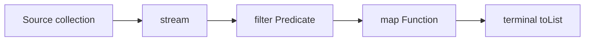

# Lambdas and Functional Interfaces

> **Status:** Completed  
> **Module:** 16 — Lambdas and Functional Programming  
> **Target Java version:** 21  
> **Last reviewed:** 2026-11-11  
> **Chapter profile:** Technical  
> **Depth target:** Levels 2–3 (`java.util.function`, target typing, composition at API boundaries)  
> **Examples verified with:** Temurin JDK 21.0.12.1 (`javac 21.0.12.1`)

**Section policy:** Sections are **conditional unless marked mandatory**. Include a section when it adds meaningful learning value. Do **not** manufacture content to fill headings. For omitted sections, record the reason in the Review Checklist.

| Mandatory for most chapters | Conditional |
| --------------------------- | ----------- |
| Learning objectives | Internal behavior |
| Prerequisites | Performance |
| Why this exists | Security |
| Conceptual explanation | Language comparisons |
| Mechanism and execution flow *(or merge note)* | Advanced examples |
| Terminology | Real-world use cases |
| Examples | Design trade-offs *(strongly encouraged for Technical / Deep-dive)* |
| Common mistakes | Compatibility details |
| Summary and references | — |

## 1. Learning Objectives

After completing this chapter, you should be able to:

- Write lambdas for common **SAM** shapes: no arg, one arg, two args, void return.
- Use **`@FunctionalInterface`** and standard types in **`java.util.function`**.
- Apply **target typing** and **type inference** for lambda parameters.
- Convert between lambdas, anonymous classes, and method references when signatures match.
- Avoid pitfalls: **boxing**, wrong arity, non-functional interfaces, exception handling.

## 2. Prerequisites

- **Ch.01** — closures, higher-order methods, effectively final capture.
- **Module 08 Ch.03** — functional interfaces, `default` methods, `@FunctionalInterface`.
- **Module 12** — `List`, iteration; lambdas often replace inline `for` loops.
- **Module 14** — unchecked exceptions from lambdas follow the SAM’s declared `throws`.

**Refresher:** A lambda is **not** a type—it is an **expression** whose type is the **target functional interface** at the assignment, argument, or return site.

## 3. Why This Concept Exists

Without a shared vocabulary (`Predicate`, `Function`, `Consumer`), every library invents its own callback interface. **`java.util.function`** supplies interoperable SAM types so streams, `Optional`, and `CompletableFuture` compose consistently.

## 4. Conceptual Explanation

### 4.1 Lambda syntax variants

```java
() -> "Hello"
s -> s.length()
(a, b) -> a + b
(x, y) -> { int z = x * y; return z; }
```

Expression lambdas must be compatible with the SAM’s return type; block lambdas need explicit `return` for non-void SAMs.

### 4.2 Target typing

The compiler infers the lambda’s type from **context**:

```java
Predicate<String> p = s -> !s.isBlank(); // target: Predicate.test
```

Assignment, method argument, cast, or conditional branch can provide the target.

### 4.3 Core `java.util.function` types

| Interface | SAM | Typical use |
|-----------|-----|-------------|
| `Predicate<T>` | `test(T) -> boolean` | filter, validation |
| `Function<T,R>` | `apply(T) -> R` | map, transform |
| `Consumer<T>` | `accept(T) -> void` | forEach side effect |
| `Supplier<T>` | `get() -> T` | lazy factories, orElseGet |
| `UnaryOperator<T>` | `apply(T) -> T` | same-type pipeline |
| `BiFunction<T,U,R>` | `apply(T,U) -> R` | combine two inputs |
| `BiConsumer<T,U>` | `accept(T,U) -> void` | `Map.forEach`, paired iteration |
| `BiPredicate<T,U>` | `test(T,U) -> boolean` | pairwise validation |
| `BinaryOperator<T>` | `apply(T,T) -> T` | `reduce`, combiners |

Primitive specializations (`IntPredicate`, `ToIntFunction`, `ObjIntConsumer`, …) reduce boxing in numeric hot paths. Prefer **`IntStream`** when the source is already primitive.

### 4.4 Defaults and `@FunctionalInterface`

If an interface has **two** abstract instance methods, it is **not** functional—even with many defaults. `@FunctionalInterface` triggers a compile error when the count is wrong.

### 4.5 Boxing in predicates

`Predicate<Integer>` on a stream of `int` may autobox; prefer `IntPredicate` or `IntStream` when profiling shows cost.

### 4.6 Choosing the right standard type

| Need | Type | Avoid when |
|------|------|------------|
| Filter / validation | `Predicate<T>` | You need a transformed value — use `Function` |
| Transform | `Function<T,R>` | No result — use `Consumer` |
| Side effect only | `Consumer<T>` | You must return a value to the caller |
| Lazy build | `Supplier<T>` | Value is already computed — pass the value |
| Same-type step | `UnaryOperator<T>` | Types differ — use `Function<T,R>` |
| Merge two inputs | `BiFunction<T,U,R>` | Only one input matters — use `Function` |

Naming the type in a **public** method signature (`Predicate<String> nonBlank`) documents **intent** better than raw `Function<String, Boolean>`.

### 4.7 Static helpers (Java 9+)

| API | Role |
|-----|------|
| `Predicate.not(p)` | Negation when you already hold a `Predicate` reference |
| `Comparator.comparing(keyExtractor)` | Build sort key comparators — often method references |
| `Function.identity()` | Pass-through in collectors and maps |

## 5. Mechanism and Execution Flow

### 5.1 Overload resolution and target typing

When you pass `s -> s.length()` to a method with overloads for `Function<String,Integer>` and `ToIntFunction<String>`:

1. **`javac`** attempts **overload resolution** using the **most specific** applicable target type.
2. If both fit, the call is **ambiguous** — fix with a cast, explicit lambda parameter types, or rename overloads.

Assignment `Predicate<String> p = s -> !s.isBlank()` is the common case: the **left-hand type** is the target.

### 5.2 `LambdasInterfacesDemo` pipeline

1. **`Supplier<String> greeting`** runs lazily at `greeting.get()` → prints `greeting=Hello`.
2. **`Function<String,Integer> length`** via `String::length` maps `"Ada"` → `lenAda=3`.
3. **`Predicate<String> nonBlank`** filters four strings; empty and whitespace-only fail → `nonBlankCount=2`.
4. **`map`** with `String::toUpperCase` on survivors → `mapped=[ADA, BOB]`.

Each step is the **same structural loop** with a different SAM—preview of stream pipelines in Module 17.

### 5.3 `@FunctionalInterface` compile-time check

The annotation is **optional** but valuable on **custom** APIs: if you add a second abstract method later, **`javac` fails immediately** instead of breaking every lambda call site silently.

## 6. Terminology

| Term | Meaning |
|------|---------|
| Arity | Number of lambda parameters |
| Target type | Functional interface expected at the use site |
| `java.util.function` | Standard SAM library (Java 8+) |

## 7. Syntax and Language Rules

- Lambda parameter types: optional if target is concrete; required in some ambiguous overloads.
- **`var` in lambda parameters** (Java 11+): both or neither parameters must use `var` in a list.
- Checked exceptions: SAM’s `throws` clause must accommodate lambda body or wrap/catch.

## 8. Step-by-Step Examples

Demo: [lambdas-interfaces-demo](../../examples/core-java/lambdas-interfaces-demo/).

```java
Predicate<String> nonBlank = s -> s != null && !s.isBlank();
Function<String, Integer> length = String::length;
Supplier<String> greeting = () -> "Hello";
```

**Verified output (Temurin 21.0.12.1):**

```text
greeting=Hello
lenAda=3
nonBlankCount=2
mapped=[ADA, BOB]
```

Only `"Ada"` and `"Bob"` pass `nonBlank` (empty and whitespace-only rejected).

### 7.2 Custom `@FunctionalInterface`

```java
@FunctionalInterface
interface CsvFormatter {
    String format(List<String> rows);
    default String header() { return "name"; }
}
```

Still functional—one abstract `format`.

### 7.3 Realistic — composing validators

```java
Predicate<String> nonBlank = s -> s != null && !s.isBlank();
Predicate<String> maxLen50 = s -> s.length() <= 50;
Predicate<String> usernameRule = nonBlank.and(maxLen50);

List<String> invalid = List.of("", "  ", "a".repeat(60));
long okCount = invalid.stream().filter(usernameRule).count(); // 0
```

**`and`** short-circuits like `&&`: when `nonBlank` fails, `maxLen50` is not called—cheap guards should be **leftmost** in `and` chains.

### 7.4 Checked exceptions inside lambdas

```java
List<Path> paths = List.of(Path.of("missing.txt"));
// paths.forEach(p -> Files.readString(p)); // compile error: IOException checked
```

The `Consumer<Path>` SAM does not declare `IOException`. Options: **catch inside** the lambda, **wrap** in `UncheckedIOException`, or use a **custom `@FunctionalInterface`** whose SAM declares `throws IOException` for that API only.

### 7.5 Bridge to streams — same SAMs, different driver

Module 17 runs the same functional types through **`Stream`** instead of a hand-written `for` loop:

```java
List<String> raw = List.of("Ada", "", "  ", "Bob");
List<String> mapped = raw.stream()
    .filter(nonBlank)                    // Predicate<String>
    .map(String::toUpperCase)            // Function<String,String>
    .toList();
// mapped == [ADA, BOB] — same semantics as LambdasInterfacesDemo manual loop
```

The **behavior objects** (`nonBlank`, `String::toUpperCase`) are unchanged; only the **iteration engine** changes from your `map`/`filter` helper to the stream library. If stream output disagrees with a loop version, debug the **predicate** first—not the stream machinery.



## 9. Real-World Use Cases

- **Spring `BeanValidator`:** predicates on configuration properties.
- **Resilience4j:** `Supplier` for guarded calls.
- **Event buses:** `Consumer<Event>` subscriptions.
- **Repository layer:** `Function<Id, Entity>` for cache-aside loaders.

## 10. Internal Behavior

Generic functional interfaces **erase** type parameters at runtime like any generic type. **`Predicate<String>`** at the call site still becomes **`test(Object)`** in bytecode with compiler-inserted **casts** at the lambda boundary.

**Bridge methods** appear when a functional interface specializes a generic super-interface—same erasure story as Module 13. At runtime, **`Predicate.test`** is a single interface method; overload resolution happened at compile time only.

Lambda bodies may compile to **private synthetic methods** on the enclosing class (`lambda$main$0`); linkage uses **`invokedynamic`** (Ch.01 §5.3). That is HotSpot-centric detail, not portable JVM micro-optimization advice.

## 11. Edge Cases and Limitations

- **`Object` methods** on interfaces do not count as SAM methods.
- Lambdas assigned to `Serializable` functional interfaces may need cast tricks—avoid unless required.
- Overload resolution with multiple applicable functional interfaces may need explicit cast.

## 12. Common Mistakes

### Incorrect — non-blank check without null guard

```java
Predicate<String> bad = String::isBlank; // NPE if element is null in stream
```

### Correct

```java
Predicate<String> nonBlank = s -> s != null && !s.isBlank();
```

### Incorrect — extra abstract method silently breaks lambda

```java
interface Broken {
    void a();
    void b();
}
// Broken b = () -> {}; // compile error
```

## 13. Best Practices

- Import standard functional types instead of one-off duplicates.
- Document nullability on **custom** functional interfaces.
- Prefer **`method reference`** when delegating exactly (`String::toUpperCase`).
- Keep lambdas short; extract methods for multi-branch logic.

## 14. Design Trade-offs

Custom SAM vs `Function`:
- **Named SAM** (`CsvFormatter`) documents intent at API boundary.
- **`Function`** reduces type surface but erases domain meaning.

**Checked exceptions at boundaries:** wrapping every `IOException` in `RuntimeException` at the lambda keeps signatures clean but pushes handling to a distant catch—sometimes a **narrow custom SAM** with `throws` is clearer for I/O-heavy plugin APIs.

**Null in streams:** JDK streams generally **do not** allow `null` elements; predicates should still defend against null in **non-stream** collections passed by callers.

## 15. Performance Considerations

Avoid `Function<Integer, Integer>` in tight numeric loops if boxing dominates; use `IntUnaryOperator` or primitives stream.

## 16. Security Considerations

Validators implemented as lambdas still execute untrusted **data**—sanitize before `test`, not after.

## 17. Java Version and Compatibility Notes

`java.util.function` since Java 8. Java 9+ added `Predicate.not`, optional helpers; Java 21 stable.

## 18. Related Language Comparisons

Java has no `func` keyword—interfaces carry types. Scala and Kotlin unify syntax; Java optimizes for **JVM** and **existing APIs**.

## 19. Revision and Mastery

- **Gaps:** using `get()` on wrong functional type.
- **You should answer:** Why `nonBlankCount=2` for four strings?
- **Advanced:** dual-interface lambda (rare) via intersection types `(Runnable & Serializable) () -> {}`.

## 20. Exercises

### Beginner

1. Predict all four lines of `LambdasInterfacesDemo` without running.
2. Write `Predicate<Integer>` that returns true for even numbers.

### Intermediate

3. Chain `nonBlank.and(s -> s.length() < 100)` — which strings in `List.of("Ada", "", "Bob")` pass?
4. Why does `Predicate<String> bad = String::isBlank` risk `NullPointerException` in `stream().filter(bad)`?

### Advanced

5. Design `@FunctionalInterface interface ThrowingSupplier<T> { T get() throws Exception; }` — where would you use it instead of `Supplier`?

## 21. Interview Questions

1. Difference between `Consumer` and `Function`?
2. What does `@FunctionalInterface` do?
3. When use `Supplier` vs passing a value directly?

## 22. Solutions

1. See §8.1 verified output (`greeting=Hello`, `lenAda=3`, `nonBlankCount=2`, `mapped=[ADA, BOB]`).
2. `n -> n % 2 == 0`.
3. Only `"Ada"` and `"Bob"` pass; empty string fails `nonBlank`.
4. `String::isBlank` invokes on the stream element; `null` elements call instance method on null → NPE unless `filter(Objects::nonNull)` runs first.
5. Wrap blocking I/O or JDBC in a helper that accepts `ThrowingSupplier`, catches once at the boundary, and maps to domain exceptions—keeps `Supplier` call sites free of try/catch clutter.

## 23. Chapter Summary

**Lambdas** implement **SAM** types with concise syntax. **`java.util.function`** standardizes predicates, functions, consumers, and suppliers for streams and modern APIs. **`LambdasInterfacesDemo`** filters blank strings and maps survivors to upper case.

## 24. Key Terminology

Predicate · Function · Consumer · Supplier · target typing

## 25. References and Further Reading

- [java.util.function package](https://docs.oracle.com/en/java/javase/21/docs/api/java.base/java/util/function/package-summary.html)
- [Ch.01](01-functional-fundamentals.md)

## 26. Next Steps

- [03-method-references-and-composition.md](03-method-references-and-composition.md)

## Review Checklist

**Mandatory Depth Review:** Technical profile; lambdas and `java.util.function` at **Levels 2–3**.

- [x] Learning objectives covered
- [x] Prerequisites identified and briefly refreshed
- [x] Chapter profile and depth target recorded and appropriate
- [x] Depth gate passed (detailed definitions; progressive examples)
- [x] Mandatory Depth Review (Levels 1–4) passed for this topic
- [x] Mechanism and execution flow explained where applicable (§5)
- [x] Complex relationships illustrated where useful (demo pipeline §5.2)
- [x] First-appearance concepts explained now (not deferred away)
- [x] Terminology defined before use
- [x] Examples include sufficient context to compile and run (or labeled Illustrative)
- [x] Verification status accurately labeled (**Verified** on Temurin JDK 21.0.12.1)
- [x] Explanations distinguish specification guarantees from implementation details where relevant
- [x] References support important technical claims
- [x] Solutions explain reasoning, not just final answers
- [x] No artificial sections, filler, or unexplained jargon
- [x] Chapter can be understood without repeatedly consulting other chapters
- [x] Conditional omissions recorded below
- [x] Revision and Mastery included when profile requires
- [x] `PROGRESS.md` updated honestly (standards-alignment pass 2026-11-11)

**Omissions (section → reason):**

- **Custom SAM proliferation in frameworks** — Spring/module-specific interfaces deferred to framework modules.

**Verification note:** `LambdasInterfacesDemo` output unchanged on Temurin JDK 21.0.12.1 (2026-11-11 re-run).
