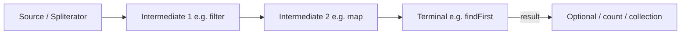

# Stream Fundamentals

> **Status:** Completed  
> **Module:** 17 — Stream API  
> **Target Java version:** 21  
> **Last reviewed:** 2026-11-10  
> **Chapter profile:** Technical  
> **Depth target:** Level 3 (pipeline model, laziness, one-shot consumption, sources)  
> **Examples verified with:** Temurin JDK 21.0.12.1 (javac 21.0.12.1)

## 1. Learning Objectives

After completing this chapter, you should be able to:

- Explain what a **Stream** is (and is not) in Java.
- Create streams from collections, arrays, ranges, and generators.
- Distinguish **intermediate** vs **terminal** operations and **lazy** evaluation.
- Describe **one-shot** consumption: streams cannot be reused after a terminal operation.
- Trace how a pipeline executes from **source** through **intermediate** stages to a **terminal** (including short-circuit).
- Choose between **sequential** and **parallel** streams at a high level (details in Ch.04).

## 2. Prerequisites

- **Module 16** — lambdas and functional interfaces (`Predicate`, `Function`, `Supplier`).
- **Module 12** — `Collection`, iteration, and when backing collections are structurally modified.

**Refresher — collection vs stream:** A `List<String>` **stores** elements in memory with a defined size. A **`Stream<String>`** is a **view** over a data source: it does not store elements itself; it pulls them through a **pipeline** of operations when a **terminal** runs. You still need a source (the list, an array, a range, or a generator).

## 3. Why This Concept Exists

Manual `for` loops scatter **how to iterate** (indices, iterators) and **what to compute** (filters, maps, sums) in the same block. That coupling makes code harder to read, test, and reuse—and easy to get wrong when requirements change (add a filter, then a limit, then a sort).

**Streams** (Java 8+) centralize common iteration patterns—filter, map, reduce, find—while leaving **what** to compute in lambdas or method references. Important runtime properties follow from the design:

- **Laziness:** intermediate steps do not run until a terminal operation needs output.
- **Fusion:** intermediates chain into one logical pass where possible instead of building intermediate collections at every step.
- **Short-circuit:** some terminals stop as soon as the answer is known (`findFirst`, `anyMatch`).

Streams are **library** abstractions in `java.util.stream`, not language syntax. They complement (not replace) loops when clarity or composition wins.

## 4. Conceptual Explanation

### 4.1 Stream is not a Collection

You cannot `add` to a stream or ask a stream for its `size()` as stored state. Operations either:

- Return another **stream** (intermediate), or
- Produce a **result** or **side effect** (terminal).

The **source** may still be a live collection. If you modify that collection in ways that break iteration rules while a stream is active, behavior is undefined or fails with `ConcurrentModificationException` on typical collections—do not treat streams as isolation from source mutation.

### 4.2 Pipeline mental model

At the highest level, every stream computation is:

```text
source → intermediate* → terminal
```

- **Source:** where elements originate (`list.stream()`, `Arrays.stream(arr)`, `IntStream.range`, `Stream.of`, IO lines, etc.).
- **Intermediate operations (0 or more):** transform or constrain the stream; return `Stream` (or primitive stream); **lazy**.
- **Terminal operation (exactly one per pipeline):** consumes the stream and produces a value, void, or collection.

Calling a terminal **starts** (or continues) traversal. Until then, setting up `filter` and `map` only builds the pipeline description.

### 4.3 Stream sources (Java 21)

| Source kind | Typical API | Notes |
|-------------|-------------|-------|
| Collection | `collection.stream()` | Sequential by default; `parallelStream()` forks (Ch.04). |
| Array | `Arrays.stream(arr)` | Also `Arrays.stream(arr, from, to)` for slices. |
| Primitive ranges | `IntStream.range(0, n)` | Half-open upper bound; `rangeClosed` is inclusive. |
| Varargs / fixed | `Stream.of("a", "b")` | Small fixed sequences; watch null—`of` does not allow null elements. |
| Builder | `Stream.builder().add(x).build()` | Imperative construction when values appear over time. |
| Generate / iterate | `Stream.generate`, `Stream.iterate` | Can be infinite; pair with `limit` or short-circuit terminals. |

Primitive specializations (`IntStream`, `LongStream`, `DoubleStream`) avoid boxing overhead for numeric pipelines—prefer them when values are truly primitive.

### 4.4 Laziness in one sentence

**Intermediates record intent; terminals execute intent.**

No element is pulled from the source for filtering or mapping until a terminal asks for the next answer (count, collect, findFirst, etc.).

## 5. Mechanism and Execution Flow

This section traces **what runs when**—separate from JDK wrapper classes (Section 10).

### 5.1 Pipeline diagram



**Prose walkthrough:**

1. **Construction:** `names.stream()` creates a `Stream` backed by the collection’s **spliterator**—a splitter/iterator the library uses to visit elements (and to split work for parallel streams).
2. **Intermediate chaining:** each intermediate wraps the previous stage. Calling `.filter(...)` returns a new stream object; it does **not** scan the list yet.
3. **Terminal trigger:** `findFirst()` begins traversal: the terminal requests elements from the outermost intermediate, which requests from its upstream, until the source yields the next item.
4. **Short-circuit:** when the terminal’s answer is satisfied, traversal **stops**; remaining source elements may never be visited.

### 5.2 Execution trace: `StreamFundamentalsDemo`

The module demo wires laziness and short-circuit explicitly. Important lines:

```java
Stream<String> lazy = names.stream()
        .filter(s -> {
            System.out.println("filter:" + s);
            return s.startsWith("L");
        });
System.out.println("beforeTerminal");
String first = lazy.findFirst().orElse("none");
```

**Ordered steps on Temurin 21 (Verified):**

| Step | What happens |
|------|----------------|
| 1 | `list.stream().count()` in demo runs a **separate** pipeline; prints `listCount=3`. |
| 2 | `IntStream.rangeClosed(1, 5).sum()` runs another pipeline; prints `rangeSum=15`. |
| 3 | `filter` stage is attached; **no** `filter:` lines yet. |
| 4 | `beforeTerminal` prints—proves intermediates did not run. |
| 5 | `findFirst()` runs: pulls `Ada` → predicate runs → `filter:Ada` → false. |
| 6 | Pulls `Lin` → `filter:Lin` → true → terminal returns `Lin`; **stops**. |
| 7 | `Zoe` is never passed to `filter` (short-circuit). |

**Verified output** ([stream-fundamentals-demo](../../examples/core-java/stream-fundamentals-demo/)):

```text
listCount=3
rangeSum=15
beforeTerminal
filter:Ada
filter:Lin
firstL=Lin
```

`rangeSum` is \(1+2+3+4+5 = 15\).

### 5.3 One-shot consumption

Internally, a stream tracks whether it is **closed** after terminal execution. A second terminal on the **same** instance throws `IllegalStateException`.

**Mechanism:**

- Pipeline A: `stream.count()` → stream marked consumed.
- Pipeline B: must start from `list.stream()` again (new stream object).

This is not a collection limitation—it is **per stream instance**.

### 5.4 Side effects and evaluation order

The Java SE API documents that **except for encounter-order-sensitive operations**, you must not depend on **order of side effects** in parallel pipelines—and even in sequential pipelines, treating `filter` logging as a guaranteed global order of “business events” is fragile when refactoring to parallel.

For **this chapter’s sequential** demo, encounter order matches source order; that is the usual mental model for lists. Label **implementation dependency** when you rely on it for correctness (prefer collecting results instead of side effects in intermediates).

### 5.5 Sequential vs parallel (preview)

`stream()` is sequential unless converted with `parallel()`. Parallel forks spliterator splits across the common `ForkJoinPool` (Ch.04). At fundamentals level: **same operations**, different **execution engine**—correctness requires associative, non-interfering operations.

## 6. Terminology

| Term | Meaning |
|------|---------|
| **Source** | Origin of stream elements (collection, array, generator, IO). |
| **Intermediate operation** | Lazy stage returning another stream (e.g. `filter`, `map`). |
| **Terminal operation** | Consumes the stream and produces a result or side effect (e.g. `count`, `collect`). |
| **Lazy evaluation** | Intermediates defer work until a terminal runs. |
| **Short-circuit** | Terminal or intermediate may stop early without processing all elements. |
| **Spliterator** | Splitting iterator abstraction feeding streams (`trySplit`, `forEachRemaining`). |
| **Encounter order** | Whether a stream promises stable ordering from source (e.g. `List`). |
| **One-shot** | Each stream instance is consumable once by terminals. |

## 7. Syntax and Language Rules

- Generic object streams: `Stream<T>`. Primitives: `IntStream`, `LongStream`, `DoubleStream`.
- **Method reference** and **lambda** forms are interchangeable where functional interface types match (`filter(Predicate)`, `map(Function)`).
- **`stream()`** on `Collection` is encounter-ordered for ordered collections (`List`).
- Two terminals on the **same** `Stream` reference: **illegal** (`IllegalStateException`).
- **`Stream.empty()`** for zero elements; factories and ranges for common sources.
- **`close()`** on streams wrapping IO—use try-with-resources when the stream owns a resource.

## 8. Step-by-Step Examples

### 8.1 Minimal — count and sum (Verified)

**Package / file:** default package, `StreamFundamentalsDemo.java` (demo project).

```java
long size = names.stream().count();
int sum = IntStream.rangeClosed(1, 5).sum();
```

**Run:** compile and run `StreamFundamentalsDemo` from [stream-fundamentals-demo](../../examples/core-java/stream-fundamentals-demo/).

**Verified output:** `listCount=3`, `rangeSum=15` (see Section 5.2).

**Why written this way:** two tiny pipelines show **independent** one-shot runs on the same source list and a **primitive** stream without boxing.

### 8.2 Realistic — lazy filter + short-circuit (Verified)

Full demo excerpt in Section 5.2. **Important lines:**

- Assigning `Stream<String> lazy = ...` separates **pipeline build** from **terminal run**.
- `findFirst()` returns `Optional<String>`—empty if no match (demo uses `orElse`).

**Common incorrect variation — assuming eager filter:**

```java
System.out.println("setup");
names.stream().filter(predicate); // no terminal → no filter execution
```

### 8.3 Advanced — infinite stream with limit (Illustrative)

Illustrative pattern—not the module demo:

```java
long three = Stream.iterate(1, n -> n + 2)
        .limit(3)
        .count(); // 3
```

`limit` is a **stateful** intermediate that stops the source after enough elements; without `limit`, `count()` on infinite iterate would not terminate.

## 9. Real-World Use Cases

- **In-memory reporting:** aggregate DTOs already loaded from a database or API before paging to the UI.
- **Log batch analysis:** parse lines from a bounded buffer, filter severity, map to metrics—often clearer as a pipeline than nested loops.
- **Validation passes:** `anyMatch` / `allMatch` over configuration rows before startup.
- **Numeric summaries:** `IntStream` over indexes or primitive metrics without `Integer` boxing.

Streams shine when **stages compose**; they are a poor default for **tiny** hot loops or when you need **break/continue** across complex control flow (loops may read clearer).

## 10. Internal Behavior

Labeled **JDK / library implementation**, not JLS guarantees about your side effects:

- Streams are built from **`Spliterator`** instances from sources (`Collection.spliterator()`, array spliterators, etc.).
- Intermediate operations form a **linked pipeline** of `AbstractPipeline` subclasses in OpenJDK’s `java.util.stream` package—each `opWrapSink` links **Sink** callbacks so one traversal drives all stages (**fusion**).
- **Parallel** execution uses spliterator `trySplit()` to create chunks processed under the **ForkJoin** framework (Ch.04).
- Laziness is implemented by **not** calling into the source spliterator until the terminal pulls.

Do **not** treat specific wrapper class names as API contracts—they may change between JDK releases.

## 11. Edge Cases and Limitations

- **Infinite streams** require `limit`, short-circuit terminals, or bounded sources—otherwise terminals like `count()` never finish.
- **Null elements:** many streams forbid null; `Stream.of` rejects null arguments; `map` results that are null may cause NPE in later ops—know your API.
- **Concurrent modification:** modifying a backing `ArrayList` structurally during a sequential stream can throw `ConcurrentModificationException`.
- **Primitive overflow:** `IntStream.sum` uses `int` arithmetic—large ranges need `LongStream` or `BigInteger` reductions.
- **Resource streams:** forgetting `close()` on file-backed streams can leak handles.

## 12. Common Mistakes

### Incorrect — reusing the same stream instance

```java
Stream<String> s = list.stream();
s.count();
s.count(); // IllegalStateException: stream has already been operated upon or closed
```

### Correct — new stream per pipeline

```java
long n = list.stream().count();
boolean any = list.stream().anyMatch(x -> x.startsWith("A"));
```

### Incorrect — missing terminal after intermediates

```java
list.stream()
    .filter(x -> x.length() > 2)
    .map(String::toUpperCase); // no effect; pipeline discarded
```

### Correct — attach a terminal

```java
List<String> upper = list.stream()
    .filter(x -> x.length() > 2)
    .map(String::toUpperCase)
    .toList();
```

### Incorrect — relying on peek for production logic

```java
list.stream().peek(System.out::println).count(); // peek is for debugging; order not guaranteed in parallel
```

### Correct — use `map` / `collect` for transformations you need in the result

## 13. Best Practices

- Prefer **`toList()`** (Java 16+) when you need an unmodifiable list from a terminal; use `collect` when you need mutable or custom structures (Ch.03).
- Keep **side effects out of intermediates**; use `peek` only temporarily for debugging.
- Reach for a **plain loop** when the logic needs `break`, multiple exit points, or indexed access with complex mutations—the stream may not clarify intent.
- Start pipelines from **immutable or stable** sources when possible during aggregation.
- Use **primitive streams** for numeric-heavy paths.

## 14. Design Trade-offs

| Approach | Strengths | Costs |
|----------|-----------|-------|
| Indexed `for` / enhanced `for` | Simple control flow, lowest overhead on tiny data | Repeated filter/map patterns get verbose |
| Stream pipeline | Composable stages, lazy + short-circuit | Object overhead, harder stepped debugging |
| External iteration (iterator) | Explicit consume/remove semantics | Manual composition of filter/map |
| SQL / DB aggregation | Scales to large data | Not in-process; different language |

Choose streams when **readability and stage composition** win; measure when lists are small and hot.

## 15. Performance Considerations

Streams add allocation (pipeline objects, boxing for `Stream<Integer>`). On very small collections (single digits of elements), a simple loop can be faster. For larger in-memory data, clarity often matters more than micro-seconds—**profile** before rewriting pipelines into loops.

`sorted()` and `distinct()` buffer or remember state (Ch.02)—not constant memory.

## 16. Java Version and Compatibility Notes

- **Streams:** since Java 8 (`java.util.stream`).
- **`Stream.toList()`:** since Java 16; returns **unmodifiable** list (unlike `collect(Collectors.toList())` which was mutable).
- **Java 21:** no stream syntax changes; use Java 21 APIs and run demos on 21 LTS.

## 17. Revision and Mastery

**You should already understand**

- Lambdas as `Predicate` / `Function` actual arguments.
- That `Optional` models absence without null returns from many terminals.

**Common knowledge gaps**

- Treating a `Stream` like a `List` copy or reusable cursor.
- Assuming `filter` runs at the line where `filter` appears in source code.
- Forgetting that **each** terminal needs a **fresh** stream from the source.

**Frequently misunderstood**

- Why only two `filter:` lines printed in the demo (short-circuit + sequential encounter order).
- Difference between **lazy** (no work until terminal) and **deferred execution** in other APIs (e.g. `CompletableFuture`—different topic).
- **`parallelStream()`** does not make every pipeline faster (Ch.04).

**Questions you should answer**

1. What triggers stream evaluation?
2. Can you call `count()` then `toList()` on the same `Stream` reference?
3. Why might `findFirst` stop before visiting all names?
4. What object actually iterates the `List` under the hood?

**Practical exercises**

1. Predict every println in `StreamFundamentalsDemo` before running it.
2. Add `map(String::toUpperCase)` before `findFirst` in the demo—does `Zoe` ever reach `filter`?
3. Create an `IntStream` of squares 1–5 and terminal-sum to 55 (solution in Section 22).

**Advanced follow-ups**

- Read `Spliterator` characteristics (`ORDERED`, `SIZED`, `NONNULL`) on your favorite collection.
- Skim `java.util.stream` package summary for stream factories you have not used yet.

## 18. Exercises

### Beginner

1. From `List.of("a", "bb", "ccc")`, print how many strings have length > 1 using a stream terminal.
2. Use `IntStream.range(1, 4)` and explain why 4 is excluded.

### Intermediate

3. Predict `StreamFundamentalsDemo` lazy lines without running; then verify.
4. Write a pipeline that returns the first name starting with `"Z"` or `"none"`.

### Advanced

5. Explain why `Stream.iterate(0, i -> i + 1).count()` does not terminate—and name two safe alternatives.

## 19. Interview Questions

1. Difference between intermediate and terminal operations?
2. Can you reuse a stream? What exception?
3. What triggers pipeline evaluation?
4. Is `Stream` a data structure? Why or why not?
5. What is short-circuiting? Give two operation names.

## 20. Solutions

1. **Length > 1:** `list.stream().filter(s -> s.length() > 1).count()` → 2 for the sample list. **Concept:** lazy filter, eager count terminal.
2. **`range(1, 4)`:** yields 1, 2, 3 (upper bound exclusive). **Concept:** half-open range convention matches `IntStream` javadoc.
3. See Section 5.2 trace and Verified output.
4. `names.stream().filter(s -> s.startsWith("Z")).findFirst().orElse("none")` → `Zoe` for the demo list.
5. Infinite iterate never ends; use **`limit(n)`** before a consuming terminal, or **`anyMatch`/`findFirst`** with a predicate that stops, or a **finite** source.

## 21. Chapter Summary

A **Stream** is a **lazy, one-shot pipeline** over a **source**: **intermediate** operations define transforms without running them; a **terminal** operation executes the pipeline and may **short-circuit**. The fundamentals demo shows `beforeTerminal` before any `filter:` output, then stops after `Lin` without filtering `Zoe`. Primitive streams and fresh stream instances per pipeline are everyday mechanics you will use in Ch.02–03.

## 22. Key Terminology

Stream · source · intermediate · terminal · lazy · short-circuit · spliterator · one-shot · encounter order

## 23. References and Further Reading

- [Package `java.util.stream`](https://docs.oracle.com/en/java/javase/21/docs/api/java.base/java/util/stream/package-summary.html) — stream factories and package overview.
- [Interface `Stream`](https://docs.oracle.com/en/java/javase/21/docs/api/java.base/java/util/stream/Stream.html) — operation catalog.
- [Interface `Spliterator`](https://docs.oracle.com/en/java/javase/21/docs/api/java.base/java/util/Spliterator.html) — splitting and characteristics.

## 24. Next Steps

- [02-intermediate-and-terminal-operations.md](02-intermediate-and-terminal-operations.md) — operation semantics, stateful stages, `Optional` terminals.
- [03-collectors-and-grouping.md](03-collectors-and-grouping.md) — `collect` and `Collector` reductions.
- [04-parallel-streams-and-pitfalls.md](04-parallel-streams-and-pitfalls.md) — parallel execution and correctness (not covered here).

## Review Checklist

**Mandatory Depth Review:** Level 3 for Technical profile — pipeline model, laziness, one-shot, sources, short-circuit trace.

- [x] Learning objectives covered
- [x] Prerequisites identified and briefly refreshed
- [x] Chapter profile **Technical** and depth target **Level 3** recorded
- [x] Depth gate passed (definitions, progressive examples, mistakes, trade-offs)
- [x] Mandatory Depth Review (Levels 1–4) passed for this topic
- [x] Mechanism and execution flow (Section 5) with mermaid pipeline diagram
- [x] Complex relationships illustrated (execution trace table)
- [x] First-appearance concepts explained (Optional, spliterator preview)
- [x] Terminology defined before use
- [x] Demo + in-chapter snippets with compile/run path
- [x] Verification status: demo **Verified** on Temurin 21.0.12.1; iterate example **Illustrative**
- [x] Spec vs implementation labeled in Internal Behavior
- [x] References to official API docs
- [x] Solutions explain reasoning
- [x] No filler sections
- [x] Standalone readability with prerequisite refreshers
- [x] Revision and Mastery (dual audience)
- [x] `PROGRESS.md` unchanged (module already marked; content matches Completed)

**Omissions (section → reason):**

- **Security Considerations** — no stream-specific security topic beyond generic input bounds; boundless streams noted under Edge Cases.
- **Related Language Comparisons** — omitted; LINQ/reactive comparisons do not change Java usage here.
- **Advanced in-chapter example** — infinite iterate labeled Illustrative only; finite demos are Verified.
