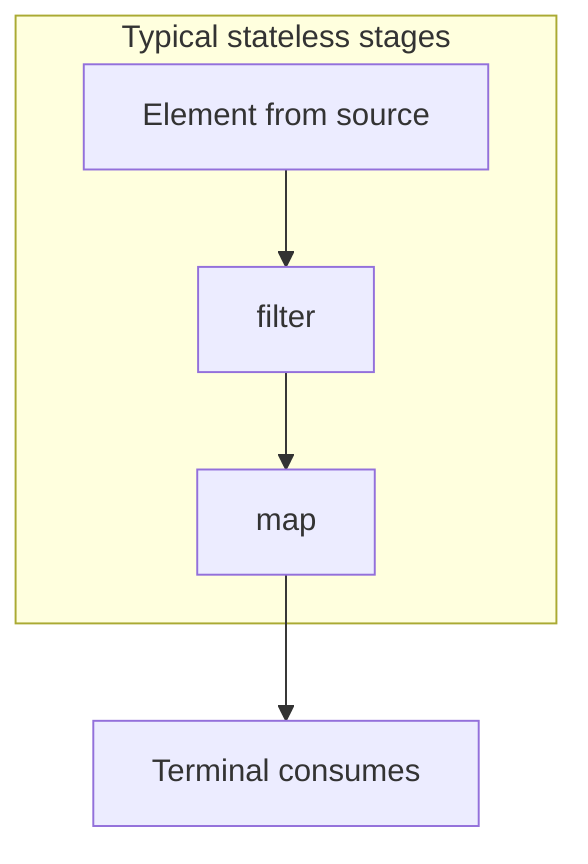

# Intermediate and Terminal Operations

> **Status:** Completed  
> **Module:** 17 — Stream API  
> **Target Java version:** 21  
> **Last reviewed:** 2026-11-10  
> **Chapter profile:** Technical  
> **Depth target:** Level 3 (operation semantics, short-circuit, stateful vs stateless, `map`/`flatMap`, `Optional` terminals)  
> **Examples verified with:** Temurin JDK 21.0.12.1 (javac 21.0.12.1)

## 1. Learning Objectives

After completing this chapter, you should be able to:

- Use common **intermediates**: `filter`, `map`, `flatMap`, `sorted`, `distinct`, `limit`, `skip`, `peek`.
- Classify intermediates as **stateless** vs **stateful** and explain why that affects memory and short-circuiting.
- Use common **terminals**: `forEach`, `reduce`, `collect`, `toList`, `count`, `min`/`max`, `findFirst`/`findAny`, `anyMatch`/`allMatch`/`noneMatch`.
- Contrast **`map`** (one element in, one element out) with **`flatMap`** (one element in, zero or many elements out, then flattened).
- Interpret **`Optional`** results from find and extrema terminals without unsafe `get()`.
- Explain **evaluation order** for sequential pipelines and why parallel pipelines weaken side-effect ordering.
- Avoid mutable accumulation inside `forEach`, especially on parallel streams.

## 2. Prerequisites

- **Ch.01** — pipeline model, laziness, one-shot consumption, short-circuit basics.
- **Module 16** — lambda types, method references, `Comparator`.
- **Module 18 (preview)** — `Optional` models present-or-absent without null returns from many stream terminals.

**Refresher:** An **intermediate** operation returns a stream and is **lazy**. A **terminal** operation ends the pipeline and produces a result, an `Optional`, or a side effect. Until the terminal runs, chained intermediates are only **structure**.

## 3. Why This Concept Exists

Collections give you elements; business logic usually needs **transformed**, **filtered**, **sorted**, **deduplicated**, or **aggregated** views. Encoding each pattern as a hand-written loop duplicates **how to walk** the data and invites subtle bugs (off-by-one, forgotten empty case, wrong comparator).

Each stream operation encodes a **reusable traversal pattern**:

- **`map`** — change shape 1:1 (DTO to ID).
- **`flatMap`** — expand nested structure (lines → words, tasks → subtasks).
- **`reduce`** — fold values with an associative operator.
- **Match / find terminals** — stop early when the question is answered.

The stream library implements these patterns with **fusion** (one pass when possible) and **short-circuit** where the operation semantics allow.

## 4. Conceptual Explanation

### 4.1 Intermediate operations — frequent catalog

| Operation | Purpose | Stateless / Stateful |
|-----------|---------|----------------------|
| `filter(Predicate)` | Keep elements that match | Stateless |
| `map(Function)` | Transform each element | Stateless |
| `flatMap(Function to Stream)` | Map then flatten streams | Stateless |
| `distinct()` | Remove duplicates (`equals`) | **Stateful** (remembers seen) |
| `sorted()` / `sorted(Comparator)` | Sort remaining stream | **Stateful** (buffers as needed) |
| `peek(Consumer)` | Observe without changing | Stateless (debug only) |
| `limit(n)` | Truncate after n elements | **Stateful** |
| `skip(n)` | Drop first n | **Stateful** |
| `mapToInt` / `mapToLong` / `mapToDouble` | Unbox to primitive stream | Stateless |

**Stateful** intermediates may need to remember information across elements (seen set, sorting buffer, counters). They can **block** full-stream short-circuit semantics upstream of sorting, and they increase **memory** pressure on large inputs.

### 4.2 Terminal operations — frequent catalog

| Terminal | Result | Short-circuit? |
|----------|--------|----------------|
| `toList()` / `toArray()` | Materialize | No (visits what pipeline delivers) |
| `collect(Collector)` | Custom reduction (Ch.03) | No (collector-dependent) |
| `reduce(...)` | Fold | No (unless optimized internally; treat as full) |
| `forEach(Consumer)` | Side effects | No |
| `count()` | `long` count | No |
| `min` / `max(Comparator)` | `Optional<T>` | No |
| `findFirst` / `findAny` | `Optional<T>` | **Yes** |
| `anyMatch` / `allMatch` / `noneMatch` | `boolean` | **Yes** |

**Short-circuit terminals** stop pulling elements once the result is determined (`anyMatch` true, `findFirst` found, etc.).

### 4.3 `map` vs `flatMap`

- **`map`:** `T → U`. One input element yields **exactly one** output element (or `null` where allowed—not recommended).
- **`flatMap`:** `T → Stream<U>`. Each input may produce **zero, one, or many** outputs; the library **flattens** substreams into one stream.

Example mental model: `List<List<String>>` of lines per page → `flatMap(lines -> lines.stream())` gives words across pages.

### 4.4 `reduce` — identity vs no identity

```java
int sum = nums.stream().reduce(0, Integer::sum);
Optional<Integer> max = nums.stream().reduce(Integer::max);
```

- **Identity + accumulator + combiner:** always returns a `T`; empty stream returns identity (must be a true identity for the operator).
- **No identity (binary operator only):** returns `Optional.empty()` on empty stream—preferred for `max` when “no answer” is valid.

The combining function matters for **parallel** streams (`Integer::sum` is associative; `(a,b) -> a - b` is not safe).

### 4.5 `Optional` on terminals

`findFirst`, `max`, `min`, and no-identity `reduce` return **`Optional`** to avoid null. Use `orElse`, `orElseGet`, `orElseThrow`, or `ifPresent`—avoid `get()` without `isPresent()` check.

## 5. Mechanism and Execution Flow

### 5.1 Sequential evaluation order

For an **ordered** source and **sequential** stream, the library generally processes elements in **encounter order**: for each element, it flows through all **stateless** intermediates in order before the next element is considered—**unless** an operation buffers (e.g. `sorted` must see all elements before emitting sorted order).



**`sorted()` mechanism (stateful):**

1. Terminal begins pull.
2. `sorted` stage accepts **all** elements (or until limited upstream), sorts, then exposes ordered iterator to terminal.
3. Upstream short-circuit may not reduce work **past** a buffered sort once sort is in the pipeline.

### 5.2 Short-circuit flow

```text
source: 3, 10, 7, 4, 8
  anyMatch(n > 9)  →  sees 3, then 10 → true → STOP (may not visit 7,4,8)
  findFirst() after filter  →  stops at first match
```

Short-circuit is implemented in the **Sink** chain: downstream stages refuse further elements after the terminal’s condition is met.

### 5.3 Demo pipeline execution (`StreamOperationsDemo`)

**Verified** pipeline on `List.of(3, 10, 7, 4, 8)`:

```java
List<Integer> evensDouble = nums.stream()
        .filter(n -> n % 2 == 0)
        .map(n -> n * 2)
        .sorted()
        .toList();
```

| Stage | Elements passed |
|-------|-----------------|
| `filter` (even) | 10, 4, 8 |
| `map` (×2) | 20, 8, 16 |
| `sorted` | 8, 16, 20 |
| `toList` | `[8, 16, 20]` |

**Separate pipelines** in the demo (same list, new stream each time):

- `reduce(0, Integer::sum)` over **all** nums → `sum=32` (3+10+7+4+8).
- `max` → `10`.
- `anyMatch(n > 9)` → true after considering 10.

**Verified output** ([stream-operations-demo](../../examples/core-java/stream-operations-demo/)):

```text
evensDouble=[8, 16, 20]
sum=32
max=10
anyBig=true
```

### 5.4 Parallel note (preview)

On **parallel** streams, `forEach` **does not** guarantee encounter order. `findAny` may return any matching element in the chunk that wins the race. Correctness must not depend on **which** match unless you document sequential streams only.

## 6. Terminology

| Term | Meaning |
|------|---------|
| **Stateless intermediate** | Processes each element without retaining across elements (except combiner context in parallel forks). |
| **Stateful intermediate** | Retains state across elements (`distinct`, `sorted`, `limit`, `skip`). |
| **Short-circuit terminal** | May stop without consuming the entire stream. |
| **Associative operator** | `(a op b) op c` equals `a op (b op c)` — required for reliable `reduce` / `sum` in parallel. |
| **Encounter order** | Stable order from ordered sources (`List`). |
| **`flatMap`** | Map to stream, then concatenate substreams. |

## 7. Syntax and Language Rules

- `sorted()` requires elements to be `Comparable` or supply `Comparator`; specify `Comparator.nullsFirst` / `nullsLast` when nulls appear.
- `distinct()` uses `equals` / `hashCode`; mutable elements can break dedupe if they change during pipeline.
- Primitive streams (`mapToInt`, etc.) avoid boxing; terminal primitives return `int` / `OptionalInt` etc.
- `forEachOrdered` exists for ordered parallel streams but is not a substitute for safe mutation.
- Calling **`get()`** on empty `Optional` from `max()` on empty stream → `NoSuchElementException`.

## 8. Step-by-Step Examples

### 8.1 Minimal — filter and sum (Verified)

From `StreamOperationsDemo`: `int total = nums.stream().reduce(0, Integer::sum);` → **32**.

**Why:** identity `0` with `Integer::sum` is the standard counting-sum idiom; works on empty list (returns 0).

### 8.2 Realistic — filter, map, sort, materialize (Verified)

See Section 5.3; output `evensDouble=[8, 16, 20]`.

**Incorrect variation — `map` instead of `flatMap` on nested lists:**

```java
List<List<Integer>> nested = List.of(List.of(1, 2), List.of(3));
List<List<Integer>> wrong = nested.stream().map(x -> x).toList(); // still nested
List<Integer> right = nested.stream().flatMap(Collection::stream).toList(); // [1,2,3]
```

### 8.3 Advanced — `flatMap` from lines to words (Compile-verified)

```java
List<String> lines = List.of("a b", "c");
List<String> words = lines.stream()
        .flatMap(line -> Arrays.stream(line.split("\\s+")))
        .toList(); // [a, b, c]
```

Splitting produces arrays; `Arrays.stream` → `flatMap` flattens per line into one stream of tokens.

### 8.4 Optional terminal (Illustrative)

```java
Optional<Integer> emptyMax = Stream.<Integer>empty().max(Integer::compareTo);
emptyMax.isEmpty(); // true — do not call get()
```

## 9. Real-World Use Cases

- **Invoice lines:** `mapToInt(LineItem::subtotal).sum()` for totals without boxing.
- **API dedupe:** `distinct()` on stable DTO keys before batch insert.
- **Paging:** `skip(page * size).limit(size)` on **ordered** in-memory lists (not a DB substitute).
- **Guards:** `allMatch(validator)` before commit; `anyMatch(thresholdExceeded)` for alerting.
- **Parsing:** `flatMap` from records to child events in one flat processing pipeline.

## 10. Internal Behavior

Labeled **JDK implementation**, not JLS:

- **`distinct`:** typically backed by a hash set (`LinkedHashSet` preserves order in sequential encounter-ordered streams) or concurrent structures when parallel.
- **`sorted`:** collects into array and `Arrays.sort` (natural or comparator).
- **Match operations:** implement short-circuit in pipeline sinks.
- Memory cost of `distinct` / `sorted` is **O(n)** in the number of elements reaching that stage.

Behavior may change between releases; do not depend on specific collection classes inside the JDK for correctness.

## 11. Edge Cases and Limitations

- **Empty stream:** `reduce(Integer::max)` → `Optional.empty()`; identity reduce `reduce(0, Integer::sum)` → `0`.
- **`findFirst` vs `findAny`:** on parallel, `findAny` is often cheaper; `findFirst` preserves first in encounter order when ordered.
- **Nulls:** `sorted()` without null-safe comparator can throw `NullPointerException`.
- **`limit` after infinite source:** still bounded only if terminal or short-circuit completes within limit.
- **Floating point `reduce`:** not truly associative for decimal rounding—use careful rounding or `BigDecimal` workflows.

## 12. Common Mistakes

### Incorrect — external mutable list in `forEach` (especially parallel)

```java
List<Integer> bad = new ArrayList<>();
nums.parallelStream().forEach(bad::add); // data race; undefined contents
```

### Correct — collect or `toList`

```java
List<Integer> good = nums.stream()
        .filter(n -> n % 2 == 0)
        .toList();
```

### Incorrect — `get()` on empty `Optional`

```java
stream.max(Comparator.naturalOrder()).get(); // NoSuchElementException if empty
```

### Correct

```java
int m = stream.max(Comparator.naturalOrder()).orElse(-1);
```

### Incorrect — non-associative reduce on parallel

```java
nums.parallelStream().reduce(0, (a, b) -> a - b); // wrong fold semantics across chunks
```

### Correct — use `Integer::sum` or sequential stream for non-associative logic

## 13. Best Practices

- Prefer **`mapToInt` / `mapToDouble`** when the domain is numeric end-to-end.
- Replace **`forEach` + mutation** with **`collect`** / **`reduce`** / **`toList`**.
- Use **`flatMap`** when the natural type is `Stream<U>` per element; use **`map`** for 1:1 transforms.
- Put **`limit` early** when you only need a prefix—can reduce work before expensive stages (when stateless upstream).
- Document whether pipelines **require sequential** streams for ordering semantics.

## 14. Design Trade-offs

| Choice | When it wins | When to avoid |
|--------|--------------|---------------|
| `flatMap` | Nested collections, optional expansions, many-to-one flatten | Single values—use `map` |
| `reduce` | Custom associative folds | Complex mutable reports → `collect` (Ch.03) |
| `forEach` | Fire-and-forget side effects (logging) | Building collections |
| `sorted` in stream | Medium in-memory sorts | Large data—sort in DB or specialized structures |
| Nested loops | Two fixed levels, break-heavy logic | Repeated composable stages |

## 15. Performance Considerations

- **`sorted()`** is **O(n log n)** and requires full materialization at that stage—cannot short-circuit sorting itself.
- **`distinct()`** adds set memory per element seen.
- **`peek`** still invokes consumer per element—remove in production hot paths.
- Boxing in `Stream<Integer>` adds GC pressure vs `IntStream`.

## 16. Java Version and Compatibility Notes

- **Streams:** Java 8+.
- **`Stream.toList()`:** Java 16+, unmodifiable list.
- **Matcher-style terminals** unchanged in Java 21.

## 17. Revision and Mastery

**You should already understand**

- Ch.01 laziness and one-shot rules.
- That `Comparator` defines sort order explicitly.

**Common knowledge gaps**

- Assuming **`map`** flattens nested lists (it does not—use **`flatMap`**).
- Treating **`peek`** as a transformation.
- Using **`forEach`** to build a `List` because it “feels like a loop.”

**Frequently misunderstood**

- Why **`evensDouble`** is `[8, 16, 20]` not encounter order of doubles ( **`sorted`** stage).
- Why **`sum=32`** includes odds while **`evensDouble`** does not ( **separate pipelines** ).
- **`allMatch`** short-circuits on first false; **`noneMatch`** on first true.

**Questions you should answer**

1. Which intermediates are stateful?
2. Name three short-circuit terminals.
3. `map` vs `flatMap` on `List<List<T>>`?
4. What does empty-stream `max()` return?
5. Why is `parallelStream().forEach(list::add)` wrong?

**Practical exercises**

1. Predict all four lines of `StreamOperationsDemo` output.
2. From `List.of("ab", "c")`, flatMap to character count with distinct.
3. Insert `distinct()` after `map` in the evens pipeline—when does it change output?

**Advanced follow-ups**

- Read `Collector` characteristics interplay with `distinct` (Ch.03).
- Compare `reduce` with `collect` for `groupingBy` reports.

## 18. Exercises

### Beginner

1. From `List.of(1,2,3)`, produce `[2,4,6]` with one pipeline.
2. Which terminal answers “is any value negative?” with short-circuit?

### Intermediate

3. Reproduce demo `evensDouble` on paper; verify against Verified output.
4. Convert `words.stream().map(String::length)` to a `max` without boxing if possible.

### Advanced

5. Pipeline: nested lists of integers → single sorted distinct list—name the stages.

## 19. Interview Questions

1. `map` vs `flatMap`?
2. Name a stateful intermediate.
3. Which terminals short-circuit?
4. Why not `forEach` to build a list?
5. `findFirst` vs `findAny` on parallel streams?
6. What does `reduce` without identity return on empty stream?

## 20. Solutions

1. `.map(n -> n * 2).toList()`.
2. `anyMatch(n -> n < 0)`.
3. Section 5.3 trace → `[8, 16, 20]`.
4. `words.stream().mapToInt(String::length).max()` → `OptionalInt`.
5. `flatMap(Collection::stream).distinct().sorted().toList()` (ordering strategy explicit via `sorted`).

## 21. Chapter Summary

**Intermediates** reshape streams lazily; **stateful** stages remember data and can buffer. **Terminals** finish the pipeline—many **short-circuit**. The demo shows **filter → map → sorted → toList** yielding `[8, 16, 20]`, while separate terminals sum all five inputs and report `max` and `anyMatch`. Use **`flatMap`** for one-to-many expansion; use **`Optional`** safely; avoid **`forEach`** for aggregation.

## 22. Key Terminology

filter · map · flatMap · stateless · stateful · short-circuit · reduce · Optional · encounter order

## 23. References and Further Reading

- [Interface `Stream`](https://docs.oracle.com/en/java/javase/21/docs/api/java.base/java/util/stream/Stream.html)
- [Interface `IntStream`](https://docs.oracle.com/en/java/javase/21/docs/api/java.base/java/util/stream/IntStream.html)
- [Class `Optional`](https://docs.oracle.com/en/java/javase/21/docs/api/java.base/java/util/Optional.html)

## 24. Next Steps

- [03-collectors-and-grouping.md](03-collectors-and-grouping.md) — `Collector` contract and `groupingBy`.
- [01-stream-fundamentals.md](01-stream-fundamentals.md) — pipeline basics if revisiting laziness.
- [04-parallel-streams-and-pitfalls.md](04-parallel-streams-and-pitfalls.md) — parallelism affects ordering and `forEach`.

## Review Checklist

**Mandatory Depth Review:** Level 3 — operation semantics, stateful vs stateless, evaluation order, Verified demo.

- [x] Learning objectives covered
- [x] Prerequisites refreshed (Optional preview)
- [x] Chapter profile **Technical**, depth **Level 3**
- [x] Depth gate passed
- [x] Mechanism and execution flow (Section 5) — evaluation order, short-circuit, demo trace
- [x] Diagram (mermaid) for sequential flow
- [x] Terminology and syntax rules
- [x] Verified demo output Temurin 21.0.12.1
- [x] flatMap compile-verified snippet; Optional illustrative
- [x] Internal behavior labeled JDK
- [x] Common mistakes with corrections
- [x] Revision and Mastery expanded
- [x] Solutions with reasoning

**Omissions (section → reason):**

- **Security Considerations** — only generic PII/logging note would duplicate Ch.01 edge guidance; omitted.
- **Related Language Comparisons** — reactive/Rx comparison omitted; not required to use Java streams.
- **Performance** — included briefly (`sorted`/`distinct` cost); no micro-benchmark claims.
