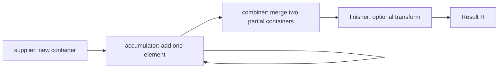

# Collectors and Grouping

> **Status:** Completed  
> **Module:** 17 — Stream API  
> **Target Java version:** 21  
> **Last reviewed:** 2026-11-10  
> **Chapter profile:** Technical  
> **Depth target:** Level 3 (`Collector` contract, grouping/partitioning, downstream, `toMap` merge, when custom collectors matter)  
> **Examples verified with:** Temurin JDK 21.0.12.1 (javac 21.0.12.1)

## 1. Learning Objectives

After completing this chapter, you should be able to:

- Explain the **`Collector`** contract: **supplier**, **accumulator**, **combiner**, and **finisher**, plus **characteristics**.
- Use **`Collectors.toList`**, **`toSet`**, **`toMap`**, **`joining`** with correct expectations for mutability, duplicates, and ordering.
- Apply **`groupingBy`** and **`partitioningBy`** with **downstream** collectors (`mapping`, `counting`, `toList`).
- Build **multi-level** grouping (nested `groupingBy`).
- Summarize with **`summingInt`**, **`averagingDouble`**, **`summarizingInt`**, and **`counting`** downstream.
- Handle **`toMap`** duplicate keys with a **merge function** and choose map suppliers for sorted results.
- Decide when **`Collectors` factories** suffice vs when a **custom `Collector`** is justified.

## 2. Prerequisites

- **Ch.02** — terminal `collect`, stream materialization vs `reduce`.
- **Module 12** — `Map`, `List`, `Set`, equality, hash buckets.
- **Module 15** — records as compact row types (demo uses `record Person`).

**Refresher:** `stream.collect(collector)` is a **terminal** that folds stream elements into a **mutable container** (usually) via a **`Collector`** strategy. That strategy encodes **how to start**, **how to add each element**, **how to merge parallel partial results**, and optionally **how to transform** the final container.

## 3. Why This Concept Exists

`reduce` expresses simple folds but becomes awkward for **nested structures**: “group people by department, list names per dept, count per dept, and join all names for CSV.” Hand-written `Map<String, List<...>>` loops work but repeat bookkeeping and are easy to get wrong under **parallel** merges.

**`Collectors`** provides named reduction strategies the stream library understands:

- Optimized combinations for known shapes (`joining`, `groupingBy`).
- Documented **downstream** composition for **two-level** reductions.
- **Characteristics** (`IDENTITY_FINISH`, `CONCURRENT`, etc.) that affect parallel efficiency.

You still choose **immutability vs mutability** of results—`toList()` terminal vs `toList()` collector behave differently (Ch.02 vs this chapter).

## 4. Conceptual Explanation

### 4.1 What `collect` does

```java
R result = stream.collect(collector);
```

The collector drives:

1. Create accumulation container (**supplier**).
2. For each element, incorporate (**accumulator**).
3. If parallel, merge partial containers (**combiner**).
4. Optionally transform mutable result to final type (**finisher**).

Factory methods on `Collectors` hide this unless you author custom collectors.

### 4.2 `groupingBy` default shape

```java
Map<K, List<T>> byKey = stream.collect(Collectors.groupingBy(classifier));
```

Each key maps to a **list of all elements** in that group (default downstream: `toList()`). Order within lists follows encounter order of the stream (unless downstream changes semantics).

### 4.3 Downstream collectors

```java
Collectors.groupingBy(
    Person::dept,
    Collectors.mapping(Person::name, Collectors.toList())
);
```

**Outer** collector groups by department. **Inner (downstream)** collector controls **value type**:

- Default downstream → `List<Person>`.
- With `mapping(Person::name, toList())` → `List<String>` of names per dept.

Downstream can be `counting()`, `summingInt`, `joining`, or another nested `groupingBy` for multi-level maps.

### 4.4 `partitioningBy`

Special case of `groupingBy` where keys are **`Boolean`** from a predicate—exactly two buckets (`true` / `false`). Useful for yes/no splits without string keys.

### 4.5 `joining`

`Collectors.joining(delimiter)` reduces a `Stream<String>` to a single delimited string in encounter order (sequential). Not HTML-safe or escape-aware.

### 4.6 `toMap` hazards

```java
Collectors.toMap(keyMapper, valueMapper);
```

- **Duplicate keys:** `IllegalStateException` without a merge function.
- **Null keys/values:** generally disallowed—`NullPointerException`.
- **Supplier** overload chooses `TreeMap`, `ConcurrentHashMap`, etc.

### 4.7 Immutability choices

| API | Typical mutability |
|-----|-------------------|
| `Collectors.toList()` | Mutable `ArrayList` |
| `Collectors.toUnmodifiableList()` (Java 10+) | Immutable view |
| `Stream.toList()` terminal | Unmodifiable (Ch.02) |

Expose grouped maps externally? Consider unmodifiable copies of values.

## 5. Mechanism and Execution Flow

### 5.1 Collector contract (four functions)



| Function | Role in sequential run | Role in parallel run |
|----------|------------------------|----------------------|
| **Supplier** | `() -> new Container` | Each fork may call supplier for sub-container |
| **Accumulator** | `(container, element) -> void` | Adds to fork-local container |
| **Combiner** | Often `(a,b) -> merged` | Merges partial containers from forks |
| **Finisher** | `container -> result` | Applied after merge if needed |

**Characteristics** (on `Collector`):

- **`CONCURRENT`:** accumulator may run concurrently on **shared** container (rare; must be thread-safe).
- **`UNORDERED`:** encounter order not required—optimization hint.
- **`IDENTITY_FINISH`:** finisher is identity—container type equals result type.

### 5.2 `groupingBy` accumulation (conceptual)

For each element `t`:

1. Compute key `K = classifier.apply(t)`.
2. Fetch or create **downstream container** for that key (e.g. `List`).
3. Run downstream accumulator with `(container, t)` or mapped value if `mapping` is used.

**Combiner** merges two `Map<K, DownstreamResult>`:

- For each key in either map, merge downstream results (e.g. concatenate lists via downstream’s combiner).

This is why downstream collectors must have **consistent** merge behavior for parallel streams.

### 5.3 Demo execution trace (`CollectorsGroupingDemo`)

**Verified** team list: Ada/eng, Lin/eng, Zoe/ops.

**Pipeline 1 — `byDept`:**

```java
Map<String, List<String>> byDept = team.stream()
        .collect(Collectors.groupingBy(
                Person::dept,
                Collectors.mapping(Person::name, Collectors.toList())));
```

| Key | Accumulated names |
|-----|-------------------|
| `eng` | `Ada`, `Lin` |
| `ops` | `Zoe` |

**Pipeline 2 — `csv`:** map names → `joining(", ")` → `"Ada, Lin, Zoe"` (list encounter order).

**Pipeline 3 — `counts`:** `groupingBy(dept, counting())` → `eng=2`, `ops=1`.

**Verified output** ([collectors-grouping-demo](../../examples/core-java/collectors-grouping-demo/)):

```text
byDept={ops=[Zoe], eng=[Ada, Lin]}
csv=Ada, Lin, Zoe
counts={ops=1, eng=2}
```

`HashMap` **iteration order** in `println` may vary across runs or JDKs; **membership** matches above.

### 5.4 `toMap` merge mechanism

When keys collide:

```java
stream.collect(Collectors.toMap(
    Person::name,
    p -> p,
    (existing, replacement) -> existing  // merge: keep first
));
```

Without the merge function, the library throws at second insert of same key. Merge function defines **duplicate policy** (first wins, last wins, combine values).

### 5.5 When custom collectors matter

Use **`Collectors` factories** when they match:

- Standard maps, sets, lists, strings, grouping, summarizing.

Author **`Collector.of(...)`** when you need:

- A **domain-specific** immutable result in one pass.
- **Single container** rules not expressible by chaining downstream collectors.
- **Strict resource** handling or validation at finisher time.
- **Performance** with known `IDENTITY_FINISH` and `UNORDERED` for parallel.

If `groupingBy` + `mapping` + `counting` reads clearly, prefer composition over bespoke collectors.

## 6. Terminology

| Term | Meaning |
|------|---------|
| **Classifier** | Function `T → K` producing group key |
| **Downstream collector** | Inner collector reducing values per group key |
| **Finisher** | Post-process mutable accumulation into final result |
| **Merge function** | `(oldValue, newValue) -> combined` for `toMap` key collisions |
| **Characteristic** | `Collector` flags guiding optimizations and parallel safety |
| **Partitioning** | `groupingBy` with boolean keys |

## 7. Syntax and Language Rules

- `groupingBy(classifier, mapFactory, downstream)` — third arg chooses `TreeMap` for sorted keys.
- `groupingByConcurrent` requires concurrent downstream when used concurrently.
- `teeing` (Java 12+) runs **two** collectors on same stream—advanced dual summary.
- `Collectors.toMap` overloads: with / without merge, with map supplier.
- Record components as method references: `Person::dept`, `Person::name`.

## 8. Step-by-Step Examples

### 8.1 Minimal — `joining` (Verified)

From demo: `team.stream().map(Person::name).collect(Collectors.joining(", "))` → `csv=Ada, Lin, Zoe`.

### 8.2 Realistic — grouping with mapping downstream (Verified)

Produces `byDept` map in Section 5.3. **Why not default `groupingBy`?** Values would be `List<Person>`; `mapping` projects to names **inside** the reduction—no second manual loop.

### 8.3 Realistic — `counting` downstream (Verified)

`groupingBy(Person::dept, Collectors.counting())` → `counts={ops=1, eng=2}`.

### 8.4 `toMap` duplicate handling (Illustrative)

```java
// Two people named "Ada" → exception without merge
Collectors.toMap(Person::name, p -> p, (a, b) -> a)
```

### 8.5 Multi-level grouping (Compile-verified pattern)

```java
Map<String, Map<String, List<Person>>> byCountryDept = people.stream()
        .collect(Collectors.groupingBy(
                Person::country,
                Collectors.groupingBy(Person::dept)));
```

Outer groups by country; inner maps by department within country.

### 8.6 Custom collector sketch (Illustrative)

```java
Collector<Person, ?, String> namesInParens = Collector.of(
        StringBuilder::new,
        (sb, p) -> sb.append('(').append(p.name()).append(')'),
        (a, b) -> { a.append(b); return a; },
        StringBuilder::toString);
```

Shows all four functions explicitly—prefer factories when equivalent.

## 9. Real-World Use Cases

- **Ops dashboards:** `groupingBy(service, counting())` for error rates per microservice from in-memory logs.
- **Lookup maps:** `toMap(User::id, Function.identity(), (a,b)->a)` with explicit duplicate policy.
- **CSV / audit exports:** `joining` after `map` to field string.
- **Nested reports:** multi-level `groupingBy` before serializing JSON.
- **Partition canaries:** `partitioningBy(FeatureFlag::enabled)` for A/B cohort lists.

When data exceeds memory or needs indexes—**push aggregation to SQL** or an analytics engine; streams are **in-process** tools.

## 10. Internal Behavior

Labeled **JDK library**, not JLS:

- `groupingBy` uses `Map.computeIfAbsent` style logic to create per-key downstream containers.
- Parallel combiners call downstream `.combiner()` to merge partial lists/maps.
- `joining` uses internal `StringJoiner` or similar builders.
- `toMap` uses merge on collisions when provided—implementation in `Collector` helpers in `java.util.stream.Collectors`.

Incorrect downstream choice (non-concurrent) with `groupingByConcurrent` can cause race conditions—match API docs.

## 11. Edge Cases and Limitations

- **Null keys** in `HashMap` grouping: traditionally one null key—avoid null classifiers.
- **Mutable values** in map (`List` from `toList()` collector): defensive copy before exposing outside package.
- **Duplicate keys** in `toMap` without merge → exception at collect time, not at stream setup.
- **Ordering:** `HashMap` key order undefined; use `TreeMap` supplier or sort when stable UI order matters.
- **Large grouping:** all groups held in memory—streaming DB cursors need different patterns.

## 12. Common Mistakes

### Incorrect — `toMap` without merge on duplicates

```java
stream.collect(Collectors.toMap(Person::name, p -> p)); // IllegalStateException on duplicate name
```

### Correct

```java
stream.collect(Collectors.toMap(Person::name, p -> p, (a, b) -> a));
```

### Incorrect — assuming grouping values are immutable

```java
Map<String, List<Person>> g = team.stream().collect(Collectors.groupingBy(Person::dept));
g.get("eng").clear(); // mutates internal collector result
```

### Correct — wrap defensively when publishing

```java
Map<String, List<Person>> ro = team.stream()
        .collect(Collectors.groupingBy(Person::dept))
        .entrySet().stream()
        .collect(Collectors.toUnmodifiableMap(
                Map.Entry::getKey,
                e -> List.copyOf(e.getValue())));
```

### Incorrect — expecting sorted keys from default `groupingBy`

Use `groupingBy(classifier, TreeMap::new, downstream)` when keys must sort.

## 13. Best Practices

- **`groupingBy` + `counting`** for frequency tables.
- **`mapping`** to project fields early—keeps map value types narrow.
- Document **`toMap` merge** policy in code review (first vs last wins vs merge records).
- Prefer **`Stream.toList()`** terminal when you do not need a custom collector—Ch.02.
- For public APIs returning grouped data, return **unmodifiable** maps/lists.

## 14. Design Trade-offs

| Approach | Strengths | Weaknesses |
|----------|-----------|------------|
| Stream collectors | Concise grouping/joining | All in-heap |
| Imperative `Map` loop | Debugger-friendly, flexible breaks | Verbose, error-prone merges |
| SQL `GROUP BY` | Scales, indexes | Not for arbitrary in-memory graphs |
| `teeing` / custom collector | Multiple summaries one pass | Harder to read |

Collectors win for **batch in-memory** ETL on collections already loaded.

## 15. Performance Considerations

`groupingBy` allocates a list per distinct key—fine for typical service batch sizes. Very high cardinalities (millions of keys) need database aggregation or streaming stores.

`joining` creates one growing string—mind memory for huge streams.

## 16. Java Version and Compatibility Notes

- **`Collectors`:** Java 8.
- **`toUnmodifiableList`:** Java 10+.
- **`teeing`:** Java 12+.
- **Records** in demos align with Java 16+ record semantics; runs on Java 21.

## 17. Revision and Mastery

**You should already understand**

- Terminal `collect` vs `reduce`.
- `Map` key uniqueness and `List` mutability.

**Common knowledge gaps**

- Why demo `byDept` values are `List<String>` not `List<Person>` (**`mapping` downstream**).
- Default downstream of `groupingBy` (**`toList()`** of full elements).
- Difference between **`Stream.toList()`** and **`Collectors.toList()`**.

**Frequently misunderstood**

- **`counts`** map value type is `Long` (`counting()` returns `Long`, not `long` in map values).
- **`joining`** order follows stream order, not alphabetical sort.
- Parallel **`groupingBy`** still needs lawful combiners on downstream.

**Questions you should answer**

1. Name the four `Collector` functions.
2. How do you keep first duplicate in `toMap`?
3. What downstream changes `groupingBy` values from persons to names?
4. `partitioningBy` vs `groupingBy`?
5. When would you write `Collector.of` instead of `groupingBy`?

**Practical exercises**

1. Predict three demo output lines before run.
2. Average salary per dept with `averagingInt` downstream (hypothetical `salary` field).
3. Produce `TreeMap`-sorted keys for departments.

**Advanced follow-ups**

- Study `Collector.Characteristics` for a custom concurrent accumulator.
- Compare `Collectors.summarizingInt` output map fields (`count`, `sum`, `min`, `max`, `average`).

## 18. Exercises

### Beginner

1. From three `Person` rows, write the `counts` pipeline.
2. Change demo to group by first letter of name—what is key type?

### Intermediate

3. Produce `Map<String, String>` dept → comma-separated names using `mapping` + `joining` downstream.
4. Fix a `toMap` that throws on duplicate `id`.

### Advanced

5. Two-level grouping: dept → role → list of names—sketch collector expression.

## 19. Interview Questions

1. Default downstream of `groupingBy`?
2. `toMap` duplicate key behavior?
3. `joining` vs manual `StringBuilder`?
4. What does the combiner do in parallel `collect`?
5. When is `groupingByConcurrent` appropriate?

## 20. Solutions

1. `team.stream().collect(Collectors.groupingBy(Person::dept, Collectors.counting()));`
2. `Character` or `String` depending on classifier; `groupingBy(p -> p.name().charAt(0))` → `Map<Character, List<Person>>`.
3. `groupingBy(Person::dept, Collectors.mapping(Person::name, Collectors.joining(", ")))`.
4. Add merge `(a,b) -> a` or merge business logic.
5. `groupingBy(Person::dept, groupingBy(Person::role, mapping(Person::name, toList())))` with static imports for brevity.

**Averaging exercise:** `groupingBy(Person::dept, averagingInt(Person::salary))` → `Map<String, Double>`.

## 21. Chapter Summary

**Collectors** package reduction as **supplier / accumulator / combiner / finisher**. **`groupingBy`** builds maps of groups; **downstream** collectors shape values (`mapping`, `counting`, `joining`). **`toMap`** needs **merge** functions for duplicate keys. The demo groups **names by dept**, joins **CSV**, and **counts** per dept with **Verified** Temurin 21 output. Prefer factory collectors; use **custom** collectors when composition is insufficient.

## 22. Key Terminology

Collector · supplier · accumulator · combiner · finisher · groupingBy · downstream · joining · toMap merge · partitioning

## 23. References and Further Reading

- [Class `Collectors`](https://docs.oracle.com/en/java/javase/21/docs/api/java.base/java/util/stream/Collectors.html)
- [Interface `Collector`](https://docs.oracle.com/en/java/javase/21/docs/api/java.base/java/util/stream/Collector.html)
- [Package `java.util.stream`](https://docs.oracle.com/en/java/javase/21/docs/api/java.base/java/util/stream/package-summary.html)

## 24. Next Steps

- [04-parallel-streams-and-pitfalls.md](04-parallel-streams-and-pitfalls.md) — parallel combiners and interference.
- [02-intermediate-and-terminal-operations.md](02-intermediate-and-terminal-operations.md) — when to `collect` vs `toList`.
- Module 12 — `Map` and collection contracts for exposed results.

## Review Checklist

**Mandatory Depth Review:** Level 3 — Collector contract, grouping/partitioning, downstream, toMap, custom collector guidance.

- [x] Learning objectives covered
- [x] Prerequisites refreshed
- [x] Chapter profile **Technical**, depth **Level 3**
- [x] Depth gate passed
- [x] Mechanism and execution flow (Section 5) with contract diagram and demo trace
- [x] Collector four-function table and parallel role
- [x] Verified demo Temurin 21.0.12.1
- [x] Illustrative vs compile-verified examples labeled
- [x] Internal behavior labeled JDK
- [x] toMap merge mistakes documented
- [x] When custom collectors matter (Section 5.5)
- [x] Revision and Mastery expanded
- [x] Solutions with reasoning

**Omissions (section → reason):**

- **Security Considerations** — joining/CSV does not escape HTML; noted briefly in conceptual joining; no dedicated security section.
- **Related Language Comparisons** — SQL GROUP BY mentioned in trade-offs only; no appendix comparison section.
