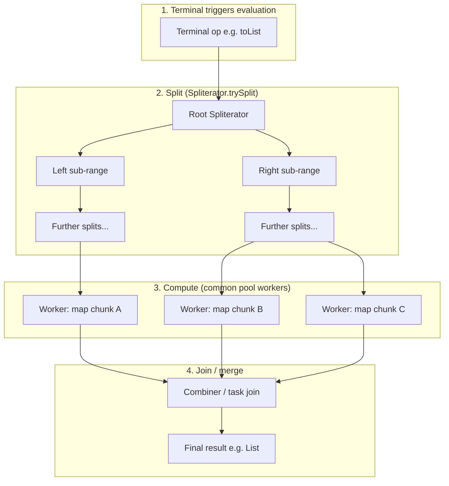

# Parallel Streams and Pitfalls

> **Status:** Completed  
> **Module:** 17 — Stream API  
> **Target Java version:** 21  
> **Last reviewed:** 2026-11-10  
> **Chapter profile:** Deep-dive  
> **Depth target:** Levels 3–4 (ForkJoin common pool, Spliterator splitting, ordering, thread-safety)  
> **Examples verified with:** Temurin JDK 21.0.12.1 (javac 21.0.12.1)

**Section policy:** Sections are **conditional unless marked mandatory**. Include a section when it adds meaningful learning value. Do **not** manufacture content to fill headings. For omitted sections, record the reason in the Review Checklist.

| Mandatory for most chapters | Conditional |
| --------------------------- | ----------- |
| Learning objectives | Internal behavior |
| Prerequisites | Performance |
| Why this exists | Security |
| Conceptual explanation | Language comparisons |
| Mechanism and execution flow *(or merge note)* | Advanced examples |
| Terminology | Real-world use cases |
| Examples | Design trade-offs *(strongly encouraged for Technical / Deep-dive)* |
| Common mistakes | Compatibility details |
| Summary and references | — |

**Editorial judgment:** Deep-dive on parallel stream mechanics and production pitfalls—not a quick `parallelStream()` recipe. Level 4 treatment on mechanisms because misuse affects the **entire JVM** via the shared common pool.

## 1. Learning Objectives *(mandatory)*

After completing this chapter, you should be able to:

- Explain how **parallel streams** delegate work to the **ForkJoin common pool** and how tasks are **split** and **merged**.
- Decide when parallelization may help versus hurt, using criteria beyond folklore (“always faster on big data”).
- Interpret **Spliterator** characteristics (`ORDERED`, `SIZED`, `SUBSIZED`, and related flags) and how they affect split quality.
- State **ordering** guarantees and non-guarantees for parallel pipelines (`forEach`, `forEachOrdered`, collectors).
- Identify **thread-safety** requirements on **sources**, **intermediate state**, and **accumulators** (including combiners in `collect`/`reduce`).
- Avoid **side effects** and **shared mutation** in parallel pipelines, and explain why a “lucky” demo output does **not** prove safety.
- Use **`parallel()`** / **`parallelStream()`** with awareness of **nested parallelism** and **blocking work** on the common pool.

## 2. Prerequisites *(mandatory)*

- **Ch.01** — Stream fundamentals: source → intermediate\* → terminal; laziness until terminal; **Spliterator** mentioned as the internal splitter feeding streams from collections.
- **Ch.02** — Intermediate and terminal operations; why `forEach` with external mutation is already discouraged on sequential streams.
- **Ch.03** — Collectors: **supplier**, **accumulator**, **combiner**, **finisher**; parallel `collect` merges partial results via **combiners**.
- **Module 16** — Lambdas and functional interfaces; capturing variables must be **effectively final** for anonymous classes/lambdas (JLS rules).

**Refresher — sequential pipeline execution:** Operations are fused into a single traversal (conceptually): each element moves through `filter` → `map` → … until the terminal consumes it. No extra threads are involved unless you use `parallel()`.

**Refresher — happens-before (minimum for this chapter):** If thread A writes a value and thread B reads it without synchronization, B may see stale or torn state. `ArrayList` is **not** designed for concurrent `add` from multiple threads; parallel `forEach` can invoke your lambda on **different threads** without you noticing.

**Concurrency depth:** Module 34 and related material cover `ForkJoinPool`, `ExecutorService`, and the Java Memory Model in full. This chapter explains what parallel streams **actually do** so you can use them safely before (or alongside) that module.

## 3. Why This Concept Exists *(mandatory)*

Modern machines expose many CPU cores. If every collection operation stays on one thread, CPU-bound work leaves cores idle. Java 8 introduced **parallel streams** so library code can **split** a data source, process chunks concurrently, and **combine** results—without hand-writing recursive decomposition for every `map`/`filter`/`reduce`.

The design trades **control** for **convenience**:

- You do not pick thread counts, queue depths, or pool isolation—the default is the JVM-wide **common pool**.
- Splitting quality depends on the source’s **Spliterator** and reported **characteristics**, not on your call to `parallel()`.
- Correctness still depends on **your** lambdas being safe for concurrent execution and on **associative** reductions where the API requires them.

When parallel streams work, they express homogeneous **CPU-bound** transforms succinctly. When they fail, they fail **quietly** (nondeterministic order, corrupted shared structures, or **pool starvation** that slows unrelated code). This chapter focuses on recognizing both outcomes.

## 4. Conceptual Explanation *(mandatory)*

### 4.1 What “parallel stream” means in the API

A stream is a **flag** on a pipeline, not a separate type. Calling `collection.parallelStream()` or `stream.parallel()` marks subsequent operations as eligible for parallel execution. The **same** intermediate and terminal methods apply; the stream implementation may fork work across threads.

Nothing in the **Java Language Specification** mandates a particular threading model for streams. The behavior described here comes from the **Java SE API** (`java.util.stream`) and its **JDK reference implementation** (OpenJDK), which uses **ForkJoin**-style task splitting.

### 4.2 Fork/join at a glance

**Fork/join** is a pattern: divide a large task into smaller subtasks, execute subtasks (possibly on different workers), **join** (merge) partial results into a final answer. `ForkJoinPool` provides work-stealing queues so idle workers can take tasks from busy ones.

Parallel streams submit pipeline evaluation to a **ForkJoinPool**. Unless you use advanced patterns (submitting the whole pipeline inside a **different** `ForkJoinPool`), parallel streams use the **`ForkJoinPool.commonPool()`**—a **static, shared** pool inside the JDK implementation.

### 4.3 Spliterator’s role

When you call `list.stream()`, the collection supplies a **Spliterator**—an iterator that can **`trySplit()`** into two Spliterators covering sub-ranges of the data. The parallel stream framework repeatedly splits until chunks are small enough, wraps each chunk in tasks, and runs stages over those chunks.

If splitting is **poor** (hard to divide evenly, unknown size, expensive split), parallel speedup may never materialize.

### 4.4 When parallel might help

Parallel streams are candidates when **all** of the following are roughly true:

| Criterion | Rationale |
|-----------|-----------|
| **Large in-memory source** | Splitting and task scheduling have fixed costs; tiny sources stay sequential in practice. |
| **CPU-bound per-element work** | Pure `map`/`filter`/`reduce` on primitives or small objects—work dominates overhead. |
| **Cheap split, known size** | `ArrayList`, arrays, many `IntStream` ranges report `SIZED` / `SUBSIZED` (see §6, §10). |
| **Associative, thread-safe reduction** | `reduce` and `Collector` combiners must merge partial results correctly (Ch.03). |
| **No blocking or IO in lambdas** | Blocking ties up **common pool** workers (see §11, §14). |

These are engineering heuristics. The only reliable verdict is **measurement** on your data and hardware.

### 4.5 When parallel hurts

| Situation | What goes wrong |
|-----------|-----------------|
| **Small collections** | Task creation and join cost exceed saved CPU time. |
| **Lightweight operations** | `map(n -> n + 1)` on millions of elements may still be memory-bandwidth bound; parallel adds coordination. |
| **IO, locks, or `sleep` inside lambdas** | Workers block; **other** parallel streams and `CompletableFuture` defaults that use the common pool stall. |
| **Order-sensitive side effects** | `forEach` on parallel streams does **not** guarantee encounter order (API contract). |
| **Shared mutable state** | Multiple threads mutate the same `ArrayList`, `HashMap`, or counter without synchronization → **data races** (undefined behavior at the JVM level for unsynchronized access). |
| **Nested parallel streams** | Inner pipelines compete for the same limited pool (**§11**). |
| **Poor spliterator** | Some sources split once or allocate heavily per split. |

### 4.6 Ordering in parallel pipelines

**Encounter order** is the order elements would be processed in a **sequential** traversal of the source (for ordered sources).

- **`forEach`** on a parallel stream: **order is not guaranteed** for ordinary objects (API documentation). Do not use it to print or append in “source order” without `forEachOrdered`.
- **`forEachOrdered`**: processes elements in encounter order; may reduce parallelism because order must be preserved.
- **`collect` / `toList()`**: generally preserve encounter order for ordered streams when the collector is **unordered** or the stream is ordered—details matter; for typical `toList()` on ordered list sources, results match sequential order (as in the demo).
- **`reduce`**: still requires an **associative** accumulator; order of combination across chunks is not something you should observe via side effects.

For **unordered** streams (e.g. after `unordered()`), even `forEachOrdered` only orders within the stream’s defined ordering rules.

### 4.7 Thread-safety: three places to audit

1. **Source:** Concurrent modification of a backing collection during a parallel stream is as unsafe as during sequential iteration (`ConcurrentModificationException` or worse). Thread-safe collections help only if their **iterator/spliterator** contract supports concurrent traversal (many do not for full mutation).
2. **Intermediate operations:** Stateful lambdas (e.g. a counter in `map`) create races unless synchronized.
3. **Terminal side effects / accumulation:** External `ArrayList`, `StringBuilder`, or `+=` on a shared variable from `forEach` or badly written `collect` is a classic pitfall.

**Rule:** treat parallel pipeline lambdas as running on **arbitrary threads** unless you have a single-threaded guarantee (sequential stream).

## 5. Mechanism and Execution Flow *(mandatory)*

This section is the **mechanism layer** between “what parallel streams are” (§4) and JDK implementation specifics (§10). It describes the **sequence of events** when a parallel terminal operation runs.

### 5.1 Trigger: terminal operation starts evaluation

Stream stages remain lazy until a **terminal** operation executes (`collect`, `reduce`, `count`, `forEach`, etc.). At that moment the framework builds a **stream graph** (pipeline of operations) and chooses a **task structure** for parallel evaluation.

### 5.2 Split phase (Spliterator-driven)

1. Obtain the pipeline’s **Spliterator** from the source (e.g. `ArrayList.spliterator()`).
2. Call **`trySplit()`** repeatedly to produce child Spliterators covering sub-ranges.
3. Stop splitting when estimates indicate chunks are small enough, or `trySplit()` returns `null` (cannot split further).

Each child Spliterator is associated with work for **one or more** pipeline stages. The framework batches elements into **leaf tasks** that apply the fused operation chain.

### 5.3 Compute phase (common pool workers)

1. Tasks are submitted to **`ForkJoinPool.commonPool()`** (JDK default for `parallelStream()`).
2. Idle **worker threads** execute leaf tasks: read elements from their Spliterator slice, run intermediates, write into **local** accumulators or shared reduction machinery depending on the terminal.
3. **Work stealing:** if a worker finishes early, it may take tasks from another worker’s deque—good for load balance, bad if tasks have very uneven cost.

For **`map` → `toList()`**, each task typically builds a **partial list**; there is no user-visible sharing until merge.

For **`reduce` / `collect`**, each task uses the collector’s **accumulator** on its slice; **combiner** functions merge partial containers (Ch.03).

### 5.4 Join / merge phase

1. Partial results from sibling tasks are **combined** up the task tree (fork/join join).
2. For `Collectors.toList()`, combiners concatenate or merge lists (implementation detail).
3. For `count`, partial counts sum.
4. The terminal returns the **final** result to your thread—the one that called `collect()` / `toList()` / etc.

### 5.5 End-to-end diagram (split → compute → merge)



**How to read this diagram:** The **terminal** does not merely “loop faster”—it drives **splitting** at the Spliterator, schedules **parallel leaf work** on the common pool, then **merges** partial outputs. Your lambda runs inside leaf tasks; merge logic is framework + collector code.

### 5.6 Step trace: `data.parallelStream().map(n -> n * 10).toList()`

Assume `data` is `List.of(1, 2, 3, 4, 5)` (immutable list, fixed size).

1. **Spliterator** from the list reports **ORDERED** and **SIZED** (characteristics bitmask—see §6).
2. Parallel flag set; on `toList()`, framework splits the spliterator (on five elements, splits may be shallow—overhead still low).
3. Workers apply `n * 10` on each element in their slice—**pure**, no shared state.
4. Partial lists merge preserving **encounter order** for this ordered collector path.
5. Caller receives `[10, 20, 30, 40, 50]`—same **values** as sequential `map`, same **list order** for this demo (**Verified** in §8).

### 5.7 Step trace: anti-pattern `parallelStream().forEach(bad::add)`

Same five-element list, shared `ArrayList bad`:

1. Multiple workers may call `bad.add(n)` **concurrently**.
2. `ArrayList` is **not synchronized**; internal `size` and `elementData` updates race.
3. Outcomes include **lost elements**, **duplicate slots**, **`ArrayIndexOutOfBoundsException`**, or **apparently correct size by luck** on tiny inputs.

The demo prints `badSize=5` on Temurin 21.0.12.1—that is **not** proof of correctness (**§8.3**).

## 6. Terminology *(mandatory)*

| Term | Meaning |
|------|---------|
| **Parallel stream** | Stream pipeline with the parallel flag set; work may run on multiple threads. |
| **ForkJoinPool** | JDK thread pool optimized for divide-and-conquer; **work-stealing** schedulers. |
| **Common pool** | Shared static `ForkJoinPool` used by default for parallel streams (`commonPool()`). |
| **Spliterator** | Splitting iterator: `tryAdvance`, `forEachRemaining`, **`trySplit`**, `estimateSize`, **`characteristics`**. |
| **Characteristics** | Bit flags (`ORDERED`, `SIZED`, `SUBSIZED`, `DISTINCT`, `SORTED`, `NONNULL`, `IMMUTABLE`, `CONCURRENT`) describing spliterator semantics. |
| **Encounter order** | Order of sequential traversal of an ordered source. |
| **Combiner** | `Collector` binary operator merging two partial accumulators in parallel reduction. |
| **Side effect** | Mutation of non-local state (fields, shared collections, IO) from pipeline lambdas. |
| **Associative operation** | `(a op b) op c` equivalent to `a op (b op c)`—required for parallel `reduce` without breaking results. |
| **Work stealing** | Idle workers take tasks from others’ deques to balance load. |

## 7. Syntax and Language Rules *(mandatory for API surface)*

### 7.1 Creating parallel streams

```java
List<Integer> data = List.of(1, 2, 3);

// From Collection — parallel by default on this call:
Stream<Integer> p1 = data.parallelStream();

// Toggle on an existing sequential stream:
Stream<Integer> p2 = data.stream().parallel();

// Back to sequential:
Stream<Integer> s = data.parallelStream().sequential();
```

Only the **last** parallel/sequential flag on the chain matters for that pipeline instance.

### 7.2 Primitive streams

`IntStream`, `LongStream`, `DoubleStream` support `parallel()` the same way; splitting often efficient for arrays and ranges (`IntStream.range`).

### 7.3 Custom thread pool (advanced, Illustrative pattern)

The public API does **not** expose `parallelStream(Executor)`. To run a pipeline on a **non-common** pool, the usual pattern is:

```java
ForkJoinPool custom = new ForkJoinPool(4);
try {
    custom.submit(() ->
        data.parallelStream().map(...).collect(Collectors.toList())
    ).get();
} finally {
    custom.shutdown();
}
```

**Illustrative** — error handling, pool lifecycle, and `submit` wrapping must match your production policy. This isolates work from the **common pool** but adds operational complexity.

### 7.4 What the language does *not* guarantee

- Number of threads, pool name, or default parallelism (**JDK/HotSpot detail** — §10).
- That `parallel()` always uses multiple threads (single-element sources may never fork).
- Deterministic **timing** or **forEach** callback order on parallel streams.

## 8. Step-by-Step Examples *(mandatory)*

Demo source: [`examples/core-java/parallel-streams-demo`](../../examples/core-java/parallel-streams-demo/) (`ParallelStreamsDemo.java`).

**Compile and run (Verified):**

```bash
cd examples/core-java/parallel-streams-demo
javac ParallelStreamsDemo.java
java ParallelStreamsDemo
```

### 8.1 Minimal — pure `map` sequential vs parallel

**Verification status:** **Verified** (Temurin JDK 21.0.12.1)

```java
List<Integer> sequential = data.stream()
        .map(n -> n * 10)
        .toList();

List<Integer> parallel = data.parallelStream()
        .map(n -> n * 10)
        .toList();
```

**Important lines:**

- `map(n -> n * 10)` — **stateless** and **pure**: output depends only on input; safe on any thread count.
- `toList()` — terminal that materializes a list; parallel implementation merges partial results.

**Why this shape:** demonstrates that **correct** parallel pipelines match sequential **results** for associative, side-effect-free operations—not that parallel is faster on five elements.

### 8.2 Realistic — parallel `collect` with grouping (Compile-verified sketch)

**Verification status:** **Compile-verified** — pattern shown; run in your project with real `Person` rows.

```java
import java.util.List;
import java.util.Map;
import java.util.stream.Collectors;

// Illustrative record
record Person(String dept, String name) {}

List<Person> people = /* loaded in memory */;

Map<String, Long> headcount = people.parallelStream()
        .collect(Collectors.groupingBy(Person::dept, Collectors.counting()));
```

**Important lines:**

- `groupingBy` + `counting` uses a **combiner** that merges per-chunk maps—safe when keys are merged associatively (count sums per key).
- Still requires **in-memory** list and **CPU-cheap** classifiers; profile before using parallel in request paths.

### 8.3 Advanced — demo anti-pattern and the `badSize=5` trap

**Verification status:** **Verified** (Temurin JDK 21.0.12.1)

```java
AtomicInteger sideEffect = new AtomicInteger();
List<Integer> bad = new ArrayList<>();
data.parallelStream().forEach(n -> {
    sideEffect.incrementAndGet();
    bad.add(n);
});
```

**Verified output (full program):**

```text
sequential=[10, 20, 30, 40, 50]
parallel=[10, 20, 30, 40, 50]
sideEffect=5
badSize=5
```

**Critical interpretation:**

- `sequential` and `parallel` lines show **ordered list results** for pure `map` — expected for this source and collector.
- `sideEffect=5` only shows the loop ran five times; `AtomicInteger` is **thread-safe**, unlike `ArrayList`.
- **`badSize=5` is NOT proof of safety.** On five elements and a lucky schedule, unsynchronized `ArrayList.add` may appear to succeed. On larger lists or different hardware, you can see **`badSize` < n**, exceptions, or silent corruption.

**Incorrect variation (do not use):**

```java
List<Integer> bad = new ArrayList<>();
data.parallelStream().forEach(bad::add); // data race on ArrayList
```

**Corrected approach:**

```java
List<Integer> good = data.parallelStream()
        .map(n -> n) // or filter, etc.
        .toList();
// Or: collect(toList()) with same effect on Java 16+
```

**Why `forEach` was wrong here:** terminal **side effect** on shared **non-thread-safe** state. The framework explicitly warns that parallel `forEach` behavior is **nondeterministic** with respect to order and threading.

### 8.4 Incorrect vs correct — reduction

**Incorrect — non-associative “reduction” via mutable int[]**

```java
int[] box = {0};
data.parallelStream().forEach(n -> box[0] += n); // race on box[0]
```

**Correct — associative reduce**

```java
int sum = data.parallelStream()
        .reduce(0, Integer::sum);
```

`Integer::sum` is associative; the framework splits sums and combines them.

## 9. Real-World Use Cases *(conditional)*

| Scenario | Parallel stream fit | Prefer alternative |
|----------|---------------------|-------------------|
| Batch repricing millions of in-memory SKUs (pure math) | Possible after JMH/profile | Dedicated `ForkJoinPool` or executor with isolation |
| Per-request servlet filtering of 20 IDs | Usually **no** | Sequential stream or plain loop |
| ETL transform on large `double[]` already in RAM | Strong candidate if CPU-bound | Vector API / native libs for extreme perf |
| Calling HTTP per element | **Never** on common pool | `ExecutorService` + virtual threads (Java 21) for IO |
| Building report with `groupingBy` on loaded data | Sometimes | Measure; watch heap from combiner merges |

**Production norm:** default to **sequential** streams; enable parallel only with evidence. Many codebases ban `parallelStream()` in web tiers entirely.

## 10. Internal Behavior *(conditional — Level 4)*

### 10.1 Specification versus JDK implementation

| Topic | Guaranteed by spec/API | Implementation detail (OpenJDK / HotSpot) |
|-------|------------------------|---------------------------------------------|
| Parallel flag affects execution | API documents parallel vs sequential **behavior contracts** (e.g. ordering) | Task sizing, queue placement, stealing |
| `forEach` order on parallel | **No** encounter-order guarantee | Thread assignment per spliterator chunk |
| Which pool runs default parallel streams | Documented: **common pool** in `Stream` API notes | `ForkJoinPool.commonPool()` singleton |
| Default **parallelism level** of common pool | **Not** a language guarantee | Typically derived from available processors (see below) |
| Exact split strategy | Not specified | `AbstractTask` / `Node` tree in `java.util.stream` |

Label claims carefully: say “in the **JDK reference implementation**” rather than “the JVM always …”.

### 10.2 Common pool sizing (implementation detail — not language law)

In OpenJDK, `ForkJoinPool` common pool construction uses logic equivalent to:

- Parallelism often set from **`Runtime.getRuntime().availableProcessors() - 1`**, with a minimum of **1**, unless overridden by system property **`-Djava.util.concurrent.ForkJoinPool.common.parallelism=N`**.
- **Factory and thread names** are implementation details.

**This is HotSpot/OpenJDK behavior**, subject to change. Other JDK distributions may differ slightly. **Never** bake business logic assuming exactly `N-1` workers.

### 10.3 Spliterator characteristics and split quality (Level 4)

`Spliterator.characteristics()` returns a bitmask. Parallel performance cares especially about:

| Flag | Practical effect |
|------|------------------|
| **SIZED** | `estimateSize()` is finite and known—helps balance splits. |
| **SUBSIZED** | After `trySplit()`, child spliterators are also `SIZED`—better load balance. |
| **ORDERED** | Encounter order defined; collect/forEachOrdered preserve it when required. |
| **CONCURRENT** | Spliterator can be used concurrently **if** source permits (rare for mutable collections). |
| **IMMUTABLE** / **NONNULL** | Document source constraints; do not confuse with thread-safe mutation. |

`ArrayList` spliterators typically report **ORDERED | SIZED | SUBSIZED**—friendly to parallel streams.

**Poor sources:** `Stream.iterate` (infinite), some IO-backed spliterators, or custom spliterators that return `null` from `trySplit()` immediately → pipeline may stay effectively sequential or split once.

### 10.4 Collector internals in parallel

For a `Collector` with characteristics `CONCURRENT`, the accumulator may be shared differently than non-concurrent collectors. Most built-in mutable collectors use **per-task accumulators + combiner**.

If combiner is wrong or accumulator mutates shared static state, parallel `collect` breaks even when sequential `collect` appeared fine.

### 10.5 Interaction with other common-pool users

`CompletableFuture.supplyAsync(...)` (no executor) and some `ForkJoinTask` defaults also use the **common pool**. Heavy parallel streams can delay unrelated async work—and vice versa.

## 11. Edge Cases and Limitations *(strongly encouraged)*

- **Tiny sources:** Parallelism overhead can make parallel **slower** than sequential (measure, do not assume).
- **Nested `parallelStream()`:** Doubles contention on the same pool; often **serializes** or thrashes without speedup.
- **Stateful intermediate ops:** `sorted()` buffers **all** elements; parallel `sorted` is still memory-heavy and O(n log n).
- **`distinct()`:** May use concurrent hash structures in parallel—memory and **ordering** side effects are implementation-dependent; treat encounter order carefully.
- **ThreadLocal in lambdas:** Reading ThreadLocal is fine; **writing** ThreadLocal from parallel workers pollutes arbitrary threads in the pool.
- **`Random` / `SplittableRandom`:** Use **`SplittableRandom`** or thread-local generators for parallel random streams—not one shared `java.util.Random` without synchronization.
- **Immutable sources:** `List.of` forbids mutation but parallel **pure** ops are still fine; spliterator still splits read-only views.
- **Exception in lambda:** If one worker throws, terminal may complete exceptionally; partial side effects may already have occurred—another reason to avoid side effects.

## 12. Common Mistakes *(mandatory)*

### 12.1 Shared `ArrayList` via `forEach`

**Incorrect:**

```java
List<T> results = new ArrayList<>();
list.parallelStream().forEach(results::add);
```

**Corrected:**

```java
List<T> results = list.parallelStream()
        .filter(predicate)
        .map(mapper)
        .toList();
```

### 12.2 Blocking IO inside `map`

**Incorrect:**

```java
urls.parallelStream()
    .map(url -> httpClient.fetch(url)) // blocks common-pool worker
    .toList();
```

**Corrected:** bounded `ExecutorService`, virtual threads, or async client—**outside** default parallel streams.

### 12.3 Assuming parallel `forEach` order

**Incorrect:**

```java
list.parallelStream().forEach(System.out::println); // order varies
```

**Corrected (if order matters):**

```java
list.parallelStream().forEachOrdered(System.out::println);
// Or: collect(toList()) then iterate sequentially
```

### 12.4 Synchronized collection mistaken for “safe parallel pipeline”

Wrapping `ArrayList` with `Collections.synchronizedList` does **not** make **compound** operations across `forEach` safe unless **every** access is manually synchronized—and still may serialize parallelism away.

### 12.5 Treating demo success as proof

**Incorrect reasoning:** “`badSize` equals input size, so parallel `add` is fine.”

**Correct reasoning:** Data races are **undefined behavior** for unsynchronized access; rare success on small N is **expected sometimes**, failure is **expected often** at scale.

## 13. Best Practices *(include when guidance adds value)*

- Default to **sequential**; justify parallel with benchmarks (JMH) or production metrics.
- Keep pipeline lambdas **pure** (no shared mutation).
- Prefer **`collect` / `reduce` / `toList()`** over `forEach` for gathering results.
- Never run **blocking** or **long-running** tasks in parallel stream lambdas on the common pool.
- For isolation, run the pipeline inside a **dedicated** `ForkJoinPool` or use an **ExecutorService** with explicit bounds.
- Document team policy: many organizations **forbid** `parallelStream()` in request-handling code.
- After Module 34, prefer explicit executors when you need **backpressure**, **rejection policies**, and **monitoring**.

## 14. Design Trade-offs *(conditional — strongly encouraged)*

| Approach | Strengths | Costs |
|----------|-----------|-------|
| **Parallel streams** | Concise for homogeneous CPU transforms; built-in splitting | Shared common pool; limited isolation; easy misuse |
| **`ExecutorService` / virtual threads** | Explicit concurrency bounds; good for IO | More boilerplate; manual decomposition |
| **Plain loops** | Lowest overhead for small N; obvious debugging | Verbose for multi-stage transforms |
| **Dedicated `ForkJoinPool` wrapper** | Isolates CPU batch from common pool | Lifecycle management; still need safe lambdas |

Parallel streams are **not** a replacement for a **concurrency model**—they are a **library optimization path** for specific data-parallel shapes.

## 15. Performance Considerations *(conditional)*

- **Amdahl’s law:** serial portions (split setup, join, synchronized sections) cap speedup.
- **Memory bandwidth:** very light ops may be memory-bound; more threads do not help.
- **False sharing:** rare in high-level streams but relevant if accumulators pound adjacent cache lines in custom collectors.
- **Rule of thumb (not a guarantee):** parallel rarely pays for **< 10⁴–10⁵** elements with **nanosecond-scale** ops—**profile your case**.
- **GC pressure:** splitting creates short-lived task objects; young GC churn can offset gains.

## 16. Java Version and Compatibility Notes *(conditional)*

- Parallel streams introduced in **Java 8**; unchanged default pool model through **Java 21 LTS**.
- **`toList()`** terminal (Java 16+) returns unmodifiable lists; parallel merge behavior remains JDK implementation detail.
- **Virtual threads** (Java 21) improve **IO** concurrency models; they do **not** automatically fix parallel stream pitfalls on the common pool.

## 17. Revision and Mastery *(mandatory for Deep-dive)*

**You should already understand:**

- Sequential stream laziness and collector combiners (Ch.01–03).
- Why shared mutation in `forEach` is discouraged even sequentially.

**Common knowledge gaps:**

- Believing `parallelStream()` always uses all cores.
- Confusing **thread-safe collection** with **safe parallel lambda**.
- Ignoring **common pool** as a shared JVM resource.
- Interpreting one **lucky** race-free run as correctness proof.

**Frequently misunderstood details:**

- **`forEach` vs `forEachOrdered`** on parallel streams.
- **Spliterator characteristics** vs collection thread-safety.
- Difference between **API ordering contracts** and **printf order** you observe once.

**Questions you should answer without notes:**

1. Which pool do default parallel streams use?
2. Why is `ArrayList.add` from parallel `forEach` unsafe?
3. Does parallel `map` always improve throughput?
4. What does `SUBSIZED` imply for splitting?
5. Why is `badSize=5` in the demo misleading?

**Practical checks:**

- Run `ParallelStreamsDemo` on JDK 21; explain each output line.
- Rewrite the anti-pattern using `toList()` and explain combiner role if you used `collect`.

## 18. Exercises

### Beginner

1. Predict all four lines of `ParallelStreamsDemo` output before running.
2. Change `parallelStream()` to `stream()` in the anti-pattern block only; does that make `bad.add` safe? Why?

### Intermediate

3. Create a list of 1..100_000 and compare wall-clock sequential vs parallel `map` (record hardware and JDK). When does parallel win or lose?
4. Use `forEachOrdered` on a parallel stream printing indices; compare with `forEach`.

### Advanced

5. Wrap a parallel pipeline in a custom `ForkJoinPool` with parallelism 2; explain how that differs from default common pool behavior.
6. Implement a **custom** `Collector` with a broken combiner and show sequential vs parallel divergence.

## 19. Interview Questions *(conditional)*

1. Which executor/pool backs `Collection.parallelStream()` by default?
2. Is `ArrayList` safe for parallel `forEach` with `add`?
3. When would you avoid parallel streams in a REST service?
4. What is the role of `Spliterator.trySplit()`?
5. How does `forEachOrdered` differ from `forEach` on parallel streams?

## 20. Solutions

### Exercise 1 — intended concept: verified demo interpretation

**Step-by-step:** Pure `map` doubles digits → `[10,20,30,40,50]` for both modes. `sideEffect` counts 5 atomic increments. `bad` may show size 5 without being safe.

**Expected output:** **Verified** — same four lines as §8.3.

**Why:** Ordered list + pure `map` → identical lists. Atomic counter is safe; `ArrayList` is not.

### Exercise 2 — intended concept: threading vs safety

Sequential `forEach` with `bad.add` runs on **one thread**, so `ArrayList` is safe. Parallel `forEach` invokes `add` from **multiple threads** — unsafe without synchronization.

### Exercises 3–6 — intended concepts

3: document N, timing, and conclusion (no universal threshold). 4: `forEachOrdered` preserves encounter order. 5: §7.3 custom pool isolation. 6: broken `Collector` combiner diverges under parallel.

## 21. Chapter Summary *(mandatory)*

**Parallel streams** split sources via **Spliterator**, execute pipeline stages on **ForkJoin common pool** workers, and **merge** results through terminal logic and **collector combiners**. They suit large, in-memory, **CPU-bound**, **side-effect-free** work when profiling supports the choice.

**Ordering:** parallel **`forEach`** does not guarantee encounter order; use **`forEachOrdered`** or proper **collection** when order matters.

**Thread-safety:** audit **source**, **stateful intermediates**, and **terminals**; never mutate shared **non-thread-safe** structures from parallel lambdas. **`badSize=5`** on a five-element demo is **not** evidence of a safe pattern.

**Internals:** common pool **size** and split heuristics are **JDK implementation details**, not JLS guarantees. Treat parallel streams as convenience atop fork/join—not as your application’s primary concurrency architecture.

## 22. Key Terminology

Parallel stream · ForkJoinPool · common pool · Spliterator · trySplit · characteristics (ORDERED, SIZED, SUBSIZED) · encounter order · combiner · associative reduction · side effect · work stealing

## 23. References and Further Reading *(mandatory)*

- [Package `java.util.stream`](https://docs.oracle.com/en/java/javase/21/docs/api/java.base/java/util/stream/package-summary.html) — parallel stream notes, ordering.
- [Interface `Spliterator`](https://docs.oracle.com/en/java/javase/21/docs/api/java.base/java/util/Spliterator.html) — characteristics, `trySplit`.
- [Class `ForkJoinPool`](https://docs.oracle.com/en/java/javase/21/docs/api/java.base/java/util/concurrent/ForkJoinPool.html) — common pool, parallelism.
- [Java Tutorial — Aggregate Operations — Parallelism](https://docs.oracle.com/javase/tutorial/collections/streams/parallelism.html) — conceptual background (supplement; verify version-sensitive details against Java 21 API docs).
- OpenJDK source `java.util.stream` / `ForkJoinPool` — implementation study (not normative spec).

## 24. Next Steps

- **Module 18** — Optional and null-safe stream patterns.
- **Module 34+** — executors, fork/join in depth, Java Memory Model, structured concurrency.

**Introduced here:** parallel flag, common pool default, Spliterator-driven split/join, ordering and safety pitfalls. **Deepened later:** formal concurrency, custom pools, production executor design.

## Review Checklist

**Mandatory Depth Review:** Deep-dive profile; critical mechanisms at **Level 4** (common pool, Spliterator splitting, ordering contracts, thread-safety).

- [x] Learning objectives covered
- [x] Prerequisites identified and briefly refreshed
- [x] Chapter profile and depth target recorded and appropriate
- [x] Depth gate passed (detailed definitions; progressive examples)
- [x] Mandatory Depth Review (Levels 1–4) passed for this topic
- [x] Mechanism and execution flow explained (§5) with split/merge diagram
- [x] Complex relationships illustrated with mermaid diagram
- [x] First-appearance concepts explained now (ForkJoin, Spliterator, combiner refreshed)
- [x] Terminology defined before use (§6)
- [x] Examples include sufficient context to compile and run
- [x] Verification status accurately labeled (Verified / Compile-verified / Illustrative)
- [x] Explanations distinguish specification guarantees from implementation details (§10)
- [x] References support important technical claims
- [x] Solutions explain reasoning, not just final answers
- [x] No artificial sections, filler, or unexplained jargon
- [x] Chapter can be understood without repeatedly consulting other chapters
- [x] Conditional omissions recorded below
- [x] Revision and Mastery included (§17)
- [ ] `PROGRESS.md` updated honestly *(unchanged this pass—chapter already Completed; verify module row if needed)*

**Omissions (section → reason):**

- **§ Security Considerations** — omitted; parallel streams do not introduce a distinct security model beyond ordinary concurrency and input-size concerns already covered under side effects and denial-of-service via common-pool exhaustion (§11, §14). No cryptography timing guidance (not valuable for this API chapter).
- **§ Related Language Comparisons** — omitted; comparison to C# LINQ or other languages does not clarify JDK fork/join stream mechanics for Java 21 learners.

**Ten-question teaching review (summary):** Major concepts (parallel flag, common pool, Spliterator split/merge, ordering, thread-safety, combiners) have motivation, mechanism, contrasts, progressive examples, and limits. Beginner can follow with prerequisites refreshers; Track B gains §10 and §17.
