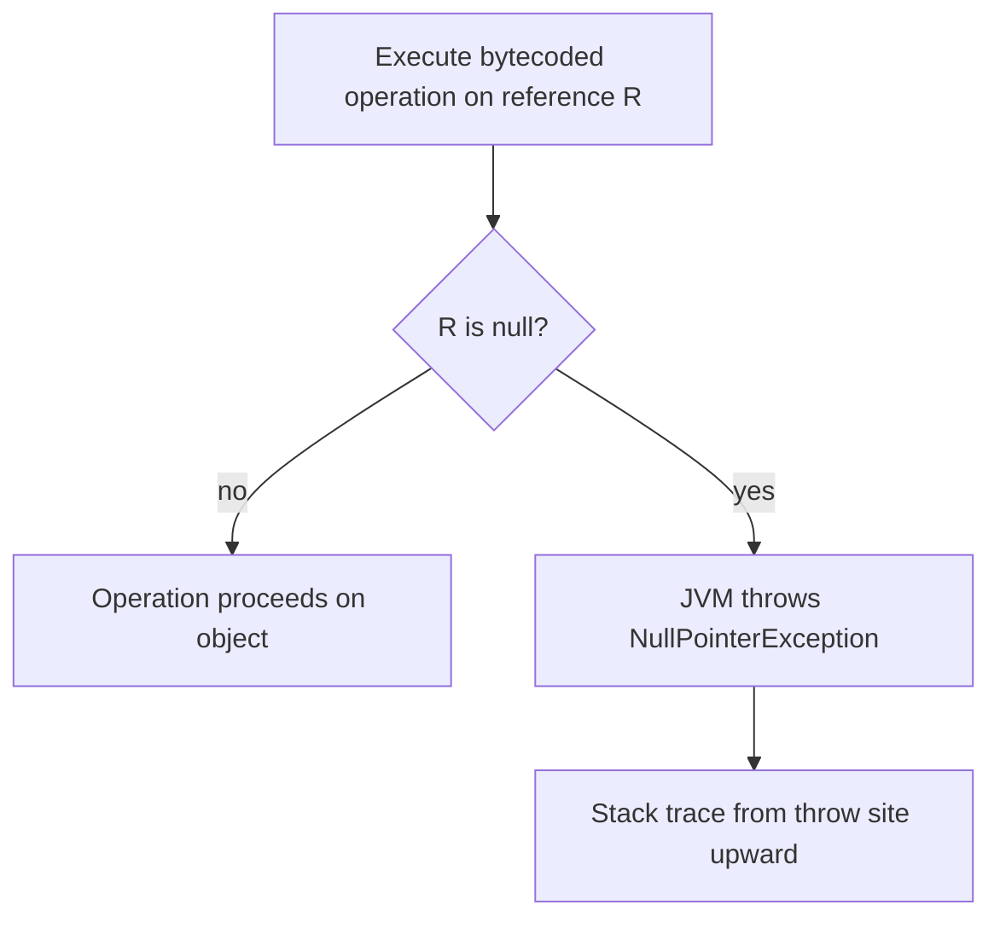

# Null and NullPointerException

> **Status:** Completed  
> **Module:** 18 — Optional and Null Handling  
> **Target Java version:** 21  
> **Last reviewed:** 2026-11-11  
> **Chapter profile:** Technical  
> **Depth target:** Levels 2–3 (null semantics, NPE site, defense patterns)  
> **Examples verified with:** Temurin JDK 21.0.12.1 (javac 21.0.12.1)

**Section policy:** Conditional sections omitted only when noted in the Review Checklist. Mechanism (Section 5) is mandatory for NPE throw flow.

## 1. Learning Objectives

After completing this chapter, you should be able to:

- Explain **null** as absence of an object reference in Java’s type system—not a value object of its own.
- Read **`NullPointerException` (NPE)** stack traces and locate the **dereference** site, including improved HotSpot messages (JEP 358).
- Apply **defensive checks**, **guard clauses**, and **null-safe defaults** at system boundaries.
- Contrast **null** with **empty** strings, **empty collections**, and **`Optional`** empty (Ch.02).
- Describe **null-hostile** vs **nullable** API design and when each is appropriate.

## 2. Prerequisites

- **Module 02** — references vs primitives; autoboxing and unboxing.
- **Module 14** — exceptions, checked vs unchecked, stack traces.

**Refresher — references:** A variable of reference type (e.g. `String s`) either points at an object on the heap or holds **null**. Primitives (`int`, `boolean`, …) are never null. **Autoboxing** wraps primitives in wrapper objects; unboxing a **null** `Integer` throws NPE at the unbox site, not at assignment.

## 3. Why This Concept Exists

**Tony Hoare’s “billion-dollar mistake”**: nullable references make “absent value” implicit in billions of lines of Java. Callers forget checks; failures surface far from the bug. Java keeps **null** for backward compatibility; modern APIs layer **`Optional`**, **`Objects.requireNonNull`**, and nullness annotations (`@Nullable`, JSpecify elsewhere) to document intent—but **null itself remains part of the language**.

Without disciplined handling, production systems see NPEs in maps, JDBC rows, JSON payloads, and chained getters. This chapter teaches recognition and defense; Ch.02–03 teach **`Optional`** as an explicit return type for optional *values*.

## 4. Conceptual Explanation

### 4.1 What null is

A **reference variable** holds either an address of an object or **null** (no object). The literal `null` is assignable to any reference type. Dereferencing null—calling a method, reading a field, or unboxing—throws **NPE** at the point of use:

```java
String missing = null;
missing.length(); // throws NullPointerException here
```

**Null is not a string**, not “empty,” and not a sentinel object. It means “no object selected.”

### 4.2 NPE is unchecked

`NullPointerException` extends `RuntimeException` (JLS). The compiler does not force handling. The JVM throws NPE when execution **uses** a null reference where an object is required—typically at `invokevirtual`, `invokeinterface`, field access, or `checkcast`.

### 4.3 Layers of defense

1. **Validate at boundaries** (HTTP parameters, message payloads, DB rows).
2. **Fail fast** with clear messages when null is illegal (`requireNonNull`, guard clauses).
3. **Return null** only when the contract documents it—or prefer **`Optional`** for new internal service APIs (Ch.02).
4. **Return empty collections** instead of null for “no items” (`List.of()`, `Collections.emptyList()`).

### 4.4 null vs empty

| | `null` | empty `""` | empty `List` |
|---|--------|------------|--------------|
| Meaning | no object / unknown | known zero-length text | known zero elements |
| `length()` / `size()` | NPE if null | 0 | 0 |
| Loop / iteration | must branch first | valid | valid (zero iterations) |

Callers often confuse “no list” (null) with “list with no elements.” Prefer empty collections so foreach and streams need no null branch.

## 5. Mechanism and Execution Flow

NPE is a **runtime check**, not a compile-time error. Separate **assignment** of null from **dereference**.

### 5.1 Assignment vs dereference

```java
String s = null;   // legal — no NPE
int n = s.length(); // NPE at length() invocation
```

Until the reference is *used*, null can flow through variables and parameters.

### 5.2 Throw flow (conceptual)



**HotSpot** (not a universal JVM law) implements null checks on many access bytecodes. **JEP 358** (Java 14+) can attach a **message** naming which variable was null when the JVM can determine it—e.g. `Cannot invoke "String.length()" because "missing" is null`.

### 5.3 Chained calls

```java
a.getB().getC();
```

If `a.getB()` returns null, NPE occurs inside `getB().getC()`—the stack trace names the line but not always *which* hop was null. Prefer locals or `Optional` chains (Ch.02) for clarity.

### 5.4 Auto-unboxing path

```java
Integer boxed = null;
int primitive = boxed; // NPE on unbox, not on assignment to Integer
```

## 6. Terminology

| Term | Meaning |
|------|---------|
| Dereference | Using `.`, `[]`, or method invocation on a reference |
| NPE | `NullPointerException` when a null reference is used |
| Guard clause | Early return or throw when preconditions fail (e.g. null input) |
| Nullable / null-hostile | API contract allowing vs rejecting null parameters or returns |

## 7. Syntax and Language Rules

- `== null` and `!= null` test reference identity with null.
- **`Objects.requireNonNull(ref, msg)`** throws NPE with message if `ref` is null (often used in constructors).
- **`Objects.requireNonNullElse(ref, default)`** returns default when null.
- Pattern matching `if (x instanceof String s)` — if `x` is **null**, the pattern does not match (no NPE from `instanceof` itself).

## 8. Step-by-Step Examples

Canonical demo: [null-npe-demo](../../examples/core-java/null-npe-demo/) (`NullNpeDemo.java`, default package).

Compile and run:

```bash
javac --release 21 NullNpeDemo.java
java NullNpeDemo
```

### 8.1 Minimal — null-safe default

```java
static String orDefault(String value, String fallback) {
    return value == null ? fallback : value;
}
```

**Verified output:** `safe=unknown` — `missing` is null; ternary never calls `length()` on null.

### 8.2 Realistic — caught NPE at dereference

```java
try {
    int len = missing.length();
} catch (NullPointerException ex) {
    System.out.println("npe=" + ex.getClass().getSimpleName());
}
```

**Verified output:** `npe=NullPointerException` — exception type is caught; message may include variable name on Temurin 21.

### 8.3 Advanced — sentinel at boundary

`displayName(null)` returns `"<anonymous>"` without throwing—**boundary conversion** before deeper logic.

**Full demo Verified output (Temurin 21.0.12.1):**

```text
safe=unknown
npe=NullPointerException
user=Ada
display=<anonymous>
```

`user=Ada` shows documented nullable return from `fetchUserName` when id is valid.

### 8.4 Incorrect vs correct equals

**Incorrect:**

```java
if (s.equals("admin")) { } // NPE if s is null
```

**Correct:**

```java
if ("admin".equals(s)) { }
// or
if (s != null && s.equals("admin")) { }
```

## 9. Real-World Use Cases

- **`Map.get`** returns null for missing keys (use `getOrDefault` or `containsKey` when distinguishing absent vs null value).
- JDBC **`ResultSet.getString`** may return null for SQL `NULL`.
- JSON **null** fields often deserialize to Java null—validate before dereference.

## 10. Internal Behavior

NPE is thrown by the **JVM** when a null reference is used in an operation that requires an object. **HotSpot** implements quick null checks; stack walk cost applies like any exception. Library code increasingly uses **`Objects.requireNonNull`** in constructors to fail at creation time rather than deep in call graphs.

Label: **JVMS / HotSpot** — helpful NPE messages are implementation-enhanced (JEP 358), not a language guarantee on every JVM.

## 11. Edge Cases and Limitations

- **Auto-unboxing** null wrapper → NPE on unbox.
- **Chained getters** obscure which hop was null.
- **`Map` with null keys** — `HashMap` allows one null key; `ConcurrentHashMap` does not—API-specific.
- **`Optional.of(null)`** throws NPE immediately (Ch.02)—different from nullable reference.

## 12. Common Mistakes

### Incorrect — assume non-null after weak validation

```java
void process(User u) {
    // u might still be null if caller ignored contract
    u.getId();
}
```

### Corrected

```java
void process(User u) {
    Objects.requireNonNull(u, "user");
    u.getId();
}
```

## 13. Best Practices

- Document nullable returns and parameters in Javadoc.
- Prefer **empty collections** over null for “no items.”
- Use **constant-left** `equals` for nullable strings.
- Validate at **system boundaries** once; avoid redundant null checks on every internal call unless contracts differ.

## 14. Design Trade-offs

| Approach | Pros | Cons |
|----------|------|------|
| Nullable return | Lightweight, familiar | Easy to forget checks |
| `Optional` return | Explicit absence in type | Small allocation; not for fields (Ch.03) |
| Exception | Illegal state, not mere absence | Heavy for expected cases |

## 15. Performance Considerations

Null checks (`== null`) are cheap. Avoid sprinkling redundant checks in hot inner loops when outer layers already enforce invariants.

## 16. Security Considerations

Security gates that assume a non-null principal or token after a single check may skip authorization if a path passes null. Validate identity objects at entry.

## 17. Java Version and Compatibility Notes

- **JEP 358** — improved NPE messages (Java 14+, **HotSpot**).
- Null semantics unchanged in Java 21.

## 18. Related Language Comparisons

Kotlin `String?` enforces nullability at compile time. Java relies on annotations, discipline, and **`Optional`** for returns—not language-enforced null safety.

## 19. Revision and Mastery

- Why does `display=<anonymous>` print instead of throwing?
- How is a null list different from `List.of()` for a caller’s foreach?
- Where does unboxing NPE occur vs null assignment?
- What does JEP 358 add to stack traces on HotSpot?

## 20. Exercises

### Beginner

Predict each line of `NullNpeDemo` output before running.

### Intermediate

Rewrite a three-level `getA().getB().getC()` chain using locals and null guards.

### Advanced

Design a REST DTO boundary: which fields are nullable vs empty collection, and how do you enforce it in constructors?

## 21. Interview Questions

1. Can primitives be null?
2. Why is NPE unchecked?
3. Explain the “Yoda” equals pattern.

## 22. Solutions

1. **Concept:** Ternary avoids dereference; NPE only on explicit `length()`; `fetchUserName(42)` returns non-null; `displayName` maps null to sentinel. **Output:** see §8.3 Verified block.
2. **Steps:** `var b = a.getB(); if (b == null) return optionalEmpty; var c = b.getC();` — fail at first missing hop. **Why:** local names appear in stack traces and debugging.
3. **Trade-off:** Validation annotations + `requireNonNull` at build time vs runtime-only checks.

## 23. Chapter Summary

**Null** means no object; **NPE** strikes at **dereference**, not at storing null. Guard at boundaries, prefer empty over null collections, use safe equals and `requireNonNull` where contracts demand non-null. The demo shows defaulting, a caught NPE, nullable lookup, and display sentinel mapping.

## 24. Key Terminology

null · NPE · guard clause · dereference · empty collection

## 25. References and Further Reading

- [JLS 11.2 — Exception Types](https://docs.oracle.com/javase/specs/jls/se21/html/jls-11.html)
- [JEP 358: Helpful NullPointerExceptions](https://openjdk.org/jeps/358)
- [`Objects` (Java 21)](https://docs.oracle.com/en/java/javase/21/docs/api/java.base/java/util/Objects.html)

## 26. Next Steps

- [02-optional-api.md](02-optional-api.md) — explicit optional values in return types.

## Supplement — NPE diagnostics and boundary patterns (Level 3 depth)

### Reading stack traces (HotSpot / Temurin 21)

1. Find the **topmost frame in your code** (not `java.base` internals).
2. Note the **line number**—that is the dereference site, not where null was assigned.
3. On Java 14+ (**HotSpot**), read the **exception message** for `because "x" is null` when available.

Example message shape (Illustrative wording):

```text
Cannot invoke "String.length()" because "missing" is null
```

### Map APIs and null

| API | Missing key behavior |
|-----|---------------------|
| `map.get(k)` | returns `null` (ambiguous if null is stored value) |
| `map.getOrDefault(k, d)` | returns default when no mapping |
| `map.computeIfAbsent(k, f)` | atomically computes if absent |

`ConcurrentHashMap` does not allow `null` keys or values—**NPE** on attempt.

### JDBC and external null

`ResultSet.getString(i)` returns Java `null` for SQL `NULL`. Pattern at boundary:

```java
String raw = rs.getString("nickname");
String nickname = raw == null ? "" : raw.strip();
```

Prefer converting once before domain logic—do not pass JDBC null deep into graphs.

### Collections contract

**Never** return `null` for “no results” from a method typed as `List<T>` when callers iterate—return `List.of()` or `Collections.emptyList()`. Callers then write:

```java
for (var item : service.itemsFor(user)) { ... }
```

without a null guard.

## Review Checklist

**Mandatory Depth Review:** Level 2–3 for Technical profile — null meaning, NPE mechanism, defense patterns.

- [x] Learning objectives covered
- [x] Prerequisites identified and briefly refreshed
- [x] Chapter profile **Technical** and depth target **Levels 2–3** recorded
- [x] Depth gate passed (definitions, progressive examples, mistakes, trade-offs)
- [x] Mandatory Depth Review (Levels 1–4) passed for this topic
- [x] Mechanism and execution flow (Section 5) with mermaid throw flow
- [x] First-appearance concepts explained (Optional preview linked, not deferred)
- [x] Terminology defined before use
- [x] Demo **Verified** on Temurin 21.0.12.1; incorrect-equals **Illustrative**
- [x] Spec vs implementation labeled (JEP 358 HotSpot)
- [x] Solutions explain reasoning
- [x] Revision and Mastery present
- [x] Standalone readability with prerequisite refreshers

**Omissions (section → reason):**

- **Language comparisons** — brief Kotlin note only; appendix holds detail.
- **Advanced in-chapter third-party JSON** — deferred to web modules; null-on-wire noted in use cases.
