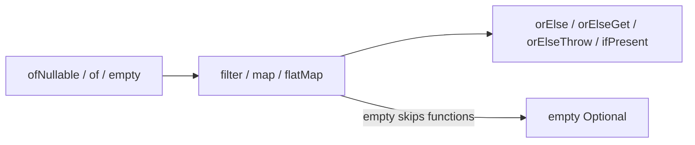

# Optional API

> **Status:** Completed  
> **Module:** 18 — Optional and Null Handling  
> **Target Java version:** 21  
> **Last reviewed:** 2026-11-11  
> **Chapter profile:** Technical  
> **Depth target:** Level 3 (`Optional` factories, map/flatMap, defaults, stream integration)  
> **Examples verified with:** Temurin JDK 21.0.12.1 (javac 21.0.12.1)

## 1. Learning Objectives

After completing this chapter, you should be able to:

- Create **`Optional`** instances with `of`, `ofNullable`, and `empty` and explain when each throws or accepts null.
- Transform values with **`map`**, **`flatMap`**, and **`filter`** without nested null checks.
- Provide defaults with **`orElse`**, **`orElseGet`**, **`or`**, and **`orElseThrow`**—knowing eager vs lazy evaluation.
- Avoid **`get()`** without a presence guarantee.
- Integrate Optional with **streams** via `optional.stream()` (Java 9+).

## 2. Prerequisites

- **Ch.01** — null, NPE, guard patterns.
- **Module 16** — `Supplier`, method references.

**Refresher — `Supplier<T>`:** A functional interface `get()` that produces a value when called. **`orElseGet(Supplier)`** calls the supplier only when the Optional is empty—unlike **`orElse(value)`**, which always evaluates the alternative expression.

## 3. Why This Concept Exists

Nested `if (x != null) { y = x.getY(); ... }` obscures business logic. **`Optional<T>`** (Java 8+) models an **optional single reference**—zero or one non-null value—with a small fluent API. The **type of the return** signals absence to callers more clearly than undocumented null, without changing Java’s nullable reference rules.

Optional is a **library container**, not language null safety. It composes with streams and lambdas from Module 16–17.

## 4. Conceptual Explanation

### 4.1 Creation rules

| Factory | When to use |
|---------|-------------|
| `Optional.of(v)` | `v` is **known non-null**; throws NPE if `v` is null |
| `Optional.ofNullable(v)` | `v` may be null → `empty()` |
| `Optional.empty()` | Explicit absence (singleton) |

Never return a **null Optional reference** from your methods—return `Optional.empty()`.

### 4.2 Presence queries

- `isPresent()` / `isEmpty()` (Java 11+) — imperative style.
- Prefer **`ifPresent`**, **`map`**, **`orElse*`** over `isPresent()` + `get()`.

### 4.3 map vs flatMap

```java
optional.map(String::trim)        // Optional<String>
optional.flatMap(this::lookup)    // lookup returns Optional<T>
```

**`map`** wraps the function result in `Optional`. If the function returns `Optional<U>`, you get `Optional<Optional<U>>`—use **`flatMap`** to flatten.

### 4.4 Defaults — eager vs lazy

- **`orElse(x)`** — evaluates `x` **always** (even when present).
- **`orElseGet(Supplier)`** — calls supplier **only when empty**.
- **`or(Supplier<Optional<T>>)`** (Java 9+) — alternative Optional without unwrapping early.
- **`orElseThrow()`** — empty → `NoSuchElementException`; overload with `Supplier` for custom exceptions.

### 4.5 Primitive specializations

`OptionalInt`, `OptionalLong`, `OptionalDouble` avoid boxing for primitives—prefer in numeric pipelines.

## 5. Mechanism and Execution Flow

Optional operations form a **short-circuit pipeline** over zero or one value.

### 5.1 Pipeline diagram



- **`map` / `flatMap` on empty:** function not called; stays empty.
- **`filter` on empty:** stays empty.
- **`orElseGet` on present:** supplier not called.

### 5.2 `findLength` from demo (conceptual trace)

Input `"  hi  "` → `ofNullable` present → `map(String::trim)` → `filter` non-blank → `map(String::length)` → `orElse("0")` → **`len=2`**.

If input were `null` or blank after trim, chain short-circuits to `orElse("0")`.

### 5.3 Stream integration

```java
optional.stream().forEach(System.out::println); // zero or one element
Stream<Optional<T>> opts = ...;
opts.flatMap(Optional::stream); // drop empties, unwrap values
```

## 6. Terminology

| Term | Meaning |
|------|---------|
| Optional | `final` container for zero or one **non-null** reference |
| Empty Optional | Absent value; singleton `Optional.empty()` |
| NoSuchElementException | Thrown by `get()` on empty Optional |

## 7. Syntax and Language Rules

- `Optional` is **final**; cannot represent multiple values or primitives without `OptionalInt` etc.
- **`Optional` is not intended** for fields or method parameters (Ch.03)—returns only.
- Serialization is supported but rarely appropriate for domain models.

## 8. Step-by-Step Examples

Demo: [optional-api-demo](../../examples/core-java/optional-api-demo/).

```bash
javac --release 21 OptionalApiDemo.java
java OptionalApiDemo
```

### 8.1 Minimal — creation and `isEmpty`

**Verified:** `present=Ada`, `emptyIsEmpty=true`, `nullableEmpty=true`.

### 8.2 Realistic — `map` and lazy default

**Verified:** `upper=ADA` from present value; `fromEmpty=fallback` uses `flatMap` on empty then **`or`** supplies fallback Optional.

### 8.3 Advanced — multi-step string pipeline

**Verified:** `len=2` for `"  hi  "` after trim, non-blank filter, length map.

**Full Verified output (Temurin 21.0.12.1):**

```text
present=Ada
emptyIsEmpty=true
nullableEmpty=true
upper=ADA
fromEmpty=fallback
len=2
```

### 8.4 Incorrect — expensive `orElse`

```java
opt.orElse(expensive()); // expensive() runs even when present
opt.orElseGet(this::expensive); // lazy
```

## 9. Real-World Use Cases

- Repository **`findById`** → `Optional<Entity>`.
- Config property lookup when absence is normal.
- Stream terminals: `findFirst`, `max`, `min` return Optional.

## 10. Internal Behavior

`Optional` stores a private `@Nullable` value field; `empty` is a shared singleton. **map**/`flatMap` allocate new Optional instances when non-empty—acceptable at boundaries, not in innermost nanosecond loops.

## 11. Edge Cases and Limitations

- **`of(null)`** throws NPE at creation.
- Optional does not replace **null on the wire** (JSON) without explicit mapping.
- **`get()` without check** throws `NoSuchElementException`—cousin of NPE confusion.
- Two **empty** Optionals are equal regardless of prior type parameter erasure path.

## 12. Common Mistakes

### Incorrect

```java
if (opt.isPresent()) {
    return opt.get();
} // verbose; race in concurrent updates of underlying data
```

### Corrected

```java
return opt.orElse(defaultValue);
// or
return opt.orElseThrow(() -> new NotFoundException(id));
```

## 13. Best Practices

- Return Optional when **absence is part of the happy path**.
- Chain **map** / **filter** / **flatMap** instead of nested null checks.
- Never return **null** instead of `Optional.empty()`.

## 14. Design Trade-offs

| Choice | Benefit | Cost |
|--------|---------|------|
| Optional return | Self-documenting, composable | Allocation per call |
| Nullable return | Less ceremony in hot internals | Implicit contract |

## 15. Performance Considerations

Optional allocates a small object. For tight primitive loops use **`OptionalInt`** or sentinels. Profile before banning Optional org-wide.

## 16. Security Considerations

`orElseThrow` messages surfaced to HTTP clients must not leak internal paths or IDs beyond policy.

## 17. Java Version and Compatibility Notes

- `isEmpty`, `or`, `stream` — Java 9 / 11.
- Stable **final** API in Java 21.

## 18. Related Language Comparisons

Guava `Optional` predates the JDK type; prefer **`java.util.Optional`** in new code—interoperate carefully at library boundaries.

## 19. Revision and Mastery

- Why is `len=2` for `"  hi  "`?
- When does `orElse` evaluate its argument vs `orElseGet`?
- `map` vs `flatMap` when lookup returns Optional?
- How does `Optional.stream()` behave on empty?

## 20. Exercises

### Beginner

Predict all `OptionalApiDemo` lines.

### Intermediate

Rewrite three nested null checks as one `flatMap` chain.

### Advanced

Convert `List<String>` of nullable IDs to `List<User>` using `map` + `Optional` + `flatMap(Optional::stream)`.

## 21. Interview Questions

1. `of` vs `ofNullable`?
2. `map` vs `flatMap` on Optional?
3. Is Optional serializable—and should you?

## 22. Solutions

1. See §8.3 Verified block—trace each factory and chain step.
2. Each step returns `Optional`; `flatMap` prevents nested Optional.
3. Serializable yes; domain fields should still avoid Optional (Ch.03).

## 23. Chapter Summary

**Optional** makes absence explicit and chains transforms safely. Use lazy defaults (`orElseGet`, `or`), avoid `get()`, prefer `flatMap` for nested Optional. The demo covers creation, mapping, `or`, and a trim/filter/length pipeline.

## 24. Key Terminology

Optional · ofNullable · flatMap · orElseGet · or · empty

## 25. References and Further Reading

- [`Optional` (Java 21)](https://docs.oracle.com/en/java/javase/21/docs/api/java.base/java/util/Optional.html)
- [`OptionalInt`](https://docs.oracle.com/en/java/javase/21/docs/api/java.base/java/util/OptionalInt.html)

## 26. Next Steps

- [03-optional-design-and-misuse.md](03-optional-design-and-misuse.md)

## Supplement — Chaining patterns and stream flat-mapping (Level 3 depth)

### Three-level null check vs Optional chain

**Imperative (fragile):**

```java
User u = findUser(id);
if (u != null) {
    Address a = u.getAddress();
    if (a != null) {
        String zip = a.getZip();
        if (zip != null) {
            return zip;
        }
    }
}
return "00000";
```

**Optional chain (same semantics, clearer data flow):**

```java
return findUser(id)
    .map(User::getAddress)
    .map(Address::getZip)
    .filter(z -> !z.isBlank())
    .orElse("00000");
```

If any step yields null **inside** a method that returns nullable types, insert **`flatMap`** when the step itself returns `Optional`:

```java
return findUser(id)
    .flatMap(User::lookupVerifiedAddress) // Optional<Address>
    .map(Address::getZip)
    .orElse("00000");
```

### Terminal operations table (Java 21)

| Method | Empty behavior | Present behavior |
|--------|----------------|------------------|
| `get()` | `NoSuchElementException` | returns value |
| `orElse(x)` | returns `x` | returns value; **evaluates x always** |
| `orElseGet(s)` | calls `s.get()` | returns value; supplier skipped |
| `orElseThrow()` | `NoSuchElementException` | returns value |
| `ifPresent(c)` | no-op | calls consumer |
| `stream()` | empty `Stream` | single-element stream |

### Collecting many Optionals

When transforming `List<String>` ids to present users only:

```java
List<User> found = ids.stream()
    .map(this::findUser)           // Stream<Optional<User>>
    .flatMap(Optional::stream)     // drops empty
    .toList();
```

**Why `Optional::stream`:** Java 9+ method reference avoids manual `filter(Optional::isPresent)` + `map(Optional::get)`.

### Teaching trace — why `fromEmpty=fallback` in the demo

1. Start from `Optional.empty()`.
2. `flatMap` on empty does not call the mapping function → still empty.
3. `or(() -> Optional.of("fallback"))` runs the supplier because current value is empty.
4. Second Optional is present → result `fallback`.

If the chain had started **present**, step 3 would return the present value without calling the supplier inside `or`'s alternative path for the primary present case.

### `ifPresentOrElse` (Java 9+)

```java
opt.ifPresentOrElse(
    v -> System.out.println("found " + v),
    () -> System.out.println("missing"));
```

Use when both branches need side effects—prefer expression forms (`map`/`orElse`) when producing values.

### Optional in streams from `Stream` terminals

`Stream.findFirst()` returns `Optional<T>`—already integrated with Module 17. Chaining:

```java
names.stream()
    .filter(s -> s.startsWith("A"))
    .findFirst()
    .map(String::toUpperCase)
    .orElse("NONE");
```

### Null inside Optional is impossible by contract

`Optional` contents are **non-null** when present; `ofNullable(null)` yields **empty**, not “present null.” This differs from some other languages’ option types—do not expect tri-state null wrapping.

## Review Checklist

**Mandatory Depth Review:** Level 3 for Technical profile — factories, short-circuit map chain, lazy defaults.

- [x] Learning objectives covered
- [x] Chapter profile **Technical**, depth **Level 3**
- [x] Mechanism and execution flow (Section 5) with pipeline diagram
- [x] Demo **Verified** Temurin 21.0.12.1
- [x] Eager vs lazy `orElse` explained with incorrect variation
- [x] Revision and Mastery present
- [x] Solutions with reasoning

**Omissions (section → reason):**

- **Performance micro-benchmarks** — qualitative guidance only; not characteristic of all workloads.
