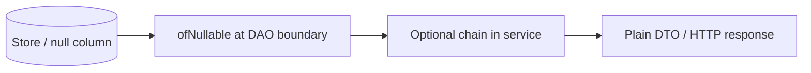

# Optional Design and Misuse

> **Status:** Completed  
> **Module:** 18 — Optional and Null Handling  
> **Target Java version:** 21  
> **Last reviewed:** 2026-11-11  
> **Chapter profile:** Technical  
> **Depth target:** Level 3 (intended use, anti-patterns, boundaries, Optional vs exceptions)  
> **Examples verified with:** Temurin JDK 21.0.12.1 (javac 21.0.12.1)

## 1. Learning Objectives

After completing this chapter, you should be able to:

- Apply JDK guidance: Optional is for **return types**, not fields or parameters.
- Model **repository lookups** and parsers with Optional without ceremony at call sites.
- Spot anti-patterns: blind `get()`, `Optional` in DTOs/JSON, `List<Optional<T>>`, returning null Optional.
- Combine Optional with **streams** and choose **exceptions** vs empty Optional at boundaries.
- Decide among Optional, exceptions, and sentinel null for HTTP and persistence layers.

## 2. Prerequisites

- **Ch.01–02** — null, Optional API.

**Refresher — return-only Optional:** The type documents “result may be missing” once at the method boundary. Callers convert to plain values, DTOs, or HTTP status codes immediately—Optional should not leak across every layer.

## 3. Why This Concept Exists

Misused Optional adds **allocation** and **confusion** without clarity—`void save(Optional<String> nick)` forces callers to wrap values. Brian Goetz and the `Optional` JavaDoc stress **semantic returns**, not a second null. Clear rules keep Optional a tool for **expected absence**, not a wholesale null replacement.

## 4. Conceptual Explanation

### 4.1 Intended uses

- **Return type** when absence is normal (`findByEmail`, `parseVersion`).
- **Service-layer chaining** with `map` / `flatMap`.
- **Stream pipelines** via `Optional::stream`.

### 4.2 Discouraged uses

| Anti-pattern | Why |
|--------------|-----|
| Field `Optional<String> middleName` | Serialization, equals, JPA awkward |
| Parameter `void save(Optional<String> nick)` | Caller wraps; use nullable + doc or overloads |
| `List<Optional<T>>` | Use flat list or separate queries |
| `optional.get()` without check | `NoSuchElementException` |
| Returning **null** `Optional` | Return `empty()` |

### 4.3 Repository pattern

```java
Optional<String> findUserName(int id) {
    return Optional.ofNullable(users.get(id));
}
```

Callers: `orElse("unknown")` for UI default—**Verified:** `missing=unknown`.

### 4.4 JSON / REST

Jackson/Gson may serialize Optional as nested object unless configured—usually map absent as **omit field** or JSON `null`, not `{ "present": true }`.

### 4.5 Exceptions vs Optional

| Signal | Mechanism |
|--------|-----------|
| Expected absence | `Optional.empty()` |
| Unexpected failure / invariant broken | Exception |
| Validation error | Exception or result type (Module 07 patterns) |

**404 vs empty:** HTTP “not found” is often a **resource** concern—empty Optional in DAO, `orElseThrow(NotFoundException)` at controller—not Optional in JSON body.

## 5. Mechanism and Execution Flow

**Boundary conversion** keeps Optional inside the service/DAO shell.



1. Persistence may use **null** for absent columns (`ofNullable` once).
2. Service composes Optional operations.
3. Controller/web layer **unwraps** to primitives, DTOs, or status codes—Optional does not cross the wire.

## 6. Terminology

| Term | Meaning |
|------|---------|
| Anti-pattern | Optional use that fights the JDK design |
| Boundary conversion | Map Optional ↔ null/DTO once per layer |
| Sentinel | Magic value meaning missing (legacy null or -1) |

## 7. Syntax and Language Rules

- Methods should return **`Optional.empty()`**, never a null reference of type `Optional`.
- `Optional` in **records** as a component is still discouraged—use nullable field with documentation.

## 8. Step-by-Step Examples

Demo: [optional-design-demo](../../examples/core-java/optional-design-demo/).

```bash
javac --release 21 OptionalDesignDemo.java
java OptionalDesignDemo
```

### 8.1 Minimal — present lookup

**Verified:** `good=Ada` from map hit.

### 8.2 Realistic — default for absent id

**Verified:** `missing=unknown`.

### 8.3 Advanced — presence without `get()`

**Verified:** `hasUser1=true` via `isPresent` or stream-style check—prefer functional unwrap at real boundaries.

**Full Verified output (Temurin 21.0.12.1):**

```text
good=Ada
missing=unknown
hasUser1=true
```

## 9. Real-World Use Cases

- Spring Data **`findById`** → `Optional<Entity>`.
- Configuration optional keys.
- Parsing optional XML/JSON elements—convert to Optional at parse boundary, DTO without Optional inside.

## 10. Internal Behavior

Same storage model as Ch.02. **equals** on Optional compares wrapped values; two empties equal. **hashCode** suitable for use as map keys only when you accept Optional as key semantics (rare).

## 11. Edge Cases and Limitations

- Deep graphs of Optional wrappers increase GC pressure without clarity gain.
- **Reactive streams** (`Mono`) replace Optional at scale—different chapter.
- **serialization** of Optional fields breaks API evolution—avoid.

## 12. Common Mistakes

### Incorrect

```java
public void update(Optional<String> name) { ... }
```

### Corrected

```java
public void update(@Nullable String name) { ... } // documented
public void updateIfPresent(Consumer<String> c) { findName().ifPresent(c); }
```

## 13. Best Practices

- Optional **only where absence is happy path**.
- Convert once at boundaries.
- Test **empty** and **present** branches explicitly.
- Use **`orElseThrow`** with domain exception at API edge.

## 14. Design Trade-offs

| Boundary | Nullable | Optional return |
|----------|----------|------------------|
| Public HTTP DTO | common | rare |
| Internal service | either | Optional OK |
| SQL column | null | `ofNullable` at DAO |

## 15. Performance Considerations

High-frequency internal calls: nullable faster. Optional at **DAO/repository** boundary is typical compromise.

## 16. Security Considerations

Do not use empty Optional to hide **authorization** failures—use explicit 403/404 policy.

## 17. Java Version and Compatibility Notes

Guidance unchanged in Java 21; `Optional` remains return-oriented in official documentation.

## 18. Related Language Comparisons

Rust `Option<T>` is language-enforced; Haskell `Maybe`; Java Optional is **library-level only**.

## 19. Revision and Mastery

- Why not Optional fields?
- When does exception beat empty Optional?
- How should Jackson map absent JSON fields?
- Why avoid `List<Optional<T>>`?

## 20. Exercises

### Beginner

Predict `OptionalDesignDemo` output.

### Intermediate

Refactor `get()` to `orElseThrow` with meaningful supplier message.

### Advanced

Sketch three-layer architecture showing where Optional appears and where DTOs strip it.

## 21. Interview Questions

1. Optional as method parameter—opinion grounded in JDK guidance?
2. `of` vs `ofNullable` for DB column?
3. Serialize Optional to JSON—risks?

## 22. Solutions

1. **Concept:** Parameters force wrapper creation; returns document absence once. **Why:** JDK designers optimized for call-site ergonomics on returns.
2. **ofNullable** — SQL NULL maps to null reference before wrap.
3. **Risk:** Non-portable JSON shape; configure mapper or use plain nullable DTO fields.

## 23. Chapter Summary

Use **Optional** to announce **optional results**, not every null. Avoid fields, parameters, and lists of Optionals. Convert at boundaries; demo shows repository lookup defaults.

## 24. Key Terminology

Anti-pattern · repository lookup · boundary conversion · return-only Optional

## 25. References and Further Reading

- [`Optional` usage notes (Java 21)](https://docs.oracle.com/en/java/javase/21/docs/api/java.base/java/util/Optional.html)

## 26. Next Steps

- **Module 19** — [Modern Java features](../19-modern-java-features/)

## Supplement — Layering and testing Optional-based services (Level 3 depth)

### Controller → service → DAO layering

| Layer | Nullable / Optional policy |
|-------|---------------------------|
| DAO | SQL `NULL` → `Optional.ofNullable` at repository boundary only |
| Service | Optional chains; business rules as `filter` / `flatMap` |
| Controller / REST | Unwrap to HTTP: `orElseThrow(NotFound)` → 404; **no Optional in JSON body** |
| DTO | Plain fields; document null for optional JSON properties |

Anti-pattern: propagating `Optional<String>` through five layers—unwrap once per boundary.

### Spring Data mental model (framework, not JLS)

**Framework behavior:** `CrudRepository.findById` returns `Optional<Entity>`. This matches the JDK return-only guidance. **Do not** treat Spring’s choice as license for Optional **fields** on JPA entities—ORM providers map columns to null, not `Optional` wrappers.

### Testing matrix

For each repository-style method, test at minimum:

1. **Present path** — key exists (`good=Ada`).
2. **Absent path** — key missing (`missing=unknown` with default).
3. **Illegal state** — if empty should be impossible after validation, assert `orElseThrow` with domain exception (separate test).

### Code review checklist (team)

- [ ] No `Optional` parameters on public APIs without exceptional justification
- [ ] No `optional.get()` in production code
- [ ] No returning `null` instead of `Optional.empty()`
- [ ] Expensive defaults use `orElseGet`, not `orElse`
- [ ] REST layer converts Optional to status/body explicitly

### When to keep nullable returns internally

Hot inner paths between trusted modules may use **documented null** with `requireNonNull` on entry to avoid allocation. Optional shines at **module boundaries** where absence is common and discoverability matters.

### HTTP status mapping patterns

| Domain meaning | Optional in service | HTTP |
|----------------|---------------------|------|
| Resource absent (expected) | `empty()` | 404 with body policy |
| Resource forbidden | empty vs exception | 403 — use exception, not empty Optional masking auth |
| Success with payload | `of(dto)` | 200 |

Confusing 404 (not found) with 403 (forbidden) is a **design** error—Optional does not fix it.

### `Optional` and `equals` in DTOs

Do not put Optional in `equals`/`hashCode` for persisted entities—ORM and JSON serializers assume null or plain fields. Testing `equals` on accidentally included Optional fields is painful and non-idiomatic.

### Library interop: Guava vs JDK

Legacy Guava `Optional` is a **different type**—convert at boundaries:

```java
return GuavaAdapter.fromGuava(guavaOpt); // to java.util.Optional
```

New Java code should emit JDK Optional only.

### Documentation strings

In Javadoc for nullable returns, prefer:

```text
@return user name, or empty if id unknown
```

for Optional returns—not `@return null` (never return null Optional reference).

### Extended exercise solution sketch

**Refactor `get()`:** Replace with `orElseThrow(() -> new NoSuchElementException("id=" + id))` only when absence is **bug**; use `orElse`/`orElseGet` when absence is **valid**—semantics differ from blind `get()`.

### Team style guide snippet (copy/adapt)

```text
1. Return Optional only from methods where empty is valid.
2. Never use Optional parameters on public APIs.
3. No Optional fields on entities or DTOs.
4. Unwrap at controller/gateway with explicit HTTP/status mapping.
5. Ban optional.get() in static analysis / review checklist.
```

### Serialization and JPA (framework)

Persisted entities use **null** for absent columns—JPA providers do not map `Optional` attributes idiomatically. Optional belongs **above** persistence layer in service returns, not on `@Entity` fields.

### Metrics and logging

Logging `Optional.toString()` yields `Optional[value]` or `Optional.empty`—acceptable in debug. Avoid logging `get()` without check. For metrics, count empty vs present at business boundary, not inside tight loops allocating Optional.

### Parallel streams + Optional

`findAny` returns Optional—parallel streams may return different present elements across runs; document nondeterminism when using for side effects (Module 17 parallel pitfalls).

### Full module 18 synthesis

| Ch | Focus |
|----|--------|
| 01 | null, NPE, guards |
| 02 | Optional API mechanics |
| 03 | Where Optional belongs in architecture |

Assessment tests cross-chapter judgment—not API memorization alone.

### Additional interview scenarios

**Q:** `Map.get` returns null—wrap in Optional? **A:** `Optional.ofNullable(map.get(k))` at boundary OK; do not change `Map` to store Optional values.

**Q:** Kotlin interop? **A:** Kotlin platform types may be nullable at boundary—convert once entering Java Optional layer.

## Review Checklist

**Mandatory Depth Review:** Level 3 — misuse table, boundary flow, exception contrast.

- [x] Chapter profile **Technical**, depth **Level 3**
- [x] Mechanism boundary diagram (Section 5)
- [x] Demo **Verified** Temurin 21.0.12.1
- [x] Misuse patterns with corrections
- [x] Revision and Mastery + solutions with reasoning

**Omissions (section → reason):**

- **Jackson configuration recipes** — noted; web modules own mapper setup (PROGRESS outstanding item).
