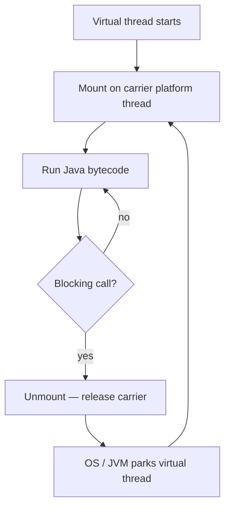

# Java 21 Feature Tour

> **Status:** Completed  
> **Module:** 19 — Modern Java Features  
> **Target Java version:** 21  
> **Last reviewed:** 2026-11-11  
> **Chapter profile:** Technical  
> **Depth target:** Level 3 (LTS feature map, virtual threads concept, pattern matching, sequenced collections)  
> **Examples verified with:** Temurin JDK 21.0.12.1 (javac 21.0.12.1)

## 1. Learning Objectives

After completing this chapter, you should be able to:

- Name major **Java 21 LTS** language and library features the handbook builds on.
- Run code using **virtual threads**, **sequenced collections**, **record patterns**, and **switch expressions**.
- Relate Java 21 features to earlier modules (records, pattern matching, concurrency).
- Decide when a feature is **production-default** on Java 21 versus **preview/incubator** (Ch.03).

## 2. Prerequisites

- Modules **03**, **15** — pattern matching fundamentals, records, sealed types.
- Module **16+** — lambdas and streams (for comparing thread models).
- [appendix/java-version-history.md](../appendix/java-version-history.md) — LTS cadence.

**Refresher — records:** Compact data carriers with canonical constructor and accessors `name()`. **Record patterns** (this chapter) destructure a record’s components in `instanceof` and `switch`—they require a **record** type (or nested patterns in later releases).

## 3. Why This Concept Exists

Java 21 is the handbook’s **primary LTS**. Teams standardizing on 21 need a map of what changed since 17/11—not every JEP, but what appears in new codebases: lighter concurrency, richer pattern matching, collection API cleanup, and stable syntax from the 17→21 pipeline.

## 4. Conceptual Explanation

### 4.1 Virtual threads (JEP 444 — final in 21)

**Platform threads** map ~1:1 to OS threads; creating millions is costly. **Virtual threads** are JVM-managed; blocking I/O **parks** the virtual thread so the **carrier** platform thread can run other work. API entry: `Executors.newVirtualThreadPerTaskExecutor()`.

Virtual threads optimize **many blocking tasks**, not CPU-bound parallelism—compute still needs pools sized to cores or fork/join (Module 24).

### 4.2 Sequenced collections (JEP 431)

`SequencedCollection`, `SequencedSet`, `SequencedMap` unify **first/last** and **reversed** views. `List` gains `getFirst()`, `getLast()`, `addFirst()`, `addLast()` with consistent semantics vs `get(0)` on empty lists.

### 4.3 Record patterns (JEP 440)

```java
if (o instanceof Point(int x, int y)) {
    // x, y in scope
}
```

Deconstructs record components after type test—pairs with records from Module 15.

### 4.4 Pattern matching for `switch` (JEP 441)

`switch` supports type patterns, guards, and **switch expressions** (`->`) that yield values. Exhaustiveness checking applies to expression forms.

### 4.5 Other stable highlights on the 21 path

- **Text blocks** (since 15) for multi-line strings.
- **Foreign Function & Memory** — preview path in 21 (Ch.03).
- GC tuning (e.g. generational ZGC) — runtime flags, not syntax.

## 5. Mechanism and Execution Flow

### 5.1 Virtual thread mount/unmount (HotSpot)



**Pinning:** `synchronized` or native code on the virtual thread stack can **pin** the carrier—reduces scalability (Module 24 deepens). Label: **HotSpot** behavior; semantics of `Thread` API are JLS/library; scheduler details are implementation.

### 5.2 Record pattern matching (compile time)

The compiler desugars record patterns to accessor calls and local bindings—no runtime “pattern object.” Type test + destructure happen in one `instanceof` form (JLS rules).

### 5.3 Sequenced API

Operations delegate to list/deque internals; **empty list** `getFirst()` throws `NoSuchElementException`—distinct from index `0` on some legacy behaviors.

## 6. Terminology

| Term | Meaning |
|------|---------|
| LTS | Long-term support release (21 = handbook primary) |
| Virtual thread | Lightweight `Thread` scheduled by JVM, not OS 1:1 |
| Carrier thread | Platform thread running mounted virtual threads |
| Record pattern | Pattern that binds record components |
| Sequenced collection | Collection with defined encounter order and first/last API |

## 7. Syntax and Language Rules

- Virtual threads: `try (var ex = Executors.newVirtualThreadPerTaskExecutor()) { ex.submit(() -> ...); }`
- Record patterns require **record** receiver types (for this pattern form).
- Switch expressions use `->`; exhaustiveness required when expression-valued.

## 8. Step-by-Step Examples

Demo: [java21-features-demo](../../examples/core-java/java21-features-demo/).

```bash
javac --release 21 Java21FeaturesDemo.java
java Java21FeaturesDemo
```

### 8.1 Minimal — virtual thread task

**Verified:** `virtualThread=vt-ready`

### 8.2 Realistic — sequenced list

**Verified:** `sequenced=head/tail` from `addFirst` / `addLast`.

### 8.3 Advanced — record pattern + switch expression

**Verified:** `recordPattern=3+4=7`, `switchExpr=default`, `textBlockLines=2`.

**Full Verified output (Temurin 21.0.12.1):**

```text
virtualThread=vt-ready
sequenced=head/tail
recordPattern=3+4=7
switchExpr=default
textBlockLines=2
```

## 9. Real-World Use Cases

- HTTP services: one virtual thread per request with blocking JDBC/HTTP clients.
- Deques/lists: first/last without manual index math.
- Command dispatch: record patterns on sealed message types.

## 10. Internal Behavior

Virtual threads use **continuation-style** mounting on carriers (**HotSpot**). Record patterns are compiler desugaring. Do not cite carrier pools as JLS guarantees.

## 11. Edge Cases and Limitations

- **Pinning** on synchronized/native blocks.
- Record patterns on **non-record** types use type patterns (Module 03).
- Preview features (structured concurrency, FFM) need `--enable-preview` (Ch.03).

## 12. Common Mistakes

### Incorrect

Using virtual threads for CPU-saturated parallel compute expecting free linear speedup.

### Corrected

Virtual threads for **many blocking** tasks; size platform pools to cores for compute.

## 13. Best Practices

- Standardize **`--release 21`** in builds.
- Prefer **sequenced** APIs when intent is first/last element.
- Track **JEP status** when adopting post-21 syntax (Ch.02).

## 14. Design Trade-offs

Virtual threads simplify thread-per-task code but require review of **thread-local**, **synchronized**, and pool assumptions.

## 15. Performance Considerations

Millions of virtual threads feasible; millions of platform threads not. Measure pinning before production cutover.

## 16. Security Considerations

New APIs do not bypass module access; avoid preview APIs in high-assurance code until final.

## 17. Java Version and Compatibility Notes

| Feature | Introduced | Status in 21 |
|---------|------------|--------------|
| Virtual threads | 21 | Final |
| Sequenced collections | 21 | Final |
| Record patterns | 21 | Final |
| Pattern matching for switch | 21 | Final |
| Structured concurrency | 21 | Preview |

## 18. Related Language Comparisons

Go goroutines and Kotlin coroutines offer cheap tasks with different runtime models; Java virtual threads preserve **blocking** style.

## 19. Revision and Mastery

- Explain carrier pinning at a high level.
- When is `getFirst()` clearer than `get(0)`?
- Record **type** vs record **pattern**?
- Which Ch.03 features need preview flags on 21?

## 20. Exercises

### Beginner

List three Java 21 features you used in earlier modules.

### Intermediate

Extend demo with sealed `Shape` and exhaustive switch.

### Advanced

Compare virtual-thread executor vs fixed platform pool for 10k simulated blocking sleeps.

## 21. Interview Questions

What problem do virtual threads solve? What is a sequenced collection?

## 22. Solutions

Exercise 1: records (15), text blocks (03), pattern matching `instanceof` (03). Exercise 2–3: module assessment solutions; measure wall-clock and carrier utilization.

## 23. Chapter Summary

Java 21 LTS delivers **virtual threads**, **sequenced collections**, and mature **pattern matching**. Handbook targets this release; Ch.02–03 cover cadence after 21 and preview lifecycle.

## 24. Key Terminology

Virtual thread · carrier · sequenced collection · record pattern · switch expression · LTS

## 25. References and Further Reading

- [Oracle Java 21 release notes](https://www.oracle.com/java/technologies/javase/21-relnote-issues.html)
- [JEP 444](https://openjdk.org/jeps/444), [431](https://openjdk.org/jeps/431), [440](https://openjdk.org/jeps/440), [441](https://openjdk.org/jeps/441)

## 26. Next Steps

[02-features-after-java-21.md](02-features-after-java-21.md) · [03-preview-and-incubator-features.md](03-preview-and-incubator-features.md)

## Supplement — Feature-to-module map and adoption checklist (Level 3 depth)

### Where each feature is taught in depth

| Java 21 highlight | First introduced | Deeper module |
|-------------------|------------------|---------------|
| Records | Module 15 | Sealed hierarchies, serialization (21) |
| `instanceof` patterns | Module 03 | Record patterns here |
| Switch expressions | Module 03 | Exhaustive switch on sealed types |
| Text blocks | Module 03 / 11 | SQL, JSON, tests |
| Virtual threads | This chapter | Module 24 concurrency |
| Sequenced collections | This chapter | Module 12 lists/deques |
| Pattern matching `switch` | Module 03 + here | Domain dispatch patterns |

Use this table when revising: Ch.01 is the **map**, not the only lesson.

### Production adoption checklist (virtual threads)

1. Audit **`synchronized`** blocks on hot paths—measure pinning.
2. Review **`ThreadLocal`** usage—may not scale across millions of threads.
3. Keep platform pool for CPU work; virtual threads for blocking I/O.
4. Load-test with production drivers (JDBC, HTTP clients)—not micro-benchmarks only.
5. Confirm observability (thread dumps name virtual threads distinctly on 21).

### Record pattern exhaustiveness

When combining **sealed** hierarchy + record patterns + switch expression, the compiler can prove exhaustiveness—same design as Module 15 sealed exercises. Record pattern is **syntax** for destructuring after you already chose a record **type**.

### Demo output line-by-line (Verified)

| Line | Teaching point |
|------|----------------|
| `virtualThread=vt-ready` | Task completed on virtual thread executor |
| `sequenced=head/tail` | `addFirst` / `addLast` vs index arithmetic |
| `recordPattern=3+4=7` | Component binding `Point(int x,int y)` |
| `switchExpr=default` | Non-matching case arm in expression switch |
| `textBlockLines=2` | Multi-line literal line count |

### Virtual threads vs platform thread pool (decision table)

| Workload | Suggested model |
|----------|-----------------|
| 10k blocking HTTP/JDBC calls | Virtual thread per task |
| CPU-bound matrix math | `ForkJoinPool` / sized platform pool |
| Mixed | Split pipelines; do not run compute on virtual thread pool assuming magic speedup |

### Sequenced collections implementers (awareness)

`ArrayList`, `LinkedList`, `LinkedHashSet`, `LinkedHashMap`, deques—types with defined encounter order benefit from sequenced interfaces. **HashMap** has no stable iteration order for `getFirst()` semantics on map views—use `LinkedHashMap` when order matters.

### Pattern matching readability rule

Prefer record patterns when **type + destructure** happen together:

```java
if (expr instanceof Add(Point(int x), Point(int y))) { ... }
```

If only type test needed, plain `instanceof` may suffice—avoid pattern noise.

### Switch expression style

Arrow form avoids fall-through:

```java
String label = switch (n) {
    case 1 -> "one";
    case 2, 3 -> "two or three";
    default -> "other";
};
```

Colon form with `yield` still valid—team style guide should pick one for consistency.

### Language vs library feature labels

| Kind | Examples | Spec bucket |
|------|----------|-------------|
| Language | record patterns, switch patterns | JLS |
| Library | sequenced collections, virtual thread API | Java SE API |
| VM / preview | structured concurrency scopes | JEP + preview flags |

Label correctly in design docs—reviewers conflate language and library when blaming “compiler bug.”

### JEP reading practice (15 minutes)

Pick **JEP 444** (virtual threads): read **Summary**, **Motivation**, **API**, **Dependencies** sections only—enough to explain to a teammate why carriers exist. Repeat for **431** (sequenced collections) focusing on interface additions, not every implementer class.

### Text blocks reminder

Text blocks (since 15) reduce escaping in SQL and JSON fixtures—demo counts lines to prove string embedded newlines work—pair with `String.stripIndent` when leading whitespace control matters in tests.

### Generational GC (awareness only)

Java 21 continues GC evolution (ZGC, G1)—**flags** not **syntax**. Performance modules may discuss; feature tour only notes that JDK upgrades change defaults—retest after bumping feature release or LTS.

### Cross-links for revision

- Records/patterns: Modules 03, 15, 19 Ch.01
- Threads: Module 24 after virtual thread intro
- Collections first/last: Module 12 + 19 Ch.01

### Verified demo compile path

```bash
cd examples/core-java/java21-features-demo
javac --release 21 Java21FeaturesDemo.java
java Java21FeaturesDemo
```

No preview flags required for Ch.01 demo—all **final** features on 21.

## Review Checklist

**Mandatory Depth Review:** Level 3 — LTS map, virtual thread mechanism (labeled HotSpot), verified tour demo.

- [x] Chapter profile **Technical**, depth **Level 3**
- [x] Mechanism Section 5 (virtual thread flow + record compile model)
- [x] Demo **Verified** Temurin 21.0.12.1
- [x] Preview rows labeled
- [x] Revision and Mastery

**Omissions (section → reason):**

- **Carrier pinning operations detail** — PROGRESS points to Module 24 concurrency depth.
