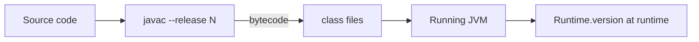

# Features After Java 21

> **Status:** Completed  
> **Module:** 19 — Modern Java Features  
> **Target Java version:** 21 (primary); awareness for 22–25+  
> **Last reviewed:** 2026-11-11  
> **Chapter profile:** Technical  
> **Depth target:** Levels 2–3 (release cadence, `Runtime.version()`, upgrade discipline)  
> **Examples verified with:** Temurin JDK 21.0.12.1 (javac 21.0.12.1)

## 1. Learning Objectives

- Read **`Runtime.version()`** and JDK **feature** numbers for upgrade planning.
- Distinguish **non-LTS feature releases** (22–24, 26…) from **LTS** anchors (21, 25, …).
- Adopt a checklist before using syntax from a newer release on an older deployment JDK.
- Explain why the handbook teaches **Java 21** as primary while documenting **awareness** of later releases.

## 2. Prerequisites

- Ch.01 Java 21 tour; [appendix/java-version-history.md](../appendix/java-version-history.md).

**Refresher — `--release`:** The compiler flag caps **language features and APIs** to a specific Java SE version. Source using Java 24 syntax **fails** on `--release 21` even if your IDE JDK is 24.

## 3. Why This Concept Exists

Production moves slower than OpenJDK’s six-month cadence. Developers read articles about Java 23 syntax but deploy on **21**. This chapter teaches **awareness without treating every feature release as curriculum default**—upgrade discipline prevents “works on my laptop” failures.

## 4. Conceptual Explanation

### 4.1 Release cadence

- **Feature release** every ~6 months (22, 23, 24, …).
- **LTS** releases (8, 11, 17, 21, **25**, …) with longer vendor support—typical enterprise anchor.

### 4.2 Handbook policy

**Primary path: Java 21.** Document **25 LTS** migration deltas when appendix history grows. Treat **22–24 / 26+** as “introduced in / status” notes—not required learning for certification path.

### 4.3 Representative themes after 21 (awareness only)

Verify on [OpenJDK JEPs](https://openjdk.org/jeps/0) before adoption:

| Area | Examples (check current JEP status) |
|------|--------------------------------------|
| Language tidy-ups | Unnamed variables (`_`), flexible constructor bodies |
| Libraries | Collections, concurrency API evolutions |
| Runtime | GC default shifts on newer LTS |
| Retired previews | Removed or promoted—blogs go stale |

Table is **orientation**, not exam vocabulary—status changes each release.

### 4.4 Upgrade discipline

1. Read **`java --version`** on laptop, CI, prod.
2. Align **Maven/Gradle `--release`** with lowest deployment JDK.
3. Run **tests** on target JDK before merging newer-only syntax.

## 5. Mechanism and Execution Flow

Two different “version” checks serve different jobs:



- **`javac --release`:** compile-time cap (build fails if source needs newer).
- **`Runtime.version()`:** reports **running** JVM feature/interim/update—smoke test that CI actually invoked the intended JDK.

No compile-time API detects “was I compiled with 21-only APIs” at runtime beyond `class file version` inspection tools.

## 6. Terminology

| Term | Meaning |
|------|---------|
| Feature number | `Runtime.version().feature()` — 21, 22, … |
| Interim / update | Vendor build components in `Runtime.version()` |
| Non-LTS | Shorter-supported feature release |
| LTS | Long-term supported anchor release |

## 7. Syntax and Language Rules

`Runtime.Version` (Java 9+):

```java
var v = Runtime.version();
int feature = v.feature();
```

Vendor strings (`Temurin`, `Oracle`, `Corretto`) vary; **feature** drives language level decisions.

## 8. Step-by-Step Examples

Demo: [features-after-21-demo](../../examples/core-java/features-after-21-demo/).

```bash
javac --release 21 FeaturesAfter21Demo.java
java FeaturesAfter21Demo
```

**Verified output (Temurin 21.0.12.1):**

```text
feature=21
interim=0
update=12
handbookPrimary=21-LTS
awareness=Document 22-24 non-LTS and 25-LTS in Module 19 Ch.02
upgradeCheck=java --version and Runtime.version() before adopting new syntax
```

On JDK 25, `feature=25` without recompile—useful forward-compat smoke test.

## 9. Real-World Use Cases

- CI matrix: mandatory 21, optional 25 job.
- Library **multi-release JARs** (`META-INF/versions/22/`).
- Code review: reject syntax above project `release`.

## 10. Internal Behavior

`Runtime.version()` parses the running JVM’s version string per API spec. **Compile-time** feature gating is entirely **`javac --release`** (and `source`/`target` legacy flags).

## 11. Edge Cases and Limitations

- EA builds may show unusual interim/update.
- Containers lag LTS—verify image tags, not only pom.xml.
- Vendor **backport** patches may differ while feature stays 21.

## 12. Common Mistakes

### Incorrect

Paste Java 24 snippet into `--release 21` project without JEP check.

### Corrected

Document JEP id, `introduced in`, `status`; gate CI on correct release.

## 13. Best Practices

- Pin JDK in **CI / Docker / toolchains**.
- Maintain internal **platform version** doc.
- Prefer **21-final** APIs in shared libraries.

## 14. Design Trade-offs

Chasing every feature release maximizes freshness; **LTS** trades that for support and training cost.

## 15. Performance Considerations

Newer JDKs may change **default GC**—benchmark after JDK upgrade, not only code change.

## 16. Security Considerations

Stay on vendor-supported builds; non-LTS has shorter security window.

## 17. Java Version and Compatibility Notes

Handbook primary **21**; **25 LTS** awareness in appendix over time.

## 18. Related Language Comparisons

Other ecosystems (Node LTS, .NET LTS) use similar “train vs LTS” split—process matters more than syntax details.

## 19. Revision and Mastery

- Feature release vs LTS?
- Why non-LTS chapters stay awareness-only?
- `javac --release` vs `Runtime.version()`?

## 20. Exercises

### Beginner

Run `java -version`; record vendor vs feature.

### Intermediate

List three JEPs between 21 and current LTS; note final vs preview.

### Advanced

Sketch CI: compile 21, optional test 25, fail on undeclared preview.

## 21. Interview Questions

How do you prevent Java 23 syntax in a Java 21 deployment?

## 22. Solutions

**CI policy:** `--release 21` on all compiler tasks; optional newer JDK job; forbidden preview without flag; code review checklist for JEP references.

## 23. Chapter Summary

After Java 21, treat newer releases as **versioned upgrades** with explicit checks. Use `Runtime.version()` at runtime and `--release` at compile time—do not assume blog syntax runs on LTS 21.

## 24. Key Terminology

Feature release · LTS · Runtime.version · --release

## 25. References and Further Reading

- [appendix/java-version-history.md](../appendix/java-version-history.md)
- [OpenJDK JEP index](https://openjdk.org/jeps/0)

## 26. Next Steps

[03-preview-and-incubator-features.md](03-preview-and-incubator-features.md)

## Supplement — Build tools and CI version pinning (Level 3 depth)

### Maven `release` (Illustrative config fragment)

```xml
<maven.compiler.release>21</maven.compiler.release>
```

**Why `release` not raw `source`/`target`:** `release` ties language level **and** bootstrap classpath to Java 21 APIs—prevents accidental call to Java 22-only methods while compiling with a newer JDK.

### Gradle JVM toolchain (Illustrative)

```kotlin
java {
    toolchain {
        languageVersion.set(JavaLanguageVersion.of(21))
    }
}
```

Toolchains download or select JDK 21 even if Gradle runs on JDK 24—CI stays honest.

### CI matrix pattern

| Job | JDK | Purpose |
|-----|-----|---------|
| `build-21` | 21 | Required; matches production |
| `smoke-25` | 25 (optional) | Forward compatibility |
| `lint` | 21 | Same as production |

Fail the build if integration tests run on JDK newer than deployment without an explicit policy.

### Multi-release JAR sketch

Library needs Java 22 API but baseline 21:

```text
src/main/java        → Java 21 bytecode
META-INF/versions/22/  → Java 22-specific classes
```

Runners on 21 load default; runners on 22+ load versioned entries. Document in library README—handbook appendix may expand later.

### Vendor vs feature

Operations cares about **CVE patches** on vendor builds (`21.0.12.1`); developers care about **feature** for syntax. Record both in runbooks:

```text
java --version          # human readable
Runtime.version()       # programmatic feature/interim/update
```

### LTS adoption timeline (typical enterprise)

```text
Year 0: LTS GA (21)
Year 1–2: CI and new services on LTS; feature releases in dev spikes
Year 2–4: majority production on LTS; prepare next LTS (25)
```

Non-LTS releases fit **developer workstations** and **canary** clusters—not default student path.

### Class file version awareness

`javap -verbose My.class | findstr major` (Windows) or `grep major` on Unix shows **major version** tied to bytecode level—bytecode 65 = Java 21. Tools and bytecode scanners use this when `Runtime.version()` is irrelevant (static jars).

### Forward compatibility testing without adopting syntax

Run **existing Java 21 bytecode** on JDK 25—should run barring removed APIs. Detect removals early via `--release 21` compile plus **25 smoke test**—does not require Java 25 syntax in source.

### Documentation obligation for bloggers / internal RFCs

Every snippet after 21 should header:

```text
// Requires: JDK 21+, feature final as of 21
// Or: JDK 24 preview — not handbook primary
```

Handbook Ch.02 is the policy anchor for those headers.

### FAQ

**Q:** Is Java 22 “required” to learn streams? **A:** No—streams final long before 22; feature number ≠ curriculum module number.

**Q:** Can `interim`/`update` change language? **A:** No—language level is **feature**; interim/update are vendor build identifiers (patch releases).

**Q:** Should students install non-LTS JDK? **A:** Optional side-by-side install for curiosity; assessments target **21**.

### Container and cloud images

Pin tags like `eclipse-temurin:21-jre` not `latest`—`latest` drifts across feature releases. Record digest in prod manifests; `Runtime.version()` in health check logs confirms drift detection.

### Vendor selection (awareness)

Temurin, Corretto, Oracle, Semeru—**feature** level aligns across vendors for language; patch cadence differs. Security teams track vendor CVE advisories per **installed** build, not only feature number.

### Student workflow recommendation

1. Install JDK **21** LTS as default.
2. Set IDE project SDK to 21.
3. Run handbook demos with `javac --release 21`.
4. Optionally install JDK 25+ read-only for appendix experiments—never required for graded work.

### Relation to appendix

[appendix/java-version-history.md](../appendix/java-version-history.md) is canonical timeline; this chapter teaches **process** (how to stay honest about versions), appendix lists **facts** (what shipped when).

### Ten-question teaching self-check (Ch.02)

1. Can you name handbook primary LTS? **21**
2. Does feature 22 imply LTS? **No**
3. Does `interim` change syntax? **No**
4. What flag caps compile API? **`--release`**
5. What API reports running JVM feature? **`Runtime.version()`**
6. Why multi-release JAR? **Baseline + newer APIs**
7. Why CI on 21 mandatory? **Matches prod**
8. Are blogs authoritative? **No—JEPs are**
9. Demo `update=12` meaning? **Vendor patch component on Temurin**
10. Next chapter topic? **Preview lifecycle**

## Review Checklist

**Mandatory Depth Review:** Levels 2–3 — cadence, dual version mechanism, verified demo.

- [x] Chapter profile **Technical**
- [x] Mechanism compile vs runtime (Section 5)
- [x] Demo **Verified** Temurin 21.0.12.1
- [x] Awareness vs primary path explicit

**Omissions (section → reason):**

- **Exhaustive post-21 JEP table** — PROGRESS notes appendix growth; table stays representative.
