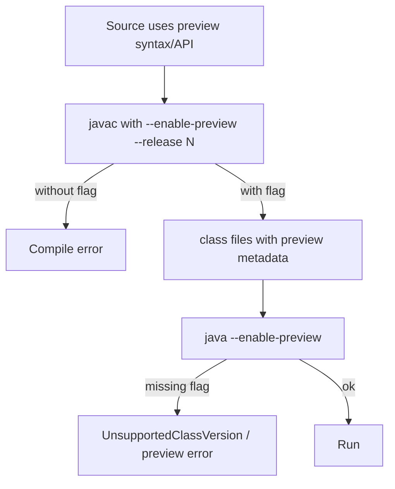

# Preview and Incubator Features

> **Status:** Completed  
> **Module:** 19 — Modern Java Features  
> **Target Java version:** 21  
> **Last reviewed:** 2026-11-11  
> **Chapter profile:** Technical  
> **Depth target:** Level 3 (lifecycle, flags, documentation obligations, structured concurrency example)  
> **Examples verified with:** Temurin JDK 21.0.12.1 (`javac --enable-preview --release 21`)

## 1. Learning Objectives

- Define **preview**, **incubator**, and **final** feature stages in OpenJDK delivery.
- Compile and run preview code with **`--enable-preview`** and matching **`--release`**.
- Label preview APIs in documentation; avoid production defaults on non-final features.
- Explain **StructuredTaskScope** as a Java 21 **preview** example.

## 2. Prerequisites

- Ch.01–02; JDK install (Module 01).

**Refresher — JPMS:** Incubator features may live in **`jdk.incubator.*`** modules requiring `--add-modules`. Preview language features use compiler/runtime **metadata** toggled by `--enable-preview`.

## 3. Why This Concept Exists

OpenJDK ships experimental APIs for feedback. Preview semantics may **change or be removed**; incubator modules may relocate. Without labeling, teams ship production code on unstable surfaces and break on the next JDK upgrade.

## 4. Conceptual Explanation

### 4.1 Lifecycle (simplified)

1. **Incubator** — often separate module; API unstable.
2. **Preview** — requires `--enable-preview`; may span multiple preview rounds.
3. **Second preview** — refinement round before final.
4. **Final** — standard semantics; no preview flag.

### 4.2 Compiler and runtime flags

```text
javac --enable-preview --release 21 PreviewIncubatorDemo.java
java --enable-preview PreviewIncubatorDemo
```

**`--release` on javac** must match the JDK feature used for preview. **`java`** does not take `--release`—only `--enable-preview` on the same major version as compile.

### 4.3 Structured Concurrency (Java 21)

`StructuredTaskScope` (JEP 453 **preview** in 21) groups forked tasks; failure in one fork can **shutdown** siblings—structured failure propagation. **Status in 21: preview**—re-check JEP on every JDK upgrade.

### 4.4 Documentation obligation

Tag in prose and examples:

- **Introduced in:** version
- **Status:** preview | incubator | final | deprecated | removed

## 5. Mechanism and Execution Flow

### 5.1 Preview gate



Preview class files carry **preview metadata**; runtime refuses execution if flags disagree.

### 5.2 Structured task scope (conceptual)

1. Open scope.
2. **Fork** subtasks.
3. **Join** or handle **first failure**.
4. Close scope—cancels outstanding forks per API contract (preview semantics—verify JEP).

## 6. Terminology

| Term | Meaning |
|------|---------|
| Preview feature | Needs `--enable-preview`; non-final semantics |
| Incubator module | Delivered on incubator module path |
| `--release` | Compile against Java SE API surface of version N |

## 7. Syntax and Language Rules

- Preview APIs may emit **compiler warnings**—treat as debt.
- Mixing preview and stable in one artifact requires consistent build flags across modules.

## 8. Step-by-Step Examples

Demo: [preview-incubator-demo](../../examples/core-java/preview-incubator-demo/).

```bash
javac --enable-preview --release 21 PreviewIncubatorDemo.java
java --enable-preview PreviewIncubatorDemo
```

**Verified output (Temurin 21.0.12.1):**

```text
structuredConcurrency=scoped-result
compileFlags=--enable-preview --release 21
status=Structured Concurrency is preview in Java 21; check JEP for current phase
```

### 8.1 Incorrect flag pairing

**Illustrative:** `java --enable-preview` on classes compiled without preview → failure.

**Illustrative:** `javac --enable-preview` without `--release 21` on mismatched JDK → errors.

## 9. Real-World Use Cases

- Spikes on preview branches—not `main` without governance.
- Frameworks gate features on JDK version **and** flag detection.

## 10. Internal Behavior

Preview implemented in **javac/HotSpot** with guarded metadata. Removing a preview in a later JDK **breaks** source/binaries that depended on it—no guarantee of migration shim.

## 11. Edge Cases and Limitations

- IDE support may lag preview syntax.
- JPMS + preview module paths confuse classpath vs module path.
- Deprecated previews may be **removed entirely**.

## 12. Common Mistakes

### Incorrect

`java --release 21 --enable-preview` (invalid for `java` launcher).

### Corrected

`javac --enable-preview --release 21` + `java --enable-preview`.

## 13. Best Practices

- No preview on production LTS baseline without risk acceptance record.
- Track JEP **delivery** each release.
- Remove preview flags promptly when features finalize.

## 14. Design Trade-offs

Early access influences API shape; cost is **rework** if signatures change.

## 15. Performance Considerations

Not primary for preview governance—benchmark only after final.

## 16. Security Considerations

Incubator/preview native/FFM surfaces warrant extra scrutiny with untrusted input until final.

## 17. Java Version and Compatibility Notes

Structured Concurrency: **preview in 21**. Re-check [JEP 453](https://openjdk.org/jeps/453) when upgrading.

## 18. Related Language Comparisons

Other languages use nightly flags; Java encodes lifecycle in JEP **Preview** mechanism.

## 19. Revision and Mastery

- Preview vs incubator?
- Why `--release` pairs with preview **javac**?
- What breaks when preview is removed?

## 20. Exercises

### Beginner

Compile demo without preview; capture compiler error.

### Intermediate

Find one preview in current JDK release notes; record JEP status.

## 21. Interview Questions

Can you use preview features in production? What flags are required?

## 22. Solutions

**Production:** only with explicit risk acceptance and upgrade plan; flags as in §8. **Error exercise:** compiler names unrecognized preview API or missing `--enable-preview`.

## 23. Chapter Summary

Label non-final features; use **`--enable-preview`** with **`--release`** on **javac**; treat preview code as experimental. Demo runs Structured Concurrency under preview on 21.

## 24. Key Terminology

Preview · incubator · --enable-preview · StructuredTaskScope

## 25. References and Further Reading

- [JEP 453: Structured Concurrency](https://openjdk.org/jeps/453)
- [OpenJDK preview features guide](https://openjdk.org/jeps/12)

## 26. Next Steps

Module 20 — [Java Standard Library](../20-java-standard-library/)

## Supplement — JEP status vocabulary and removal risk (Level 3 depth)

### Reading a JEP delivery section

When upgrading JDK, open the JEP and record:

| Field | Question to answer |
|-------|-------------------|
| **Status** | Draft / Candidate / Proposed / Targeted / Integrated … |
| **Preview** | Which rounds? Second preview? |
| **JDK** | First delivery version |
| **Relates to** | Supersedes or depends on other JEPs |

Blog posts rarely update these fields—treat JEP as source.

### What breaks when preview ends

| Outcome | Your code |
|---------|-----------|
| Feature goes **final** | Remove `--enable-preview`; fix compile errors from semantic tweaks |
| Feature **removed** | No migration—rewrite without the preview API |
| Feature changes between preview rounds | Compiler errors on upgrade—budget rework |

### Structured Concurrency intent (preview semantics)

**Goal:** Tie lifetime of child tasks to a **scope** so cancellation and errors propagate predictably—contrast with “fire-and-forget” `ExecutorService` tasks. **Why preview:** API surface and failure modes evolved across rounds—do not bake into libraries without shading version checks.

### IDE and build alignment

Ensure IDE **Project SDK** and **compiler preview** settings match Maven/Gradle—mismatches show red squiggles while CLI builds succeed (or vice versa). Document flags in `examples/.../README.md` for preview demos.

### Incubator modules (awareness)

Some features ship in **`jdk.incubator.vector`** etc.—require:

```text
--add-modules jdk.incubator.NAME
```

Different from language preview flags; both are non-final surfaces.

### Compiler warning hygiene

Preview compilations may emit **preview feature** warnings—track count in CI; zero warnings policy may fail builds when enabling preview in spike modules—isolate preview code in separate Maven module/profile.

### Feature flag matrix (team doc template)

| Feature | JEP | Introduced | Status on 21 | Flags | Production |
|---------|-----|------------|--------------|-------|------------|
| Structured Concurrency | 453 | 21 | Preview | `--enable-preview` | No |
| (your spike) | … | … | … | … | … |

Update each JDK upgrade; attach to release notes.

### Comparison: preview vs experimental elsewhere

C++ contracts, Rust nightly, and ECMAScript stages use different vocabulary—Java’s **JEP preview rounds** are the authoritative lifecycle for this handbook. Do not assume “two previews” always—some features skip or add rounds.

### Failure messages beginners see

| Mistake | Typical symptom |
|---------|-----------------|
| Run preview class without `java --enable-preview` | UnsupportedClassVersionError / preview not enabled |
| `javac` on JDK 17 with Java 21 preview source | Feature not found |
| Mix LTS runtime with preview class from newer JDK only compile | Class version mismatch |

Capture these in onboarding docs beside the demo commands in §8.

### Relation to Module 24

Structured Concurrency preview ties to **task scope** and **virtual threads** (Ch.01)—when preview graduates, concurrency module will deepen shutdown semantics; until then treat demo output as **evidence of flag wiring**, not production pattern.

### Gradle preview compile (Illustrative)

```kotlin
tasks.withType<JavaCompile>().configureEach {
    options.compilerArgs.addAll(listOf("--enable-preview", "--release", "21"))
}
```

```kotlin
tasks.withType<JavaExec>().configureEach {
    jvmArgs("--enable-preview")
}
```

Keep preview limited to dedicated source set so main production sources stay flag-free.

### Maven compiler plugin (Illustrative)

```xml
<compilerArgs>
  <arg>--enable-preview</arg>
</compilerArgs>
<release>21</release>
```

Mirror demo commands in build files—avoid “IDE works, CI fails” drift.

### Risk acceptance template (one paragraph)

Document: feature name, JEP, business reason for preview use, rollback plan when JEP changes, owner, review date. Required for any preview in production-bound artifact—even internal.

### Teaching lab: capture compiler errors

| Step | Student action |
|------|----------------|
| 1 | Compile demo **without** preview; paste error |
| 2 | Add `--enable-preview --release 21`; success |
| 3 | Run without `java --enable-preview`; paste runtime error |
| 4 | Record in notes beside Ch.03 §8 |

Builds muscle memory for flag pairing—more valuable than memorizing JEP numbers.

### Second preview round awareness

Some features ship **Preview 2** with breaking tweaks—upgrade notes may say “incompatible with Preview 1 source.” Budget refactor time when following bleeding edge.

## Review Checklist

**Mandatory Depth Review:** Level 3 — lifecycle, flag mechanism, verified preview run.

- [x] Chapter profile **Technical**, depth **Level 3**
- [x] Mechanism preview gate diagram
- [x] Structured Concurrency labeled preview
- [x] Demo **Verified** with documented flags

**Omissions (section → reason):**

- **Incubator module walkthrough** — no separate incubator demo in repo; narrative only.
