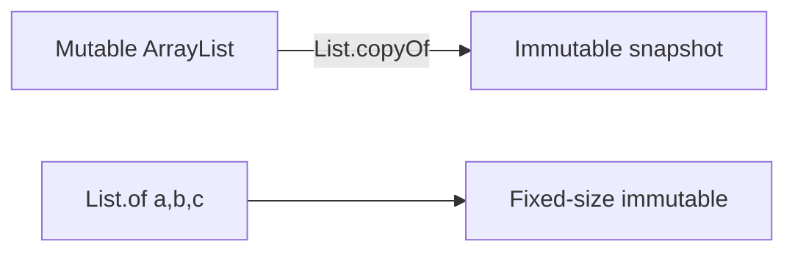

# java.lang and java.util

> **Status:** Completed  
> **Module:** 20 — Java Standard Library  
> **Target Java version:** 21  
> **Last reviewed:** 2026-11-11  
> **Chapter profile:** Technical  
> **Depth target:** Level 3 (`String`, `Objects`, collections factories, sequenced list API)  
> **Examples verified with:** Temurin JDK 21.0.12.1 (javac 21.0.12.1)

## 1. Learning Objectives

- Navigate core **`java.lang`** (`String`, `Objects`, wrappers, `Math`, exceptions) and **`java.util`** collections utilities.
- Use **immutable factory methods** (`List.of`, `Map.of`) and **sequenced** list accessors safely.
- Choose collection interfaces for everyday tasks and declare APIs with interface types.
- Explain **shallow immutability** of factory collections and **null rejection** rules.

## 2. Prerequisites

- Modules **02**, **11**, **12** — types, strings, collections.

**Refresher — interface vs implementation:** Fields and parameters should use **`List<String>`**, not `ArrayList<String>`, so callers can pass any implementation. Instantiation uses concrete classes: `new ArrayList<>()`.

## 3. Why This Concept Exists

Every program implicitly imports **`java.lang`**. Daily productivity depends on **`String`** text processing, **`Objects`** null-safe utilities, and the **Collection** framework without reinventing helpers. Java 21 **sequenced** list methods reduce index noise for first/last intent.

## 4. Conceptual Explanation

### 4.1 java.lang essentials

- **`String`** — immutable UTF-16 sequence; prefer `strip()`, `isBlank()`, `formatted()`.
- **`Objects`** — `equals`, `hash`, `requireNonNull`, `isNull`/`nonNull`.
- **Wrappers** — boxing/unboxing (Module 02); watch null unbox NPE.
- **`Math` / `StrictMath`** — transcendental and utility math.

### 4.2 java.util collections

- **`List`**, **`Set`**, **`Map`** — program to interfaces.
- **Factory methods** — `List.of("a","b")` immutable; **no null** elements.
- **Mutability** — `new ArrayList<>()` for growth; `List.copyOf` for defensive snapshots from mutable sources.
- **Sequenced API (21)** — `getFirst()`, `getLast()` on lists with encounter order.

### 4.3 Staples elsewhere in java.util

**`Optional`** (Module 18), **`Stream`** (Module 17), **`Comparator`**, **`Collections`**, **`Arrays`** — cross-module depth; here we use them as collaborators.

## 5. Mechanism and Execution Flow

### 5.1 `List.copyOf` vs mutable list



- **`List.of`:** fixed size at creation; null element → NPE.
- **`List.copyOf`:** copies current elements; changes to source list afterward do not affect copy (snapshot).

### 5.2 `String.strip` vs `trim`

`strip` uses Unicode **white space** rules (broader than ASCII `trim`). Mechanism: JDK walks code points against `Character.isWhitespace` categories—relevant for internationalized input.

## 6. Terminology

| Term | Meaning |
|------|---------|
| Immutable collection | No structural modification after creation |
| Encounter order | Order elements are traversed |
| Factory method | Static collector like `List.of` |
| Shallow immutability | Elements inside list may still be mutable objects |

## 7. Syntax and Language Rules

- `Map.of` limited to 10 pairs; `Map.ofEntries(Map.entry(...), ...)` for larger.
- `List.of` and `Set.of` forbid duplicate elements where applicable (`Set`).
- Empty list: `List.of()` or `Collections.emptyList()`.

## 8. Step-by-Step Examples

Demo: [java-lang-util-demo](../../examples/core-java/java-lang-util-demo/).

```bash
javac --release 21 JavaLangUtilDemo.java
java JavaLangUtilDemo
```

**Verified output (Temurin 21.0.12.1):**

```text
strip=Ada Lovelace
isBlank=false
copyOf=[Bob, Ada, Lin]
first=Bob
mapAda=95
join=Bob-Ada-Lin
hashConsistent=true
```

### 8.1 Important lines

- `strip=` — Unicode-aware trim.
- `first=` — **sequenced** API on Java 21 list.
- `hashConsistent=` — `Objects.hash` stable for same inputs.

### 8.2 Incorrect factory use

```java
List.of(items.toArray(new String[0])); // NPE if any array slot null
```

Use mutable `ArrayList` when nulls are business-meaningful.

## 9. Real-World Use Cases

- Normalize user input before validation (`strip`, `isBlank`).
- Return immutable DTO list snapshots from services (`List.copyOf`).
- Build delimited logs with `String.join`.

## 10. Internal Behavior

`String` is backed by `byte[]` plus coder flag (compact strings **HotSpot** optimization). Factory collections use specialized immutable implementations—constant-time `contains` not guaranteed; optimize for memory and safety.

## 11. Edge Cases and Limitations

- Immutability does not deep-copy mutable elements.
- `List.of` throws on null **element**.
- `String` equality: content `equals`, reference `==` only when intentional.

## 12. Common Mistakes

Using `get(0)` on empty list vs `getFirst()`—both throw on empty; sequenced API communicates intent.

## 13. Best Practices

- Declare **`List<String>`** in APIs.
- `Objects.requireNonNull` at boundaries.
- Prefer **`strip()`** over `trim()` for user text.

## 14. Design Trade-offs

Immutable factories reduce bugs; forbid in-place updates—clone to mutable when edits needed.

## 15. Performance Considerations

`String.join` and `formatted` allocate; acceptable for typical service code; profile hot parsers separately.

## 16. Security Considerations

Normalize Unicode before authentication comparisons (homoglyph attacks)—`strip` alone insufficient; consider NFC normalization for high assurance.

## 17. Java Version and Compatibility Notes

Sequenced collections and list methods **final in 21**.

## 18. Revision and Mastery

- `List.copyOf` vs `Collections.unmodifiableList`?
- Why `Map.of` has 10-pair limit?
- Shallow vs deep immutability?

## 19. Exercises

Normalize and join usernames; build stable hash for composite key.

## 20. Interview Questions

Difference `List.of` and `Arrays.asList`?

## 21. Solutions

**List.of** fully immutable; **`Arrays.asList`** fixed-size backed by array—set may mutate backing array; not same null rules.

## 22. Chapter Summary

`java.lang` and `java.util` are the daily toolkit: text, objects, collections—with Java 21 sequenced conveniences. Demo verifies strip, `copyOf`, `getFirst`, `Map.get`, join, and hash helpers.

## 23. Key Terminology

Immutable factory · sequenced list · strip · shallow immutability

## 24. References and Further Reading

- [`String` (Java 21)](https://docs.oracle.com/en/java/javase/21/docs/api/java.base/java/lang/String.html)
- [`List` (Java 21)](https://docs.oracle.com/en/java/javase/21/docs/api/java.base/java/util/List.html)

## 25. Next Steps

[02-io-nio-net-and-time-overview.md](02-io-nio-net-and-time-overview.md)

## Supplement — Collections and `Objects` in practice (Level 3 depth)

### `List.copyOf` vs `Collections.unmodifiableList`

| | `List.copyOf(collection)` | `Collections.unmodifiableList(list)` |
|---|---------------------------|-------------------------------------|
| Null elements | forbidden | reflects backing list’s null policy |
| Backing mutations | snapshot; later edits invisible | changes to backing list may show through |
| Null list argument | NPE | NPE if list null |

Use **`copyOf`** when handing data to untrusted callers or returning from public APIs.

### `Map.of` size limits and `Map.ofEntries`

`Map.of(k1,v1,...)` supports up to **10** pairs at call site—language limitation. Larger immutable maps:

```java
Map<String, Integer> scores = Map.ofEntries(
    Map.entry("Ada", 95),
    Map.entry("Lin", 88),
    Map.entry("Bob", 91)
);
```

Duplicate keys in `Map.of` → `IllegalArgumentException`.

### Sequenced list failure modes

`List.getFirst()` on **empty** list → `NoSuchElementException` (same family as `Optional.get` misuse). Check `isEmpty()` or use optional-style handling at boundary when emptiness is expected.

### `Objects` utility recap

```java
Objects.requireNonNull(name, "name");
Objects.equals(a, b);           // null-safe
Objects.hash(a, b, c);          // stable mixing for equals contract
Objects.requireNonNullElse(s, d);
```

`requireNonNull` return type is useful for assignment chains:

```java
this.name = Objects.requireNonNull(name, "name");
```

### Demo field guide (Verified)

| Output | Mechanism |
|--------|-----------|
| `strip=Ada Lovelace` | Leading/trailing Unicode whitespace removed |
| `copyOf=[Bob, Ada, Lin]` | Immutable snapshot from mutable source |
| `first=Bob` | Sequenced API encounter order |
| `mapAda=95` | `Map.get` for existing key |
| `join=Bob-Ada-Lin` | Delimiter join without `StringBuilder` loop |
| `hashConsistent=true` | Same inputs → same `Objects.hash` |

### `String` methods cheat sheet (Java 21 everyday)

| Method | Purpose |
|--------|---------|
| `strip` / `stripLeading` / `stripTrailing` | Unicode whitespace trim |
| `isBlank` | true if empty or all whitespace |
| `lines` | Stream of lines from string |
| `formatted` / `format` | Format with arguments |
| `translateEscapes` | Unescape `\n`, `\t`, etc. |

Prefer over legacy `trim` when user input may include non-ASCII space characters.

### Collection picking guide

| Need | Start with |
|------|------------|
| Insertion order, duplicates | `ArrayList` |
| Fast contains, no duplicates | `HashSet` |
| Sorted keys | `TreeMap` / `TreeSet` |
| LRU cache | `LinkedHashMap` with removeEldestEntry |
| Queue / deque ends | `ArrayDeque` |

Declare fields as interface types (`Deque`, `Map`) per Module 12 guidance.

### `Arrays` utilities (often with streams)

`Arrays.sort`, `Arrays.binarySearch`, `Arrays.mismatch`, `Arrays.compare`—parallel `Arrays.parallelSort` for large primitive arrays—Module 17 covers stream integration; here remember **primitive arrays** are not `Collection`s.

### `Math.clamp` (Java 21)

```java
int bounded = Math.clamp(value, min, max);
```

Reduces manual `Math.min(max, Math.max(min, value))` errors—use when normalizing scores and indices.

### Anti-pattern: raw types and collections

```java
List raw = new ArrayList(); // legacy
List<String> typed = new ArrayList<>();
```

Generics from Module 13 apply throughout `java.util`—raw types defeat compile-time checks.

### `Objects.equals` contract in collections

`List.contains` uses `equals` on elements—if you redefine `equals`, ensure consistency with `hashCode` for `HashSet`/`HashMap` keys (Module 09). `Objects.equals(a,b)` handles null arguments in **your** utility code; collection APIs still depend on element `equals`.

### `Optional` and `Stream` pointers

This module uses `Optional` and `Stream` as **`java.util` citizens**—full teaching in Modules 17–18. When you see `stream()` on collections, you are handing off to the stream pipeline model.

### `Collections` utility class

`sort`, `reverse`, `singletonList`, `unmodifiableMap`—legacy but pervasive in older codebases. Know **`List.of`** replaces many `singletonList`/`emptyList` use cases with stricter null rules.

### `Comparator` composition

```java
Comparator<Person> byName = Comparator.comparing(Person::name);
Comparator<Person> byNameThenAge = byName.thenComparingInt(Person::age);
```

Stable sorts and multi-field ordering for tables and reports—pairs with Module 17 `sorted()`.

### Wrappers and `valueOf`

Prefer `Integer.valueOf(127)` caching awareness for autoboxing hot spots—rare micro-optimization; meaningful in extreme loops only.

### Module 20 learning path

Ch.01 daily APIs → Ch.02 package survey → Ch.03 reflection/process for framework literacy → Module 21 file bytes → Module 22 time.

### Depth self-check

Explain each **Verified** demo line without opening source—if you cannot, re-read §8 and Supplement field guide.

## Review Checklist

**Mandatory Depth Review:** Level 3 — factories, sequenced API, verified demo.

- [x] Chapter profile **Technical**, depth **Level 3**
- [x] Mechanism copyOf/of flow (Section 5)
- [x] Demo **Verified** Temurin 21.0.12.1

**Omissions (section → reason):**

- **Language comparisons** — not needed for daily `java.util` use.
