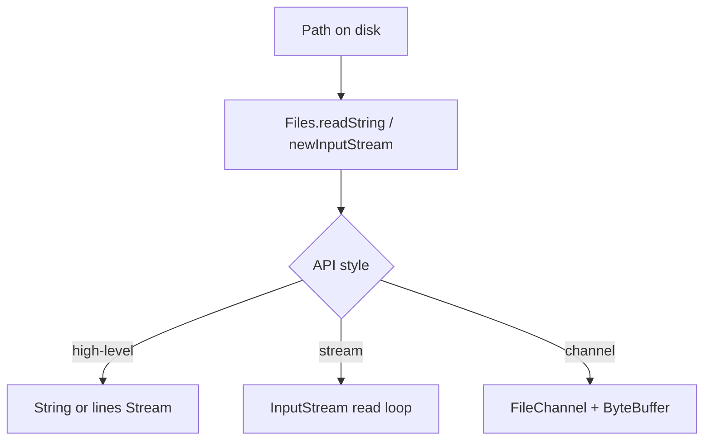

# IO, NIO, Net, and Time Overview

> **Status:** Completed  
> **Module:** 20 — Java Standard Library  
> **Target Java version:** 21  
> **Last reviewed:** 2026-11-11  
> **Chapter profile:** Technical  
> **Depth target:** Levels 2–3 (package map, I/O model sketch, `Path`/`ByteBuffer`/`URI`/`Instant` survey)  
> **Examples verified with:** Temurin JDK 21.0.12.1 (javac 21.0.12.1)

## 1. Learning Objectives

- Map major JDK packages: **`java.io`**, **`java.nio`**, **`java.net`**, **`java.time`**.
- Know which handbook module deepens each area (21 file I/O, 22 date/time, later networking).
- Use **`Path`**, **`ByteBuffer`**, **`URI`**, and **`Instant`** at survey level with correct mental model.
- Contrast **stream-oriented I/O** vs **buffer/channel** vs **NIO.2 file utilities**.

## 2. Prerequisites

- Module **14** — try-with-resources.
- Module **02** — references; basic exceptions.

**Refresher — try-with-resources:** `AutoCloseable` resources closed in reverse declaration order at block exit—critical for streams and `Files.lines` (Module 21).

## 3. Why This Concept Exists

The JDK is large. A **survey** prevents guessing package names and clarifies migration paths: **NIO.2** over legacy `File`, **`java.time`** over `Date`/`Calendar`, **`HttpClient`** over old `HttpURLConnection` patterns.

## 4. Conceptual Explanation

| Package | Role | Handbook depth |
|---------|------|----------------|
| `java.io` | byte/char streams, readers/writers, serialization markers | Module 21 |
| `java.nio` | `Buffer`, `Channel`, charset, `java.nio.file` | Module 21 |
| `java.net` | sockets, `URI`, `URL`; `java.net.http` client (11+) | Later networking modules |
| `java.time` | ISO-8601 model, immutable types | Module 22 |

**NIO.2** (`java.nio.file.Path`, `Files`) is the preferred **file** API for new code.

### 4.1 Stream vs buffer vs file helper

- **`InputStream` / `Reader`:** byte/char sequential flow—socket, serialization, piped transforms.
- **`ByteBuffer`:** in-memory typed view for channel I/O—position/limit/capacity model.
- **`Files.readString`:** high-level file op on `Path`—uses streams/channels internally.

## 5. Mechanism and Execution Flow

### 5.1 Typical read path (conceptual)



Module 21 implements each branch; Module 22 replaces clock reads with `Instant` / `ZonedDateTime`.

### 5.2 `ByteBuffer` position

After `putInt(4)`, **position** advances by 4 bytes—demo `byteBufferPos=4`. **Limit** and **capacity** bound readable/writable window; `flip()` prepares for read after write.

### 5.3 Time at survey level

`Instant.now()` captures UTC timeline point; epoch second > 0 in demo `instantEpoch=true`. Conversions to local zones happen in Module 22—not with legacy `Date`.

## 6. Terminology

| Term | Meaning |
|------|---------|
| NIO | New I/O — buffers and channels (`java.nio`) |
| NIO.2 | File system API (`java.nio.file`, Java 7+) |
| Charset | Maps bytes ↔ chars (`StandardCharsets.UTF_8`) |
| Instant | UTC point on timeline (`java.time`) |

## 7. Syntax and Language Rules

```java
Path path = Path.of("notes.txt");
ByteBuffer buf = ByteBuffer.allocate(16);
URI uri = URI.create("https://example.com/path");
Instant now = Instant.now();
```

## 8. Step-by-Step Examples

Demo: [stdlib-overview-demo](../../examples/core-java/stdlib-overview-demo/).

**Verified output (Temurin 21.0.12.1):**

```text
pathFileName=notes.txt
byteBufferPos=4
uriHost=example.com
instantEpoch=true
```

Compile/run: `javac --release 21 StdlibOverviewDemo.java` then `java StdlibOverviewDemo`.

## 9. Real-World Use Cases

- Build config `Path` with `resolve` instead of string concat.
- HTTP client calls with `java.net.http.HttpClient` (later modules).
- Log event time as `Instant` in UTC.

## 10. Internal Behavior

`Files` methods delegate to `FileSystemProvider` (default platform provider). **HotSpot** does not change API contracts—`Provider` SPI allows alternate file systems (ZIP, in-memory).

## 11. Edge Cases and Limitations

- Legacy **`java.io.File`** still in old code—prefer `Path`.
- Default charset UTF-8 since Java 18—still specify charset in libraries.
- NIO channels shine for bulk transfer; tiny text may use `readString`.

## 12. Common Mistakes

Mixing **`Date`/`Calendar`** with `java.time` in one model—pick `java.time` for new code.

## 13. Best Practices

- Try-with-resources for streams/channels.
- Store **UTC** instants; convert at UI.
- **`Files`** one-shots for small files; stream large files.

## 14. Design Trade-offs

High-level `Files` vs low-level channels—complexity vs control; Module 21 bridges both.

## 15. Performance Considerations

Buffer sizing affects channel throughput—not critical for survey snippets.

## 16. Security Considerations

`URI` parsing does not validate trust—TLS and certificate validation live in HTTP layer.

## 17. Java Version and Compatibility Notes

`HttpClient` final since 11; UTF-8 default charset 18+; handbook **21**.

## 18. Revision and Mastery

- Which module owns file depth? Time depth?
- What advances `ByteBuffer` position after `putInt`?
- Stream vs `Files.readString` choice?

## 19. Exercises

Map three tasks in your app to package + API (`Path`, `HttpClient`, `Instant`).

## 20. Interview Questions

Difference `java.io` and `java.nio.file` for files?

## 21. Solutions

**java.io** stream-centric legacy; **NIO.2** path-centric `Files`/`Path` with richer exceptions and options—preferred for new file code.

## 22. Chapter Summary

Standard library I/O, NIO, networking, and time packages each have dedicated modules; this chapter orients the map before depth. Demo touches `Path`, `ByteBuffer`, `URI`, `Instant`.

## 23. Key Terminology

NIO.2 · ByteBuffer · Instant · Path

## 24. References and Further Reading

- [Package `java.nio.file`](https://docs.oracle.com/en/java/javase/21/docs/api/java.base/java/nio/file/package-summary.html)
- [Package `java.time`](https://docs.oracle.com/en/java/javase/21/docs/api/java.base/java/time/package-summary.html)

## 25. Next Steps

[03-reflection-annotations-and-process-apis.md](03-reflection-annotations-and-process-apis.md); Modules **21–22**.

## Supplement — Package selection guide (Level 3 depth)

### Decision tree (files and time)

```text
Need to read a small config file on disk?
  → java.nio.file.Files + Path (Module 21)

Need socket / HTTP client?
  → java.net / java.net.http (later networking modules)

Need bulk binary channel I/O?
  → java.nio.channels + ByteBuffer (Module 21 bridges)

Need timestamps in domain model?
  → java.time.Instant / ZonedDateTime (Module 22) — not java.util.Date

Need Java object graph to bytes?
  → reconsider JSON (Module 21 Ch.03); serialization last resort
```

### `java.io` still required when

- Legacy APIs return **`InputStream`** / **`Reader`**.
- **ObjectOutputStream** serialization pipeline.
- **Piped** streams connecting threads.
- Third-party libraries not yet NIO.2-native.

Survey does not mean “avoid `java.io` forever”—means **prefer NIO.2 for new path-centric file code**.

### `ByteBuffer` quick reference

| Field | Meaning |
|-------|---------|
| capacity | Total size |
| position | Next read/write index |
| limit | End of valid data |

After writing with `putInt`, **flip()** before reading—demo only advances position to show write path (`byteBufferPos=4`).

### `java.net.http.HttpClient` (awareness)

Since Java 11, asynchronous and synchronous HTTP in standard library—replaces much `HttpURLConnection` boilerplate. TLS, redirects, and HTTP/2 supported—**API reference** in Oracle docs; handbook defers tutorials to networking modules per PROGRESS.

### Charset default (Java 18+)

JVM default charset UTF-8 on modern releases—**library code** still passes `StandardCharsets.UTF_8` explicitly so behavior does not depend on launcher locale.

### Legacy `java.util` time (do not use in new code)

`Date`, `Calendar`, `SimpleDateFormat` — mutable, threading hazards, confusing timezone behavior. Migration path:

```java
Instant instant = Instant.now();                    // UTC timeline
ZonedDateTime z = instant.atZone(ZoneId.of("UTC"));
```

Module 22 owns `java.time` depth; survey only establishes **ban Date in new domain code**.

### `java.nio` beyond files

| Subpackage | Role |
|------------|------|
| `java.nio` | Buffers, channels core |
| `java.nio.channels` | SocketChannel, FileChannel |
| `java.nio.charset` | Charset, CharsetDecoder |
| `java.nio.file` | NIO.2 Path/Files (Module 21) |

Network servers may use **channels** for selector-based I/O—reactive stacks build on this; handbook networking modules pick up narrative.

### `URI` vs `URL`

`URI` is immutable RFC 2396 parser—`getHost()`, `getPath()`. **`URL`** legacy includes stream handlers and is trickier for equality; **`URI.toURL()`** when interop needed. Demo: `uriHost=example.com`.

### Error handling style

NIO.2 methods throw **`IOException`** subclasses—callers decide checked propagation vs wrap in unchecked domain exceptions. Streams APIs do not remove IO failure modes—they localize them at operation sites.

### Cross-module study path

1. This survey (Module 20 Ch.02)
2. Files + streams depth (Module 21 Ch.01)
3. NIO.2 tree/path (Module 21 Ch.02)
4. `java.time` (Module 22)
5. HTTP client / sockets (later networking)

### Verified demo one-liner teaching

Each output line maps one package family: **file name** (`Path`), **buffer position** (`nio`), **URI host** (`net`), **instant positive epoch** (`time`).

### `Instant` vs `LocalDateTime` (preview for Module 22)

| Type | Stores | Use |
|------|--------|-----|
| `Instant` | UTC point on line | Events, logs, DB `TIMESTAMP WITH TIME ZONE` |
| `LocalDateTime` | civil date-time without zone | Human schedules in one zone |
| `ZonedDateTime` | local + zone rules | User-facing timestamps |

Demo uses `Instant` only to prove `java.time` loads alongside I/O packages in one overview class.

### Socket overview (no tutorial)

`java.net.Socket` / `ServerSocket` blocking model pairs with virtual threads (Module 19) for thread-per-connection servers. NIO `SocketChannel` + `Selector` suits high-connection custom servers—networking modules compare models.

### `StandardCharsets` constants

Use `StandardCharsets.UTF_8` not `Charset.forName("UTF-8")`—avoids typo and unnecessary lookup; required in security-sensitive parsers.

### Checklist before Module 21

- [ ] Know package for file reads (`java.nio.file`)
- [ ] Know try-with-resources applies to streams **and** `Stream<Path>`
- [ ] Know not to use `Date` in new code
- [ ] Ran `StdlibOverviewDemo` once locally

### Study questions with reasoning

**Why survey chapter?** Prevents random package imports and skipped prerequisites before file and time modules.**Why ByteBuffer in survey?** Later channel I/O reuses buffer vocabulary.**Why URI not URL in demo?** Modern parsing without opening connections.

## Review Checklist

**Mandatory Depth Review:** Levels 2–3 survey + mechanism read-path diagram.

- [x] Chapter profile **Technical**
- [x] Mechanism Section 5 (read path + buffer position)
- [x] Demo **Verified** Temurin 21.0.12.1
- [x] HTTP/time deferral explicit with module links

**Omissions (section → reason):**

- **HttpClient tutorial** — PROGRESS: networking modules own depth.
