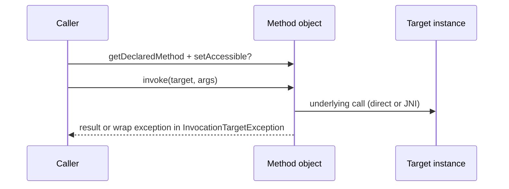

# Reflection, Annotations, and Process APIs

> **Status:** Completed  
> **Module:** 20 — Java Standard Library  
> **Target Java version:** 21  
> **Last reviewed:** 2026-11-11  
> **Chapter profile:** Deep-dive  
> **Depth target:** Levels 3–4 (reflection invocation chain, retention, `ProcessBuilder` I/O)  
> **Examples verified with:** Temurin JDK 21.0.12.1 (javac 21.0.12.1)

## 1. Learning Objectives

- Read **runtime annotations** and invoke methods via **reflection** (`java.lang.reflect`).
- Declare simple **annotations** with `@Retention` and `@Target`.
- Start external processes with **`ProcessBuilder`** and avoid stream deadlock.
- Distinguish **spec guarantees** vs **JPMS** access constraints and **performance** costs of reflection.

## 2. Prerequisites

- Modules **05–07** — classes, methods, exceptions.
- Module **06** — nested types (optional).

**Refresher — annotation vs comment:** Annotations are types meta-applied to declarations; **retention** decides whether they exist at runtime for reflection or only in class files / source.

## 3. Why This Concept Exists

Frameworks (Spring, JPA, JUnit) use **annotations + reflection** for wiring and discovery. Build plugins spawn **`javac`** or formatters via **Process API**. Understanding these JDK facilities demystifies “magic” and enables small utilities—without replacing compile-time processors where possible.

## 4. Conceptual Explanation

### 4.1 Annotations

Metadata on packages, types, fields, methods, parameters. Defined with `@interface`; meta-annotated with:

- **`@Retention(RetentionPolicy.RUNTIME)`** — visible to reflection.
- **`@Target(ElementType.…)`** — legal attachment sites.

`SOURCE` annotations (e.g. `@Override`) disappear after compile; `CLASS` stays in bytecode but not runtime by default.

### 4.2 Reflection

`Class<?>`, `Method`, `Field`, `Constructor` inspect live types. **`Method.invoke`** dispatches with accessibility checks. Trade-off: breaks encapsulation, bypasses compile-time checks, **slower** than direct calls.

### 4.3 Process API

`ProcessBuilder` lists command **arguments** (no shell parsing by default—good for safety). `start()` → `Process`; consume **stdout/stderr** or redirect to files to avoid **deadlock** when buffers fill.

## 5. Mechanism and Execution Flow

### 5.1 Reflection invoke chain



Real failures live in **`InvocationTargetException.getCause()`**—unwrap for diagnostics.

### 5.2 Annotation read at runtime

1. `clazz.getAnnotation(DemoTag.class)`
2. If retention is RUNTIME and annotation present on element, JVM returns proxy implementing annotation interface.
3. Access attribute methods (`value()`, etc.).

### 5.3 ProcessBuilder start

1. Configure `command(List)` — executable plus args.
2. Optional `directory`, `environment`, `redirectErrorStream(true)`.
3. `start()` spawns OS process.
4. Parent reads streams or waits `waitFor()`.

Demo: `processArgs=[java, -version]` — **list form**, not single concatenated string.

## 6. Terminology

| Term | Meaning |
|------|---------|
| Reflection | Runtime inspection and invocation of types |
| Retention policy | How long annotation metadata survives |
| InvocationTargetException | Wrapper when invoked method throws |
| ProcessBuilder | Configurable external process launcher |

## 7. Syntax and Language Rules

```java
@Retention(RetentionPolicy.RUNTIME)
@Target(ElementType.TYPE)
@interface DemoTag { String value(); }

Method m = clazz.getDeclaredMethod("greet", String.class);
Object out = m.invoke(instance, "Ada");
```

Deprecated: `Class.newInstance()` — use `getConstructor().newInstance()`.

## 8. Step-by-Step Examples

Demo: [reflection-annotations-process-demo](../../examples/core-java/reflection-annotations-process-demo/).

**Verified output (Temurin 21.0.12.1):**

```text
annotation=sample-bean
reflectInvoke=hello Ada
processRan=true
processArgs=[java, -version]
```

### 8.1 Lines explained

- `annotation=` — RUNTIME retention on `SampleBean`.
- `reflectInvoke=` — no-arg ctor + `greet` via reflection.
- `processRan=` — child `java -version` produced output containing “version”.

## 9. Real-World Use Cases

- Test runners finding `@Test` methods.
- Serialization mappers reading custom annotations.
- Gradle/Maven invoking compiler CLI with argument list.

## 10. Internal Behavior

Reflection uses **JVM metadata** from class files; **JPMS** may deny deep reflection on non-exported packages without **`--add-opens`**. **HotSpot** has inflation: first invocations may use native accessors; later may generate bytecode stubs—performance improves but never matches direct calls.

Label: **JVMS / JPMS** for access; **HotSpot** for inflation heuristics.

## 11. Edge Cases and Limitations

- **Records** and reflection: canonical constructor and accessor names follow record rules.
- **SecurityManager** deprecated/removal path—do not rely for new designs.
- **GraalVM native image** needs reflection configuration for dynamic access.

## 12. Common Mistakes

### Incorrect

```java
Runtime.getRuntime().exec("java -version"); // shell parsing, injection risk
```

### Corrected

```java
new ProcessBuilder(List.of("java", "-version")).start();
```

Forgetting to read child **stdout** while waiting → deadlock.

## 13. Best Practices

- Prefer **annotation processors** at compile time over heavy runtime reflection.
- Cache `Method`/`Constructor` handles when reflecting repeatedly.
- **`redirectErrorStream(true)`** for simple merge of err/out.

## 14. Design Trade-offs

| Approach | Pros | Cons |
|----------|------|------|
| Runtime reflection | Flexible discovery | Slow, breaks encapsulation |
| Annotation processor | Compile-time errors | Build complexity |
| Explicit registration | Fast, clear | Manual maintenance |

## 15. Performance Considerations

Reflection invocation orders of magnitude slower than direct calls—unacceptable in tight loops without caching/generated code.

## 16. Security Considerations

Never pass user input into process commands unvalidated; **argument list** API avoids shell injection. Deserialization + reflection gadgets are separate concern (Module 21).

## 17. Java Version and Compatibility Notes

`MethodHandles` (Module 16 area) offer alternate invocation path; reflection remains widespread in frameworks on **21**.

## 18. Revision and Mastery

- Retention policies compared?
- Why list args in `ProcessBuilder`?
- JPMS `--add-opens` when?
- Unwrap `InvocationTargetException` why?

## 19. Exercises

### Beginner

Add a second annotation attribute; read via reflection.

### Intermediate

Run `ProcessBuilder` with merged streams; capture first line of output.

### Advanced

Explain when annotation processor replaces runtime scan in a DI framework.

## 20. Interview Questions

Difference CLASS vs RUNTIME retention? Why is reflection slower?

## 21. Solutions

**RUNTIME** visible to `getAnnotation`; **CLASS** in bytecode only. Reflection traverses metadata + access checks + invocation path not inlined by JIT like direct call.

## 22. Chapter Summary

Annotations describe metadata; reflection reads RUNTIME metadata and invokes members; `ProcessBuilder` runs external programs with explicit argument lists and careful stream handling.

## 23. Key Terminology

Reflection · retention · ProcessBuilder · InvocationTargetException

## 24. References and Further Reading

- [Package `java.lang.reflect`](https://docs.oracle.com/en/java/javase/21/docs/api/java.base/java/lang/reflect/package-summary.html)
- [Class `ProcessBuilder`](https://docs.oracle.com/en/java/javase/21/docs/api/java.base/java/lang/ProcessBuilder.html)

## 25. Next Steps

Module 21 — [File I/O and Serialization](../21-file-io-and-serialization/)

## Supplement — JPMS opens and process stream deadlock (Level 4 depth)

### JPMS reflection opens (Illustrative)

Module `com.app` exporting `com.app.api` may **not export** `com.app.internal`. Framework code reflecting on internal packages needs:

```text
--add-opens com.app.internal/com.pkg=ALL-UNNAMED
```

**Not a language rule**—module system policy. Prefer exporting stable SPI interfaces instead of deep reflection.

### `InvocationTargetException` unwrap pattern

```java
try {
    m.invoke(target, args);
} catch (InvocationTargetException e) {
    Throwable cause = e.getCause();
    if (cause instanceof RuntimeException re) throw re;
    // handle checked cause
}
```

The **target method’s exception** is always the **cause**—logging only `e` hides real failure.

### Process stream deadlock

Child process fills **stdout buffer** (typically 4–8 KB on many OSes). Parent waits on `waitFor()` without reading → child blocks on write → parent blocks → **deadlock**.

Mitigations:

1. `redirectErrorStream(true)` and consume merged stream.
2. `ProcessBuilder.redirectOutput(Redirect.INHERIT)` for dev tools.
3. Async read threads for large output (production scripts).

Demo reads child output for `java -version`—required for `processRan=true`.

### Annotation processor vs runtime (design)

| | Annotation processor | Runtime reflection |
|---|----------------------|-------------------|
| When runs | Compile time | Run time |
| Failure mode | Compiler error | Reflection exception / silent missing |
| Performance | No runtime scan | Metadata + invoke cost |

JUnit 5, MapStruct, and Micronaut lean on processors; older frameworks scan with reflection—know which model your stack uses.

### `VarHandle` and `MethodHandles` (pointer)

Java 7+ **`MethodHandles`** and Java 9+ **`VarHandle`** offer alternate invocation and field access with different performance and access rules—framework internals use them; application code often stays on `Method.invoke` unless profiling demands change.

### Meta-annotations quick reference

| Annotation | Purpose |
|------------|---------|
| `@Retention` | SOURCE / CLASS / RUNTIME |
| `@Target` | Where applicable |
| `@Documented` | Appears in Javadoc |
| `@Inherited` | Subclasses inherit on class targets |

Custom annotations combine these—misconfigured RUNTIME on wrong element prevents framework discovery.

### Reflective generic information

`Type`, `ParameterizedType` capture generic signatures for frameworks deserializing `List<String>` fields—erasure removes generics at runtime for ordinary `Class` tokens; advanced serializers need `Type` literals.

### `Process` lifecycle

```java
Process p = pb.start();
boolean finished = p.waitFor(30, TimeUnit.SECONDS);
if (!finished) p.destroyForcibly();
```

Always bound wait time for ops automation—runaway children should not hang deploy scripts.

### Security manager note (deprecated)

Do not design new security boundaries assuming **SecurityManager**—removed/deprecated path in modern JDK. Use OS permissions, containers, and minimal privilege for `ProcessBuilder` instead.

### Demo alignment (Verified)

| Output | Validates |
|--------|-----------|
| `annotation=sample-bean` | RUNTIME retention + `getAnnotation` |
| `reflectInvoke=hello Ada` | Constructor + method invoke |
| `processRan=true` | Child JVM produced version string |
| `processArgs=[java, -version]` | List-form command, not shell string |

### When reflection is justified

- Plugin loading with known interface contract
- Test utilities
- Thin adapter for legacy library without hooks

When alternatives exist (SPI, service loader, annotation processor), prefer them—Module 20 assessment expands trade-offs.

## Review Checklist

**Mandatory Depth Review:** Levels 3–4 on invoke chain, process I/O, JPMS caveats.

- [x] Chapter profile **Deep-dive**
- [x] Mechanism sequences (Section 5)
- [x] Demo **Verified** Temurin 21.0.12.1
- [x] Security on process invocation
- [x] Spec vs HotSpot labeled

**Omissions (section → reason):**

- **Annotation processor implementation** — build module scope (PROGRESS note).
