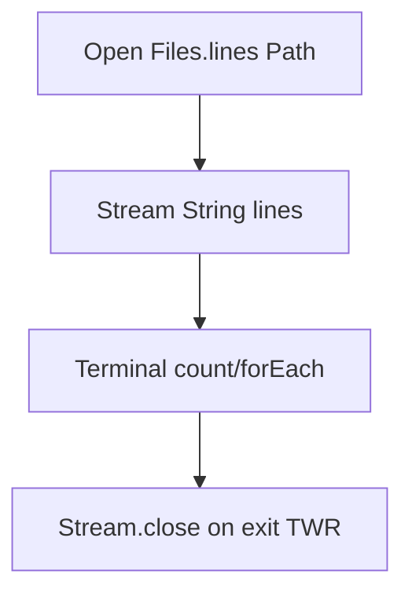

# Files and Streams

> **Status:** Completed  
> **Module:** 21 — File I/O and Serialization  
> **Target Java version:** 21  
> **Last reviewed:** 2026-11-11  
> **Chapter profile:** Technical  
> **Depth target:** Level 3 (NIO.2 `Files`, classic streams, try-with-resources, charset)  
> **Examples verified with:** Temurin JDK 21.0.12.1 (javac 21.0.12.1)

## 1. Learning Objectives

- Read and write text with **`Files`** (NIO.2) and classic **streams** (`Reader`/`Writer`, `InputStream`/`OutputStream`).
- Use **try-with-resources** so streams and `Stream<Path>` close reliably.
- Bridge **`Path`** to streams via `Files.newInputStream` / `newOutputStream`.
- Choose **one-shot** file reads vs **streaming** for size and memory trade-offs.

## 2. Prerequisites

- Module **14** — try-with-resources.
- Module **20** Ch.02 — I/O package survey.

**Refresher — charset:** Bytes on disk are not characters until decoded. Prefer **`StandardCharsets.UTF_8`** in APIs even when JVM default is UTF-8 (Java 18+).

## 3. Why This Concept Exists

Programs persist and exchange data. Java offers **stream-oriented** (`java.io`) and **file-centric** (`java.nio.file`) APIs. Modern code favors **NIO.2** for paths; streams remain essential for sockets, piped transforms, and Java serialization (Ch.03).

## 4. Conceptual Explanation

### 4.1 Stream model

A **stream** is sequential bytes or characters—process without loading entire payload into memory (when used correctly).

### 4.2 NIO.2 for files

`Files.writeString`, `readString`, `lines` operate on **`Path`** with explicit `Charset`.

### 4.3 Bridging

`Files.newInputStream(path)` feeds `InputStream` APIs; `BufferedReader` wraps `Reader` for efficient line reads.

### 4.4 Temp files

`Files.createTempFile` for isolated demos/tests—delete in `finally` or try-with-resources patterns.

## 5. Mechanism and Execution Flow

### 5.1 `Files.lines` lifecycle



`Files.lines` returns a **`Stream<String>`** that must be **closed**—it holds open file handles. Try-with-resources on the stream is mandatory.

### 5.2 Buffered in-memory pipeline

`StringReader` → `BufferedReader` → read line → transform → `StringWriter`. No disk—demonstrates classic stack used with sockets later.

### 5.3 Binary read

`Files.readAllBytes` loads whole file—demo `readBytes=17` for small payload; avoid for multi-GB files.

## 6. Terminology

| Term | Meaning |
|------|---------|
| Path | NIO.2 hierarchical file system location |
| BufferedReader | Decorator reducing read syscalls |
| try-with-resources | Automatic `close()` on `AutoCloseable` |

## 7. Syntax and Language Rules

```java
try (var lines = Files.lines(path, StandardCharsets.UTF_8)) {
    long n = lines.count();
}
```

## 8. Step-by-Step Examples

Demo: [files-streams-demo](../../examples/core-java/files-streams-demo/).

**Verified output (Temurin 21.0.12.1):**

```text
tempLines=3
bufferedTransform=ONE
TWO
readBytes=17
```

### 8.1 Progressive reading

1. **Minimal** — temp file three lines → `tempLines=3`.
2. **Realistic** — buffered uppercase lines `ONE` / `TWO`.
3. **Binary** — byte length from small file.

## 9. Real-World Use Cases

- CSV export to temp file for upload.
- Config line parsing with `BufferedReader`.
- Log tailing with streams (not `readAllBytes`).

## 10. Internal Behavior

`Files` delegates to `FileSystemProvider`; UTF-8 default charset is JVM-wide **HotSpot** / JDK setting—explicit charset in library code remains best practice.

## 11. Edge Cases and Limitations

- `Files.lines` must close.
- CRLF vs LF affects displayed line counts across OS.
- `readString` loads entire text—memory bound.

## 12. Common Mistakes

Forgetting close on `Files.lines` → open handle leaks on Windows.

## 13. Best Practices

- **`Path`** not string concatenation.
- Delete temp artifacts in tests.
- Stream large inputs; one-shot small configs.

## 14. Design Trade-offs

| API | When |
|-----|------|
| `readString` | Small known text |
| `lines` + stream | Line processing, unknown size |
| `InputStream` | Binary or integration with legacy APIs |

## 15. Performance Considerations

`BufferedReader` amortizes I/O; unbuffered byte-by-byte reads stress syscalls.

## 16. Security Considerations

Validate paths stay under allowed base (Ch.02 `normalize`); see traversal attacks.

## 17. Java Version and Compatibility Notes

UTF-8 default charset since Java 18; handbook **21**.

## 18. Revision and Mastery

- Why try-with-resources on `Stream` from `Files.lines`?
- When `readAllBytes` vs streaming?

## 19. Exercises

Copy temp file through buffered transform to second path.

## 20. Interview Questions

Difference `Files.readString` and `BufferedReader` loop?

## 21. Solutions

`readString` convenience loads all; `BufferedReader` constant memory per line when used correctly.

## 22. Chapter Summary

Use **NIO.2 `Files`** for path-based work; combine **streams** for transforms; always close resources. Demo: temp file line count, buffered transform, bytes read.

## 23. Key Terminology

Files · Path · BufferedReader · try-with-resources

## 24. References and Further Reading

- [`Files` (Java 21)](https://docs.oracle.com/en/java/javase/21/docs/api/java.base/java/nio/file/Files.html)

## 25. Next Steps

[02-nio2.md](02-nio2.md)

## Supplement — Resource closing and size strategy (Level 3 depth)

### Try-with-resources expansion order

Resources close in **reverse declaration order**. If you open `InputStream` then `Reader` wrapper:

```java
try (InputStream in = Files.newInputStream(path);
     Reader reader = new InputStreamReader(in, UTF_8);
     BufferedReader br = new BufferedReader(reader)) {
    // ...
}
```

`BufferedReader` closes first, then `Reader`, then `InputStream`—each `close()` delegates down the stack.

### `Files.lines` vs `readAllLines`

| API | Memory | Close required |
|-----|--------|----------------|
| `Files.readAllLines` | Loads all lines | no Stream |
| `Files.lines` | Lazy stream | **yes** (Stream) |
| `readString` | Whole file as String | N/A |

For multi-GB logs, use `BufferedReader` loop or `lines` with short-circuit (`findFirst`, `limit`)—never `readString`.

### Character vs byte streams

| | Char (`Reader`/`Writer`) | Byte (`InputStream`/`OutputStream`) |
|---|--------------------------|-------------------------------------|
| Unit | Unicode code units (via decoding) | raw bytes |
| Use | text protocols, config | binary, images, serialization |
| Charset | required at bridge | N/A until interpreted as text |

`InputStreamReader` is the **bridge**—wrong charset corrupts text.

### Temp file hygiene

```java
Path tmp = Files.createTempFile("demo", ".txt");
try {
    // use tmp
} finally {
    Files.deleteIfExists(tmp);
}
```

Windows may lock files still open—close streams before delete.

### Demo trace (Verified)

1. Create temp file, write three lines → `tempLines=3`.
2. `StringReader` pipeline uppercases → `ONE` / `TWO` on separate lines.
3. Binary read length → `readBytes=17` for small payload.

### Bridging `Path` to classic APIs (pattern)

```java
Path path = Path.of("out.bin");
try (OutputStream out = Files.newOutputStream(path);
     BufferedOutputStream buf = new BufferedOutputStream(out)) {
    buf.write(payload);
}
```

Same try-with-resources rules: outer wrapper closes inner stream. Use when a library only accepts `OutputStream` but you have a `Path`.

### Line endings and portability

`Files.write` with `Iterable<String>` uses platform line separator unless you join with explicit `\n` for cross-platform tests. CI on Linux vs dev on Windows may otherwise disagree on golden file tests—pin `\n` in test fixtures.

### `Files.readString` / `writeString` (Java 11+)

```java
Files.writeString(path, content, StandardCharsets.UTF_8,
    StandardOpenOption.CREATE, StandardOpenOption.TRUNCATE_EXISTING);
String text = Files.readString(path, StandardCharsets.UTF_8);
```

Preferred for small config when entire content fits comfortably in heap.

### Anti-pattern: double-reading huge files

```java
byte[] all = Files.readAllBytes(huge);
String s = new String(all, UTF_8); // two full copies in memory peak
```

Stream with `BufferedReader` or memory-mapped channels for large artifacts.

### Extended interview prep

| Question | Short answer |
|----------|--------------|
| Why close `Files.lines` stream? | Holds open directory/file handle until closed |
| Charset default OK in apps? | Explicit UTF-8 in libraries regardless of JVM default |
| When buffered wrapper? | Many small reads on `InputStream` without buffering |

### `StandardOpenOption` for writes

| Option | Effect |
|--------|--------|
| `CREATE` | Create if missing |
| `TRUNCATE_EXISTING` | Zero length before write |
| `APPEND` | Append to end |
| `CREATE_NEW` | Fail if exists |

Combine for log append: `CREATE`, `APPEND`, `WRITE`.

### Piped streams (thread handoff)

```java
try (PipedOutputStream pos = new PipedOutputStream();
     PipedInputStream pis = new PipedInputStream(pos)) {
    // writer thread writes pos; reader reads pis
}
```

Connect producer/consumer threads without temp files—see `PipedReader`/`PipedWriter` for character variant.

### `Files.newBufferedReader` / `newBufferedWriter`

Shortcut over manual `Files.newInputStream` + `InputStreamReader` + `BufferedReader`—prefer when you know path and charset.

### Testing file code

Use **JUnit `@TempDir Path tmp`** (JUnit 5) or `Files.createTempDirectory` as demo does—isolate tests from developer working directory. Assert on **normalized** paths in cross-platform CI.

### Mastery checklist

- [ ] Can write try-with-resources for `Files.lines`
- [ ] Can choose `readString` vs streaming
- [ ] Can bridge `Path` to third-party `InputStream` API
- [ ] Can explain Verified `readBytes=17` without opening demo source

## Review Checklist

**Mandatory Depth Review:** Level 3 — lines stream close mechanism, verified demo.

- [x] Chapter profile **Technical**, depth **Level 3**
- [x] Mechanism Section 5
- [x] Demo **Verified** Temurin 21.0.12.1

**Omissions (section → reason):**

- **WatchService** — PROGRESS outstanding; advanced I/O module.
