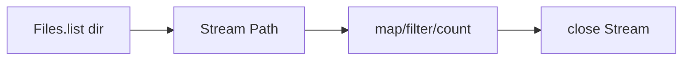

# NIO.2

> **Status:** Completed  
> **Module:** 21 — File I/O and Serialization  
> **Target Java version:** 21  
> **Last reviewed:** 2026-11-11  
> **Chapter profile:** Technical  
> **Depth target:** Level 3 (`Path` algebra, `Files` copy/list/walk, metadata, cleanup)  
> **Examples verified with:** Temurin JDK 21.0.12.1 (javac 21.0.12.1)

## 1. Learning Objectives

- Work with **`Path`**, **`Path.of`**, and **`Files`** utilities.
- **Copy**, **list** directories, **walk** trees, query **metadata** (`size`, `exists`).
- Clean up temp directory trees safely after demos/tests.
- Use **`resolve` / `normalize`** instead of string path concatenation.

## 2. Prerequisites

- Ch.01 files and streams.

**Refresher — relative vs absolute:** `Path` may be relative; `toAbsolutePath()` and `normalize()` matter for security comparisons.

## 3. Why This Concept Exists

**NIO.2** (Java 7 `java.nio.file`) replaces much `java.io.File` with richer exceptions (`IOException` subclasses), **`CopyOption`**, and **`FileVisitor`**. Single static **`Files`** façade reduces boilerplate for common file operations.

## 4. Conceptual Explanation

- **`Path`** — hierarchical path; immutable; `resolve`, `relativize`, `getFileName`.
- **`Files`** — create, copy, move, delete, read/write, `list`, `walk`.
- **`FileStore`** — volume attributes (advanced).
- **Symbolic links** — `Files.isSymbolicLink`; follow policy matters for security.

## 5. Mechanism and Execution Flow

### 5.1 Directory list



### 5.2 Walk + delete tree (demo pattern)

1. `createTempDirectory`
2. write `data.txt`, **copy** to `copy.txt`
3. `list` → `listCount=2`
4. `walk` sorted **reverse** → delete files then dirs (children before parent)

### 5.3 Copy semantics

`Files.copy(source, target, REPLACE_EXISTING)` — atomic on many file systems when replacing; still handle `FileAlreadyExistsException` when option omitted.

## 6. Terminology

| Term | Meaning |
|------|---------|
| NIO.2 | `java.nio.file` file system API |
| CopyOption | `REPLACE_EXISTING`, `ATOMIC_MOVE`, … |
| FileVisitor | Callbacks for tree walk |

## 7. Syntax and Language Rules

```java
Path dir = Files.createTempDirectory("demo");
Path file = dir.resolve("data.txt");
Files.writeString(file, "nio2-line");
```

Never `path + "/" + child` on Windows/Unix portability.

## 8. Step-by-Step Examples

Demo: [nio2-demo](../../examples/core-java/nio2-demo/).

**Verified output (Temurin 21.0.12.1):**

```text
exists=true
size=9
read=nio2-line
listCount=2
```

## 9. Real-World Use Cases

- Atomic config write: temp + `Files.move`.
- CI artifact enumeration with `walk`.
- Package tools listing JAR entries.

## 10. Internal Behavior

Operations route through **`FileSystemProvider`** for default disk FS; ZIP/JAR file systems use same API with different provider.

## 11. Edge Cases and Limitations

- TOCTOU: `exists` then `read` may race—handle `NoSuchFileException`.
- **`Files.list`/`walk`** streams must close.
- WatchService not covered here (PROGRESS outstanding).

## 12. Common Mistakes

String concat paths vs **`resolve`**.

## 13. Best Practices

- `createTempDirectory` for tests.
- `normalize().toAbsolutePath()` before security prefix checks.
- Explicit `StandardCopyOption` when replacing.

## 14. Design Trade-offs

`walk` loads directory entries lazily but still risk on very large trees—filter early.

## 15. Performance Considerations

`walk` with `Files.size` per file costly on huge trees—batch metadata carefully.

## 16. Security Considerations

```java
Path normalized = userPath.normalize().toAbsolutePath();
if (!normalized.startsWith(allowedBase)) throw new SecurityException();
```

Block `..` escape after normalize.

## 17. Java Version and Compatibility Notes

NIO.2 stable since Java 7; handbook **21**.

## 18. Revision and Mastery

- Why reverse walk for delete?
- `list` vs `walk`?

## 19. Exercises

Implement safe join of base + user relative path with validation.

## 20. Interview Questions

`Path` vs legacy `File`?

## 21. Solutions

**Path** immutable, interoperates with `Files`, better exceptions; **`File`** legacy mixed API.

## 22. Chapter Summary

NIO.2 centers on **`Path` + `Files`** for create/read/copy/list/walk. Demo verifies existence, size, read, directory count, and cleanup walk.

## 23. Key Terminology

Path · Files.walk · resolve · normalize

## 24. References and Further Reading

- [`Path` (Java 21)](https://docs.oracle.com/en/java/javase/21/docs/api/java.base/java/nio/file/Path.html)

## 25. Next Steps

[03-serialization-and-data-formats.md](03-serialization-and-data-formats.md)

## Supplement — Path algebra and tree operations (Level 3 depth)

### `resolve` vs `resolveSibling`

```java
Path dir = Path.of("/var/app/config");
Path file = dir.resolve("settings.xml");     // /var/app/config/settings.xml
Path sibling = dir.resolveSibling("logs"); // /var/app/logs — next to config dir name
```

Use **`resolve`** for child paths; **`resolveSibling`** when targeting a sibling directory of the path’s final element (common in build layouts).

### `normalize` and `..`

```java
Path p = Path.of("/var/app/data/../data/file.txt");
Path n = p.normalize(); // /var/app/data/file.txt
```

Security checks must use **`normalize().toAbsolutePath()`** before `startsWith(base)`—attackers supply `..` segments.

### `Files.walk` options

```java
try (Stream<Path> paths = Files.walk(start, 1)) {
    paths.filter(Files::isRegularFile).forEach(System.out::println);
}
```

Depth argument limits recursion—`1` lists immediate children only (similar to `list` but walks API).

### Reverse walk delete pattern (why demo uses it)

Deleting a directory requires **children first**. `Files.walk(dir).sorted(Comparator.reverseOrder())` visits deeper paths before parents—safe delete tree in one pass (handle `IOException` per file in production tools).

### Copy and move options

| `StandardCopyOption` | Effect |
|----------------------|--------|
| `REPLACE_EXISTING` | Overwrite target if present |
| `COPY_ATTRIBUTES` | Copy metadata when supported |
| `ATOMIC_MOVE` | Move as atomic operation when FS supports |

Demo copy uses replace for idempotent test runs.

### `FileStore` awareness (brief)

`Files.getFileStore(path)` reports quota, type, read-only—useful for installers and disk-space guards—not required for everyday `readString`.

### Comparing `java.io.File` migration

| Legacy `File` | NIO.2 replacement |
|---------------|-------------------|
| `new File("a/b")` | `Path.of("a", "b")` |
| `file.exists()` | `Files.exists(path)` |
| `file.listFiles()` | `Files.list(dir)` or `newDirectoryStream` |
| `file.delete()` | `Files.delete(path)` |
| `file.length()` | `Files.size(path)` |

`File.toPath()` bridges old APIs during migration—long term, use `Path` as the primary type in new code.

### Symbolic links

`Files.isSymbolicLink(path)` and `Files.readSymbolicLink` inspect links without following. For untrusted paths, consider `LinkOption.NOFOLLOW_LINKS` when querying so you do not accidentally traverse attacker-controlled targets.

### Exception granularity

NIO.2 throws specific subclasses (`NoSuchFileException`, `FileAlreadyExistsException`, `AccessDeniedException`) instead of only generic `IOException`—catch narrowly in tools that retry or surface UX messages.

### Walkthrough aligned with demo (Verified)

1. `createTempDirectory` — isolated FS location.
2. Write `data.txt` with known content → `read=nio2-line`.
3. `Files.copy` to second name → two entries → `listCount=2`.
4. `Files.size` → `size=9` (character count of content; encoding UTF-8).
5. `exists=true` before teardown; walk deletes children then directory.

### Exercises — extended solutions sketch

**Safe path join:** Resolve user input `sub` against `base`; `normalize`; verify `startsWith(baseNorm)`; else reject—prevents directory traversal even when `sub` contains `..` segments.

**Atomic config write:** Write complete config bytes to `settings.xml.tmp` in same directory, then `Files.move(tmp, settings.xml, REPLACE_EXISTING)` so readers never see partial content (where file system supports atomic replace).

### `DirectoryStream` vs `Files.list`

`Files.newDirectoryStream(dir, glob)` returns `DirectoryStream<Path>`—also requires close in try-with-resources. Choose `list` when you want a `Stream` pipeline; `DirectoryStream` when foreach is simpler in older code.

### Attributes without reading file content

```java
long size = Files.size(path);
FileTime modified = Files.getLastModifiedTime(path);
boolean isDir = Files.isDirectory(path);
```

Cheap metadata for UIs and sync tools before opening large files.

### ZIP file system provider (Illustrative)

```java
try (FileSystem fs = FileSystems.newFileSystem(Path.of("app.jar"), (ClassLoader) null)) {
    Path entry = fs.getPath("META-INF/MANIFEST.MF");
    String manifest = Files.readString(entry);
}
```

Same `Path`/`Files` API on archive contents—build tools and scanners use this pattern.

### Performance notes

| Operation | Cost driver |
|-----------|-------------|
| `Files.walk` deep tree | directory entries count |
| `Files.copy` large file | disk IO + COPY_ATTRIBUTES |
| `Files.list` huge dir | open + iterate; close promptly |

For millions of files, filter early in the stream pipeline—do not collect full path lists into memory.

### Solutions — path traversal exercise

**Concept:** Attacker passes `../../etc/passwd` as relative segment. **Steps:** `Path resolved = base.resolve(userInput).normalize().toAbsolutePath();` if `!resolved.startsWith(baseAbsolute) throw ...` **Why:** `normalize` collapses `..` before prefix test.

### Revision questions (extra)

- Difference `delete` vs `deleteIfExists`?
- When `NoSuchFileException` vs return false?
- Why `walk` sort order matters for delete?

### `FileTime` and ZIP entries

`Files.getLastModifiedTime` returns `FileTime` for metadata comparisons; copying with `COPY_ATTRIBUTES` preserves when file system supports—important for incremental backup tools.

### `UserPrincipal` / ACL (awareness)

NIO.2 supports POSIX attributes and ACL views via `Files.getAttribute`—enterprise file systems use these for permission audits; everyday CRUD uses simpler `Files` methods.

### Integration with Module 21 Ch.01

Read text via `Files.readString(path)`; transform in memory; write via `Files.writeString`—Ch.01 streaming supplements when data does not fit memory. NIO.2 chapter owns **path algebra** and **tree** operations Ch.01 defers here.

### Copy failure scenarios

`FileAlreadyExistsException` when target exists and `REPLACE_EXISTING` omitted—handle or pass option explicitly in idempotent deploy scripts.

### Mastery: draw path diagram

Sketch: temp dir → `data.txt` → copy → `list` → walk delete. Label each demo output line on the diagram—submission-style exercise for visual learners.

## Review Checklist

**Mandatory Depth Review:** Level 3 — path algebra, list/walk close, verified demo.

- [x] Chapter profile **Technical**
- [x] Mechanism walk/delete flow
- [x] Demo **Verified** Temurin 21.0.12.1

**Omissions (section → reason):**

- **WatchService** — deferred per PROGRESS.
