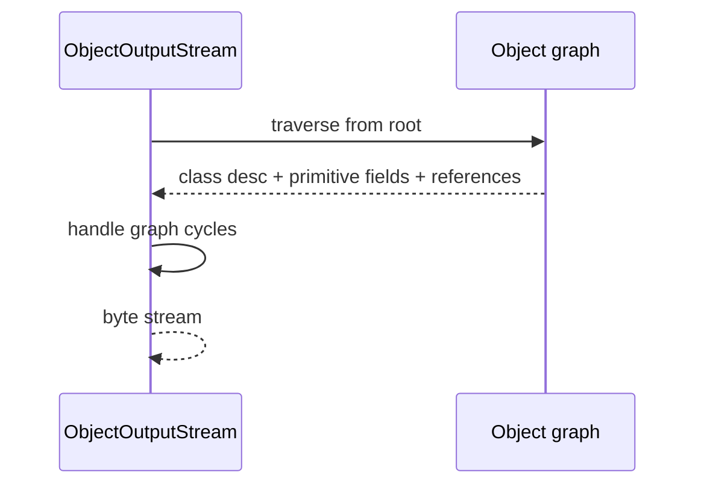

# Serialization and Data Formats

> **Status:** Completed  
> **Module:** 21 — File I/O and Serialization  
> **Target Java version:** 21  
> **Last reviewed:** 2026-11-11  
> **Chapter profile:** Deep-dive  
> **Depth target:** Levels 3–4 (Java serialization graph, `serialVersionUID`, deserialization risk, Properties, format choice)  
> **Examples verified with:** Temurin JDK 21.0.12.1 (javac 21.0.12.1)

## 1. Learning Objectives

- Serialize object graphs with **`ObjectOutputStream`** / **`ObjectInputStream`** when justified—and articulate **when not to**.
- Use **`Properties`** for simple key-value persistence with encoding rules.
- Compare Java serialization to **JSON** and other interchange formats conceptually.
- Describe **deserialization attacks** and **ObjectInputFilter** direction (JEP 415 ecosystem).

## 2. Prerequisites

- Ch.01–02; classes and **records** (Module 15).

**Refresher — record serialization:** Records can implement **`Serializable`**; semantics follow normal object serialization with component fields—still subject to **gadget** risks if deserializing untrusted bytes.

## 3. Why This Concept Exists

Systems exchange **bytes**. Java **native serialization** preserves graphs and type information but is **fragile** (versioning) and **dangerous** (untrusted input). Modern services prefer **JSON/Protobuf**; Java serialization persists in caches, RMI legacy, and some frameworks—teams must know risks.

## 4. Conceptual Explanation

### 4.1 Java serialization

`Serializable` marker interface (no methods). Default serialization writes class metadata + field values; handles cycles via handles.

### 4.2 Versioning

**`serialVersionUID`** stabilizes explicit version compatibility; mismatch → `InvalidClassException`.

### 4.3 Properties

`.properties` files: ISO-8859-1 with Unicode escapes; `load`/`store` for simple config—not for secrets in plain text.

### 4.4 JSON (survey)

Textual, cross-language; libraries (Jackson) preferred for APIs. Demo measures UTF-8 **byte length** of JSON **string** without external deps.

## 5. Mechanism and Execution Flow

### 5.1 Serialize write path (Level 4)



**`writeObject` / `readObject`** hooks customize steps; misuse breaks compatibility.

### 5.2 Deserialize read path (security critical)

1. `ObjectInputStream.readObject()`
2. Stream describes classes to instantiate.
3. Without **filter**, attacker-chosen class chains (**gadgets**) may execute harmful logic during read.

**Never deserialize untrusted bytes.** Prefer JSON/schema-validated formats. Use **`ObjectInputFilter`** allowlists when Java serialization is unavoidable (JDK API).

### 5.3 Properties store

`Properties.store(OutputStream, comment)` writes `key=value` lines with escaping rules.

## 6. Terminology

| Term | Meaning |
|------|---------|
| Serializable | Marker for JVM native serialization participation |
| Gadget chain | Deserialization path invoking attacker-chosen methods |
| ObjectInputFilter | JDK filter hook to limit deserializable classes |
| DTO | Data transfer object—often JSON, not Java serialization |

## 7. Syntax and Language Rules

```java
record UserDto(String name, int score) implements Serializable { }

try (var oos = new ObjectOutputStream(baos)) {
    oos.writeObject(dto);
}
```

## 8. Step-by-Step Examples

Demo: [serialization-formats-demo](../../examples/core-java/serialization-formats-demo/).

**Verified output (Temurin 21.0.12.1):**

```text
serializedBytes=99
deserialized=Ada:97
propertiesStored=true
jsonBytes=25
```

### 8.1 Interpretation

- Round-trip **record** `UserDto`.
- Properties round-trip boolean flag.
- JSON byte measure **illustrative** of compact text vs Java binary.

## 9. Real-World Use Cases

- Legacy session replication—migrate to DTO + JSON.
- Ops feature flags in `.properties`.
- Cross-language APIs: **never** Java serialization on the wire.

## 10. Internal Behavior

Serialization uses **defaultWriteObject** / reflection on non-transient fields unless customized. **HotSpot** does not change wire format—format is **JVM binary protocol**, not language spec for all data interchange.

## 11. Edge Cases and Limitations

- **transient** fields skipped.
- **Enum** serialization by name.
- **Evolution** requires disciplined UID and optional `serialPersistentFields`.

## 12. Common Mistakes

Deserializing network payloads without filter or format change.

## 13. Best Practices

- Default to **versioned DTOs + JSON** for APIs.
- If Java serialization required: minimal class set, **filter**, no external input.
- Document field changes and compatibility.

## 14. Design Trade-offs

| Format | Strength | Weakness |
|--------|----------|----------|
| Java serialization | Graphs, Java types | Opaque, unsafe, versioning pain |
| JSON | Interop, human | Schema enforcement needed |
| Properties | Simple config | No nesting, encoding limits |

## 15. Performance Considerations

Binary Java serialization can be faster than JSON for Java-only caches—but security and evolution costs dominate decisions.

## 16. Security Considerations

Treat Java deserialization of **untrusted** input as **vulnerability**. Mandatory filters or ban. Do not rely on “obscure” classes as security.

## 17. Java Version and Compatibility Notes

Filter APIs evolved post-8; handbook on **21**—consult current `ObjectInputFilter` documentation when enabling.

## 18. Revision and Mastery

- What executes during `readObject` attack?
- When Properties vs YAML/JSON config?
- Record + Serializable caveats?

## 19. Exercises

Design allowlist filter for demo `UserDto` only.

## 20. Interview Questions

Why is Java deserialization unsafe on public endpoints?

## 21. Solutions

Attacker picks types whose `readObject`/`readResolve` chains invoke runtime primitives; without filter, graph can trigger **remote code execution** historically—use safe formats or strict allowlists.

## 22. Chapter Summary

Know Java serialization mechanics and **when not to use them**; Properties for trivial config; default to JSON/text for interoperability. Demo verifies bytes, round-trip, properties, JSON size measure.

## 23. Key Terminology

Serializable · serialVersionUID · gadget · ObjectInputFilter · Properties

## 24. References and Further Reading

- [`Serializable` (Java 21)](https://docs.oracle.com/en/java/javase/21/docs/api/java.base/java/io/Serializable.html)
- [JEP 415: Serialization Filters](https://openjdk.org/jeps/415)
- [`Properties` (Java 21)](https://docs.oracle.com/en/java/javase/21/docs/api/java.base/java/util/Properties.html)

## 25. Next Steps

Module 22 — `java.time` depth.

## Supplement — Evolution, filters, and format choice (Level 4 depth)

### `serialVersionUID` discipline

Explicit constant:

```java
private static final long serialVersionUID = 1L;
```

Change **only** when you intentionally break compatibility. Renaming fields, changing types, or altering hierarchy without UID plan → `InvalidClassException` at runtime.

### `transient` and custom hooks

| Mechanism | Use |
|-----------|-----|
| `transient` field | Skip default serialization |
| `writeObject` / `readObject` | Custom wire format per class |
| `writeReplace` / `readResolve` | Replace with proxy instance (security-sensitive) |

Gadget chains often abuse **`readObject`** in library classes—reason to minimize classpath deserializable types.

### `ObjectInputFilter` (conceptual allowlist)

JDK filter API (see JEP 415) lets you allow or reject class descriptors during deserialization:

```java
ObjectInputFilter filter = ObjectInputFilter.Config.createFilter(
    "com.example.UserDto;!*");
```

Production: combine with **no external input** policy—not a substitute for avoiding Java serialization on the wire.

### Properties encoding reality

`.properties` files use ISO-8859-1 with `\uXXXX` escapes for non-Latin text—**UTF-8 YAML/JSON** often better for international config. Properties remain fine for simple English keys and feature flags.

### When JSON wins (default for new systems)

| Concern | JSON + schema | Java serialization |
|---------|---------------|------------------|
| Cross-language | yes | no |
| Human audit | yes | no |
| Schema evolution | OpenAPI / JSON Schema | brittle UID model |
| Untrusted input | parse + validate | **dangerous** |

Demo `jsonBytes=25` is **UTF-8 byte length** of a small JSON **string**—Illustrative measure without Jackson dependency in repo.

### Records on the wire

Prefer **DTO records** serialized as JSON fields matching component names—or explicit DTO mappers. Java binary serialization of records is possible but inherits same **trust** rules as classes.

### Serialization wire format (awareness, not memorization)

Stream begins with **magic** `0xAC 0xED`, version, then object graph descriptions (class names, field values, references, handles for cycles). Demo `serializedBytes=99` on small record—size grows with class metadata and graph depth.

### `Externalizable` vs `Serializable`

`Externalizable` forces custom `readExternal`/`writeExternal`—full control, more maintenance. Use when default field serialization is wrong or too verbose; still subject to **trust** rules on read.

### XML and other formats (survey)

| Format | Typical Java stack |
|--------|-------------------|
| JSON | Jackson, Gson, JSON-B |
| XML | JAXB, Jackson XML |
| YAML | SnakeYAML (config) |
| Protobuf | gRPC, schema-evolved binary |

Handbook does not mandate a library—Module 21 establishes **default to JSON** for services.

### Compliance and audit

Regulated environments may forbid Java deserialization entirely in security profiles—align with organizational ASVS / OWASP deserialization guidance; Properties files for non-secret toggles only (secrets in vaults, not `.properties` in repos).

### Exercise: filter design reasoning

**Intent:** Allow only `com.example.UserDto` in stream. **Why:** shrunk attack surface—gadget chains need arbitrary classes on classpath. **Limit:** still unsafe if `UserDto` has dangerous `readObject`—defense in depth means trusted types + no untrusted input + prefer JSON.

### Verified demo recap

| Line | Meaning |
|------|---------|
| `serializedBytes=99` | Binary size of one round-trip graph |
| `deserialized=Ada:97` | Record integrity after read |
| `propertiesStored=true` | Key round-trip in memory buffer |
| `jsonBytes=25` | UTF-8 size of illustrative JSON string |

### `readObject` defense in depth

Even with allowlist filters:

1. Reject untrusted bytes at network edge (best).
2. Use JSON/schema validation (preferred interchange).
3. If Java serialization required: filter + minimal classpath + no custom dangerous `readObject` in app types.
4. Monitor deserialization in security audits.

### Version migration story (Illustrative)

```text
v1 User with field "name"
v2 User adds "email" with default for old streams → plan UID + optional custom readObject
```

Without plan, old caches throw `InvalidClassException` on deploy—coordinate cache flush with schema change.

### `Serializable` vs `Externalizable` decision

Default `Serializable` is faster to implement; `Externalizable` when you must shrink wire size or hide fields entirely—both remain **trust-sensitive**.

### Properties vs env vars in 12-factor apps

Properties files suit local defaults; containers inject **environment variables** for secrets. Do not commit API keys in `.properties` tracked by git.

### Record serialization and evolution

Adding a component to a **record** changes serialization shape—treat like adding a field to a class: bump UID strategy or invalidate old blobs. Prefer JSON version field for API evolution.

### Interview deep dive

**Q:** Why is `ObjectInputStream` on a socket dangerous? **A:** Attacker supplies serialized gadget chain selecting classes already on server classpath whose `readObject` methods chain to RCE—or denial via allocation bombs.

### Hands-on exercise extension

Measure `serializedBytes` before/after adding a field to `UserDto`—observe metadata growth; relate to cache storage budgeting.

## Review Checklist

**Mandatory Depth Review:** Levels 3–4 — serialize/deserialize flow, security Level 4.

- [x] Chapter profile **Deep-dive**
- [x] Mechanism write/read sequences (Section 5)
- [x] Demo **Verified** Temurin 21.0.12.1
- [x] Security warnings prominent

**Omissions (section → reason):**

- **Jackson tutorial** — cross-link in later web modules (PROGRESS).
