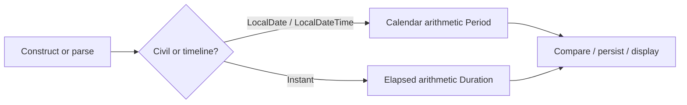

# java.time

> **Status:** Completed  
> **Module:** 22 — Date, Time, and Internationalization  
> **Target Java version:** 21  
> **Last reviewed:** 2026-11-11  
> **Chapter profile:** Technical  
> **Depth target:** Levels 2–3 (type roles, immutability, arithmetic)  
> **Examples verified with:** Temurin JDK 21.0.12.1 (javac 21.0.12.1); re-run 2026-11-11 on Oracle JDK 21.0.9 produced identical demo output

**Section policy:** Omissions recorded in Review Checklist. Expand-preserve third deepen pass: keep verified demo facts; deepen type roles, legacy contrast, and arithmetic rules.

## 1. Learning Objectives *(mandatory)*

After completing this chapter, you should be able to:

- Explain why **`java.time`** replaced mutable **`Date`** / **`Calendar`** for new code.
- Choose among **`LocalDate`**, **`LocalTime`**, **`LocalDateTime`**, **`Instant`**, **`Duration`**, and **`Period`** for a concrete scenario.
- Explain why these types are **immutable** and safe to share across threads when used as values.
- Compare dates/times and perform arithmetic without confusing **calendar** amounts (`Period`) and **elapsed** amounts (`Duration`).
- Use **`Instant`** as a UTC timeline value for logs and persistence boundaries.
- Inject a **`Clock`** (or fixed test dates) instead of hard-wiring `now()` in business logic.

## 2. Prerequisites *(mandatory)*

- Module **02** — numeric types; `long` for epoch seconds and nanoseconds.
- Module **06** — immutability as a design habit (value objects that never mutate after construction).
- Module **20** — standard-library overview may mention legacy time APIs; **this module replaces them for new work**.

**Refresher — mutable vs immutable values:** A mutable object can change fields after you hand it to another method. An **immutable** type returns a *new* instance from every mutating-looking operation (`plusDays`, `withYear`). Callers can share the value without defensive copying.

## 3. Why This Concept Exists *(mandatory)*

For years, Java’s primary time API was **`java.util.Date`** plus **`Calendar`**. That model caused recurring production bugs:

| Legacy pain | What went wrong |
|-------------|-----------------|
| **Mutability** | `Date.setTime(...)` changed shared instances; caches and concurrent readers saw races. |
| **Mixed meanings** | One `Date` was “milliseconds since epoch” *and* often treated as local wall time without an explicit zone. |
| **Awkward calendar math** | `Calendar` months were **0-based** (January = 0); day-of-week numbering was easy to get wrong. |
| **Poor naming** | `Date` was not a civil date; it was an instant with a confusing `toString()` that used the JVM default zone. |

**`java.time`** (JSR-310, final in **Java 8**) separates concerns that the legacy API mashed together:

- **Civil** year-month-day / clock-of-day without claiming a unique global moment (`Local*`).
- A **machine timeline** point (`Instant`) on UTC.
- **Amounts** of time either as elapsed (`Duration`) or as calendar units (`Period`).
- **Zones and formatting** (next chapter) as explicit collaborators, not hidden defaults.

Without that separation, teams keep inventing half-fixed helpers around `Date`, or store ambiguous “local” strings that cannot be converted safely when the server zone changes.

## 4. Conceptual Explanation *(mandatory)*

### 4.1 Type roles (choose by meaning, not by habit)

| Type | Represents | Typical use |
|------|------------|-------------|
| `LocalDate` | Year-month-day, no time, no zone | Birthday, invoice due date, “open until” calendar day |
| `LocalTime` | Time-of-day, no date, no zone | Store hours “09:00–17:00” for a shop’s local schedule |
| `LocalDateTime` | Local date + time, **still no zone** | Meeting slot *as printed on a local flyer*—not a unique global instant |
| `Instant` | Point on the UTC timeline | Log timestamps, DB `timestamptz` mental model, distributed event ordering |
| `Duration` | Exact elapsed time (seconds + nanos; also hours/minutes helpers) | SLA timeout, “meeting lasted 150 minutes” |
| `Period` | Calendar amount (years, months, days) | Age, “renew every 1 month”, subscription length |

**Rule of thumb:** If two people in different cities must agree on *the same moment*, you need an **`Instant`** (or a zoned/offset type from Ch.02). If you only care about a *printed calendar date* in one civil calendar, use **`LocalDate`**.

### 4.2 Instant vs Local* — the core confusion

```text
Instant ──────── UTC timeline (same everywhere)
LocalDateTime ── wall clock fields with NO zone attached
```

- `Instant.parse("2026-11-10T09:00:00Z")` is one global moment (the trailing `Z` means UTC offset zero).
- `LocalDateTime.of(2026, 11, 10, 9, 0)` is “nine o’clock on that date” **somewhere**—Yangon, New York, and UTC all disagree about which `Instant` that is until you attach a `ZoneId` (Ch.02).

Mixing them silently (for example storing `LocalDateTime.now()` in a multi-region database) is a common source of “it worked in staging” bugs.

### 4.3 Immutability and thread safety (API / design)

Every `java.time` value type in common use is **immutable**:

```java
LocalDate d = LocalDate.of(2026, 1, 31);
LocalDate next = d.plusMonths(1); // new value; d unchanged
```

**API / design:** Because fields never mutate after construction, sharing a `LocalDate` or `Instant` across threads is safe *as a value*. You still must not mutate *containers* that hold them without synchronization—but the time objects themselves do not need locks.

Legacy contrast (do **not** write this in new code):

```java
Date shared = new Date();
shared.setTime(shared.getTime() + 60_000); // mutates; dangerous if shared
```

### 4.4 Duration vs Period

| | `Duration` | `Period` |
|-|------------|----------|
| Question it answers | How much **elapsed** time? | How many **calendar** years/months/days? |
| Typical inputs | Two `Instant`s or two `LocalTime`/`LocalDateTime`s | Two `LocalDate`s |
| Surprises | Fixed length (ignores DST clock shifts when used on instants correctly via `Instant`) | Month lengths and leap years matter |

Age in years is almost always a **`Period`**. A stopwatch between two log lines is a **`Duration`**.

### 4.5 Construction, parsing, and “now”

Common factories:

- `LocalDate.of(2026, 11, 10)` — explicit fields (months are **1-based**).
- `LocalDate.parse("2026-11-10")` — ISO-8601 local date.
- `Instant.parse("2026-11-10T09:00:00Z")` — ISO-8601 instant.
- `LocalDate.now()` / `Instant.now()` — current value using the system clock.
- `LocalDate.now(Clock.fixed(...))` — testable “now”.

Prefer **explicit values** in demos and unit tests so output is reproducible.

## 5. Mechanism and Execution Flow *(mandatory)*

`java.time` types are ordinary heap objects implementing well-defined arithmetic. There is **no special JVM bytecode** for dates—behavior lives in the library.

Typical flow for a business calculation:

1. **Obtain** inputs — parse ISO strings, read DB columns into the right type, or construct with `of`.
2. **Normalize meaning** — decide whether the value is civil (`LocalDate`) or timeline (`Instant`). Do not cast between them without an explicit zone (Ch.02).
3. **Compute** — `plus` / `minus` / `Period.between` / `Duration.between` return **new** objects.
4. **Compare** — `isBefore`, `isAfter`, `compareTo`, or `equals` (equality is field equality for local types; for `Instant`, timeline equality).
5. **Emit** — persist `Instant` (or offset) at boundaries; format for humans later (Ch.02–03).



**Diagram:** Choose the branch by *meaning*. Crossing from `LocalDateTime` to `Instant` requires a zone rule set (next chapter)—that edge is intentional and must be explicit in code.

## 6. Terminology *(mandatory)*

| Term | Meaning |
|------|---------|
| Civil date | Year-month-day in a calendar sense, without claiming a unique UTC moment |
| Instant | A single point on the UTC timeline |
| ISO-8601 | Widely used string formats; `LocalDate` / `Instant` parse common ISO forms by default |
| Epoch | Reference origin for machine time; Java `Instant` uses the Unix epoch (1970-01-01T00:00:00Z) plus nanos |
| Immutable value | Object whose observable state never changes after construction; “updates” return copies |
| Clock | Abstraction for “what time is it now?”, injectable for tests |

## 7. Syntax and Language Rules *(include when the topic is language/API surface)*

```java
LocalDate birth = LocalDate.of(1990, 1, 15);
Period age = Period.between(birth, LocalDate.now());
Duration meeting = Duration.between(startTime, endTime);
Instant logEvent = Instant.parse("2026-11-10T08:00:00Z");
```

Important language/API rules:

- Months in `of(year, month, day)` are **1–12** (unlike legacy `Calendar`).
- `LocalDate.plusMonths` uses calendar rules (end-of-month adjustment)—not “always 30 days”.
- `Duration.toMinutes()` truncates toward zero leftover seconds; use nanos APIs when sub-minute precision matters.
- String escape is ordinary Java; ISO parsers expect standard forms (`2026-11-10`, `2026-11-10T09:00:00Z`).

Inject **`Clock`** in production services and tests instead of scattering bare `LocalDate.now()` calls (demo flag `useJavaTime` marks the modern path).

## 8. Step-by-Step Examples *(mandatory)*

Demo project: [java-time-demo](../../examples/core-java/java-time-demo/).

**Compile and run** (from the demo directory):

```text
javac JavaTimeDemo.java
java JavaTimeDemo
```

### 8.1 Minimal — period and duration (Verified)

Core of `JavaTimeDemo.java` (default package):

```java
LocalDate birth = LocalDate.of(1990, 3, 15);
LocalDate today = LocalDate.of(2026, 11, 10);
Period age = Period.between(birth, today);
System.out.println("ageYears=" + age.getYears());

LocalDateTime start = LocalDateTime.of(2026, 11, 10, 9, 0);
LocalDateTime end = start.plusHours(2).plusMinutes(30);
Duration meeting = Duration.between(start, end);
System.out.println("durationMinutes=" + meeting.toMinutes());

Instant i1 = Instant.parse("2026-11-10T09:00:00Z");
Instant i2 = i1.plus(Duration.ofHours(1));
System.out.println("instantPlus=" + i2);

System.out.println("useJavaTime=true");
```

**Verified output (Temurin JDK 21.0.12.1; identical on Oracle JDK 21.0.9 re-run 2026-11-11):**

```text
ageYears=36
durationMinutes=150
instantPlus=2026-11-10T10:00:00Z
useJavaTime=true
```

**Important lines:**

- `Period.between` uses **calendar** rules: years/months/days between two `LocalDate`s—not “days / 365”.
- `Duration.between` on two `LocalDateTime`s on the same civil day yields a fixed elapsed length; here 2h30m → **150** minutes.
- `Instant.plus(Duration)` moves along the UTC timeline; ISO printing keeps the `Z` offset marker.

**Why written this way:** Fixed dates (not `now()`) keep the Verified output stable for handbook checks.

### 8.2 Realistic — age check and SLA window (Illustrative)

```java
boolean adult(LocalDate birth, LocalDate onDay) {
    return Period.between(birth, onDay).getYears() >= 18;
}

boolean withinSla(Instant request, Instant response, Duration max) {
    return Duration.between(request, response).compareTo(max) <= 0;
}
```

Use **`Period`** for age policies and **`Duration`** for latency SLAs. Do not convert “18 years” into `Duration.ofDays(18 * 365)`.

### 8.3 Incorrect vs corrected

**Incorrect (legacy in new code):**

```java
new Date(); // mutable; unclear local vs UTC; avoid in new APIs
```

**Corrected:**

```java
Instant.now();           // timeline event
// or
LocalDate.now(clock);    // civil “today” with injectable Clock
```

**Incorrect (wrong amount type):**

```java
Duration adultSpan = Duration.ofDays(18L * 365); // ignores leap years / calendar
```

**Corrected:**

```java
boolean ok = Period.between(birth, today).getYears() >= 18;
```

## 9. Real-World Use Cases *(conditional)*

- **Subscriptions** — store start `LocalDate` or `Instant` plus a `Period` (“+1 month”).
- **Audit logs** — emit `Instant` in UTC; convert to zoned display only at the UI edge (Ch.02).
- **Batch jobs** — compute “yesterday” as `LocalDate.now(clock).minusDays(1)` in the business zone’s civil calendar, not as `Instant.minus(Duration.ofHours(24))` when the calendar day is what the product means.
- **APIs** — prefer ISO-8601 strings for instants (`...Z` or offset) over locale-formatted text in machine payloads.

## 11. Edge Cases and Limitations *(strongly encouraged)*

- **Month arithmetic** — `LocalDate.of(2026, 1, 31).plusMonths(1)` becomes **2026-02-28** (or 29 in a leap year), not March 2/3. Document product expectations for “end of month”.
- **Leap years** — `Period` and `LocalDate` honor Feb 29; naive day multiplications do not.
- **Leap seconds** — the Java time-scale is a simplified UTC-SLS model; leap seconds are rarely an app concern but matter in some scientific systems.
- **`LocalDateTime` alone** does not identify a global moment—add `ZoneId` / `ZonedDateTime` (Ch.02) before ordering events across regions.
- **Equality** — `LocalDateTime` equality is field equality; two equal local values can map to different instants in different zones.

## 12. Common Mistakes *(mandatory)*

### Incorrect — mutable legacy sharing

```java
Date deadline = loadDeadline();
deadline.setTime(deadline.getTime() + TimeUnit.DAYS.toMillis(1));
```

### Corrected

```java
Instant deadline = loadDeadline();
Instant extended = deadline.plus(Duration.ofDays(1));
```

### Incorrect — treating `LocalDateTime` as global

```java
LocalDateTime created = LocalDateTime.now(); // depends on JVM default zone
```

### Corrected

```java
Instant created = Instant.now(clock); // explicit timeline; zone at display time
```

### Incorrect — mixing `Duration` and `Period` semantics

```java
// “one month later” as 30 days of elapsed time
Instant next = start.plus(Duration.ofDays(30));
```

### Corrected (civil month)

```java
LocalDate next = startDate.plus(Period.ofMonths(1));
```

## 13. Best Practices *(include when guidance adds value)*

- Prefer **`java.time` only** in new code; convert at the boundary if a library still returns `Date` (`date.toInstant()`).
- Store **`Instant`** (or offset date-time) at persistence and messaging boundaries.
- Use **`Clock`** (or fixed dates) in unit tests so “today” is deterministic.
- Name variables by meaning (`dueDate`, `occurredAt`) so reviewers catch type mismatches.
- Keep human formatting and locale concerns in Ch.02–03 layers—not inside domain arithmetic.

## 14. Design Trade-offs *(conditional)*

| Choice | Benefit | Cost |
|--------|---------|------|
| Many specific types | Harder to misuse meanings | More imports and conversion points |
| Immutability | Thread-safe values; easy reasoning | More short-lived objects (usually cheap) |
| ISO default parsing | Interoperable strings | Strict formats; bad input throws `DateTimeParseException` |
| Avoiding legacy `Date` | Fewer classic bugs | Interop conversion at old library edges |

## 17. Java Version and Compatibility Notes *(conditional)*

- **`java.time`** final since **Java 8** (JSR-310); primary path on **Java 21** is unchanged.
- Legacy `Date` / `Calendar` remain in the JDK for compatibility; do not use them in new handbook examples.
- Three-ten-backport existed for older Android/Java 7 eras; irrelevant for this handbook’s Java 21 target.

## 19. Revision and Mastery *(Technical)*

**You should already understand:** immutability, why shared mutable state is dangerous, ISO-8601 as a wire format.

**Common gaps:**

- Using `LocalDateTime.now()` for distributed event timestamps.
- Computing age with `Duration` or fixed 365-day years.
- Assuming `plusMonths(1)` always preserves the day-of-month.

**Questions you should answer:**

1. When must you attach a zone before comparing two “nine o’clock” values?
2. Why is `Date` a poor name for what the legacy class actually stored?
3. How do you make `now()` testable without PowerMock-style hacks?

**Exercise:** Given birth `1990-03-15` and “today” `2026-11-10`, compute years with `Period` and explain why `Duration.between` on converted midnights would be the wrong tool for legal age.

## 20. Exercises *(include for major chapters)*

### Beginner

1. Construct a `LocalDate` for your birthday and print `Period.between` years to a fixed “today”.
2. Parse an `Instant` ending in `Z` and add two hours with `Duration`.

### Intermediate

3. Write a method that returns whether a meeting (`LocalDateTime` start/end same day) exceeds 90 minutes using `Duration`.
4. Explain in comments why storing only `LocalDateTime` is insufficient for a global webinar start.

### Advanced

5. Design a small `Clock`-injected “business day” helper that returns yesterday’s `LocalDate` for tests with a fixed clock.

## 23. Chapter Summary *(mandatory)*

**`java.time`** separates **civil** local types, **UTC instants**, and **amounts** (`Period` vs `Duration`), with **immutable** values that replace legacy `Date`/`Calendar` for new code. Choose types by meaning; keep global moments as `Instant` until you deliberately add zones (Ch.02) and locales (Ch.03).

## 25. References and Further Reading *(mandatory)*

- [Java SE 21 `java.time` package summary](https://docs.oracle.com/en/java/javase/21/docs/api/java.base/java/time/package-summary.html)
- [JSR 310: Date and Time API](https://jcp.org/en/jsr/detail?id=310)
- [ISO 8601 overview (ISO)](https://www.iso.org/iso-8601-date-and-time-format.html)

## 26. Next Steps

[02-time-zones-and-formatting.md](02-time-zones-and-formatting.md) — attach `ZoneId`, convert with `ZonedDateTime`, and format/parse with `DateTimeFormatter`.

## Review Checklist

**Mandatory Depth Review:** Technical profile → Levels 2–3.

- [x] Learning objectives covered
- [x] Prerequisites refreshed (immutability, legacy contrast)
- [x] Chapter profile and depth target recorded
- [x] Depth gate: type roles, Instant vs Local*, Period vs Duration, progressive examples
- [x] Mechanism flow (construct → branch → compute → emit) with diagram
- [x] First-appearance concepts explained now (zones previewed, not deferred as a substitute)
- [x] Verified demo output recorded from real runs (Temurin baseline; Oracle 21.0.9 re-run identical)
- [x] References support API claims
- [x] Revision and Mastery included
- [x] `PROGRESS.md` updated in this pass

**Omissions (section → reason):**

- Internal behavior (JVM) → pure library types; no JVMS-specific mechanism beyond ordinary objects
- Performance → allocation cost of immutability is negligible for typical app date math; omit filler
- Security → not primary for civil arithmetic; persistence/auth time issues belong elsewhere
