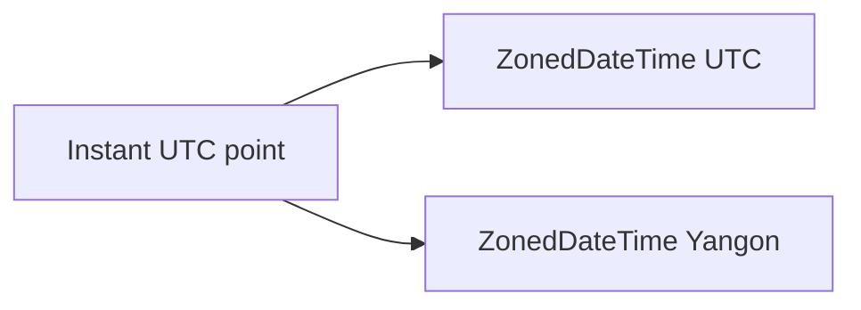

# Time Zones and Formatting

> **Status:** Completed  
> **Module:** 22 — Date, Time, and Internationalization  
> **Target Java version:** 21  
> **Last reviewed:** 2026-11-11  
> **Chapter profile:** Technical  
> **Depth target:** Levels 2–3 (ZoneId, ZonedDateTime, formatters)  
> **Examples verified with:** Temurin JDK 21.0.12.1 (javac 21.0.12.1)

## 1. Learning Objectives *(mandatory)*

- Convert the same **`Instant`** across **`ZoneId`** with **`ZonedDateTime`**.
- Format and parse with **`DateTimeFormatter`** patterns and localized styles.
- Explain **same instant, different local clock** without conflating zones and locales.

## 2. Prerequisites *(mandatory)*

- Ch.01 `java.time` types, especially `Instant` and `LocalDateTime`.

## 3. Why This Concept Exists *(mandatory)*

Users see **local civil time**; systems store a **single timeline**. **`ZonedDateTime`** binds local fields to a **zone ruleset** (including DST). **`DateTimeFormatter`** renders parseable text for humans and APIs.

## 4. Conceptual Explanation *(mandatory)*

- **`ZoneId`** — region rules (`Asia/Yangon`, `America/New_York`) or fixed offsets—not interchangeable for long-lived data when DST exists.
- **`ZonedDateTime`** — local date-time + zone; **`withZoneSameInstant`** converts display.
- **`DateTimeFormatter`** — pattern letters (`yyyy-MM-dd HH:mm z`) or `ofLocalizedDateTime`.
- **Persist** `Instant` + `ZoneId` (or offset) rather than ambiguous wall time alone.

## 5. Mechanism and Execution Flow *(mandatory)*

1. Fix an `Instant` on the UTC line.
2. `instant.atZone(ZoneId.of("UTC"))` vs `atZone(ZoneId.of("Asia/Yangon"))`.
3. `withZoneSameInstant` moves zone while keeping instant.
4. Formatter reads zone rules for abbreviation display (`MMT`).



## 8. Step-by-Step Examples *(mandatory)*

Demo: [zones-formatting-demo](../../examples/core-java/zones-formatting-demo/).

**Verified output (Temurin JDK 21.0.12.1):**

```text
utc=15:30
yangon=22:00
formatted=2026-11-10 22:00 MMT
legacyDateAvoided=true
```

UTC 15:30 aligns with 22:00 in UTC+6:30. Formatter includes zone abbreviation (display only).

## 11. Edge Cases and Limitations *(strongly encouraged)*

- **DST gaps/overlaps** — local times may be invalid or ambiguous; use `ZonedDateTime` rules API for edge cases.
- Zone **abbreviations** are not unique globally.
- **Legacy `Date`** avoided in demo—do not mix with `java.time` without explicit conversion.

## 12. Common Mistakes *(mandatory)*

Storing wall-clock `LocalDateTime` without zone for distributed events.

## 23. Chapter Summary *(mandatory)*

Zones map **instants** to civil times; formatters render text—know whether you manipulate **instant**, **local**, or **zoned** values.

## 26. Next Steps

[03-locale-and-internationalization.md](03-locale-and-internationalization.md)

## Review Checklist

- [x] Technical; Verified Temurin 21.0.12.1; diagram for instant→zones
- [x] Omissions: Security, Performance
