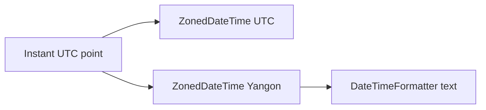

# Time Zones and Formatting

> **Status:** Completed  
> **Module:** 22 — Date, Time, and Internationalization  
> **Target Java version:** 21  
> **Last reviewed:** 2026-11-11  
> **Chapter profile:** Technical  
> **Depth target:** Levels 2–3 (ZoneId, ZonedDateTime, formatters)  
> **Examples verified with:** Temurin JDK 21.0.12.1 (javac 21.0.12.1); re-run 2026-11-11 on Oracle JDK 21.0.9 produced identical demo output

**Section policy:** Omissions in Review Checklist. Expand-preserve third deepen pass: keep Verified zone/format demo; deepen DST, conversion, and formatter pitfalls.

## 1. Learning Objectives *(mandatory)*

After completing this chapter, you should be able to:

- Convert the same **`Instant`** (or zoned value) across **`ZoneId`** values with **`ZonedDateTime`**.
- Explain **same instant, different local clock** without conflating **time zones** and **locales**.
- Prefer region-based zone IDs (`Asia/Yangon`) over raw offsets for long-lived data when DST/rules can change.
- Format and parse with **`DateTimeFormatter`** patterns and localized styles.
- Persist timeline data safely (`Instant` + zone intent) instead of ambiguous wall-clock strings alone.

## 2. Prerequisites *(mandatory)*

- Ch.01 — `java.time` types, especially **`Instant`**, **`LocalDateTime`**, immutability, and why `Local*` alone is not a global moment.

**Refresher:** An **`Instant`** is one point on the UTC timeline. A **`LocalDateTime`** is a civil date and clock time **without** zone rules. Bridging them requires a **`ZoneId`** (or a fixed offset).

## 3. Why This Concept Exists *(mandatory)*

Users see **local civil time** (“meeting at 10:00”). Distributed systems store a **single timeline** (“this event is one `Instant`”). Without an explicit zone ruleset:

- “10:00” in Yangon and “10:00” in New York are different moments.
- Daylight saving transitions create **gaps** (spring forward: local times that never exist) and **overlaps** (fall back: local times that exist twice).
- Formatting without a clear pattern/locale produces strings that humans misread or machines cannot parse.

**`ZonedDateTime`** binds local fields to a **zone ruleset** (including DST history). **`DateTimeFormatter`** turns values into parseable or human text—and parses text back—without relying on `Date.toString()` folklore.

## 4. Conceptual Explanation *(mandatory)*

### 4.1 ZoneId — rules, not just “UTC+6:30”

- **`ZoneId.of("Asia/Yangon")`** — IANA region ID; rules can include historical offset changes.
- **`ZoneId.of("UTC")` / `ZoneOffset.UTC`** — fixed zero offset (handy for storage display).
- **`ZoneOffset.ofHoursMinutes(6, 30)`** — fixed offset only; **does not** track future political/DST rule changes the way a region ID does.

For **long-lived** appointments (“every March meeting”), prefer **region IDs**. Fixed offsets are fine for *already resolved* moments or protocols that send explicit offsets.

**Asia/Yangon** is a clear teaching example: Myanmar Time is a fixed **UTC+06:30** in current rules—demo math stays stable—while still using a real region ID rather than inventing `GMT+6:30` strings.

### 4.2 ZonedDateTime — local fields + zone

`ZonedDateTime` holds:

1. Local date-time fields (what a wall clock would show in that zone).
2. The `ZoneId` whose rules interpret those fields.
3. The resolved offset for that moment (derived from rules).

Key conversions:

| Method | Keeps | Changes |
|--------|-------|---------|
| `withZoneSameInstant` | The underlying instant | Local fields / offset for the new zone |
| `withZoneSameLocal` | The local wall fields | Instant (and possibly offset) — use carefully |

Most “show this event in the user’s city” UIs want **`withZoneSameInstant`**.

### 4.3 Instant ↔ zone mapping

```text
Instant  --atZone(zone)-->  ZonedDateTime
ZonedDateTime.toInstant() --> Instant
```

Same `Instant`, different zones → different printed local times. That is expected, not a bug.

### 4.4 DateTimeFormatter — patterns and localized styles

- **Pattern:** `DateTimeFormatter.ofPattern("yyyy-MM-dd HH:mm z")` — explicit field letters.
- **Localized style:** `DateTimeFormatter.ofLocalizedDateTime(FormatStyle.MEDIUM).withLocale(locale)` — locale chooses order and symbols (Ch.03 deepens locale).
- **ISO constants:** `DateTimeFormatter.ISO_INSTANT`, `ISO_OFFSET_DATE_TIME`, etc.

**Zone vs locale:** Zone answers “which rules map instant ↔ wall time?” Locale answers “which language/symbols for month names, order, and digits?” They are **orthogonal**. You can format a Yangon zoned time with a German locale.

### 4.5 What to persist

Prefer:

- Store **`Instant`** (or timestamptz-equivalent) for events that happened / will happen uniquely on the timeline.
- Store the **user’s `ZoneId`** (or venue zone) separately when you must reconstruct local fields later.
- Avoid storing bare `LocalDateTime` for global events unless the product truly means “floating local” (rare; document it).

## 5. Mechanism and Execution Flow *(mandatory)*

Demo-shaped flow:

1. Fix a moment as `ZonedDateTime` in UTC (or start from `Instant`).
2. `withZoneSameInstant(Asia/Yangon)` recomputes local fields using Yangon rules.
3. A `DateTimeFormatter` pattern reads local fields and zone text (`z` → abbreviation such as `MMT`).
4. Downstream systems should prefer ISO instant/offset strings for machines; patterns with `z` are for display.



**Diagram:** One timeline point fans out to many civil displays. Formatting is a **presentation** step after zone conversion—not a substitute for storing the instant.

### DST mental model (when rules have transitions)

```text
Spring forward: local time jumps; some LocalDateTime values are invalid in that zone
Fall back:      local time repeats; some LocalDateTime values are ambiguous
```

`ZonedDateTime` and zone rules APIs resolve or reject these cases; never assume every local clock reading exists exactly once.

## 6. Terminology *(mandatory)*

| Term | Meaning |
|------|---------|
| ZoneId | Identifier for a set of offset/DST rules (often IANA `Area/City`) |
| ZoneOffset | Fixed difference from UTC (e.g. `+06:30`) |
| ZonedDateTime | Local date-time interpreted in a ZoneId |
| Same instant | Identical `Instant`; local clocks may differ |
| Same local | Identical wall fields; instant may differ across zones |
| DST gap / overlap | Missing or duplicated local times around transitions |
| DateTimeFormatter | Immutable formatter/parser for temporal types |

## 7. Syntax and Language Rules *(include when the topic is language/API surface)*

```java
ZoneId utc = ZoneId.of("UTC");
ZoneId yangon = ZoneId.of("Asia/Yangon");
ZonedDateTime utcTime = ZonedDateTime.of(2026, 11, 10, 15, 30, 0, 0, utc);
ZonedDateTime local = utcTime.withZoneSameInstant(yangon);
DateTimeFormatter formatter = DateTimeFormatter.ofPattern("yyyy-MM-dd HH:mm z");
String text = formatter.format(local);
```

Rules worth memorizing:

- Invalid zone IDs throw `DateTimeException` / `ZoneRulesException` at resolution time.
- Pattern letter `z` is a **textual zone name/abbreviation**—not unique worldwide; do not parse abbreviations as authoritative IDs.
- Formatters are immutable and thread-safe; reuse them.
- Parsing needs a formatter that includes enough fields for the target type (`ZonedDateTime` needs zone or offset information).

## 8. Step-by-Step Examples *(mandatory)*

Demo: [zones-formatting-demo](../../examples/core-java/zones-formatting-demo/).

```text
javac ZonesFormattingDemo.java
java ZonesFormattingDemo
```

### 8.1 Minimal — same instant, two zones (Verified)

From `ZonesFormattingDemo.java`:

```java
ZoneId utc = ZoneId.of("UTC");
ZoneId yangon = ZoneId.of("Asia/Yangon");

ZonedDateTime utcTime = ZonedDateTime.of(2026, 11, 10, 15, 30, 0, 0, utc);
ZonedDateTime local = utcTime.withZoneSameInstant(yangon);
System.out.println("utc=" + utcTime.toLocalTime());
System.out.println("yangon=" + local.toLocalTime());

DateTimeFormatter formatter = DateTimeFormatter.ofPattern("yyyy-MM-dd HH:mm z");
System.out.println("formatted=" + formatter.format(local));

System.out.println("legacyDateAvoided=true");
```

**Verified output (Temurin JDK 21.0.12.1; identical on Oracle JDK 21.0.9 re-run 2026-11-11):**

```text
utc=15:30
yangon=22:00
formatted=2026-11-10 22:00 MMT
legacyDateAvoided=true
```

**Important lines:**

- UTC **15:30** and Yangon **22:00** differ by **6 hours 30 minutes**—matching Asia/Yangon’s offset—while representing the **same instant**.
- `z` in the pattern yields **`MMT`** (Myanmar Time) as a **display** abbreviation.
- Demo avoids `java.util.Date` entirely (`legacyDateAvoided=true`).

### 8.2 Realistic — convert Instant for a user zone (Illustrative)

```java
Instant event = Instant.parse("2026-11-10T15:30:00Z");
ZonedDateTime forUser = event.atZone(ZoneId.of("Asia/Yangon"));
String label = DateTimeFormatter.ofPattern("yyyy-MM-dd HH:mm VV").format(forUser);
```

Prefer pattern letter **`VV`** (zone id) when you need a stable region id in text; `z` abbreviations are friendlier for humans but weaker for round-trips.

### 8.3 Incorrect vs corrected

**Incorrect — store wall time only:**

```java
LocalDateTime meeting = LocalDateTime.of(2026, 11, 10, 22, 0);
// later: which zone was this?
```

**Corrected:**

```java
ZonedDateTime meeting = ZonedDateTime.of(2026, 11, 10, 22, 0, 0, 0, ZoneId.of("Asia/Yangon"));
Instant canonical = meeting.toInstant(); // persist canonical + zone policy
```

**Incorrect — treat zone abbreviation as ID:**

```java
ZoneId.of("MMT"); // not a reliable IANA id
```

**Corrected:**

```java
ZoneId.of("Asia/Yangon");
```

## 9. Real-World Use Cases *(conditional)*

- **Calendaring** — store event `Instant` (or start/end instants) plus organizer/venue `ZoneId` for recurrence and display.
- **Multi-region SaaS** — render the same order timestamp in each operator’s zone with `withZoneSameInstant`.
- **Log aggregation** — keep UTC/`Instant` in storage; format only in dashboards.
- **APIs** — exchange `2026-11-10T15:30:00Z` or offset date-times; avoid ambiguous `2026-11-10 15:30` without zone/offset.

## 11. Edge Cases and Limitations *(strongly encouraged)*

- **DST gaps/overlaps** — local times may be invalid or ambiguous; consult `ZoneRules` / `ZonedDateTime` resolution methods for product-specific choices (shift forward, prefer earlier offset, etc.).
- **Zone abbreviations** are not globally unique (`CST` and others collide).
- **Politics** — zone rules databases update; keep the JDK/tzdata current in long-running servers.
- **Legacy `Date`** — convert explicitly (`Date.from(instant)`, `date.toInstant()`); do not mix APIs casually.
- **Formatter symbols** — `Y` (week-based year) vs `y` (year) is a classic off-by-one around year boundaries.

## 12. Common Mistakes *(mandatory)*

### Incorrect

```java
// Distributed event stored as local wall time with no zone
LocalDateTime createdAt = LocalDateTime.now();
```

### Corrected

```java
Instant createdAt = Instant.now(clock);
// display:
createdAt.atZone(userZoneId);
```

### Incorrect

```java
ZonedDateTime moved = meeting.withZoneSameLocal(otherCity);
// often wrong when you meant “same moment”
```

### Corrected

```java
ZonedDateTime moved = meeting.withZoneSameInstant(otherCity);
```

## 13. Best Practices *(include when guidance adds value)*

- Convert with **`withZoneSameInstant`** for “show this event elsewhere”.
- Reuse **static final** formatters for hot paths.
- Document whether APIs accept zone ids, offsets, or instants only.
- Keep locale selection (Ch.03) separate from zone selection.
- Never parse user-typed abbreviations as authoritative zone ids.

## 14. Design Trade-offs *(conditional)*

| Approach | Pros | Cons |
|----------|------|------|
| Persist `Instant` + `ZoneId` | Unambiguous timeline; flexible display | Two fields to manage |
| Persist offset date-time | Self-describing snapshot | Less ideal for future rule changes / recurring local intent |
| Persist `LocalDateTime` only | Simple | Ambiguous for global systems |
| Pattern `z` in UI | Readable | Weak for parsing / uniqueness |

## 15. Performance Considerations *(conditional)*

- `DateTimeFormatter` is thread-safe—share instances; avoid rebuilding identical patterns per request.
- Zone rules lookup is cached by the JDK; still prefer resolving `ZoneId` once when possible.
- Formatting is usually dwarfed by I/O; optimize only when profiles show hotspots.

## 17. Java Version and Compatibility Notes *(conditional)*

- `java.time` zones/formatters final since Java 8; Java 21 continues the same model.
- Tzdata updates ship with JDK updates—pin/update JDKs for correct historical and future transitions.

## 19. Revision and Mastery *(Technical)*

**Gaps to close:** `withZoneSameLocal` vs `SameInstant`; assuming `z` is parse-safe; forgetting DST gaps.

**Answer these:**

1. Why can two `LocalDateTime` values that look identical represent different instants?
2. When is a fixed `ZoneOffset` acceptable to store?
3. How do you explain UTC 15:30 → Yangon 22:00 without saying “add 6.5 hours” as a universal rule for every zone?

## 20. Exercises *(include for major chapters)*

### Beginner

1. Convert a fixed UTC `ZonedDateTime` to `America/New_York` with `withZoneSameInstant` and print both local times.

### Intermediate

2. Format the Yangon value with both `z` and `VV`; explain which is better for logs vs UI.

### Advanced

3. Research one DST transition date for `America/New_York` and describe what happens to a local time in the gap (Illustrative write-up; verify with `ZoneRules` if you code it).

## 23. Chapter Summary *(mandatory)*

Zones map **instants** to civil times via **`ZoneId` rules**; **`ZonedDateTime.withZoneSameInstant`** keeps the moment while changing the wall clock; **formatters** render text. Know whether you manipulate **instant**, **local**, or **zoned** values—and never confuse zone with locale.

## 25. References and Further Reading *(mandatory)*

- [Java SE 21 `ZoneId`](https://docs.oracle.com/en/java/javase/21/docs/api/java.base/java/time/ZoneId.html)
- [Java SE 21 `ZonedDateTime`](https://docs.oracle.com/en/java/javase/21/docs/api/java.base/java/time/ZonedDateTime.html)
- [Java SE 21 `DateTimeFormatter`](https://docs.oracle.com/en/java/javase/21/docs/api/java.base/java/time/format/DateTimeFormatter.html)
- [IANA Time Zone Database](https://www.iana.org/time-zones)

## 26. Next Steps

[03-locale-and-internationalization.md](03-locale-and-internationalization.md) — `Locale`, `NumberFormat`, and `ResourceBundle` for language and cultural formatting.

## Review Checklist

- [x] Technical profile; Levels 2–3 on zones/formatters
- [x] Mechanism + diagram for instant → zones → format
- [x] DST, abbreviations, persistence guidance
- [x] Verified Temurin baseline; Oracle 21.0.9 re-run identical
- [x] Omissions: Security (not primary here); heavy Internal JVM notes

**Omissions (section → reason):**

- Security → formatting itself is not an auth boundary; injection issues belong with untrusted pattern sources if ever dynamic
- Internal behavior → library rules engine; no separate JVMS story required for this chapter’s depth target
