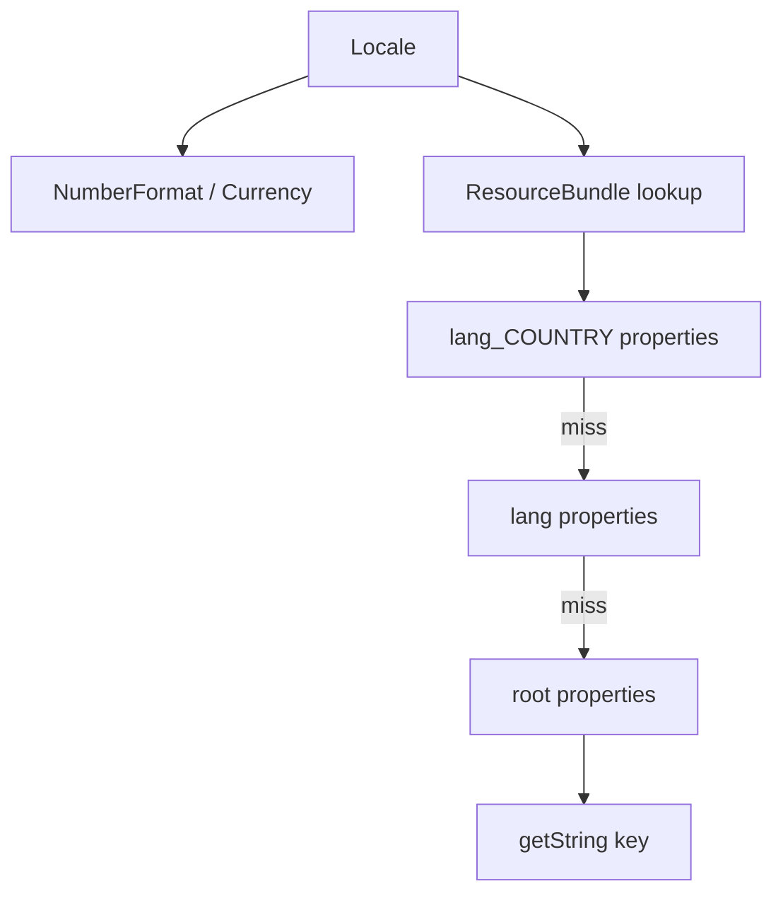

# Locale and Internationalization

> **Status:** Completed  
> **Module:** 22 — Date, Time, and Internationalization  
> **Target Java version:** 21  
> **Last reviewed:** 2026-11-11  
> **Chapter profile:** Technical  
> **Depth target:** Levels 2–3 (Locale, NumberFormat, ResourceBundle)  
> **Examples verified with:** Temurin JDK 21.0.12.1 (javac 21.0.12.1); re-run 2026-11-11 on Oracle JDK 21.0.9 produced identical demo output

**Section policy:** Omissions in Review Checklist. Expand-preserve third deepen pass: keep Verified locale/bundle demo; deepen beginner-friendly bundle lookup and Locale ≠ Zone.

## 1. Learning Objectives *(mandatory)*

After completing this chapter, you should be able to:

- Construct **`Locale`** instances (`Locale.US`, `Locale.GERMANY`, language tags) and explain what they control.
- Format numbers and currency with **`NumberFormat`** for a chosen locale.
- Load localized UI strings from **`ResourceBundle`** property files with fallback.
- Keep **locale** (language/culture formatting) separate from **time zone** (instant ↔ wall clock).
- Avoid hard-coded user-visible English strings in service code destined for multiple markets.

## 2. Prerequisites *(mandatory)*

- Ch.01–02 — `java.time` types and formatters; properties files on the classpath (Module 20/21 file and resource basics as needed).

**Refresher — classpath resource:** `ResourceBundle.getBundle("messages", locale)` looks for property files named like `messages_en.properties` / `messages.properties` on the classpath (same folder as classes for the simple demo layout).

## 3. Why This Concept Exists *(mandatory)*

**Internationalization (i18n)** designs software so it can adapt to many languages and cultural conventions. **Localization (l10n)** supplies the concrete translations and locale data.

Without i18n:

- Hard-coded `"Hello"` and `"$1,999.50"` assume English and US grouping.
- German users expect `1.999,5` style decimals (dot as grouping, comma as decimal).
- Shipping one English binary forces awkward forks per market.

Java’s **`Locale`**, **`NumberFormat`**, and **`ResourceBundle`** are the core SE toolkit for these concerns. Pair them with Ch.02’s `DateTimeFormatter.withLocale` for full date/time presentation.

## 4. Conceptual Explanation *(mandatory)*

### 4.1 Locale — language, country, variant

A **`Locale`** identifies a cultural region for formatting and message lookup. Common constructions:

```java
Locale us = Locale.US;                          // en_US
Locale de = Locale.GERMANY;                     // de_DE
Locale en = Locale.forLanguageTag("en");        // language only
```

Components (conceptually):

| Part | Example | Role |
|------|---------|------|
| Language | `en`, `de` | Primary message language |
| Country/region | `US`, `DE` | Formats, currency defaults, dialect |
| Variant | rare | Specialist extensions |

**Locale ≠ time zone.** `Locale.GERMANY` does not mean `Europe/Berlin`. A German-speaking user traveling in Yangon may want German number formats **and** `Asia/Yangon` wall times.

### 4.2 NumberFormat — decimals and money

```java
NumberFormat usMoney = NumberFormat.getCurrencyInstance(Locale.US);
NumberFormat deNumber = NumberFormat.getNumberInstance(Locale.GERMANY);
```

- **Grouping separators** and **decimal separators** follow the locale.
- **Currency instance** picks symbols/patterns; the demo also prints ISO codes via **`Currency`** for clarity when console encoding garbles symbols.

`Currency.getInstance(locale)` / `Currency.getInstance("USD")` gives the ISO 4217 code (`EUR`, `USD`) independent of glyph rendering.

### 4.3 ResourceBundle — externalized strings

**`ResourceBundle.getBundle(baseName, locale)`** loads key/value messages:

1. Try the most specific bundle for the locale.
2. Fall back along the chain (e.g. `messages_de_DE` → `messages_de` → `messages`).
3. `getString("greeting")` returns the value or throws **`MissingResourceException`**.

Demo uses root `messages.properties`:

```properties
greeting=Hello
farewell=Goodbye
```

For German you would add `messages_de.properties` with translated values—lookup stays `getBundle("messages", Locale.GERMAN)`.

### 4.4 Beginner walkthrough — end-to-end

Imagine a checkout page:

1. Resolve the user’s **`Locale`** (from `Accept-Language`, profile, or default).
2. Format the price with `NumberFormat.getCurrencyInstance(locale)`.
3. Load button labels from `ResourceBundle`.
4. Separately, resolve **`ZoneId`** for “order placed at” display (Ch.02).
5. Never embed `"Add to cart"` as a raw literal in core domain services if that text is user-visible across locales—put it in a bundle (or a dedicated i18n layer).

## 5. Mechanism and Execution Flow *(mandatory)*

1. Create `Locale.US` and `Locale.GERMANY` (or parse a language tag).
2. `NumberFormat.getCurrencyInstance(locale)` / `getNumberInstance(locale)` for money and plain numbers.
3. `Currency.getInstance(...)` when you need a stable ISO code in logs.
4. `ResourceBundle.getBundle("messages", locale)` resolves files; `getString(key)` reads values.

**Bundle candidate chain (simplified):**

```text
baseName + "_" + language + "_" + country
    → baseName + "_" + language
        → baseName   (root)
```



**Diagram:** Locale fans out to **numeric presentation** and **message lookup**. Missing keys fail at `getString`, not silently return the key (unless you add that policy yourself).

## 6. Terminology *(mandatory)*

| Term | Meaning |
|------|---------|
| i18n | Internationalization — design for multiple locales |
| l10n | Localization — provide locale-specific resources |
| Locale | Language/region identity for formats and bundles |
| ResourceBundle | API for locale-sensitive key/value resources |
| Base name | Bundle family name (`messages`) without locale suffix |
| Fallback chain | Search order from specific locale to root bundle |
| NumberFormat | Locale-aware numeric/currency formatting |

## 7. Syntax and Language Rules *(include when the topic is language/API surface)*

```java
Locale us = Locale.US;
Locale de = Locale.GERMANY;
NumberFormat usMoney = NumberFormat.getCurrencyInstance(us);
NumberFormat deNumber = NumberFormat.getNumberInstance(de);
ResourceBundle bundle = ResourceBundle.getBundle("messages", Locale.forLanguageTag("en"));
String hi = bundle.getString("greeting");
```

Notes:

- Property files are ISO 8859-1 by default for classic `.properties`; Unicode escapes or newer UTF-8 property modes apply depending on loader—keep demos ASCII-safe when teaching.
- Bundle base name is **not** a filesystem path with `.properties` in the string—use `"messages"`, not `"messages.properties"`.
- `Locale.forLanguageTag` accepts BCP 47 tags (`en`, `de-DE`).

## 8. Step-by-Step Examples *(mandatory)*

Demo: [locale-i18n-demo](../../examples/core-java/locale-i18n-demo/).

```text
javac LocaleI18nDemo.java
java LocaleI18nDemo
```

Ensure `messages.properties` sits on the classpath (same directory when using the default package demo layout).

### 8.1 Minimal — numbers, currency codes, bundle (Verified)

From `LocaleI18nDemo.java`:

```java
Locale us = Locale.US;
Locale de = Locale.GERMANY;

NumberFormat usMoney = NumberFormat.getCurrencyInstance(us);
NumberFormat deNumber = NumberFormat.getNumberInstance(de);
System.out.println("usPrice=" + usMoney.format(1999.50));
System.out.println("deNumber=" + deNumber.format(1999.50));
System.out.println("deCurrency=" + Currency.getInstance(de).getCurrencyCode());

Currency usd = Currency.getInstance(us);
System.out.println("usdCode=" + usd.getCurrencyCode());

ResourceBundle bundle = ResourceBundle.getBundle(
        "messages", Locale.forLanguageTag("en"));
System.out.println("greeting=" + bundle.getString("greeting"));
System.out.println("farewell=" + bundle.getString("farewell"));
```

**Verified output (Temurin JDK 21.0.12.1; identical on Oracle JDK 21.0.9 re-run 2026-11-11):**

```text
usPrice=$1,999.50
deNumber=1.999,5
deCurrency=EUR
usdCode=USD
greeting=Hello
farewell=Goodbye
```

**Important lines:**

- US currency format shows `$` and comma grouping: **`$1,999.50`**.
- German number format uses `.` for grouping and `,` for decimals: **`1.999,5`**.
- `deCurrency=EUR` / `usdCode=USD` print **ISO codes**—robust when console encoding might garble currency symbols.
- Bundle keys `greeting` / `farewell` resolve from root `messages.properties`.

### 8.2 Realistic — select locale from a language tag (Illustrative)

```java
Locale locale = Locale.forLanguageTag(requestLanguageTag);
NumberFormat money = NumberFormat.getCurrencyInstance(locale);
ResourceBundle ui = ResourceBundle.getBundle("messages", locale);
String title = ui.getString("checkout.title");
```

Validate/fallback when tags are malformed; never trust raw client input without a default.

### 8.3 Incorrect vs corrected

**Incorrect:**

```java
String price = "$" + amount; // always US-like; ignores locale
String greet = "Hello";      // hard-coded UI string
```

**Corrected:**

```java
String price = NumberFormat.getCurrencyInstance(locale).format(amount);
String greet = ResourceBundle.getBundle("messages", locale).getString("greeting");
```

## 9. Real-World Use Cases *(conditional)*

- **Storefronts** — prices and buttons follow buyer locale; warehouse timestamps stay UTC.
- **Admin consoles** — operator locale for UI; data plane stays locale-agnostic.
- **Reports** — generate PDF/CSV with explicit locale per recipient.
- **Error messages** — user-facing text from bundles; log technical details in a single ops language.

## 11. Edge Cases and Limitations *(strongly encouraged)*

- **Console encoding** may garble currency symbols—demo documents ISO codes (`deCurrency=EUR`) as a safe teaching output.
- **Missing keys** → `MissingResourceException`; fail fast in development; decide product policy for production.
- **`MessageFormat`** / plural rules (one/few/many) are richer than plain bundles—framework modules and ICU often deepen this; do not pretend `ResourceBundle` alone solves plural grammar.
- **Default locale** (`Locale.getDefault()`) is JVM/OS dependent—set explicitly in servers.
- Combining **locale + zone + formatter** is required for complete datetime i18n (Ch.02 + this chapter).

## 12. Common Mistakes *(mandatory)*

### Incorrect

```java
// User-visible strings buried in services
return "Order confirmed";
```

### Corrected

```java
return bundle.getString("order.confirmed");
```

### Incorrect

```java
ZoneId zone = ZoneId.of(locale.getCountry()); // country ≠ zone id
```

### Corrected

```java
ZoneId zone = ZoneId.of(userProfile.getTimeZoneId());
Locale locale = userProfile.getLocale();
```

## 13. Best Practices *(include when guidance adds value)*

- Externalize every user-visible string you intend to translate.
- Pass `Locale` explicitly through service methods that format for humans.
- Keep message keys stable (`order.confirmed`); change values per locale file.
- Test at least one non-US locale in CI for number/date formatting.
- Document encoding expectations for property files and consoles.

## 14. Design Trade-offs *(conditional)*

| Approach | Pros | Cons |
|----------|------|------|
| Property ResourceBundles | Simple, JDK built-in | Weak plural/gender support alone |
| Hard-coded strings | Fast to prototype | Blocks i18n; merge pain |
| Framework i18n (Spring, etc.) | Message sources, reloads | Extra stack; learn later modules |
| Always `Locale.US` on servers | Predictable logs | Wrong for end-user presentation |

## 16. Security Considerations *(conditional)*

Bundles and locale property files are **not** secret stores—do not place credentials, API keys, or private tokens in `.properties` message files. Treat them as UI assets. If you ever format untrusted patterns with `MessageFormat`, validate inputs to avoid unexpected formatting behavior.

## 17. Java Version and Compatibility Notes *(conditional)*

- `Locale` / `NumberFormat` / `ResourceBundle` long-standing; Java 21 remains the handbook path.
- Prefer `Locale.forLanguageTag` (BCP 47) over deprecated constructors in new code.

## 19. Revision and Mastery *(Technical)*

**Gaps:** conflating locale with zone; assuming currency symbol printing is portable across consoles; forgetting root bundle fallback.

**Questions:**

1. What is the lookup order for `messages` with `Locale.GERMANY`?
2. Why might a handbook demo print `EUR` instead of `€`?
3. How do you format a `ZonedDateTime` in German *and* Yangon time without mixing the two concepts?

## 20. Exercises *(include for major chapters)*

### Beginner

1. Add `messages_de.properties` with German greeting/farewell and load it with `Locale.GERMAN`.

### Intermediate

2. Format `1999.5` with US currency and German number format; explain each separator.

### Advanced

3. Wire a tiny method that takes `(amount, Locale, ZoneId, Instant)` and returns a display record: localized money string + zoned formatted time (compose Ch.02 + Ch.03).

## 23. Chapter Summary *(mandatory)*

**Locale** selects cultural formatting; **NumberFormat** / **Currency** present numbers and money; **ResourceBundle** selects text via a fallback chain. Pair with `java.time` zones and formatters for complete user-facing datetime and messaging—without treating locale as a zone.

## 25. References and Further Reading *(mandatory)*

- [Java SE 21 `Locale`](https://docs.oracle.com/en/java/javase/21/docs/api/java.base/java/util/Locale.html)
- [Java SE 21 `ResourceBundle`](https://docs.oracle.com/en/java/javase/21/docs/api/java.base/java/util/ResourceBundle.html)
- [Java SE 21 `NumberFormat`](https://docs.oracle.com/en/java/javase/21/docs/api/java.base/java/text/NumberFormat.html)
- [Unicode CLDR](https://cldr.unicode.org/) — underlying locale data ecosystem

## 26. Next Steps

Module **23** — Regular Expressions: pattern syntax and the `java.util.regex` API for validation and tokenization.

## Review Checklist

- [x] Technical; beginner-friendly bundle and Locale walkthrough
- [x] Locale ≠ zone emphasized
- [x] Encoding note preserved; Verified output re-confirmed
- [x] Security note on non-secret bundles
- [x] Omissions: Performance filler; MessageFormat plurals deferred with explanation (not as a substitute for basics)

**Omissions (section → reason):**

- Performance → formatting cost rarely dominates; omit
- MessageFormat plural deep dive → noted as limitation; enough for Level 3 on Locale/NumberFormat/ResourceBundle without framework ICU
