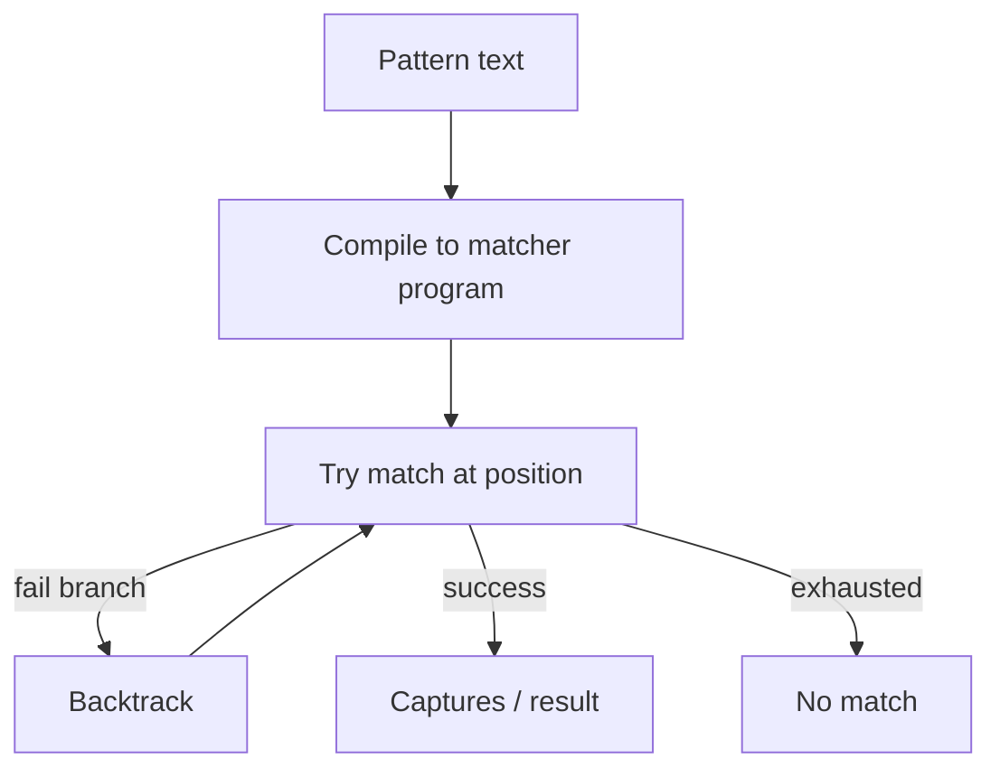

# Regex Fundamentals

> **Status:** Completed  
> **Module:** 23 — Regular Expressions  
> **Target Java version:** 21  
> **Last reviewed:** 2026-11-11  
> **Chapter profile:** Technical  
> **Depth target:** Levels 2–3 (syntax, String helpers, limits)  
> **Examples verified with:** Temurin JDK 21.0.12.1 (javac 21.0.12.1); re-run 2026-11-11 on Oracle JDK 21.0.9 produced identical demo output

**Section policy:** Omissions in Review Checklist. Expand-preserve third deepen pass: keep Verified String-regex demo; deepen metacharacters, greediness, and when not to use regex.

## 1. Learning Objectives *(mandatory)*

After completing this chapter, you should be able to:

- Read **literals**, **character classes**, **quantifiers**, **anchors**, and **capturing groups** in a Java string pattern.
- Escape correctly in Java source (`"\\d"` not `"\d"`).
- Use **`String.matches`**, **`split`**, and **`replaceAll`** for simple tasks—and know their full-string / replacement semantics.
- Contrast **greedy** vs **reluctant** quantifiers at a practical level.
- Recognize **catastrophic backtracking** risk and when regex is the **wrong** tool (HTML, nested grammars).

## 2. Prerequisites *(mandatory)*

- Module **11** — strings, immutability, and escape sequences in Java literals.

**Refresher — Java string escapes:** In a Java source string, a single backslash starts an escape (`\n`, `\"`). Regex itself also uses backslashes (`\d`). Therefore a regex digit class in source is written **`"\\d"`**: one backslash for the Java compiler, one remaining for the regex engine.

## 3. Why This Concept Exists *(mandatory)*

Many checks are **pattern-shaped**: “looks like an email local-part + `@` + domain”, “extract the order id between dashes”, “split on whitespace”. Regular expressions give a compact **declarative** way to describe those shapes.

The trade-off is real:

- Dense patterns become unreadable without comments and tests.
- Nested quantifiers can explode into **catastrophic backtracking** (ReDoS) on crafted input.
- Regex cannot reliably parse nested/recursive structures (HTML, JSON, full programming languages).

Use regex for **regular** patterns; use parsers for **grammars**.

## 4. Conceptual Explanation *(mandatory)*

### 4.1 Literals and metacharacters

Most characters match themselves: `a` matches `a`. Some characters are **metacharacters** with special meaning. To match them literally, escape with a backslash (doubled in Java source):

| Metacharacter | Role | Literal match in Java source |
|---------------|------|------------------------------|
| `.` | Any character (except line break by default) | `"\\."` |
| `+` `*` `?` `{` | Quantifiers | `"\\+"`, `"\\*"`, … |
| `(` `)` | Groups | `"\\("`, `"\\)"` |
| `[` `]` | Character class | often inside `]` rules; escape when needed |
| `^` `$` | Anchors | `"\\^"` when literal |
| `\|` | Alternation | `"\\|"` |
| `\` | Escape | `"\\\\"` for one real backslash |

### 4.2 Character classes and shorthands

- `[abc]` — one of `a`, `b`, `c`.
- `[a-z]` — inclusive range.
- `[^0-9]` — negation (not a digit).
- `\d` — digit; `\w` — word char; `\s` — whitespace (Java: `"\\d"`, `"\\w"`, `"\\s"`).
- `.` — any character except line terminators unless `DOTALL` (Ch.02 flags).

### 4.3 Quantifiers — greedy by default

| Quantifier | Meaning |
|------------|---------|
| `*` | 0 or more |
| `+` | 1 or more |
| `?` | 0 or 1 |
| `{n}` | exactly n |
| `{n,m}` | n through m |
| `{n,}` | n or more |

**Greedy** quantifiers take as much as possible while still allowing the overall match to succeed. **Reluctant** (lazy) forms add `?`: `*?`, `+?`, `??`. **Possessive** forms add `+`: `*+`, `++` (no back-off)—useful advanced control; Ch.02 touches engine behavior.

Example idea: `.*-(\\d+)-.*` greedily lets `.*` expand then backtracks until the digit group can match—demo uses this to pull `1042` from `order-1042-shipped`.

### 4.4 Anchors and `matches`

- `^` — start of region (start of string by default).
- `$` — end of region.
- **`String.matches(regex)`** requires the pattern to match the **entire** string (as if fully anchored). Partial “contains” checks need `Matcher.find` (Ch.02) or an explicit `.*` wrapper (often a smell).

### 4.5 Capturing groups and replacements

- `(...)` captures text for later use as `group(1)` or `$1` in `replaceAll`.
- `(?:...)` is non-capturing when you only need grouping for operators.
- Named groups (`(?<id>\\d+)`) appear in Ch.02’s `Pattern`/`Matcher` API.

Demo replacement: `messy.replaceAll(".*-(\\d+)-.*", "$1")` → `1042`.

### 4.6 When not to use regex

| Problem | Prefer |
|---------|--------|
| HTML / XML structure | Dedicated parser |
| Nested parentheses languages | Parser / grammar |
| Simple “starts with” / “contains” | `String` methods |
| Exact enum token set | `equals` / `switch` / set membership |

## 5. Mechanism and Execution Flow *(mandatory)*

High-level engine story (Java uses a backtracking NFA-style matcher in `java.util.regex`):

1. Compile pattern (implicitly inside `String.matches` / `replaceAll`, or explicitly via `Pattern.compile` in Ch.02).
2. Attempt a match from a starting position.
3. On failure of a branch, **backtrack** and try alternatives / shorter quantifier consumes.
4. Return success with capture buffers, or failure.

`String.matches(regex)` recompiles each call—fine for occasional validation; hot paths should reuse `Pattern` (Ch.02).



**Catastrophic backtracking warning:** Patterns like `(a+)+b` on long strings of `a` without a final `b` can explore an exponential number of partitions. Treat untrusted **regex + input** as a ReDoS risk (Ch.02 security notes). Prefer possessive quantifiers, atomic groups, input length limits, or non-regex parsers when threats matter.

## 6. Terminology *(mandatory)*

| Term | Meaning |
|------|---------|
| Metacharacter | Character with special regex meaning |
| Character class | Bracket expression matching one char from a set |
| Quantifier | How many times the previous atom may repeat |
| Greedy | Match as much as possible first, then backtrack |
| Reluctant | Match as little as possible first |
| Anchor | Assertion about position (`^`, `$`) without consuming chars |
| Capturing group | Parentheses that store matched text |
| Backtracking | Retrying earlier choices after a later failure |
| ReDoS | Denial of service via pathological backtracking |

## 7. Syntax and Language Rules *(include when the topic is language/API surface)*

```java
String pattern = "^[\\w.-]+@[\\w.-]+\\.\\w+$";
boolean ok = email.matches(pattern);
String id = messy.replaceAll(".*-(\\d+)-.*", "$1");
String[] parts = words.split("\\s+");
```

Rules:

- Always think in **two** escaping layers: Java string + regex.
- `matches` = full string; do not assume “search anywhere”.
- In replacements, `$` and `\` are special—`Matcher.quoteReplacement` (Ch.02) when substituting literal user text.
- `split` discards trailing empty strings by default in some overload forms—check the overload you need.

## 8. Step-by-Step Examples *(mandatory)*

Demo: [regex-fundamentals-demo](../../examples/core-java/regex-fundamentals-demo/).

```text
javac RegexFundamentalsDemo.java
java RegexFundamentalsDemo
```

### 8.1 Minimal — validate, capture, split (Verified)

From `RegexFundamentalsDemo.java`:

```java
String email = "ada@example.com";
String pattern = "^[\\w.-]+@[\\w.-]+\\.\\w+$";

boolean matches = email.matches(pattern);
System.out.println("emailValid=" + matches);

String messy = "order-1042-shipped";
String digits = messy.replaceAll(".*-(\\d+)-.*", "$1");
System.out.println("capturedId=" + digits);

String words = "alpha beta gamma";
String[] parts = words.split("\\s+");
System.out.println("splitCount=" + parts.length);
System.out.println("secondWord=" + parts[1]);
```

**Verified output (Temurin JDK 21.0.12.1; identical on Oracle JDK 21.0.9 re-run 2026-11-11):**

```text
emailValid=true
capturedId=1042
splitCount=3
secondWord=beta
```

**Important lines:**

- Email pattern is a **teaching** shape—not a full RFC 5321 validator.
- `replaceAll` uses capture `$1` so only the order id **`1042`** remains.
- `split("\\s+")` yields three tokens; index `1` is **`beta`**.

### 8.2 Progressive — greedy vs reluctant (Illustrative)

```java
String htmlish = "<b>one</b><b>two</b>";
// greedy: first .* consumes through last </b> opportunity then backtracks
System.out.println(htmlish.replaceAll("<b>.*</b>", "X"));
// reluctant: stop at first </b>
System.out.println(htmlish.replaceAll("<b>.*?</b>", "X"));
```

Even this example hints why HTML and regex are a bad marriage—tags nest and break assumptions. Prefer a real parser for markup.

### 8.3 Incorrect vs corrected

**Incorrect — single backslash shorthand in source:**

```java
email.matches("^\d+@"); // compile error or wrong escapes
```

**Corrected:**

```java
email.matches("^\\d+@.*"); // still may be the wrong product rule—but escapes correctly
```

**Incorrect — expecting `matches` to search inside:**

```java
"prefix ada@example.com".matches("^[\\w.-]+@[\\w.-]+\\.\\w+$"); // false
```

**Corrected:** use `Matcher.find` (Ch.02) or anchor a deliberate substring policy.

## 9. Real-World Use Cases *(conditional)*

- Light **input validation** (ids, simple tokens) with clear specs and tests.
- **Log scrubbing** — redact emails/card-shaped tokens carefully (false positives matter).
- **Token splits** on whitespace or delimiters when formats are regular.
- Feature-flag routing keys that follow a strict `TEAM-123` shape (Ch.02 named groups shine here).

## 11. Edge Cases and Limitations *(strongly encouraged)*

- **Catastrophic backtracking** on nested quantifiers—limit input length; prefer possessive forms or rewrite.
- **`matches` entire string** — partial scans need `Matcher.find` (Ch.02).
- **`"\\d"`** required in Java source—not `"\d"`.
- Unicode: default digit/word classes vs Unicode-aware flags (`UNICODE_CHARACTER_CLASS`)—outstanding depth for later notes; do not assume `\w` equals “letter in every language”.
- Email/URL “regexes” from the internet are often wrong—prefer libraries for production identity formats when stakes are high.

## 12. Common Mistakes *(mandatory)*

### Incorrect

```java
String re = "\d+"; // Java sees an invalid or unintended escape
```

### Corrected

```java
String re = "\\d+";
```

### Incorrect

```java
// Parsing HTML with regex and hoping tags never nest
page.replaceAll("<div>.*</div>", "");
```

### Corrected

Use an HTML parser; keep regex for flat token shapes.

## 13. Best Practices *(include when guidance adds value)*

- Comment non-trivial patterns; add unit tests for edge strings (empty, max length, near-misses).
- Prefer `Pattern.compile` reuse on hot paths (Ch.02).
- Fail closed on validation; do not “fix until it passes” with ever-wider `.*`.
- Prefer dedicated parsers for nested structures.
- Document that teaching email patterns are not compliance-grade validators.

## 14. Design Trade-offs *(conditional)*

| Choice | Benefit | Cost |
|--------|---------|------|
| Regex validation | Compact | Readability / ReDoS / false confidence |
| Hand-written scanners | Clear control | More code |
| Full grammar parser | Correct nesting | Heavier dependency |

## 16. Security Considerations *(conditional)*

Untrusted patterns or untrusted input against vulnerable patterns enable **ReDoS**. Bound input length, avoid nested `+`/`*` bombs, and consider timeouts/possessive quantifiers. Never execute regex from user-controlled pattern text without hardening.

## 19. Revision and Mastery *(Technical)*

**Questions:**

1. Why is `"\\d"` two backslashes in Java?
2. How do greedy and reluctant `.*` differ on nested markup-like strings?
3. When should you refuse regex entirely?

## 20. Exercises *(include for major chapters)*

### Beginner

1. Write a pattern that `matches` `SKU-12345` (prefix + digits) and reject `SKU-12a`.

### Intermediate

2. Use `replaceAll` with two groups to turn `last, first` into `first last`.

### Advanced

3. Explain why `(x+x+)+y` can be dangerous on long `x` strings; rewrite safer validation without nested quantifiers.

## 23. Chapter Summary *(mandatory)*

Regex fundamentals—literals, classes, quantifiers, anchors, groups—plus `String` helpers cover simple validation and extraction. Escape correctly in Java, know `matches` is whole-string, respect greedy vs reluctant behavior, fear catastrophic backtracking, and graduate to **`Pattern`/`Matcher`** (Ch.02) for reuse and scanning control.

## 25. References and Further Reading *(mandatory)*

- [Java SE 21 `Pattern` (syntax summary)](https://docs.oracle.com/en/java/javase/21/docs/api/java.base/java/util/regex/Pattern.html)
- [Java SE 21 `String`](https://docs.oracle.com/en/java/javase/21/docs/api/java.base/java/lang/String.html) — `matches`, `split`, `replaceAll`
- Regular-Expressions.info — engine-oriented tutorials (third-party; verify against Java docs)

## 26. Next Steps

[02-java-regex-api.md](02-java-regex-api.md) — `Pattern` / `Matcher` lifecycle, `find` vs `matches`, named groups, flags, ReDoS hardening.

## Review Checklist

- [x] Technical; metacharacters explained with examples
- [x] Greedy vs reluctant; catastrophic backtracking warning
- [x] When not to use regex
- [x] Verified demo preserved and re-run
- [x] Omissions: Language comparisons; full Unicode category deep dive noted as outstanding

**Omissions (section → reason):**

- Language comparisons → not required to learn Java regex
- Unicode category flags deep dive → flagged for later; basics + caution included now
