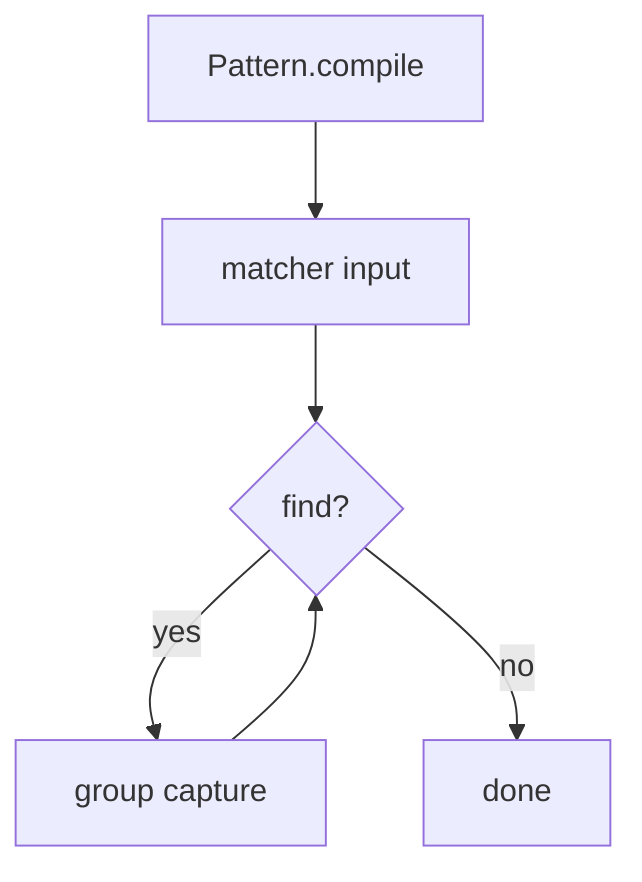

# Java Regex API

> **Status:** Completed  
> **Module:** 23 — Regular Expressions  
> **Target Java version:** 21  
> **Last reviewed:** 2026-11-11  
> **Chapter profile:** Technical  
> **Depth target:** Levels 2–3 (Pattern/Matcher lifecycle, groups, flags)  
> **Examples verified with:** Temurin JDK 21.0.12.1 (javac 21.0.12.1)

## 1. Learning Objectives *(mandatory)*

- Compile reusable **`Pattern`** instances; match with **`Matcher`**.
- Iterate with **`find()`** vs anchor with **`matches()`**.
- Use **named groups** and replacement APIs safely.

## 2. Prerequisites *(mandatory)*

- Ch.01 fundamentals; group numbering.

## 3. Why This Concept Exists *(mandatory)*

`String` regex methods hide matcher state and pattern reuse. **`java.util.regex`** exposes flags, iterative scanning, and `appendReplacement` for streaming transforms.

## 4. Conceptual Explanation *(mandatory)*

- **`Pattern.compile`** — immutable, thread-safe.
- **`Matcher`** — one per thread per input; **not thread-safe**.
- **`find()`** — next subsequence; **`matches()`** — entire region.
- **Named group** — `(?<dept>ENG)` → `group("dept")`.
- **Flags** — `CASE_INSENSITIVE`, `MULTILINE`, `DOTALL`, `UNICODE_CHARACTER_CLASS`, etc.

## 5. Mechanism and Execution Flow *(mandatory)*



## 8. Step-by-Step Examples *(mandatory)*

Demo: [java-regex-api-demo](../../examples/core-java/java-regex-api-demo/).

**Verified output (Temurin JDK 21.0.12.1):**

```text
match=ENG-42 dept=ENG
match=OPS-7 dept=OPS
replaced=[ENG#42]
fullMatch=false
findOnce=true
namedId=42
```

Multiple `find()` over two tokens. `replaceAll` with group refs. Partial remainder fails `matches()` but single-token `find` yields `namedId=42`.

## 11. Edge Cases and Limitations *(strongly encouraged)*

- Reuse matcher via `reset(CharSequence)`.
- Lookbehind width limits in Java engine.

## 16. Security Considerations *(conditional)*

Untrusted regex + input → **ReDoS**; limit length, timeout, possessive quantifiers where appropriate.

## 19. Revision and Mastery *(Technical)*

- `find` vs `matches`?
- When name groups over `group(2)`?

## 23. Chapter Summary *(mandatory)*

**Pattern** reuse and **Matcher** iteration support production parsers; mind thread safety and ReDoS.

## 26. Next Steps

Module **24** — Concurrency.

## Review Checklist

- [x] Technical; Verified Temurin 21.0.12.1; ReDoS noted
- [x] Mechanism diagram included
