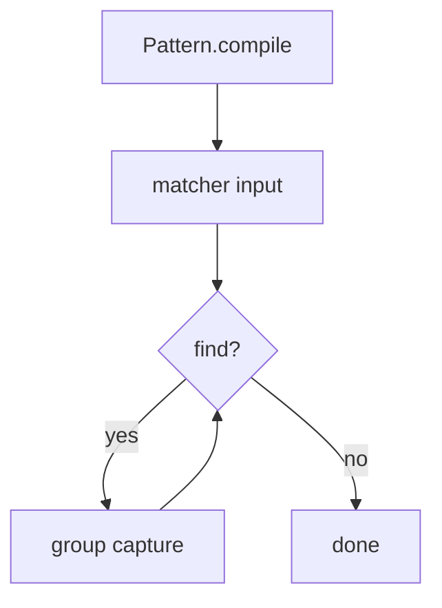

# Java Regex API

> **Status:** Completed  
> **Module:** 23 — Regular Expressions  
> **Target Java version:** 21  
> **Last reviewed:** 2026-11-11  
> **Chapter profile:** Technical  
> **Depth target:** Levels 2–3 (Pattern/Matcher lifecycle, groups, flags)  
> **Examples verified with:** Temurin JDK 21.0.12.1 (javac 21.0.12.1); re-run 2026-11-11 on Oracle JDK 21.0.9 produced identical demo output

**Section policy:** Omissions in Review Checklist. Expand-preserve third deepen pass: keep Verified Pattern/Matcher demo; deepen lifecycle, find vs matches, flags, ReDoS.

## 1. Learning Objectives *(mandatory)*

After completing this chapter, you should be able to:

- Compile reusable **`Pattern`** instances and create **`Matcher`** objects over input.
- Iterate matches with **`find()`** and contrast that with whole-region **`matches()`**.
- Read **numbered** and **named** capturing groups from a matcher.
- Apply common **flags** (`CASE_INSENSITIVE`, `MULTILINE`, `DOTALL`, `UNICODE_CHARACTER_CLASS`).
- Replace text safely (`replaceAll`, `appendReplacement`) and know when to use **`quoteReplacement`**.
- Explain **thread-safety** (`Pattern` yes, `Matcher` no) and **ReDoS** risks.

## 2. Prerequisites *(mandatory)*

- Ch.01 — regex syntax, Java escaping, greedy quantifiers, when not to use regex.

**Refresher:** `String.matches` hides compilation and only answers “does the **entire** string match?” Production scanners usually need **`find()`** loops and a reused **`Pattern`**.

## 3. Why This Concept Exists *(mandatory)*

`String` regex helpers are convenient one-liners, but they:

- Recompile patterns on each call (cost on hot paths).
- Hide **matcher state** (last match position, groups).
- Offer limited control for streaming transforms and flags.

**`java.util.regex`** exposes an explicit lifecycle: compile once → match many times → read groups → replace with fine-grained control. That is the API you want in parsers, log pipelines, and validators that run continuously.

## 4. Conceptual Explanation *(mandatory)*

### 4.1 Pattern — immutable, thread-safe

```java
Pattern pattern = Pattern.compile("(?<dept>[A-Z]+)-(?<id>\\d+)");
```

- Compilation parses and optimizes the pattern into an internal matcher program.
- **`Pattern` is immutable and thread-safe**—share one instance across threads.
- Optional flags: `Pattern.compile(regex, Pattern.CASE_INSENSITIVE | Pattern.UNICODE_CASE)`.

### 4.2 Matcher — stateful, not thread-safe

```java
Matcher matcher = pattern.matcher("ENG-42 OPS-7");
```

- Each matcher holds the **input**, **current position**, and **group captures**.
- **Not thread-safe.** One matcher per thread (or synchronize / use `ThreadLocal` carefully).
- Reuse via `matcher.reset()` or `matcher.reset(newInput)` to avoid allocation churn.

### 4.3 find vs matches vs lookingAt

| Method | Question |
|--------|----------|
| `matches()` | Does the pattern match the **entire** region? |
| `find()` | Is there a subsequence match starting at/after the current position? Advances on each call. |
| `lookingAt()` | Does it match from the region **start** without requiring the end? |

Demo consequence: `"ENG-42-extra"` fails `matches()` for `dept-id` pattern (`fullMatch=false`) but `find()` on `"ENG-42"` succeeds (`findOnce=true`).

### 4.4 Groups — numbered and named

- `group()` / `group(0)` — entire match.
- `group(1)`, `group(2)` — capturing parentheses in order.
- `group("dept")` — named group `(?<dept>...)`.

Named groups improve readability when patterns grow. Numbered groups still appear in `replaceAll("$1#$2")`.

### 4.5 Replacement APIs

- `matcher.replaceAll(replacement)` / `pattern.matcher(s).replaceAll(...)`.
- `appendReplacement` + `appendTail` for streaming builds.
- **`Matcher.quoteReplacement(text)`** when the replacement must be literal and may contain `$` or `\`.

### 4.6 Common flags

| Flag | Effect |
|------|--------|
| `CASE_INSENSITIVE` | Ignore case for matching (often with `UNICODE_CASE`) |
| `MULTILINE` | `^` / `$` match line starts/ends |
| `DOTALL` | `.` matches line breaks |
| `UNICODE_CHARACTER_CLASS` | Prefer Unicode definitions for `\d`, `\w`, `\s` |
| `LITERAL` | Treat pattern as literal text |
| `COMMENTS` | Allow whitespace/comments inside pattern (`(?x)` style) |

## 5. Mechanism and Execution Flow *(mandatory)*



**Step trace for the demo input `"ENG-42 OPS-7"`:**

1. Compile named-group pattern once.
2. Create matcher over the full string.
3. First `find()` locates `ENG-42`; `group("dept")` → `ENG`.
4. Second `find()` locates `OPS-7`; `group("dept")` → `OPS`.
5. Further `find()` returns false.
6. Separate `replaceAll` on `"ENG-42"` builds `[ENG#42]` via `$1` / `$2`.
7. `matches()` on `"ENG-42-extra"` fails because of trailing text.
8. Fresh matcher `find()` on `"ENG-42"` succeeds; `group("id")` → `42`.

## 6. Terminology *(mandatory)*

| Term | Meaning |
|------|---------|
| Pattern | Compiled, immutable regular expression |
| Matcher | Stateful engine cursor over a specific input |
| Region | Slice of input the matcher considers |
| Named group | Capture addressed by name (`(?<id>…)`) |
| Flag | Compile-time modifier of syntax/matching semantics |
| quoteReplacement | Escape `$` / `\` in literal replacement text |
| ReDoS | Resource exhaustion via pathological backtracking |

## 7. Syntax and Language Rules *(include when the topic is language/API surface)*

```java
Pattern pattern = Pattern.compile("(?<dept>[A-Z]+)-(?<id>\\d+)");
Matcher matcher = pattern.matcher("ENG-42 OPS-7");
while (matcher.find()) {
    String dept = matcher.group("dept");
}
String replaced = pattern.matcher("ENG-42").replaceAll("[$1#$2]");
boolean full = pattern.matcher("ENG-42-extra").matches();
```

Rules:

- Call `group` only after a successful `find` / `matches` / `lookingAt`.
- Named group syntax uses `(?<name>…)`; names are alphanumeric.
- Flags can also appear inline: `(?i)` case-insensitive, `(?s)` dotall, `(?m)` multiline.
- Lookbehind in Java must be finite width—some variable-length lookbehinds are rejected.

## 8. Step-by-Step Examples *(mandatory)*

Demo: [java-regex-api-demo](../../examples/core-java/java-regex-api-demo/).

```text
javac JavaRegexApiDemo.java
java JavaRegexApiDemo
```

### 8.1 Minimal — find loop, replace, matches vs find (Verified)

From `JavaRegexApiDemo.java`:

```java
Pattern pattern = Pattern.compile("(?<dept>[A-Z]+)-(?<id>\\d+)");
Matcher matcher = pattern.matcher("ENG-42 OPS-7");

while (matcher.find()) {
    System.out.println("match=" + matcher.group() + " dept=" + matcher.group("dept"));
}

String replaced = pattern.matcher("ENG-42").replaceAll("[$1#$2]");
System.out.println("replaced=" + replaced);

boolean partial = pattern.matcher("ENG-42-extra").matches();
System.out.println("fullMatch=" + partial);

Matcher anchored = pattern.matcher("ENG-42");
System.out.println("findOnce=" + anchored.find());
System.out.println("namedId=" + anchored.group("id"));
```

**Verified output (Temurin JDK 21.0.12.1; identical on Oracle JDK 21.0.9 re-run 2026-11-11):**

```text
match=ENG-42 dept=ENG
match=OPS-7 dept=OPS
replaced=[ENG#42]
fullMatch=false
findOnce=true
namedId=42
```

**Important lines:**

- Multiple `find()` calls walk **two** tokens in one input string.
- `replaceAll("[$1#$2]")` uses numbered groups even though names exist.
- `"ENG-42-extra"` is a partial shape → **`fullMatch=false`**.
- Dedicated matcher `find` + `group("id")` yields **`42`**.

### 8.2 Realistic — safe literal replacement (Illustrative)

```java
String user = "price $5 \\ tokens";
String out = Pattern.compile("TOKEN")
        .matcher("pay TOKEN now")
        .replaceAll(Matcher.quoteReplacement(user));
```

Without `quoteReplacement`, `$5` is treated as a group reference and can throw or mis-replace.

### 8.3 Incorrect vs corrected

**Incorrect — share one Matcher across threads:**

```java
static final Matcher SHARED = Pattern.compile("\\d+").matcher("");
// threads call SHARED.reset(input).find() — race on state
```

**Corrected:**

```java
static final Pattern DIGITS = Pattern.compile("\\d+");
// each use: DIGITS.matcher(input) or thread-confined matcher
```

**Incorrect — read groups before a successful match:**

```java
Matcher m = pattern.matcher(s);
String g = m.group(1); // IllegalStateException if find not called
```

**Corrected:**

```java
if (m.find()) {
    String g = m.group(1);
}
```

## 9. Real-World Use Cases *(conditional)*

- **Ticket / SKU scanners** in logs: `TEAM-123` named groups.
- **Redaction pipelines** with `appendReplacement` building sanitized output.
- **Config validators** compiling patterns once at startup.
- **Multiline** log headers with `MULTILINE` anchors.

## 11. Edge Cases and Limitations *(strongly encouraged)*

- Reuse matcher via `reset(CharSequence)`.
- Lookbehind width limits in the Java engine.
- `matches` vs `find` confusion remains the #1 API footgun.
- Group numbers shift when you insert new capturing parentheses—prefer names for stable APIs.
- Very large inputs + naive `.*` patterns → memory/time pressure; bound work.

## 12. Common Mistakes *(mandatory)*

### Incorrect

```java
pattern.matcher("ENG-42-extra").matches(); // expect true for “contains”
```

### Corrected

```java
pattern.matcher("ENG-42-extra").find(); // true if subsequence exists
```

### Incorrect

```java
matcher.replaceAll("amount=$usd"); // $u interpreted as group ref
```

### Corrected

```java
matcher.replaceAll(Matcher.quoteReplacement("amount=$usd"));
```

## 13. Best Practices *(include when guidance adds value)*

- Compile hot patterns once into `static final Pattern` fields.
- Prefer named groups in non-trivial patterns.
- Unit-test `find` loops with overlapping and adjacent matches.
- Use `quoteReplacement` for untrusted or dollar-containing replacements.
- Document flags next to the pattern; surprise `DOTALL` changes meaning of `.`.

## 14. Design Trade-offs *(conditional)*

| Approach | Pros | Cons |
|----------|------|------|
| `String.matches` | Short | Recompile; whole-string only |
| Shared `Pattern` + per-call `matcher` | Clear & safe | Short-lived matcher objects |
| `ThreadLocal<Matcher>` | Less allocation | Easy to misuse; reset discipline |
| Hand parser | Predictable performance | More code |

## 15. Performance Considerations *(conditional)*

- Compilation dominates one-off `String.matches` in tight loops—reuse `Pattern`.
- `find` on huge inputs should use anchored/more specific patterns when possible.
- Possessive quantifiers / careful rewrites reduce backtracking; measure before micro-optimizing.

## 16. Security Considerations *(conditional)*

Untrusted regex **or** untrusted input against vulnerable patterns → **ReDoS**. Mitigations:

- Limit input length.
- Avoid nested quantifiers on the same character class.
- Prefer possessive quantifiers / atomic grouping where applicable.
- Consider timeouts / isolation for user-defined patterns.
- Never expose a “test your regex” endpoint without strict guards.

## 17. Java Version and Compatibility Notes *(conditional)*

- `java.util.regex` long-standing; named groups supported for years; Java 21 primary path unchanged.
- Flag and Unicode behavior details evolve slowly—verify against SE 21 `Pattern` docs when matching `\w` across scripts.

## 19. Revision and Mastery *(Technical)*

**You should answer:**

- `find` vs `matches`?
- When name groups over `group(2)`?
- Why is `Matcher` not thread-safe?
- When is `quoteReplacement` mandatory?

**Gaps:** assuming `Pattern.compile` is free; forgetting `reset`; treating abbreviations of engine folklore as guarantees.

## 20. Exercises *(include for major chapters)*

### Beginner

1. Compile a pattern for `OPS-7` style tokens and print each `find()` match in `"OPS-7 ENG-42"`.

### Intermediate

2. Rewrite the demo replacement using named group references in the replacement string (`${dept}` style) and compare to `$1`.

### Advanced

3. Build a small redaction method that replaces emails with `***` using `appendReplacement`, and uses `quoteReplacement` for a configurable mask string containing `$`.

## 23. Chapter Summary *(mandatory)*

**Pattern** reuse and **Matcher** iteration support production parsers: compile once, `find` for subsequences, `matches` for whole-region checks, read named groups, replace carefully, and mind thread safety plus ReDoS. String helpers remain fine for one-offs; this API is the control plane.

## 25. References and Further Reading *(mandatory)*

- [Java SE 21 `Pattern`](https://docs.oracle.com/en/java/javase/21/docs/api/java.base/java/util/regex/Pattern.html)
- [Java SE 21 `Matcher`](https://docs.oracle.com/en/java/javase/21/docs/api/java.base/java/util/regex/Matcher.html)
- OWASP references on Regular Expression Denial of Service (ReDoS)

## 26. Next Steps

Module **24** — Concurrency and Multithreading (thread safety of shared matchers becomes immediately relevant in concurrent servers).

## Review Checklist

- [x] Technical; Pattern/Matcher lifecycle + diagram
- [x] find vs matches taught with Verified demo
- [x] Flags, named groups, quoteReplacement, ReDoS
- [x] Verified Temurin baseline; Oracle 21.0.9 re-run identical
- [x] Omissions: Language comparisons

**Omissions (section → reason):**

- Language comparisons → unnecessary for Java API mastery
- Exhaustive Unicode property catalog → outstanding note retained at module level
