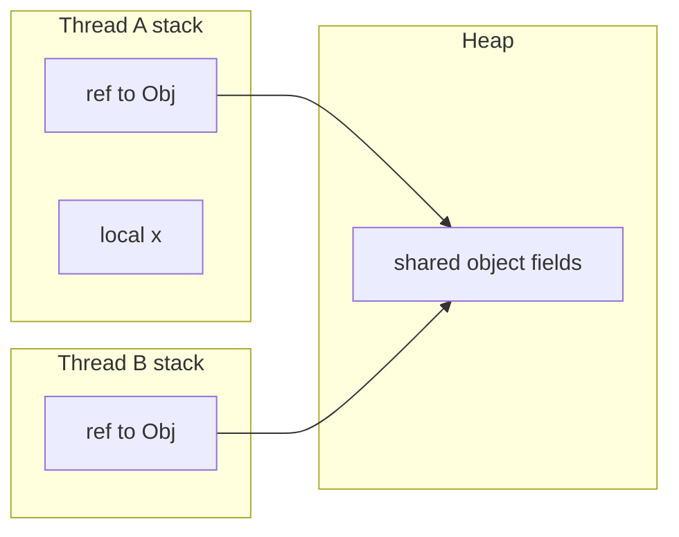

# Threads and Runnables

> **Status:** Completed  
> **Module:** 24 — Concurrency and Multithreading  
> **Target Java version:** 21  
> **Last reviewed:** 2026-11-11  
> **Chapter profile:** Deep-dive  
> **Depth target:** Levels 3–4 (thread lifecycle, JVMS stacks vs shared heap, start/join contracts)  
> **Examples verified with:** Temurin JDK 21.0.12.1 (javac 21.0.12.1)

**Section policy:** Sections are **conditional unless marked mandatory**. Include a section when it adds meaningful learning value. For omitted sections, record reasons in the Review Checklist.

## 1. Learning Objectives *(mandatory)*

After completing this chapter, you should be able to:

- Start asynchronous work with **`Thread`** and **`Runnable`** and explain why **`start()`** must not be replaced by direct **`run()`** calls.
- Use **`join()`** to wait for completion and cite the **happens-before** edge from worker actions to the joining thread (JLS §17.4.5).
- Name threads and interpret **daemon** vs **non-daemon** behavior at JVM shutdown (API).
- Distinguish **platform threads** (one-to-one with OS threads in HotSpot’s usual mapping) from tasks that still run on the **caller’s thread**.
- Map **locals and stack frames** to the current thread while **heap objects** are shared (JVMS).

## 2. Prerequisites *(mandatory)*

- **Module 00** Ch.02 — process vs thread; call stack intuition.
- **Module 16** — lambdas implementing `Runnable`.
- **Module 04** — stack frames and pass-by-value of references (what gets copied between threads).

**Refresher:** A **reference** is a value on the stack pointing at a heap object. Two threads with references to the same object see **shared mutable state** unless you coordinate (Ch.02, Module 25).

## 3. Why This Concept Exists *(mandatory)*

Single-threaded `main` cannot overlap a long database call with serving another user or keep a UI responsive while reading files. **Concurrency** runs multiple threads of control in one JVM **process**. Each thread advances its own bytecode sequence with its own **stack**; the **heap** is shared—so every design question about threads eventually becomes a question about **safe sharing**.

`Runnable` separates **what to run** from **how the JVM schedules it**, enabling executors (Ch.03), virtual threads (Ch.05), and testable task objects.

## 4. Conceptual Explanation *(mandatory)*

### 4.1 Thread as an execution carrier

A **thread** is a thread of execution in the JVM. From the **Java SE API**, you create a `Thread`, associate a `Runnable`, call **`start()`**, and the JVM causes `run()` to execute on a **new** thread of execution.

Calling **`run()`** directly executes the task on the **current** thread—no new concurrency.

### 4.2 `Runnable` and lambda tasks

`Runnable` is a functional interface:

```java
@FunctionalInterface
public interface Runnable {
    void run();
}
```

Typical pattern:

```java
Thread worker = new Thread(() -> { /* task */ }, "handbook-worker");
worker.start();
```

Subclassing `Thread` and overriding `run()` is possible but couples task to thread type; **passing a Runnable** is idiomatic.

### 4.3 Lifecycle (simplified API model)

| Phase | Meaning |
|-------|---------|
| New | `Thread` constructed, not started |
| Runnable / running | After `start()`; OS/JVM scheduler chooses when CPU runs the thread |
| Terminated | `run()` completed; `isAlive()` false |

Exact state names differ in JVM TI / documentation; use this model for application code.

### 4.4 Daemon threads

`setDaemon(true)` **before** `start()` marks a **daemon** thread. When only daemon threads remain, the JVM may exit. **Non-daemon** threads (like default `main`) keep the JVM alive until they finish.

This is **API behavior** for shutdown—not a happens-before lesson by itself.

## 5. Mechanism and Execution Flow *(mandatory)*

### 5.1 `start()` vs `run()`

```mermaid
sequenceDiagram
    participant Main
    participant JVM
    participant Worker as Worker thread

  Main->>JVM: new Thread(task)
    Main->>JVM: start()
    JVM->>Worker: schedule run()
    Note over Main,Worker: Main continues without waiting
    Main->>Worker: join() optional
    Worker-->>Main: run() finished; join returns
```

**JLS happens-before:** `Thread.start()` **happens-before** any action in the started thread. **`join()`** completion **happens-before** actions after `join` in the joining thread.

### 5.2 Memory model picture (JVMS + JLS)



Locals are thread-confined; heap fields reachable from multiple threads require synchronization (Ch.02).

### 5.3 Demo trace

Demo: [threads-runnable-demo](../../examples/core-java/threads-runnable-demo/).

1. Main prints its thread name (`main`) and default daemon flag (`false`).
2. Worker thread prints its name (`handbook-worker`) and `isAlive()==true` while running.
3. `join()` blocks main until worker finishes; then `afterJoinAlive=false`.

**Verified output (Temurin JDK 21.0.12.1):**

```text
mainThread=main
daemonDefault=false
workerName=handbook-worker
workerAlive=true
afterJoinAlive=false
```

**Important lines:** Constructor `new Thread(Runnable, String)` sets the name **before** `start()`. `join()` is what makes printing `afterJoinAlive` safe after worker completion.

## 6. Terminology *(mandatory)*

| Term | Meaning |
|------|---------|
| Platform thread | `Thread` backed by an OS thread (traditional model). |
| Task | `Runnable` body executed by a thread. |
| `start()` | JVM begins concurrent execution of `run()`. |
| `join()` | Wait until target thread terminates. |
| Daemon | Background thread that does not prevent JVM exit when alone. |

## 7. Syntax and Language Rules *(include when the topic is language/API surface)*

```java
Thread t = new Thread(() -> doWork());
t.setName("worker-1"); // optional if not passed to constructor
t.start();
t.join();              // throws InterruptedException — handle or declare
```

Uncaught exceptions on non-main threads invoke `UncaughtExceptionHandler`; they do **not** automatically terminate the whole JVM.

## 8. Step-by-Step Examples *(mandatory)*

### 8.1 Minimal — lambda worker (**Verified** in demo)

See demo source: named worker, `start`, `join`.

### 8.2 Incorrect — calling `run()` on main thread

```java
Thread t = new Thread(() -> System.out.println(Thread.currentThread().getName()));
t.run(); // prints "main" — no new thread
```

### 8.3 Realistic — wrapping checked exceptions

`Runnable.run()` cannot throw checked exceptions. Wrap in try/catch or use `Callable` + executor (Ch.03).

## 9. Real-World Use Cases *(conditional)*

- Background refresh in a desktop client (still prefer executors for lifecycle).
- Test harness spinning minimal threads to reproduce races (Ch.02 demo pattern).
- Understanding **virtual threads** as `Thread` subtype (Ch.05).

## 10. Internal Behavior *(conditional)*

- **JVMS:** Each Java thread has a Java Virtual Machine stack; heap is shared (JVMS §2.5).
- **HotSpot:** Platform Java threads map to OS threads; scheduling is OS + JVM safe points—**not** a correctness tool for your algorithms.

## 11. Edge Cases and Limitations *(strongly encouraged)*

- Unbounded `new Thread()` per request can exhaust memory or OS thread limits.
- `join()` without bound can hang forever if worker never finishes.
- **Thread-local** state does not cross threads unless inherited rules apply (`InheritableThreadLocal`—use sparingly).

## 12. Common Mistakes *(mandatory)*

### Incorrect

Subclass `Thread`, override `run()`, forget `start()`.

### Corrected

`start()` after construction; prefer `Runnable` + executor in applications.

### Incorrect

Shared mutable fields without coordination because “each thread has its own stack.”

### Corrected

Stacks isolate **locals**; **heap fields** are shared.

## 13. Best Practices *(include when guidance adds value)*

- Use **executors** (Ch.03) for application thread pools.
- **Name threads** for logs and thread dumps.
- Treat shared data as unsafe until proven otherwise.

## 14. Design Trade-offs *(conditional)*

| Raw `Thread` | ExecutorService |
|--------------|-----------------|
| Simple for learning | Pooling, policies, shutdown |
| Manual lifecycle | Bounded parallelism |

## 15. Performance Considerations *(conditional)*

Thread creation has OS/JVM cost; pooling amortizes it (Ch.03). Virtual threads reduce cost for massive **blocking** workloads (Ch.05).

## 16. Security Considerations *(conditional)*

*Omitted — no direct security API surface.*

## 17. Java Version and Compatibility Notes *(conditional)*

- `Thread` virtual-thread factory APIs finalized in Java 21 (Ch.05).
- `Thread.ofVirtual()` / `startVirtualThread()` are standard in Java 21.

## 18. Related Language Comparisons *(conditional)*

*Omitted.*

## 19. Revision and Mastery *(major / Technical / Deep-dive chapters)*

**Gaps:** Confusing `run` vs `start`; assuming stack isolation implies heap safety.

**Questions:** What HB edge does `join()` give? Why name threads in production?

## 20. Exercises *(include for major chapters)*

### Beginner

Modify demo to start two workers and `join` both.

### Intermediate

Demonstrate `run()` vs `start()` naming on `currentThread()`.

## 21. Interview Questions *(conditional)*

- `start()` vs `run()`?
- Daemon thread effect on JVM exit?

## 22. Solutions *(or link to separate solutions file)*

Beginner: second worker joined in sequence or store in array and `join` each.

## 23. Chapter Summary *(mandatory)*

**`Thread` + `Runnable` + `start()`** begin concurrent work; **`join()`** waits and establishes **happens-before** with the worker. Stacks confine locals; the **heap** is shared—coordinate in Ch.02 and Module 25.

## 24. References and Further Reading *(mandatory)*

- [JLS §17.4.5 — Thread start and join](https://docs.oracle.com/javase/specs/jls/se21/html/jls-17.html#jls-17.4.5)
- [JVMS §2.5 — Runtime data areas](https://docs.oracle.com/javase/specs/jvms/se21/html/jvms-2.html#jvms-2.5)
- [Java SE `Thread`](https://docs.oracle.com/en/java/javase/21/docs/api/java.base/java/lang/Thread.html)

## 25. Next Steps

[02-synchronization-and-atomics.md](02-synchronization-and-atomics.md)

## Review Checklist

- [x] Profile Deep-dive; Levels 3–4 on start/join/HB and JVMS heap picture
- [x] Mechanism with mermaid; Verified demo output Temurin 21.0.12.1
- [x] JLS/JVMS vs HotSpot labeled
- [x] Revision and Mastery present
- [x] Omissions: Security, language comparisons — not central
