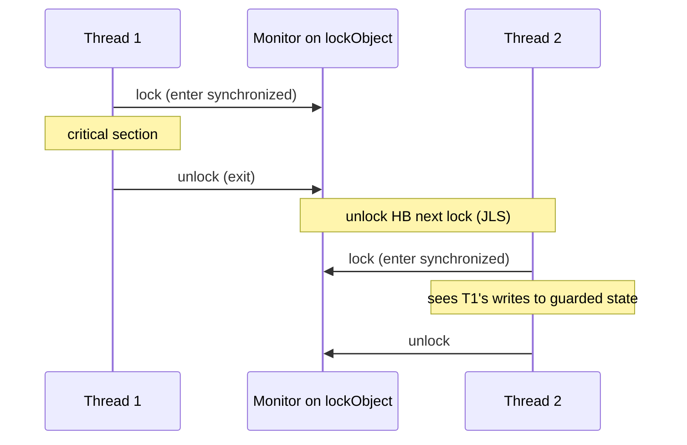
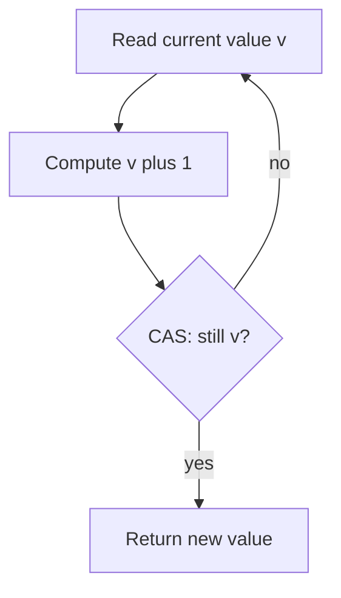

# Synchronization and Atomics

> **Status:** Completed  
> **Module:** 24 — Concurrency and Multithreading  
> **Target Java version:** 21  
> **Last reviewed:** 2026-11-11  
> **Chapter profile:** Deep-dive  
> **Depth target:** Levels 3–4 (data races, monitors, CAS atomics, JMM happens-before edges)  
> **Examples verified with:** Temurin JDK 21.0.12.1 (javac 21.0.12.1)

**Section policy:** Sections are **conditional unless marked mandatory**. Include a section when it adds meaningful learning value. Do **not** manufacture content to fill headings. For omitted sections, record the reason in the Review Checklist.

| Mandatory for most chapters | Conditional |
| --------------------------- | ----------- |
| Learning objectives | Internal behavior |
| Prerequisites | Performance |
| Why this exists | Security |
| Conceptual explanation | Language comparisons |
| Mechanism and execution flow *(or merge note)* | Advanced examples |
| Terminology | Real-world use cases |
| Examples | Design trade-offs *(strongly encouraged for Technical / Deep-dive)* |
| Common mistakes | Compatibility details |
| Summary and references | — |

**Editorial judgment:** Level 4 treatment on **lost updates**, **monitor locks**, and **CAS atomics** because incorrect coordination is a production bug class, not a style preference. JMM claims cite **JLS**; allocator and lock optimizations cite **HotSpot** only as implementation, not portable law.

## 1. Learning Objectives *(mandatory)*

After completing this chapter, you should be able to:

- Define a **data race** in JLS terms and explain why racy access to plain fields has no well-defined semantics.
- Decompose `counter++` into **load–add–store** and show how thread interleaving loses updates.
- Use **`synchronized`** blocks and methods to enforce **mutual exclusion** on a **monitor** and establish **happens-before** with unlock → lock (JLS §17.4).
- Use **`java.util.concurrent.atomic`** (`AtomicInteger`, `AtomicReference`, …) for lock-free updates on a **single** shared variable via **CAS** loops.
- State when atomics suffice versus when you need a **lock** guarding **multi-field invariants**.
- Distinguish **JLS happens-before** contracts from informal “cache flush to main memory” stories.
- Read demo output where the **unsafe** path shows a partial count while **atomic** and **synchronized** paths reach the expected total.

## 2. Prerequisites *(mandatory)*

- **Ch.01** — `Thread`, `Runnable`, `start()`, `join()`; heap shared across threads; per-thread stacks (JVMS).
- **Module 02** — primitives and references; `int` reads/writes are not magically atomic across **compound** actions.
- **Module 16** — lambdas for concise worker tasks.

**Refresher — visibility vs mutual exclusion:** Two threads can both “successfully” increment without losing counts **and** still fail to see each other’s writes on **other** fields if there is no happens-before edge. This chapter focuses on **atomicity of updates**; **Module 25** formalizes visibility rules (`volatile`, happens-before table).

**Refresher — `join()`:** When thread A calls `join()` on thread B and B completes, JLS guarantees actions in B **happen-before** `join` returns in A. That is why the demo’s main thread can safely print counter results after `joinAll`.

## 3. Why This Concept Exists *(mandatory)*

Shared mutable state is the default in Java servers: caches, registries, metrics, session tables. A line like `requests++` looks atomic in source code but compiles to multiple steps. Without coordination, two threads perform **read-modify-write** cycles on the same memory location; increments **vanish**.

The platform gives you layered tools:

- **Intrinsic locks (`synchronized`)** — one winner at a time; **unlock happens-before** the next **lock** on the same monitor (JLS).
- **Atomics (`AtomicInteger`)** — hardware-assisted **compare-and-set** for single variables; API documents which methods establish ordering with other memory actions (see `java.util.concurrent.atomic` specification).
- **Concurrent collections / higher-level APIs** (Ch.04) — when the invariant spans a structure, not one field.

Choosing the wrong tool—atomics on one counter while leaving related fields racy, or locking the wrong object—produces bugs that **pass tests** and fail under load.

## 4. Conceptual Explanation *(mandatory)*

### 4.1 Data races (JLS)

The Java Language Specification defines when an access to a variable is **synchronized** or participates in a **data race**. Informally: if two threads access the same variable, at least one access is a write, and the accesses are **not** ordered by happens-before, you have a **data race**.

For such races on **non-volatile** fields, the JLS does **not** give you a single predictable outcome. A program may observe torn writes, stale values, or outcomes that look “almost right” on small tests. **“It usually works” is not a specification.**

### 4.2 Why `counter++` is not atomic

For an `int counter`, `counter++` is equivalent in effect to:

1. Read `counter` into a local.
2. Add 1.
3. Write the local back to `counter`.

Two threads can both read `5`, both compute `6`, and both write `6`—one increment is **lost**. The same pattern applies to `counter += n`, check-then-act on fields, and many “one-liner” mutations.

**JLS / JVMS note:** Individual reads and writes of `int` are atomic in the sense that you do not observe “half an int.” The bug is **interleaving of the compound update**, not torn 32-bit words.

### 4.3 `synchronized` — mutual exclusion on a monitor

Every Java object can be associated with an **intrinsic lock** (monitor). A `synchronized` block:

```java
synchronized (lockObject) {
    // critical section
}
```

**acquires** the monitor for `lockObject` before entering and **releases** it on exit (normally or via exception). Only one thread holds a given monitor at a time for that lock.

**JLS happens-before:** An **unlock** on monitor *m* **happens-before** every subsequent **lock** on *m*. Therefore, everything done in a prior critical section is visible to the thread that acquires the lock next—**for data guarded by that same lock**.

`synchronized` **instance methods** lock on `this`; **static methods** lock on the `Class` object.

### 4.4 Atomics — single-variable CAS updates

`AtomicInteger` (and siblings) hold a `volatile` field internally and expose methods such as `incrementAndGet()` implemented with **compare-and-set (CAS)**:

1. Read current value *v*.
2. Compute new value *v'*.
3. Atomically replace if still *v*; otherwise retry.

**API contract (Java SE):** Methods like `incrementAndGet`, `addAndGet`, and `compareAndSet` perform their updates atomically; many also carry volatile-like ordering relative to other access to the same atomic variable—consult the method Javadoc for the exact memory semantics of each operation.

**Limitation (design, not implementation):** Atomics coordinate **one** location. Invariants like “`size == list.length`” across two fields need one lock or a concurrent structure that publishes both together.

### 4.5 When to use which

| Situation | Typical choice |
|-----------|----------------|
| Simple counter, sequence, single flag with atomic methods | `AtomicInteger` / `AtomicLong` |
| Multi-step invariant on several fields | `synchronized` or `java.util.concurrent.locks` |
| Read-heavy shared map | `ConcurrentHashMap` (Ch.04), not `synchronized` entire `HashMap` |
| Publish one field visible to other threads without locking | `volatile` (Module 25) — not a substitute for `++` on `volatile` in all cases |

## 5. Mechanism and Execution Flow *(mandatory)*

### 5.1 Lost update: interleaved schedules

Consider `unsafeCounter` starting at `0`, two threads each incrementing once:

| Step | Thread A | Thread B | `unsafeCounter` |
|------|----------|----------|-------------------|
| 1 | read 0 | | 0 |
| 2 | | read 0 | 0 |
| 3 | write 1 | | 1 |
| 4 | | write 1 | **1** (lost one increment) |

With four threads × 10_000 increments, the demo expects `40_000`. The **unsafe** path on Temurin 21.0.12.1 recorded **`unsafeCounter=10856`**—severe loss. Exact partial counts vary by scheduling; the **pattern** (far below 40_000) is the lesson.

### 5.2 Monitor enter / exit flow



**How to read this diagram:** Thread 2 may block until Thread 1 releases. The **JLS** edge is between unlock and the **next** lock on the **same** monitor—not “all memory flushes globally.”

### 5.3 CAS retry loop (conceptual)

For `incrementAndGet()`:



**HotSpot (implementation):** CAS maps to CPU instructions (`cmpxchg` family). Contended atomics spin and may use **adaptive spinning** or delegate to locks internally on some paths—these are **JDK implementation** strategies, not something application code should assume for all vendors.

### 5.4 Demo execution flow

Demo: [synchronization-atomics-demo](../../examples/core-java/synchronization-atomics-demo/).

1. **Unsafe run** — `unsafeCounter++` in lambdas; `joinAll` ensures workers finish before print.
2. **Atomic run** — `safeCounter.incrementAndGet()`; CAS ensures each increment counted.
3. **Synchronized run** — `synchronized (lockedCounter) { lockedCounter[0]++; }` — array used as mutable holder so the lambda can capture a effectively final reference.

**Verified output (Temurin JDK 21.0.12.1):**

```text
unsafeCounter=10856
atomicCounter=40000
syncCounter=40000
```

`40000` = 4 threads × 10_000 increments. Only the racy path misses the target.

## 6. Terminology *(mandatory)*

| Term | Meaning |
|------|---------|
| **Data race** | Conflicting unsynchronized accesses to the same variable (JLS §17.4). |
| **Happens-before** | Partial order; if *a* hb *b*, *a* is visible to *b* (JLS memory model). |
| **Monitor / intrinsic lock** | Lock associated with an object for `synchronized`. |
| **Critical section** | Code that must run exclusively while holding a lock. |
| **CAS** | Compare-and-set; atomically updates if current value matches expected. |
| **Lost update** | Two writers based on the same read; one write overwritten. |
| **Atomic variable** | `java.util.concurrent.atomic.*` types with atomic methods on one cell. |

## 7. Syntax and Language Rules *(include when the topic is language/API surface)*

### 7.1 `synchronized`

```java
// Block — lock object explicit
synchronized (lock) { /* ... */ }

// Instance method — lock is this
public synchronized void update() { /* ... */ }

// Static method — lock is Class object
public static synchronized void updateGlobal() { /* ... */ }
```

**JLS:** A thread must not lock the same monitor twice in a way that deadlocks with itself on the same monitor in standard usage; reentrant locks are allowed—the same thread may acquire a monitor it already holds.

### 7.2 Common atomic types

| Type | Typical use |
|------|-------------|
| `AtomicInteger` / `AtomicLong` | Counters, sequence numbers |
| `AtomicBoolean` | One-shot flags, gate |
| `AtomicReference<V>` | CAS on object reference |
| `LongAdder` | High-contention counters (striped accumulation; `sum()` at quiescent points) |

`incrementAndGet()` is preferred over manual `get` / `set` loops when available.

## 8. Step-by-Step Examples *(mandatory)*

### 8.1 Minimal — racy increment (**Verified** via full demo)

```java
private static int unsafeCounter;

// In worker:
unsafeCounter++;  // data race when multiple threads
```

**Important lines:** The read-modify-write is implicit. No happens-before between worker threads.

### 8.2 Realistic — atomic counter (**Verified**)

```java
private static final AtomicInteger safeCounter = new AtomicInteger();

safeCounter.incrementAndGet();
```

**Why this way:** One API call maps to a CAS loop inside the JDK; you avoid hand-rolled spin locks for a single `int`.

### 8.3 Advanced — guarding a check-then-act (**Illustrative** structure)

**Incorrect (composed race on `HashMap`):**

```java
if (!map.containsKey(k)) {
    map.put(k, v);  // two threads can both pass the if
}
```

**Corrected patterns:** `ConcurrentHashMap.putIfAbsent` / `computeIfAbsent` (Ch.04), or `synchronized` on a private lock guarding **all** map invariants.

### 8.4 Incorrect variation that still “looks fine”

```java
private volatile int counter;
// multiple threads: counter++;
```

**Why wrong for counting:** `volatile` ensures visibility of individual reads/writes, not atomicity of read-modify-write. You can still lose increments (and create races JLS classifies as problematic depending on usage). Use `AtomicInteger` or `synchronized`.

## 9. Real-World Use Cases *(conditional)*

- **In-memory metrics** — request counts, error tallies (`LongAdder` at very high contention).
- **ID generation** — `AtomicLong` sequence for correlation IDs in a single JVM.
- **Lazy one-time init** — often `synchronized` or `ConcurrentHashMap.computeIfAbsent`; double-checked locking needs `volatile` (Module 25).
- **Short critical sections** — protect balance transfer between two account fields under one lock.

## 10. Internal Behavior *(conditional)*

### 10.1 JLS / JMM (portable)

- **Unlock → lock** on the same monitor establishes happens-before (JLS §17.4.5).
- **Atomics:** Consult each method’s specification; do not assume every atomic read synchronizes all thread memory globally.
- **Data races** on non-volatile fields: program has no reliable semantics for those accesses.

### 10.2 HotSpot (implementation — not universal JVM law)

- Monitors may **inflate** from lightweight to heavy locks under contention.
- **Bias locking** has evolved across JDK releases; biased lock revocation is a HotSpot detail—do not build correctness on it.
- Atomics use intrinsic `Unsafe` / `VarHandle` machinery; on failure they retry.

Label any “store buffer,” “MESI,” or “flush to RAM” explanation as **engineering intuition** for HotSpot-class machines, not a substitute for happens-before.

## 11. Edge Cases and Limitations *(strongly encouraged for Technical / Deep-dive)*

- **Wrong lock object** — synchronizing on `new Object()` per call does not serialize access to shared data; pick **one** lock per guarded structure.
- **Lock ordering** — `synchronized(a){ synchronized(b){...}}` vs reverse order on another thread → **deadlock**; use consistent global ordering or higher-level APIs.
- **Long critical sections** — holding locks during I/O reduces throughput and increases deadlock risk.
- **Atomics do not compose** — two `AtomicInteger`s updated “together” are not atomic as a pair without a lock.
- **`LongAdder`** — `sum()` is not a global atomic snapshot under concurrent updates; fine for metrics, not for strict audit without quiescence.

## 12. Common Mistakes *(mandatory)*

### Incorrect

Using `Collections.synchronizedList` and then iterating without **external** synchronization while another thread mutates—compound actions are not atomic.

### Corrected

Use concurrent collections, snapshot iterators, or synchronize on the same mutex for **iteration + mutation** policy.

### Incorrect

```java
synchronized (this) { sharedMap.put(k, v); }
// elsewhere, unsynchronized:
sharedMap.get(k);
```

If other code paths access `sharedMap` without `this`, the map is still racy.

### Corrected

Make the lock **private final** and guard **every** access path, or use `ConcurrentHashMap`.

## 13. Best Practices *(include when guidance adds value)*

- Prefer **`java.util.concurrent`** utilities over raw `wait`/`notify` in new code unless you are implementing a low-level structure.
- Keep critical sections **short**; measure before replacing locks with atomics for nanosecond-level wins.
- Document **which lock guards which fields**; hidden `synchronized` methods on public APIs surprise callers.
- Run stress tests (many threads, long duration)—race demos under-count reliably but unit tests may miss races.

## 14. Design Trade-offs *(conditional; strongly encouraged for Technical / Deep-dive)*

| Approach | Pros | Cons |
|----------|------|------|
| `synchronized` | Simple, reentrant, clear HB with monitor | Contention serializes; easy to deadlock; no try/timeout in classic block |
| `AtomicInteger` | Lock-free for one cell; scalable for low/medium contention | CAS retries under hot contention; single-variable only |
| `LongAdder` | Very high update rates | `sum()` semantics; not for every counter |
| `ReentrantLock` (later material) | `tryLock`, timeouts, fairness option | More API surface; must `unlock` in `finally` |

## 15. Performance Considerations *(conditional)*

- Uncontended `synchronized` is often cheap after JIT inlining (HotSpot).
- Hot atomic contention causes **cache line bouncing** between cores—consider `LongAdder` or partitioning counters.
- Profile before switching; lost correctness dominates micro-optimization.

## 16. Security Considerations *(conditional)*

- **Do not expose** lock objects you synchronize on; external code could acquire your monitor and cause denial of service.
- Race conditions can become **security bugs** (double initialization, TOCTOU checks)—treat them as correctness failures first.

*Omitted detailed threat modeling; note in checklist.*

## 17. Java Version and Compatibility Notes *(conditional)*

- `java.util.concurrent.atomic` since Java 5; `VarHandle` (Java 9+) underpins lower-level access in the JDK.
- Virtual threads (Ch.05): **pinning** can occur when virtual threads enter some `synchronized` blocks on JDK 21 (HotSpot / JEP notes)—a deployment concern, not a reason to ignore races.

## 18. Related Language Comparisons *(conditional)*

*Omitted; C++ `std::mutex` / `std::atomic` parallels are conceptually similar but memory models differ—see appendix if added later.*

## 19. Revision and Mastery *(major / Technical / Deep-dive chapters)*

**You should already understand:** thread creation, shared heap, `join()` HB edge.

**Common gaps:**

- Believing `volatile` fixes `++`.
- Synchronizing on different objects for the same data.
- Assuming `AtomicReference` makes **whole object graphs** immutable without safe publication.

**Questions you should answer:**

1. Why is `10856` a valid unsafe outcome while `40000` is the atomic/sync target?
2. Which happens-before edge does `synchronized` provide?
3. When is `LongAdder` preferable to `AtomicLong`?

**Exercise (no solution inline):** Run the demo with 8 threads and 100_000 increments; record unsafe vs atomic outputs on your JDK.

## 20. Exercises *(include for major chapters)*

### Beginner

Run `SynchronizationAtomicsDemo` and explain each output line.

### Intermediate

Implement a racy `bank transfer` with two `int` fields and fix it with one lock.

### Advanced

Compare `AtomicLong` vs `LongAdder` under 16 threads for 1e8 increments (JMH optional).

## 21. Interview Questions *(conditional)*

- “Is `counter++` thread-safe on an `int`?”
- “Difference between `synchronized` and `volatile`?”
- “What is lost update?”

## 22. Solutions *(or link to separate solutions file)*

Beginner solution sketch: unsafe path races on read-modify-write; atomic uses CAS; synchronized serializes increments on `lockedCounter` monitor.

## 23. Chapter Summary *(mandatory)*

**Lost updates** expose non-atomic read-modify-write. **`synchronized`** uses monitors whose unlock→lock edges give **happens-before** for guarded state. **Atomics** provide portable single-variable CAS updates. Correctness rests on **JLS** ordering and clear **lock discipline**, not on HotSpot folklore.

## 24. Key Terminology *(optional consolidation; may point to Section 6)*

See Section 6.

## 25. References and Further Reading *(mandatory)*

- [JLS §17.4 — Happens-before Order](https://docs.oracle.com/javase/specs/jls/se21/html/jls-17.html#jls-17.4)
- [Java SE `java.util.concurrent.atomic` package summary](https://docs.oracle.com/en/java/javase/21/docs/api/java.base/java/util/concurrent/atomic/package-summary.html)
- [Java SE `synchronized` statement](https://docs.oracle.com/javase/specs/jls/se21/html/jls-14.html#jls-14.19)
- Module **25** — happens-before tables and `volatile`

## 26. Next Steps

[03-executors-and-futures.md](03-executors-and-futures.md) — pool threads running many coordinated tasks; still requires safe shared state from this chapter.

## Review Checklist

**Mandatory Depth Review:** Level 4 on races, monitors, CAS; Level 3 on selection trade-offs.

- [x] Learning objectives covered
- [x] Prerequisites identified and briefly refreshed
- [x] Chapter profile and depth target recorded and appropriate
- [x] Depth gate passed (definitions; progressive examples; wrong vs right)
- [x] Mandatory Depth Review (Levels 1–4) passed for this topic
- [x] Mechanism and execution flow explained (interleaving, monitor, CAS)
- [x] Diagrams: monitor sequence + CAS flow
- [x] First-appearance: HB, data race defined in chapter
- [x] Terminology defined before use
- [x] Examples with verification labels; demo output from Temurin 21.0.12.1
- [x] JLS vs HotSpot distinguished
- [x] References support JMM claims
- [x] Revision and Mastery included
- [x] Chapter independently readable
- [x] `PROGRESS.md` updated (EXPAND-PRESERVE pass 2026-11-11)

**Omissions (section → reason):**

- Language comparisons — not required for standalone JMM lesson
- Security — brief note only; module not security-focused
