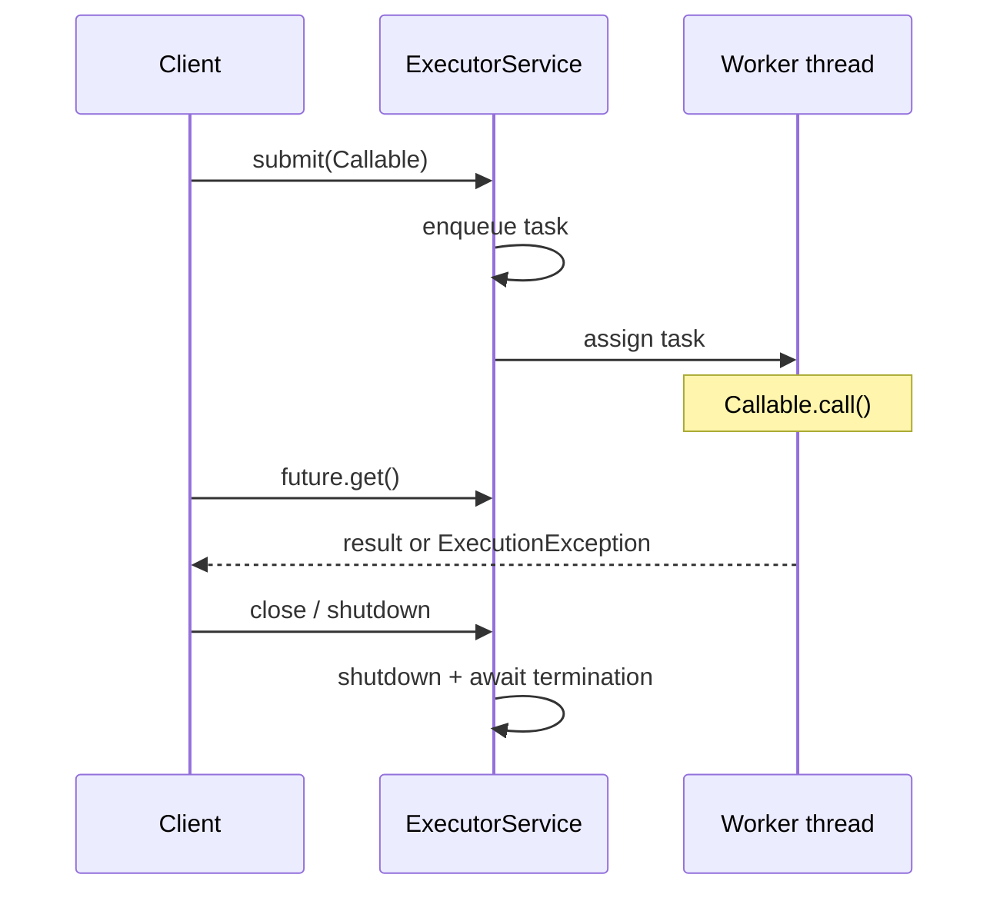

# Executors and Futures

> **Status:** Completed  
> **Module:** 24 — Concurrency and Multithreading  
> **Target Java version:** 21  
> **Last reviewed:** 2026-11-11  
> **Chapter profile:** Technical  
> **Depth target:** Levels 3 (pool lifecycle, Callable/Future, shutdown, HB from submit to task)  
> **Examples verified with:** Temurin JDK 21.0.12.1 (javac 21.0.12.1)

**Section policy:** Conditional sections omitted when noted in Review Checklist.

## 1. Learning Objectives *(mandatory)*

After completing this chapter, you should be able to:

- Submit work to an **`ExecutorService`** instead of unbounded `new Thread`.
- Return values with **`Callable<T>`** and retrieve them via **`Future<T>`**.
- Shut down pools using **try-with-resources** (`ExecutorService` extends `AutoCloseable` since Java 19) or explicit `shutdown` / `awaitTermination`.
- Describe **`ExecutionException`** as a wrapper for task failures.
- Cite **`submit` happens-before task run** ( `java.util.concurrent` specification).

## 2. Prerequisites *(mandatory)*

- Ch.01–02 threads and shared state.
- **Module 14** try-with-resources.
- **Module 16** lambdas; `Callable` is like `Runnable` but returns a value and throws `Exception`.

## 3. Why This Concept Exists *(mandatory)*

Creating an OS-backed thread per task does not scale: memory per thread, scheduler overhead, and no central **backpressure**. **Thread pools** reuse workers, cap parallelism, and queue excess work.

**`Future`** decouples **submission** from **result retrieval**—the calling thread can do other work until `get()` (with optional timeout).

## 4. Conceptual Explanation *(mandatory)*

| Type | Role |
|------|------|
| `Executor` | Executes `Runnable`; fire-and-forget |
| `ExecutorService` | `submit`, lifecycle `shutdown`, `awaitTermination` |
| `Callable<V>` | Task with return value |
| `Future<V>` | Handle to result; `get()` blocks |

`Executors.newFixedThreadPool(n)` creates a pool of **n** platform threads and an unbounded default queue (implementation detail—know backlog risk).

**JMM (API):** Actions submitting a task to an `ExecutorService` **happen-before** the task begins execution (per `java.util.concurrent` package specification).

## 5. Mechanism and Execution Flow *(mandatory)*



### Demo

Demo: [executors-futures-demo](../../examples/core-java/executors-futures-demo/).

**Verified output (Temurin JDK 21.0.12.1):**

```text
futureResult=42
done=true
poolShutdown=ok
```

**Important lines:** `try (ExecutorService ex = Executors.newFixedThreadPool(2))` triggers **close** → `shutdown` and await (Java 19+ `AutoCloseable`). `get()` observes completed computation.

## 6. Terminology *(mandatory)*

| Term | Meaning |
|------|---------|
| Work queue | Holds pending tasks when all workers busy |
| `shutdown()` | No new tasks; finish queued |
| `shutdownNow()` | Attempt cancel + interrupt workers |
| `ExecutionException` | `get()` failed because task threw |

## 7. Syntax and Language Rules *(include when the topic is language/API surface)*

```java
try (ExecutorService pool = Executors.newFixedThreadPool(4)) {
    Future<Integer> f = pool.submit(() -> 42);
    int x = f.get(5, TimeUnit.SECONDS);
}
```

Prefer **named** custom `ThreadFactory` for observability in production (not shown in minimal demo).

## 8. Step-by-Step Examples *(mandatory)*

### 8.1 Minimal — fixed pool + Callable (**Verified**)

See demo: returns 42, `isDone()` true after `get()`.

### 8.2 Incorrect — never shutdown

Long-lived CLI with a fixed pool and non-daemon workers prevents JVM exit until `shutdown`.

### 8.3 Advanced pointer

`CompletableFuture` composes async pipelines; covered in backend modules—built on same executor ideas.

## 9. Real-World Use Cases *(conditional)*

- Parallel fan-out to HTTP/DB dependencies with **bounded** concurrency.
- CPU work off UI thread on JVM clients.

## 10. Internal Behavior *(conditional)*

- **API:** Task submission HB task execution; task body must publish shared results safely (Module 25).
- **HotSpot:** Pool workers are **platform** threads unless using virtual-thread executor (Ch.05).

## 11. Edge Cases and Limitations *(strongly encouraged)*

- Fixed pool + unbounded queue → memory growth under sustained overload.
- `shutdownNow()` interrupts running tasks—tasks must handle `InterruptedException`.
- `get()` without timeout can deadlock your orchestration if tasks wait on each other.

## 12. Common Mistakes *(mandatory)*

### Incorrect

Calling `Future.get()` on the **only** pool thread from a task submitted to that same pool—risk of stall.

### Corrected

Use separate executor, `ForkJoinPool`, or async composition with explicit dependency graph.

## 13. Best Practices *(include when guidance adds value)*

- Size CPU pools near hardware parallelism; size I/O pools larger **or** use virtual threads.
- Always **shutdown** pools in servers on undeploy.
- Propagate **context** (tracing IDs) via `ThreadFactory` / framework wrappers.

## 14. Design Trade-offs *(conditional)*

| Fixed pool | Cached / per-task VT executor |
|------------|-------------------------------|
| Predictable cap | Better for blocking I/O at scale (Ch.05) |

## 15. Performance Considerations *(conditional)*

Queue depth and rejection policies (`ThreadPoolExecutor` constructors) matter under load—`Executors` helpers hide knobs.

## 16. Security Considerations *(conditional)*

*Omitted.*

## 17. Java Version and Compatibility Notes *(conditional)*

- `ExecutorService` `AutoCloseable` since Java 19—fits try-with-resources on Java 21 path.

## 19. Revision and Mastery *(Technical)*

**Questions:** What does `ExecutionException` wrap? Why await termination after shutdown?

## 20. Exercises *(include for major chapters)*

Submit multiple `Callable` tasks and sum results via `invokeAll` (API exploration).

## 23. Chapter Summary *(mandatory)*

**ExecutorService** manages reusable workers; **Callable/Future** return values; **shutdown** is part of correct lifecycle; **submit HB task start** is your portable visibility edge for task inputs.

## 25. References and Further Reading *(mandatory)*

- [Java SE `java.util.concurrent` package summary](https://docs.oracle.com/en/java/javase/21/docs/api/java.base/java/util/concurrent/package-summary.html)
- [Java SE `ExecutorService`](https://docs.oracle.com/en/java/javase/21/docs/api/java.base/java/util/concurrent/ExecutorService.html)

## 26. Next Steps

[04-concurrent-collections.md](04-concurrent-collections.md)

## Review Checklist

- [x] Technical profile; Level 3 mechanisms and lifecycle
- [x] Mechanism diagram; Verified Temurin 21.0.12.1
- [x] API HB vs HotSpot pool threads labeled
- [x] Omissions: Security, language comparisons
