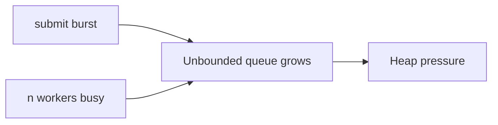

# Executors and Futures

> **Status:** Completed  
> **Module:** 24 — Concurrency and Multithreading  
> **Target Java version:** 21  
> **Last reviewed:** 2026-11-11  
> **Chapter profile:** Technical  
> **Depth target:** Levels 3 (pool lifecycle, Callable/Future, shutdown, rejection/queue risks, HB from submit to task)  
> **Examples verified with:** Oracle JDK 21.0.9 (third deepen pass 2026-11-11; Temurin 21.0.12.1 not installed on this host). Output matches prior Temurin 21.0.12.1 recordings.

**Section policy:** Conditional sections omitted when noted in Review Checklist. This chapter teaches **thread pools and Futures** as the default application concurrency API; virtual-thread executors are previewed here and deepened in Ch.05.

| Mandatory for most chapters | Conditional |
| --------------------------- | ----------- |
| Learning objectives | Internal behavior |
| Prerequisites | Performance |
| Why this exists | Security |
| Conceptual explanation | Language comparisons |
| Mechanism and execution flow | Advanced examples |
| Terminology | Real-world use cases |
| Examples | Design trade-offs |
| Common mistakes | Compatibility details |
| Summary and references | — |

**Editorial judgment:** Level 3 on **lifecycle** (`shutdown` / `awaitTermination` / try-with-resources), **Callable/Future**, **queue and rejection risks**, and the portable **`submit` happens-before task execution** edge from the `java.util.concurrent` specification.

## 1. Learning Objectives *(mandatory)*

After completing this chapter, you should be able to:

- Submit work to an **`ExecutorService`** instead of unbounded `new Thread` per task.
- Return values with **`Callable<T>`** and retrieve them via **`Future<T>`** (`get`, timeouts, `isDone`).
- Shut down pools using **try-with-resources** (`ExecutorService` extends `AutoCloseable` since Java 19) or explicit `shutdown` / `awaitTermination`.
- Describe **`ExecutionException`** as a wrapper for task failures surfaced by `Future.get()`.
- Cite **`submit` happens-before task run** (`java.util.concurrent` package specification).
- Explain why a **fixed pool + unbounded queue** can still exhaust memory under sustained overload.
- Orient on factory methods (`newFixedThreadPool`, `newCachedThreadPool`, `newSingleThreadExecutor`, virtual-thread executor) and when custom `ThreadPoolExecutor` knobs matter.

## 2. Prerequisites *(mandatory)*

- **Ch.01** — threads, `Runnable`, `start`/`join`; cost of raw thread creation.
- **Ch.02** — shared state still needs coordination inside tasks.
- **Module 14** — try-with-resources / `AutoCloseable`.
- **Module 16** — lambdas; functional interfaces.

**Refresher — `Runnable` vs returning a value:** `Runnable.run()` returns `void` and cannot throw checked exceptions. When a task must produce a result or throw checked failures, use **`Callable<V>`**, whose `call()` returns `V` and may throw `Exception`.

**Refresher — thread pool:** A **thread pool** is a managed set of worker threads plus a **work queue**. Tasks are objects (`Runnable`/`Callable`) submitted to the pool; workers pull tasks and execute them. Pooling amortizes thread creation and caps how many tasks run at once.

## 3. Why This Concept Exists *(mandatory)*

Creating an OS-backed thread per task does not scale: memory per thread, scheduler overhead, and no central **backpressure**. Under load, `new Thread(task).start()` for every request can exhaust native threads long before your business logic fails clearly.

**Thread pools** reuse workers, cap parallelism, and queue excess work. **`Future`** decouples **submission** from **result retrieval**—the calling thread can do other work until `get()` (with optional timeout).

Executors also centralize **lifecycle**: servers must stop accepting work and drain or cancel tasks on undeploy. Scattered raw threads make shutdown and observability harder (unnamed workers, no single place to interrupt).

## 4. Conceptual Explanation *(mandatory)*

### 4.1 Core types

| Type | Role |
|------|------|
| `Executor` | Executes `Runnable`; fire-and-forget (`execute`) |
| `ExecutorService` | `submit`, lifecycle `shutdown`, `awaitTermination`, `invokeAll`, … |
| `Callable<V>` | Task with return value; may throw `Exception` |
| `Future<V>` | Handle to a result; `get()` blocks until done or fails |
| `Executors` | Factory for common pool configurations |

**First appearance — `Future`:** A `Future` is a handle representing the result of an asynchronous computation. Until the task completes, `get()` waits. If the task threw, `get()` throws **`ExecutionException`** whose **cause** is the task’s throwable. If the waiting thread is interrupted, `get()` throws `InterruptedException`.

### 4.2 Factory methods (orientation)

| Factory | Typical use | Watch out |
|---------|-------------|-----------|
| `newFixedThreadPool(n)` | Bound **n** platform workers | Default queue is **unbounded** → memory risk under overload |
| `newCachedThreadPool()` | Short async tasks; creates threads as needed | Can grow aggressively under sustained load |
| `newSingleThreadExecutor()` | Serialize tasks on one worker | Still unbounded queue by default |
| `newVirtualThreadPerTaskExecutor()` | One virtual thread per task (Ch.05) | Not a CPU pool; final in Java 21 |

`Executors` helpers are convenient for learning and many apps. Production systems often construct **`ThreadPoolExecutor`** explicitly to set **core/max size**, **bounded queue**, and **`RejectedExecutionHandler`**.

### 4.3 Happens-before for task handoff

**JMM / API:** Actions in a thread prior to submitting a task to an `Executor` **happen-before** the start of that task’s execution (see the `java.util.concurrent` package specification). Practical meaning: values you write to shared fields **before** `submit` are visible to the task body without extra synchronization for that handoff edge. The task still must publish its **outputs** safely (locks, volatiles, `Future.get` happens-before after successful completion, Module 25).

### 4.4 Shutdown semantics

| Method | Meaning |
|--------|---------|
| `shutdown()` | Stop accepting new tasks; finish already queued tasks |
| `shutdownNow()` | Stop accepting; attempt to cancel queued; interrupt running workers |
| `awaitTermination(timeout, unit)` | Block until terminated or timeout |
| `close()` (Java 19+) | `AutoCloseable`: shutdown and wait (see Javadoc for details) |

Try-with-resources on `ExecutorService` is the clean default on the Java 21 path:

```java
try (ExecutorService pool = Executors.newFixedThreadPool(2)) {
    // submit work; get results
} // close → orderly shutdown
```

## 5. Mechanism and Execution Flow *(mandatory)*

### 5.1 Submit → worker → get → shutdown

```mermaid
sequenceDiagram
    participant Client
    participant Pool as ExecutorService
    participant Q as Work queue
    participant W as Worker thread

    Client->>Pool: submit(Callable)
    Pool->>Q: enqueue task
    Pool-->>Client: Future
    Q->>W: dequeue
    Note over W: Callable.call()
    Client->>Pool: future.get()
    W-->>Client: result or ExecutionException
    Client->>Pool: close / shutdown
    Pool->>Pool: reject new tasks; drain; await
```

### 5.2 Overload path (fixed pool + unbounded queue)



Workers are capped at `n`, but the queue can grow without bound with the common `Executors.newFixedThreadPool` configuration. Under sustained overload you run out of **memory**, not “threads,” unless you use a bounded queue and a rejection policy.

### 5.3 Demo

Demo: [executors-futures-demo](../../examples/core-java/executors-futures-demo/).

**Compile and run:**

```text
javac ExecutorsFuturesDemo.java
java ExecutorsFuturesDemo
```

**Verified output (Oracle JDK 21.0.9; matches prior Temurin 21.0.12.1):**

```text
futureResult=42
done=true
poolShutdown=ok
```

**Important lines:** `try (ExecutorService pool = Executors.newFixedThreadPool(2))` triggers **close** on exit → shutdown and await (Java 19+ `AutoCloseable`). `Callable` returns `21 + 21`. `future.get(5, TimeUnit.SECONDS)` waits with a timeout. After the try block, printing `poolShutdown=ok` shows the pool closed cleanly. `isDone()` is true after successful `get()`.

## 6. Terminology *(mandatory)*

| Term | Meaning |
|------|---------|
| Work queue | Holds pending tasks when all workers are busy |
| Worker | Pool thread that dequeues and runs tasks |
| `shutdown()` | No new tasks; finish queued |
| `shutdownNow()` | Attempt cancel + interrupt workers |
| `ExecutionException` | `get()` failed because the task threw |
| Rejection | Pool refuses a task (bounded queue full / shutdown) |
| Backpressure | Slowing or rejecting submissions so the system stays bounded |
| `invokeAll` | Submit a collection of Callables; wait for all |

## 7. Syntax and Language Rules *(include when the topic is language/API surface)*

```java
try (ExecutorService pool = Executors.newFixedThreadPool(4)) {
    Future<Integer> f = pool.submit(() -> 42);
    int x = f.get(5, TimeUnit.SECONDS);
}

Future<?> fireAndForget = pool.submit(() -> System.out.println("hi"));
pool.execute(() -> System.out.println("also hi")); // no Future
```

- Prefer a **named** custom `ThreadFactory` in production so thread dumps show `http-worker-3` instead of `pool-1-thread-1`.
- Always decide interruption policy: tasks catching `InterruptedException` should restore the interrupt flag (`Thread.currentThread().interrupt()`) unless they own the full lifecycle.
- `Future.cancel(true)` may interrupt a running task; `cancel(false)` only removes it if still queued—see Javadoc.

## 8. Step-by-Step Examples *(mandatory)*

### 8.1 Minimal — fixed pool + Callable (**Verified**)

See demo §5.3: returns 42, `isDone()` true after `get()`, pool closes.

### 8.2 Realistic — fan-out with timeout *(Illustrative)*

```java
try (ExecutorService pool = Executors.newFixedThreadPool(8)) {
    List<Future<String>> futures = new ArrayList<>();
    for (String id : ids) {
        futures.add(pool.submit(() -> fetch(id)));
    }
    for (Future<String> f : futures) {
        System.out.println(f.get(2, TimeUnit.SECONDS));
    }
}
```

Timeouts prevent one stuck dependency from hanging the whole batch forever. Failed tasks surface as `ExecutionException`.

### 8.3 Incorrect — never shutdown

```java
ExecutorService pool = Executors.newFixedThreadPool(4);
pool.submit(task);
// process exits? non-daemon workers keep JVM alive
```

Long-lived CLI tools and tests hang because default pool threads are **non-daemon**.

### 8.4 Corrected

Use try-with-resources, or `shutdown()` + `awaitTermination`, in a `finally` if you cannot use try-with-resources.

### 8.5 Advanced pointer — `CompletableFuture`

`CompletableFuture` composes async pipelines (`thenApply`, `thenCompose`, `exceptionally`) and often runs on the common `ForkJoinPool` or a custom executor. Backend modules deepen patterns; the same lifecycle and HB ideas apply: you still choose an executor and still must handle failures and cancellation.

## 9. Real-World Use Cases *(conditional)*

- Parallel fan-out to HTTP/DB dependencies with **bounded** concurrency.
- Background jobs in application servers (inject a managed executor; do not spawn unmanaged threads).
- CPU work off the UI thread on JVM clients.
- Isolating pools by workload (I/O pool vs CPU pool) so a stampede of blocking calls does not starve compute.

## 10. Internal Behavior *(conditional)*

- **API:** Task submission happens-before task execution; successful `Future` completion happens-before `get` returns in the waiting thread (see j.u.c. and JLS relationships discussed in Module 25).
- **HotSpot:** Workers from `newFixedThreadPool` are **platform** threads. Virtual-thread executors (Ch.05) change the worker model without changing the `ExecutorService` interface.
- **Implementation detail:** Exact queue type for `Executors` factories is documented in the factory Javadoc—read it when diagnosing memory growth.

## 11. Edge Cases and Limitations *(strongly encouraged)*

- Fixed pool + unbounded queue → memory growth under sustained overload.
- `shutdownNow()` interrupts running tasks—tasks must handle `InterruptedException` correctly.
- `get()` without timeout can deadlock orchestration if tasks wait on each other while holding all workers (**pool-induced deadlock**).
- Submitting tasks that call `get()` on other tasks in the **same** small pool is a classic stall.
- After `shutdown()`, `submit` throws `RejectedExecutionException`.
- Cached pools can create many threads if tasks block for a long time.

## 12. Common Mistakes *(mandatory)*

### Incorrect

Calling `Future.get()` on the **only** pool threads from tasks submitted to that same pool—risk of stall when all workers wait for each other.

### Corrected

Use a larger pool, a separate executor for callbacks, asynchronous composition, or an explicit dependency graph that cannot cycle on the same workers.

### Incorrect

Ignoring `ExecutionException` and only catching `InterruptedException`.

### Corrected

Unwrap `e.getCause()` for logging and mapping to domain errors.

### Incorrect

`shutdown()` without waiting, then immediately reading task side effects on shared structures.

### Corrected

`awaitTermination` or try-with-resources `close`; or `Future.get` / `join` for specific tasks.

## 13. Best Practices *(include when guidance adds value)*

- Size CPU pools near hardware parallelism; size I/O pools larger **or** use virtual threads (Ch.05).
- Always **shutdown** pools in servers on undeploy.
- Propagate **context** (tracing IDs, auth) via `ThreadFactory` / framework wrappers or scoped values (later features)—do not assume ThreadLocals propagate magically across pools.
- Prefer timeouts on `get`.
- Prefer bounded queues + rejection metrics in latency-sensitive services.

## 14. Design Trade-offs *(conditional)*

| Fixed platform pool | Cached pool | Virtual per-task executor |
|---------------------|-------------|---------------------------|
| Predictable cap | Elastic for bursty short tasks | Excellent for blocking scale (Ch.05) |
| Unbounded queue risk with factories | Thread explosion risk | Different memory profile |
| Familiar | Harder to reason under load | Not for pure CPU |

## 15. Performance Considerations *(conditional)*

Queue depth, rejection policies, and context-switch rates dominate under load. `Executors` helpers hide knobs—graduate to `ThreadPoolExecutor` when you need metrics and bounds. Pool sizing is empirical: too small increases latency; too large increases contention and memory.

## 16. Security Considerations *(conditional)*

*Omitted as primary.* Unbounded submission from untrusted input remains a DoS vector—bound queues and rate-limit at the edge.

## 17. Java Version and Compatibility Notes *(conditional)*

- `ExecutorService` implements `AutoCloseable` since **Java 19**—fits try-with-resources on the Java 21 path.
- Virtual-thread executor factories are **final** in Java 21 (Ch.05).
- `CompletableFuture` has been standard since Java 8; composition patterns expand in backend modules.

## 19. Revision and Mastery *(Technical)*

**Gaps:** Forgetting shutdown; treating factory pools as “safe under overload”; pool deadlocks; swallowing `ExecutionException`.

**Questions:**

1. What does `ExecutionException` wrap?
2. Why await termination after `shutdown()`?
3. How can a fixed thread pool still cause `OutOfMemoryError`?
4. What happens-before edge does task submission give you?

## 20. Exercises *(include for major chapters)*

### Beginner

Submit two `Callable<Integer>` tasks and print both results with timeouts.

### Intermediate

Use `invokeAll` on a list of Callables and sum results.

### Advanced

Configure a `ThreadPoolExecutor` with a bounded queue and `CallerRunsPolicy`; explain what happens when saturated.

## 21. Interview Questions *(conditional)*

- `execute` vs `submit`?
- `shutdown` vs `shutdownNow`?
- How do you avoid deadlocks with `Future.get` inside pool tasks?

## 22. Solutions *(brief)*

Beginner: two submits, two timed `get`s. Intermediate: `invokeAll` then iterate Futures. Advanced: saturation runs the task on the caller thread—natural backpressure; document the trade-off (caller latency).

## 23. Chapter Summary *(mandatory)*

**`ExecutorService`** manages reusable workers and a work queue; **`Callable`/`Future`** return values and surface failures via **`ExecutionException`**. **Shutdown** (try-with-resources on Java 21) is part of correctness. **`submit` happens-before task start** is your portable visibility edge for task inputs. Factory convenience methods hide queue and rejection knobs—know the overload risks before production.

## 25. References and Further Reading *(mandatory)*

- [Java SE `java.util.concurrent` package summary](https://docs.oracle.com/en/java/javase/21/docs/api/java.base/java/util/concurrent/package-summary.html)
- [Java SE `ExecutorService`](https://docs.oracle.com/en/java/javase/21/docs/api/java.base/java/util/concurrent/ExecutorService.html)
- [Java SE `Future`](https://docs.oracle.com/en/java/javase/21/docs/api/java.base/java/util/concurrent/Future.html)
- [Java SE `ThreadPoolExecutor`](https://docs.oracle.com/en/java/javase/21/docs/api/java.base/java/util/concurrent/ThreadPoolExecutor.html)

## 26. Next Steps

[04-concurrent-collections.md](04-concurrent-collections.md)

## Review Checklist

- [x] Technical profile; Level 3 mechanisms and lifecycle
- [x] Mechanism diagrams; Verified Temurin-matching output on Oracle JDK 21.0.9
- [x] First appearances: Future, thread pool, rejection/backpressure
- [x] API HB vs HotSpot pool threads labeled
- [x] Omissions: Security deep dive; full CompletableFuture patterns (backend); language comparisons
