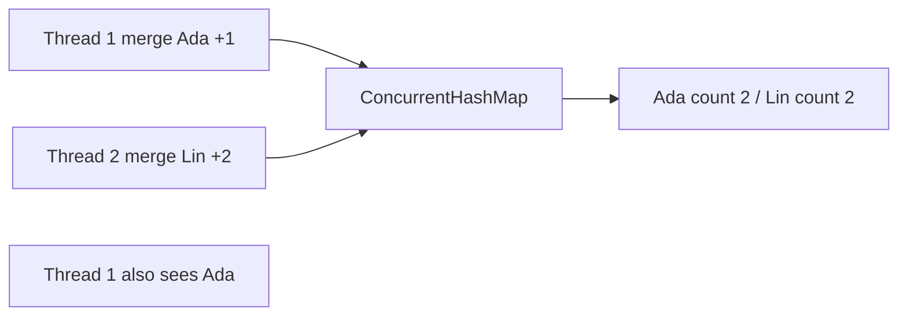
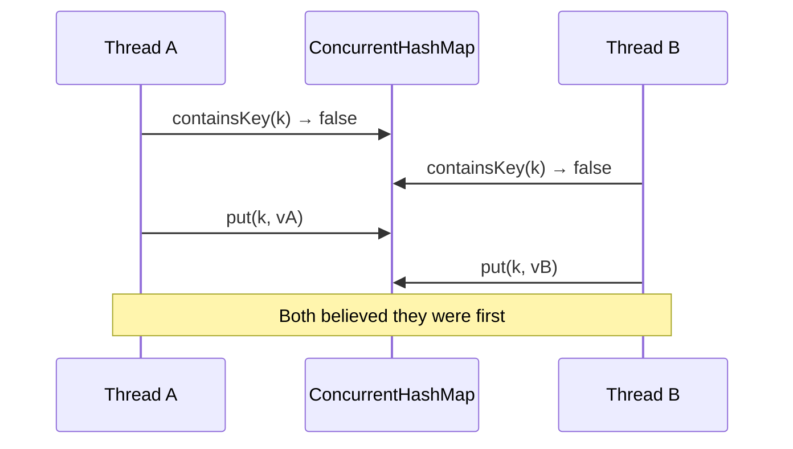

# Concurrent Collections

> **Status:** Completed  
> **Module:** 24 — Concurrency and Multithreading  
> **Target Java version:** 21  
> **Last reviewed:** 2026-11-11  
> **Chapter profile:** Technical  
> **Depth target:** Levels 3 (per-method atomicity, weakly consistent iteration, compound actions, BlockingQueue orientation)  
> **Examples verified with:** Oracle JDK 21.0.9 (third deepen pass 2026-11-11; Temurin 21.0.12.1 not installed on this host). Output matches prior Temurin 21.0.12.1 recordings.

**Section policy:** Conditional omissions recorded in Review Checklist. This chapter deepens **API contracts** for concurrent maps and related JUC types; it does not re-teach `HashMap` hashing (Module 12) or monitor locks (Ch.02).

| Mandatory for most chapters | Conditional |
| --------------------------- | ----------- |
| Learning objectives | Internal behavior |
| Prerequisites | Performance |
| Why this exists | Security |
| Conceptual explanation | Language comparisons |
| Mechanism and execution flow | Advanced examples |
| Terminology | Real-world use cases |
| Examples | Design trade-offs |
| Common mistakes | Compatibility details |
| Summary and references | — |

**Editorial judgment:** Level 3 on **per-method atomicity vs compound races**, **`ConcurrentHashMap` vs `synchronizedMap`**, and **weakly consistent iteration**. Segment/table locking strategy is labeled **HotSpot / JDK implementation**, not portable law.

## 1. Learning Objectives *(mandatory)*

After completing this chapter, you should be able to:

- Use **`ConcurrentHashMap`** for concurrent `get`/`put` and atomic methods (`merge`, `compute`, `putIfAbsent`, `computeIfAbsent`).
- Contrast **`Collections.synchronizedMap`** (one lock per operation on a wrapped map) with fine-grained concurrent maps.
- Explain why **check-then-act** across separate map operations can still race even when each call is “thread-safe.”
- Describe **weakly consistent** iterators (no `ConcurrentModificationException` for concurrent maps in the usual case, but no full snapshot guarantee).
- Orient on **`CopyOnWriteArrayList`**, **`BlockingQueue`**, and **`ConcurrentSkipListMap`** enough to choose a type for a pattern.
- State that **`null` keys and values are forbidden** in `ConcurrentHashMap` (unlike `HashMap`).

## 2. Prerequisites *(mandatory)*

- **Module 12** — `HashMap` behavior; `equals`/`hashCode` for keys; why mutable keys break maps.
- **Ch.01** — threads, `start`/`join`; heap objects are shared across threads.
- **Ch.02** — when locks guard multi-step invariants; atomics for single variables.
- **Ch.03** — executors as producers of concurrent readers/writers against a shared structure.

**Refresher — thread-safe ≠ race-free composition:** Saying a class is “thread-safe” means **individual documented operations** obey their contracts under concurrent use. It does **not** mean that two sequential calls from your code form one atomic logical transaction. That distinction is the central lesson of this chapter.

**Refresher — `merge` remapping:** `map.merge(key, value, remappingFunction)` associates `value` if the key is absent; otherwise it replaces the mapping with `remappingFunction.apply(old, value)`. For counters, `Integer::sum` is the usual remapping function.

## 3. Why This Concept Exists *(mandatory)*

Wrapping `HashMap` with a single lock (`Collections.synchronizedMap`) serializes **every** read and write. Under high read traffic that is correct but expensive: readers queue behind writers and behind each other.

High-traffic services need maps that allow concurrent reads and **scoped** atomic updates for common patterns (cache populate-once, counters, registries). The **`java.util.concurrent`** collections encode those patterns in the API—but **only** for operations whose atomicity is documented. If you invent a multi-call protocol (`containsKey` then `put`), you reintroduce races the collection cannot see.

Without concurrent collections you either:

1. Lock the entire structure for every access (simple, slow under contention), or  
2. Use an unlocked `HashMap` and hope (undefined behavior under races).

## 4. Conceptual Explanation *(mandatory)*

### 4.1 What “concurrent collection” means here

A **concurrent collection** is a type in `java.util.concurrent` (or a concurrent variant of a classic collection) designed for **multi-threaded access without external synchronization for single-method use**. Contracts differ by type:

| Family | Typical guarantee |
|--------|-------------------|
| `ConcurrentHashMap` | Concurrent retrievals; atomic updates for named methods |
| `CopyOnWriteArrayList` | Snapshot-style iteration; expensive writes |
| `BlockingQueue` | Thread-safe queue with blocking `put`/`take` |
| `ConcurrentSkipListMap` | Sorted concurrent `NavigableMap` |

This chapter’s runnable demo focuses on **`ConcurrentHashMap.merge`** for counters. Other types get orientation so you can choose them later without treating every structure as a locked `HashMap`.

### 4.2 `ConcurrentHashMap`

`ConcurrentHashMap` is a thread-safe map that does **not** lock the entire table for every `get` in modern JDK designs. Readers and writers coordinate at finer granularity (**HotSpot / OpenJDK implementation detail**—do not write algorithms that depend on a particular segment or bin lock layout).

**Per-method atomicity (API):** Methods such as `putIfAbsent`, `computeIfAbsent`, `compute`, `merge`, and `replace` apply documented atomic semantics for **that single method call**. Two threads calling `merge` on the same key will not lose increments the way two threads doing `get` + `put` would.

**First appearance — “atomic map operation”:** An atomic map operation is one API call whose Javadoc promises that the map applies the update as a unit with respect to other concurrent updates on that key (or as otherwise specified). It is **not** the same as wrapping an arbitrary block of your business logic in a monitor.

### 4.3 Compound actions (the classic race)

```java
if (!map.containsKey(k)) {
    map.put(k, expensiveCreate(k)); // still racy on ConcurrentHashMap
}
```

Two threads can both observe that `k` is absent, both call `expensiveCreate`, and both `put`. You may discard one expensive result, leak resources, or break invariants that assume “create once.”

**Correct pattern:**

```java
map.computeIfAbsent(k, this::expensiveCreate);
```

or `putIfAbsent` when you already have the value and only need “set if missing.”

### 4.4 `Collections.synchronizedMap` vs `ConcurrentHashMap`

| | `synchronizedMap` | `ConcurrentHashMap` |
|--|-------------------|---------------------|
| Mechanism | One mutex around a backing map | Concurrent design; finer coordination |
| Iteration | Must synchronize on the **wrapper** during iteration | Weakly consistent iterators; no CME for typical concurrent mods |
| Nulls | Depends on backing map (`HashMap` allows nulls) | **No null keys or values** |
| Best for | Legacy / simple wrapping | High concurrent access with atomic helpers |

### 4.5 Other types (orientation)

| Type | Pattern |
|------|---------|
| `CopyOnWriteArrayList` | Rare writes, many readers; iterators see a snapshot of the array at construction |
| `BlockingQueue` (`ArrayBlockingQueue`, `LinkedBlockingQueue`, …) | Producer–consumer; backpressure via blocking or bounded capacity |
| `ConcurrentSkipListMap` | Sorted concurrent map; navigable keys under concurrency |
| `ConcurrentLinkedQueue` | Non-blocking concurrent queue; no capacity bound by default |

**First appearance — `BlockingQueue`:** A blocking queue is a queue that can **block** the caller on `put` (when full, if bounded) or `take` (when empty) until the operation can proceed. That turns thread coordination into queue semantics instead of hand-rolled `wait`/`notify`. Hands-on producer–consumer projects deepen this; here you only need the pattern name.

### 4.6 Weakly consistent iteration

Iterators over `ConcurrentHashMap` are **weakly consistent**: they traverse elements as of some point at or after creation and may reflect later updates; they do **not** throw `ConcurrentModificationException` merely because another thread mutates the map. They also do **not** promise a frozen point-in-time snapshot of the whole map.

If you need a stable snapshot for reporting, copy under a protocol you control (`new HashMap<>(concurrentMap)` at a quiet point, or lock externally for a true critical section spanning the copy).

## 5. Mechanism and Execution Flow *(mandatory)*

### 5.1 Two threads merging the same counter key



In the demo, one thread merges `"Ada"` and another merges `"Lin"`, while `"Ada"` already starts at `1`. Each `merge` is atomic; after both joins, `Ada=2` and `Lin=2`.

### 5.2 Why `containsKey` + `put` fails



`computeIfAbsent` collapses the check and the insert into one atomic map operation for that key.

### 5.3 Demo

Demo: [concurrent-collections-demo](../../examples/core-java/concurrent-collections-demo/).

**Compile and run:**

```text
javac ConcurrentCollectionsDemo.java
java ConcurrentCollectionsDemo
```

**Verified output (Oracle JDK 21.0.9; matches prior Temurin 21.0.12.1):**

```text
Ada=2
Lin=2
size=2
```

**Important lines:** `counts.put("Ada", 1)` seeds the map. `merge("Ada", 1, Integer::sum)` atomically adds one. `merge("Lin", 2, Integer::sum)` inserts `Lin` with value `2` because the key was absent. `join` on both threads establishes happens-before so main can safely read the final counts (JLS join edge; see Ch.01 / Module 25).

## 6. Terminology *(mandatory)*

| Term | Meaning |
|------|---------|
| Concurrent collection | JUC (or concurrent) type safe for concurrent single-method use per its contract |
| Weakly consistent iterator | Reflects some state during traversal; may see later updates; not a full snapshot |
| Atomic map operation | Single method call indivisible per API specification for its documented scope |
| Compound action | Multiple calls that together form one logical invariant |
| Remapping function | Binary operator used by `merge` / `compute` to combine old and new values |
| Backpressure | Slowing producers (e.g. blocking `put` on a full queue) so consumers catch up |

## 7. Syntax and Language Rules *(include when the topic is language/API surface)*

```java
ConcurrentHashMap<String, Integer> map = new ConcurrentHashMap<>();
map.merge("Ada", 1, Integer::sum);
map.computeIfAbsent(key, k -> expensiveCreate(k));
map.putIfAbsent(key, value); // returns previous mapping, or null if absent
```

**Null policy:** `ConcurrentHashMap` does **not** permit `null` keys or values. Passing `null` throws `NullPointerException`. This differs from `HashMap` and matters when migrating code that used null as a sentinel.

**`size()` under contention:** The API documents that `size` and similar aggregate queries may be approximate while the map is concurrently updated. Do not use `size() == 0` as a substitute for a carefully designed empty-state protocol under heavy mutation.

**Synchronized wrapper iteration:**

```java
Map<K,V> m = Collections.synchronizedMap(new HashMap<>());
synchronized (m) {
    for (Map.Entry<K,V> e : m.entrySet()) {
        // ...
    }
}
```

Without synchronizing on the wrapper, iteration is not thread-safe even though individual `get`/`put` calls are.

## 8. Step-by-Step Examples *(mandatory)*

### 8.1 Minimal — atomic merge (**Verified** in demo)

Two threads update a shared `ConcurrentHashMap` with `merge`. See §5.3 for output and path.

### 8.2 Realistic — vote / event counting

Same pattern as the demo: initialize optional seed values, fan out worker threads (or an executor from Ch.03), each calling `merge(eventId, 1, Integer::sum)`, then `join` / await termination before reading totals.

**Why this shape:** Counters are the textbook case where per-key atomic updates beat a global lock, and where `get` + `put` silently loses increments under load.

### 8.3 Incorrect — non-atomic if-absent-put

```java
// Incorrect: race window between containsKey and put
if (!map.containsKey(k)) {
    map.put(k, create(k));
}
```

### 8.4 Corrected

```java
map.computeIfAbsent(k, this::create);
```

### 8.5 Advanced — bulk invariants across keys *(Illustrative)*

Moving “balance” from account A to B as two map updates is **not** atomic as a pair even on `ConcurrentHashMap`. You need an external lock, a single composite value object updated atomically, or a different design (database transaction, actor, etc.). Concurrent collections solve **structure-level** races for documented operations; they do not invent multi-key transactions.

## 9. Real-World Use Cases *(conditional)*

- Per-tenant or per-API-key rate counters in memory.
- Shared service registries and caches inside one JVM (eviction and TTL policies usually live in a higher-level cache library).
- Fan-in of metrics from many worker threads into one map before a flush.
- Producer–consumer pipelines with a `BlockingQueue` between stages (orientation; deepen in projects).

## 10. Internal Behavior *(conditional)*

- **API:** Documented atomicity is per method; weakly consistent iterators; `size()` may be approximate under contention. See the `ConcurrentHashMap` Javadoc for the authoritative contract.
- **HotSpot / OpenJDK:** Table resizing, bin locking, and treeification of long collision chains are **implementation details**. Correct programs rely on the API, not on a particular lock striping layout from a blog diagram.

## 11. Edge Cases and Limitations *(strongly encouraged)*

- `size()` / `isEmpty()` may be approximate under concurrent mutation.
- Iteration does not guarantee a point-in-time snapshot.
- **Bulk** logical operations across keys still need locks or redesign.
- `compute*` / `merge` remapping functions should be short and non-blocking; holding locks or calling back into the same map from the function can deadlock or livelock depending on the JDK’s locking (follow Javadoc restrictions).
- `CopyOnWriteArrayList` copies the entire array on each mutation—excellent for rare writes, catastrophic for frequent appends.

## 12. Common Mistakes *(mandatory)*

### Incorrect

`Collections.synchronizedMap` + iteration without synchronizing on the wrapper.

### Corrected

Synchronize on the wrapper during iteration per API docs, or use `ConcurrentHashMap` and accept weakly consistent traversal.

### Incorrect

Assuming `ConcurrentHashMap` makes any multi-step business protocol race-free.

### Corrected

Use `computeIfAbsent` / `merge` / `compute` for single-key atomic updates; lock or redesign for multi-key invariants.

### Incorrect

Storing `null` values as “missing” sentinels after migrating from `HashMap`.

### Corrected

Use `Optional`, absence of the key, or a dedicated sentinel object that is non-null.

## 13. Best Practices *(include when guidance adds value)*

- Match the collection to the access pattern (`BlockingQueue` for pipelines; COW lists for rare writes).
- Read method-level Javadoc for atomicity scope before composing operations.
- Prefer `computeIfAbsent` over check-then-act.
- Keep remapping functions pure and fast.
- Name threads / use executors (Ch.03) when many workers update the same map so dumps remain readable.

## 14. Design Trade-offs *(conditional)*

| Approach | Pros | Cons |
|----------|------|------|
| `synchronizedMap` | Simple mental model | Coarse lock; awkward iteration rules |
| `ConcurrentHashMap` | High read concurrency; atomic helpers | Must learn method contracts; no nulls |
| External lock + plain `HashMap` | Full multi-op critical sections | Serializes all access |
| Database / distributed cache | Durable, multi-node | Latency; different consistency model |

## 15. Performance Considerations *(conditional)*

- Concurrent maps shine when many threads **read** and updates are per-key.
- A single global lock may still win for tiny maps with rare contention—measure before rewriting.
- Unbounded growth of keys (unique event IDs forever) is a memory problem, not solved by concurrency alone—add eviction or partitioning.

## 16. Security Considerations *(conditional)*

*Omitted — no distinct security API surface beyond ordinary shared mutable state risks (poisoned keys, unbounded maps as DoS vectors in public-facing parsers).* Note: untrusted key spaces can exhaust memory; bound or validate input.

## 17. Java Version and Compatibility Notes *(conditional)*

- `ConcurrentHashMap` has been standard for many releases; Java 8 added the rich `compute`/`merge` family used throughout modern code.
- Java 21 path: use these APIs as **final** (not preview). Virtual threads (Ch.05) may increase concurrent access rates against the same maps—atomicity contracts still apply.

## 19. Revision and Mastery *(Technical)*

**Gaps:** Treating “thread-safe collection” as “my workflow is atomic”; confusing weakly consistent iteration with a snapshot; using `synchronizedMap` iteration without locking the wrapper.

**Questions:**

1. Why is `merge` safe for a counter while `containsKey` + `put` is not?
2. What does a weakly consistent iterator promise—and what does it refuse to promise?
3. When would you still choose an external lock over `ConcurrentHashMap` helpers?
4. Why does `ConcurrentHashMap` forbid nulls?

## 20. Exercises *(include for major chapters)*

### Beginner

Change the demo so three threads each `merge("Ada", 1, Integer::sum)` and assert `Ada=4` after joins (seed remains 1).

### Intermediate

Replace the race-prone `containsKey`/`put` sketch with `computeIfAbsent` in a small cache that constructs a value only once per key under contention.

### Advanced

Sketch (Illustrative) a bounded `BlockingQueue` pipeline with one producer and two consumers; explain how blocking provides backpressure.

## 21. Interview Questions *(conditional)*

- Difference between `Hashtable`, `Collections.synchronizedMap`, and `ConcurrentHashMap`?
- How do you increment a concurrent counter without lost updates?
- What goes wrong iterating a synchronized map without locking?

## 22. Solutions *(brief)*

Beginner: three merges of `+1` on seeded `Ada=1` yield `4`. Intermediate: single `computeIfAbsent` call. Advanced: `put` blocks when full; `take` blocks when empty—see `BlockingQueue` Javadoc.

## 23. Chapter Summary *(mandatory)*

Concurrent collections encapsulate **per-operation** thread safety. **`ConcurrentHashMap`** gives concurrent access and atomic helpers like **`merge`** and **`computeIfAbsent`**. **Logical** transactions spanning multiple calls or keys still need those atomic methods, external locks, or a different design. Iterators are typically **weakly consistent**, not snapshots. Match the type to the pattern—and read the Javadoc for what “atomic” actually covers.

## 25. References and Further Reading *(mandatory)*

- [Java SE `ConcurrentHashMap`](https://docs.oracle.com/en/java/javase/21/docs/api/java.base/java/util/concurrent/ConcurrentHashMap.html)
- [Java SE `java.util.concurrent` package summary](https://docs.oracle.com/en/java/javase/21/docs/api/java.base/java/util/concurrent/package-summary.html)
- [Java SE `BlockingQueue`](https://docs.oracle.com/en/java/javase/21/docs/api/java.base/java/util/concurrent/BlockingQueue.html)
- Module 12 maps; Ch.02 synchronization; Ch.03 executors

## 26. Next Steps

[05-virtual-threads-and-structured-concurrency.md](05-virtual-threads-and-structured-concurrency.md)

## Review Checklist

- [x] Technical Level 3; Verified demo (Oracle JDK 21.0.9; matches prior Temurin output)
- [x] API atomicity vs compound races explained with mechanism diagram
- [x] First appearances: atomic map operation, BlockingQueue orientation
- [x] HotSpot table layout not stated as portable law
- [x] Omissions: deep `locks` package; full BlockingQueue lab (projects); language comparisons
