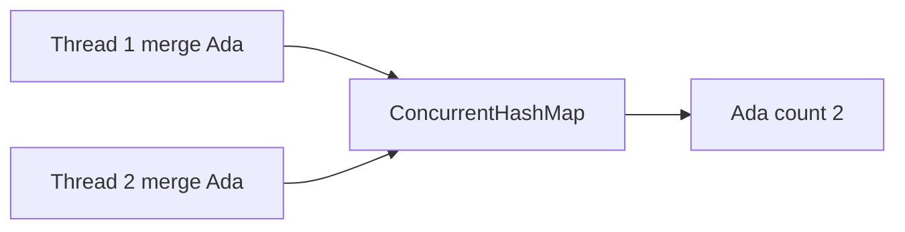

# Concurrent Collections

> **Status:** Completed  
> **Module:** 24 — Concurrency and Multithreading  
> **Target Java version:** 21  
> **Last reviewed:** 2026-11-11  
> **Chapter profile:** Technical  
> **Depth target:** Levels 3 (per-method atomicity, weakly consistent iteration, compound actions)  
> **Examples verified with:** Temurin JDK 21.0.12.1 (javac 21.0.12.1)

**Section policy:** Conditional omissions recorded in Review Checklist.

## 1. Learning Objectives *(mandatory)*

After completing this chapter, you should be able to:

- Use **`ConcurrentHashMap`** for concurrent `get`/`put` and atomic methods (`merge`, `compute`, `putIfAbsent`).
- Contrast **`Collections.synchronizedMap`** (one lock per operation) with fine-grained concurrent maps.
- Explain why **check-then-act** across map operations can still race.
- Describe **weakly consistent** iterators (no `ConcurrentModificationException`, but no full snapshot).

## 2. Prerequisites *(mandatory)*

- **Module 12** — `HashMap` behavior; `equals`/`hashCode` for keys.
- Ch.02 — when locks guard invariants.

## 3. Why This Concept Exists *(mandatory)*

Wrapping `HashMap` with a single lock serializes **every** read and write. High-traffic services need maps that allow concurrent reads and scoped atomic updates. **`java.util.concurrent`** collections encode common safe patterns—but **only** for operations whose atomicity is documented.

## 4. Conceptual Explanation *(mandatory)*

### 4.1 `ConcurrentHashMap`

Thread-safe map without locking the entire table for every `get` (JDK design: segment/table-level coordination—**HotSpot implementation detail**).

**Per-method atomicity (API):** `putIfAbsent`, `computeIfAbsent`, `merge`, etc. apply documented atomic semantics for **that single method call**.

### 4.2 Compound actions

```java
if (!map.containsKey(k)) map.put(k, v); // still racy on ConcurrentHashMap
```

Two threads can both observe absent `k` and compute expensive values. Use **`computeIfAbsent`** or external lock.

### 4.3 Other types (orientation)

| Type | Pattern |
|------|---------|
| `CopyOnWriteArrayList` | Rare writes, many readers |
| `BlockingQueue` | Producer–consumer, backpressure |
| `ConcurrentSkipListMap` | Sorted concurrent map |

This chapter’s demo focuses on **`merge`** for counters.

## 5. Mechanism and Execution Flow *(mandatory)*



Each `merge` is atomic; both threads increment the same key from 1 → 2 in the demo.

Demo: [concurrent-collections-demo](../../examples/core-java/concurrent-collections-demo/).

**Verified output (Temurin JDK 21.0.12.1):**

```text
Ada=2
Lin=2
size=2
```

## 6. Terminology *(mandatory)*

| Term | Meaning |
|------|---------|
| Weakly consistent iterator | Reflects some state; may skip concurrent additions |
| Atomic map operation | Single method call indivisible per API spec |
| Compound action | Multiple calls composing one logical invariant |

## 7. Syntax and Language Rules *(include when the topic is language/API surface)*

```java
map.merge("Ada", 1, Integer::sum);
map.computeIfAbsent(key, k -> expensiveCreate());
```

**Null:** `ConcurrentHashMap` does not permit `null` keys or values (unlike `HashMap`).

## 8. Step-by-Step Examples *(mandatory)*

### 8.1 Realistic — vote counting (**Verified**)

Demo: two threads `merge` distinct keys and share `Ada`.

### 8.2 Incorrect — non-atomic if-absent-put

Use `putIfAbsent` or `computeIfAbsent`.

## 9. Real-World Use Cases *(conditional)*

- Per-tenant rate counters in memory.
- Shared registries in JVM microservices (with eviction policies elsewhere).

## 10. Internal Behavior *(conditional)*

- **API:** Documented atomicity per method; `size()` may be approximate under contention.
- **HotSpot:** Table structure and locking strategy are implementation details.

## 11. Edge Cases and Limitations *(strongly encouraged)*

- `size()` / `isEmpty()` approximate under mutation.
- Iteration does not guarantee a point-in-time snapshot.
- **Bulk** operations still require thought about logical invariants across keys.

## 12. Common Mistakes *(mandatory)*

### Incorrect

`Collections.synchronizedMap` + iteration without synchronizing on the wrapper.

### Corrected

`ConcurrentHashMap` entrySet iteration with weak consistency rules understood, or synchronize during iteration per API docs.

## 13. Best Practices *(include when guidance adds value)*

- Match collection to access pattern (`BlockingQueue` for pipelines).
- Read method-level Javadoc for atomicity scope before composing operations.

## 14. Design Trade-offs *(conditional)*

| synchronizedMap | ConcurrentHashMap |
|-----------------|-------------------|
| Simple | Higher read concurrency |
| One lock | Must learn atomic methods |

## 19. Revision and Mastery *(Technical)*

**Question:** Why is `merge` safe but `containsKey` + `put` not?

## 23. Chapter Summary *(mandatory)*

Concurrent collections encapsulate **per-operation** thread safety; **logical** transactions spanning calls still need `compute*` methods or locks.

## 25. References and Further Reading *(mandatory)*

- [Java SE `ConcurrentHashMap`](https://docs.oracle.com/en/java/javase/21/docs/api/java.base/java/util/concurrent/ConcurrentHashMap.html)

## 26. Next Steps

[05-virtual-threads-and-structured-concurrency.md](05-virtual-threads-and-structured-concurrency.md)

## Review Checklist

- [x] Technical Level 3; Verified demo
- [x] API atomicity vs compound races explained
- [x] Omissions: Performance deep dive, Security
