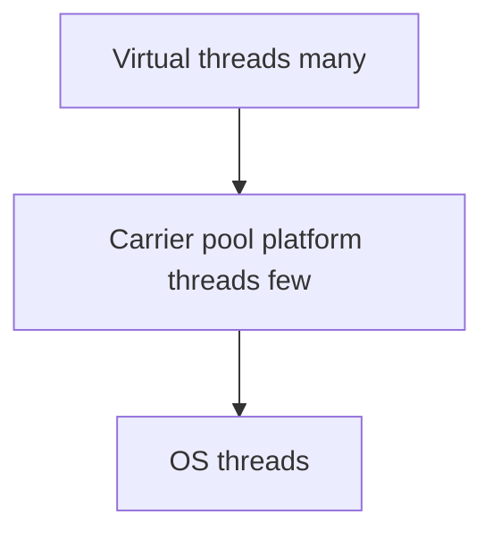

# Virtual Threads and Structured Concurrency

> **Status:** Completed  
> **Module:** 24 — Concurrency and Multithreading  
> **Target Java version:** 21  
> **Last reviewed:** 2026-11-11  
> **Chapter profile:** Deep-dive  
> **Depth target:** Levels 3–4 (virtual vs platform, pinning, preview structured concurrency)  
> **Examples verified with:** Temurin JDK 21.0.12.1 (javac 21.0.12.1)

**Section policy:** Omissions in Review Checklist.

## 1. Learning Objectives *(mandatory)*

After completing this chapter, you should be able to:

- Create **virtual threads** with **`Thread.ofVirtual().start(...)`** or **`Executors.newVirtualThreadPerTaskExecutor()`**.
- Test **`Thread.currentThread().isVirtual()`** and explain that virtual threads are **threads** in the API model (Java 21 final, JEP 444).
- Contrast **blocking I/O at scale** (many virtual threads) vs **CPU-bound** work (still bounded by cores).
- Describe **structured concurrency** as **preview** in Java 21—explicit `--enable-preview`, not production default.
- Name **pinning** as a **HotSpot / JDK 21** concern with some `synchronized` and native code—not a JVMS portability guarantee.

## 2. Prerequisites *(mandatory)*

- Ch.01–03 — threads and executors.
- **Module 19** — Java 21 feature tour may reference preview demos.

## 3. Why This Concept Exists *(mandatory)*

**Platform threads** are scarce OS resources. A server that maps **one platform thread per blocking request** caps throughput under I/O latency. **Virtual threads** let you write **blocking style** code while the JVM mounts many virtual threads on a **small carrier pool**, unmounting when blocked (JDK implementation).

CPU-bound parallelism still requires **sizing to cores**—virtual threads add **concurrency of blocking**, not magic multiplication of compute.

## 4. Conceptual Explanation *(mandatory)*

### 4.1 Virtual vs platform

| | Platform | Virtual |
|---|----------|---------|
| API | `new Thread(...)` | `Thread.ofVirtual()...` |
| Cost | OS thread | Lightweight JVM scheduling |
| Best for | CPU pools, legacy | Massive blocking I/O |

### 4.2 Structured Concurrency (Preview)

`StructuredTaskScope` groups subtasks: failure or cancellation boundaries encompass **all** forked work. In Java 21 this remains **preview API**—check JEP status on upgrade; compile with `--enable-preview`.

**This chapter does not treat preview APIs as default production dependencies.**

## 5. Mechanism and Execution Flow *(mandatory)*



When virtual thread blocks on I/O (HotSpot), carrier may mount another virtual thread—**implementation detail**.

Demo: [virtual-threads-demo](../../examples/core-java/virtual-threads-demo/).

**Verified output (Temurin JDK 21.0.12.1):**

```text
isVirtual=true
vtName=
executorVirtual=true
platformIsVirtual=false
```

Empty `vtName` is normal for default-named virtual threads on this JDK.

## 6. Terminology *(mandatory)*

| Term | Meaning |
|------|---------|
| Carrier thread | Platform thread running mounted virtual thread (HotSpot) |
| Pinning | Virtual thread cannot unmount (e.g. some synchronized/native) |
| Structured concurrency | Parent scope owns child task lifetimes |

## 7. Syntax and Language Rules *(include when the topic is language/API surface)*

```java
Thread.startVirtualThread(() -> { });
try (var ex = Executors.newVirtualThreadPerTaskExecutor()) {
    ex.submit(() -> { /* blocking work */ });
}
```

## 8. Step-by-Step Examples *(mandatory)*

### 8.1 Verified demo

See paths above; compares virtual vs platform `isVirtual()`.

### 8.2 Incorrect

Millions of CPU-spinning virtual threads expecting linear speedup.

### 8.3 Corrected

Bound CPU work with fixed platform pool or deliberate parallelism.

## 9. Real-World Use Cases *(conditional)*

- HTTP servers: one virtual thread per request with blocking JDBC/HTTP clients.
- Massive fan-out I/O orchestration.

## 10. Internal Behavior *(conditional)*

- **Java SE API (final):** Virtual threads are `Thread` instances with `isVirtual()`.
- **HotSpot:** Carrier pool, pinning with synchronized/native—monitor in production JDK notes.

## 11. Edge Cases and Limitations *(strongly encouraged)*

- Thread-local heavy code at huge scale.
- Pinning reduces carrier reuse—measure on your JDK vendor/version.
- Do not confuse virtual-thread executors with unbounded CPU parallelism.

## 12. Common Mistakes *(mandatory)*

### Incorrect

Replacing every fixed pool without profiling pinning and thread-local usage.

### Corrected

Adopt for **blocking** workloads; keep CPU pools sized to cores.

## 13. Best Practices *(include when guidance adds value)*

- Record **JDK vendor/version** when comparing pinning behavior.
- Prefer virtual threads for blocking I/O; use structured concurrency preview only with explicit preview gates.

## 14. Design Trade-offs *(conditional)*

| Platform pool | Virtual per task |
|---------------|------------------|
| Predictable for CPU | Excellent for blocking scale |

## 17. Java Version and Compatibility Notes *(conditional)*

- Virtual threads **final** in Java 21 (JEP 444).
- Structured concurrency: **preview** in 21—flags required.

## 19. Revision and Mastery *(Deep-dive)*

**Questions:** What does `isVirtual()` prove? When does pinning matter?

## 23. Chapter Summary *(mandatory)*

Java 21 **final** virtual threads scale **blocking** concurrency; **structured concurrency** remains **preview**; distinguish **API threads** from **HotSpot carriers and pinning**.

## 25. References and Further Reading *(mandatory)*

- [JEP 444: Virtual Threads](https://openjdk.org/jeps/444)
- [Java SE `Thread`](https://docs.oracle.com/en/java/javase/21/docs/api/java.base/java/lang/Thread.html)

## 26. Next Steps

Module **25** — Java Memory Model (happens-before).

## Review Checklist

- [x] Deep-dive; final vs preview labeled
- [x] Verified Temurin 21.0.12.1
- [x] HotSpot pinning not stated as JVMS law
- [x] Omissions: Security, language comparisons
