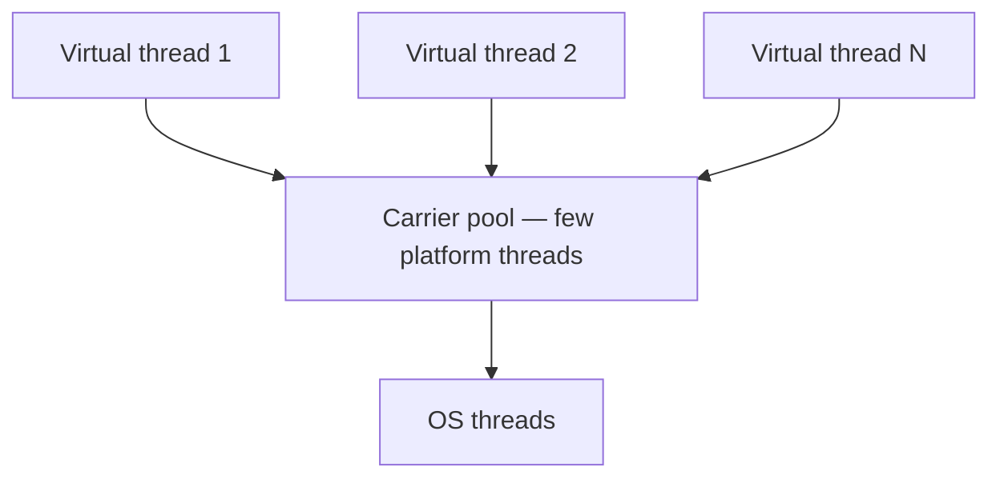
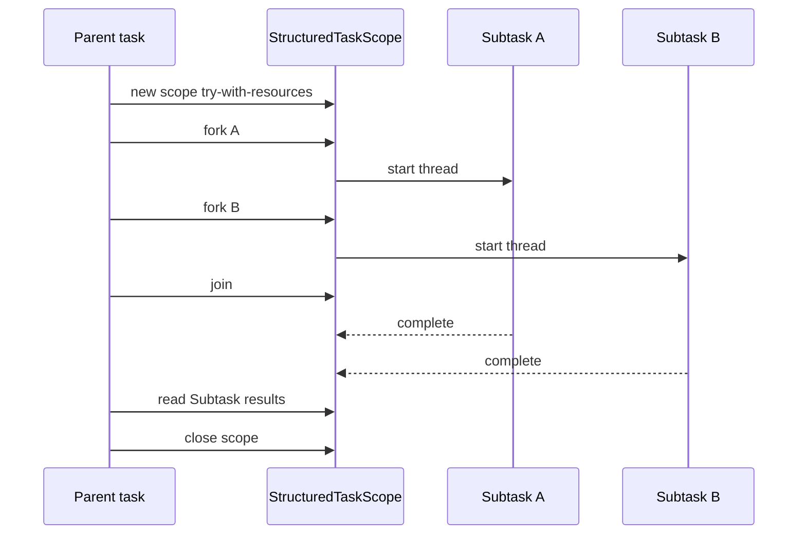

# Virtual Threads and Structured Concurrency

> **Status:** Completed  
> **Module:** 24 — Concurrency and Multithreading  
> **Target Java version:** 21  
> **Last reviewed:** 2026-11-11  
> **Chapter profile:** Deep-dive  
> **Depth target:** Levels 3–4 (virtual vs platform, carriers, pinning, preview structured concurrency)  
> **Examples verified with:** Oracle JDK 21.0.9 (third deepen pass 2026-11-11; Temurin 21.0.12.1 not installed on this host). Virtual-thread demo output matches prior Temurin 21.0.12.1. `StructuredTaskScope` probe **Verified** with `--enable-preview` on Oracle JDK 21.0.9.

**Section policy:** Omissions in Review Checklist. Virtual threads are **final** in Java 21. Structured concurrency is **preview** in Java 21 (JEP 453)—never treat it as a silent production default.

| Mandatory for most chapters | Conditional |
| --------------------------- | ----------- |
| Learning objectives | Internal behavior |
| Prerequisites | Performance |
| Why this exists | Security |
| Conceptual explanation | Language comparisons |
| Mechanism and execution flow | Advanced examples |
| Terminology | Real-world use cases |
| Examples | Design trade-offs |
| Common mistakes | Compatibility details |
| Summary and references | — |

**Editorial judgment:** Level 4 on **mount/unmount mental model** and **pinning** as **HotSpot / JDK** behavior. Level 3–4 on **structured concurrency** with explicit **preview** labeling and real compile/run flags.

## 1. Learning Objectives *(mandatory)*

After completing this chapter, you should be able to:

- Create **virtual threads** with **`Thread.ofVirtual().start(...)`**, **`Thread.startVirtualThread(...)`**, or **`Executors.newVirtualThreadPerTaskExecutor()`**.
- Test **`Thread.currentThread().isVirtual()`** and explain that virtual threads are **`Thread` instances** in the Java SE API (Java 21 **final**, JEP 444).
- Contrast **blocking I/O at scale** (many virtual threads) vs **CPU-bound** work (still bounded by cores / platform pools).
- Describe **structured concurrency** via **`StructuredTaskScope`** as a **preview API** in Java 21—requires `--enable-preview`; not a production default.
- Name **carrier threads** and **pinning** as **HotSpot / JDK 21** concerns with some `synchronized` and native frames—not a JVMS portability guarantee.
- Choose when to keep a **fixed platform pool** instead of “virtual threads everywhere.”

## 2. Prerequisites *(mandatory)*

- **Ch.01** — `Thread`, `Runnable`, `start`/`join`; platform threads as the traditional model.
- **Ch.02** — `synchronized` and shared state (pinning interacts with monitors on HotSpot).
- **Ch.03** — `ExecutorService`, shutdown, `Future`.
- **Module 19** — Java 21 feature tour may mention virtual threads; this chapter owns the concurrency depth.

**Refresher — platform thread:** A **platform thread** is a `Thread` that the JVM typically maps one-to-one onto an operating-system thread (**HotSpot** usual model). OS threads are relatively expensive; a server that creates one per blocking request hits scaling limits.

**Refresher — executor:** An **`ExecutorService`** accepts tasks and runs them on worker threads it manages. `Executors.newVirtualThreadPerTaskExecutor()` creates an executor that starts a **new virtual thread per task** and implements orderly shutdown via `AutoCloseable` (Java 19+).

## 3. Why This Concept Exists *(mandatory)*

**Platform threads** are scarce OS resources. A server that maps **one platform thread per blocking request** caps throughput under I/O latency: thousands of waiting requests need thousands of OS threads, each with a large stack reservation.

**Virtual threads** (Project Loom, finalized in Java 21 by **JEP 444**) let you write **straightforward blocking-style** code—`InputStream.read`, JDBC, HTTP clients—while the JVM schedules many virtual threads onto a **small pool of carrier (platform) threads**, unmounting a virtual thread when it blocks in supported ways (**JDK implementation**).

CPU-bound parallelism still requires **sizing to cores**. Virtual threads add **cheap concurrency for blocking**, not magic multiplication of arithmetic throughput. Spinning a million virtual threads on a tight CPU loop will thrash schedulers and caches; use a bounded platform pool or deliberate parallelism APIs for pure compute.

## 4. Conceptual Explanation *(mandatory)*

### 4.1 Virtual vs platform threads

| | Platform | Virtual |
|---|----------|---------|
| API creation | `new Thread(...)`, platform factories | `Thread.ofVirtual()...`, `startVirtualThread`, VT executor |
| Cost | OS thread + large stack | Lightweight JVM-scheduled task |
| `isVirtual()` | `false` | `true` |
| Best for | CPU pools, legacy APIs expecting few threads | Massive numbers of blocking tasks |
| Status in Java 21 | Final (always) | **Final** (JEP 444) |

**First appearance — virtual thread:** A **virtual thread** is a `Thread` that is not a one-to-one OS thread. From application code it still has a name (optional), can be `join`ed, and runs a `Runnable`. The JVM mounts it on a **carrier** to execute bytecode and can unmount it when blocked so the carrier can run another virtual thread.

You do **not** need a new mental model of “green threads vs Java threads” for API purposes: `Thread.currentThread()` inside a virtual thread returns that virtual thread; `isVirtual()` is `true`.

### 4.2 Creating virtual threads

```java
// 1) One-shot
Thread vt = Thread.startVirtualThread(() -> doBlockingWork());
vt.join();

// 2) Builder (name, uncaught handler, etc.)
Thread vt2 = Thread.ofVirtual().name("vt-worker").start(() -> doBlockingWork());

// 3) Executor: one virtual thread per submitted task
try (var ex = Executors.newVirtualThreadPerTaskExecutor()) {
    ex.submit(() -> doBlockingWork());
}
```

Prefer the **executor** form in applications: it gives you shutdown semantics and a clear place to bound fan-out at the submission site (even though the executor itself creates many threads).

### 4.3 Blocking I/O vs CPU-bound work

| Workload | Guidance |
|----------|----------|
| Blocking I/O (sockets, files, JDBC) | Virtual threads excel; write synchronous code |
| CPU-bound (crypto, image, compression) | Bound concurrency ≈ cores; fixed platform pool or `ForkJoinPool` |
| Mixed | Separate pools/policies; do not assume VT fixes CPU scaling |

### 4.4 Structured concurrency (Preview in Java 21)

**First appearance — structured concurrency:** In structured programming, every block has a clear entry and exit. **Structured concurrency** applies that idea to concurrent subtasks: a parent **scope** owns child tasks; when the scope ends, children are joined or cancelled so you do not leak “orphan” threads that outlive the logical operation.

In Java 21, the principal API is **`java.util.concurrent.StructuredTaskScope`** (**JEP 453: Structured Concurrency (Preview)**).

**Status labeling (critical):**

| Feature | Java 21 status |
|---------|----------------|
| Virtual threads | **Final** |
| `StructuredTaskScope` | **Preview API** — disabled by default |

Preview APIs may change or be removed in later releases. **This handbook does not treat preview APIs as default production dependencies.** Use them only with explicit `--enable-preview` gates and a conscious upgrade policy.

**Basic shape (preview):**

```java
try (var scope = new StructuredTaskScope.ShutdownOnFailure()) {
    StructuredTaskScope.Subtask<String> a = scope.fork(() -> fetchA());
    StructuredTaskScope.Subtask<String> b = scope.fork(() -> fetchB());
    scope.join();           // wait for forks (or shutdown)
    scope.throwIfFailed();  // propagate failure
    return a.get() + b.get();
}
```

`ShutdownOnFailure` cancels remaining subtasks when one fails; `ShutdownOnSuccess` can stop early when one succeeds—see Javadoc. `fork` returns a **`Subtask`**, not a `Future` (API change from earlier incubating shapes).

### 4.5 Pinning (HotSpot / JDK concern)

**First appearance — pinning:** On HotSpot, a virtual thread that is **pinned** to its carrier cannot unmount while blocked in certain situations (historically: holding a `synchronized` monitor, or executing native frames). Pinning reduces carrier reuse: other virtual threads wait for that carrier.

Pinning is an **implementation / JDK-version** performance concern. Do **not** elevate it to a JVMS correctness rule. Measure on your **vendor and version**; prefer `java.util.concurrent.locks` where appropriate for code you expect to run on huge numbers of virtual threads, and follow current OpenJDK guidance for your release.

## 5. Mechanism and Execution Flow *(mandatory)*

### 5.1 Carriers and mounting



When a virtual thread runs, it is **mounted** on a carrier. When it blocks on supported I/O (**HotSpot**), it may **unmount**, freeing the carrier for another virtual thread. When the I/O completes, the virtual thread becomes runnable again and remounts (possibly on a different carrier).

This diagram is a teaching model for **JDK scheduling**, not a portable JVMS mandate.

### 5.2 Structured task scope lifetime



Children are confined to the lexical scope. Exiting without joining/closing incorrectly is a misuse—the API is designed for try-with-resources.

### 5.3 Verified demos

#### Virtual threads demo

Demo: [virtual-threads-demo](../../examples/core-java/virtual-threads-demo/).

**Compile and run (no preview flags — virtual threads are final):**

```text
javac VirtualThreadsDemo.java
java VirtualThreadsDemo
```

**Verified output (Oracle JDK 21.0.9; matches prior Temurin 21.0.12.1):**

```text
isVirtual=true
vtName=
executorVirtual=true
platformIsVirtual=false
```

Empty `vtName` is normal for default-named virtual threads on this JDK. Main remains a platform thread (`platformIsVirtual=false`).

**Important lines:** `Thread.startVirtualThread` runs the lambda on a virtual thread. `Executors.newVirtualThreadPerTaskExecutor()` submits work that also reports `isVirtual=true`. Closing the executor shuts it down.

#### Structured concurrency probe (**Verified** with preview)

On Oracle JDK 21.0.9:

```text
javac --release 21 --enable-preview StructuredScopeProbe.java
java --enable-preview StructuredScopeProbe
```

**Verified output:**

```text
a=A b=B
```

Compiler notes that the source uses preview features of Java SE 21. Treat this as a **preview-gated** experiment, not a silent dependency of the handbook’s default examples.

## 6. Terminology *(mandatory)*

| Term | Meaning |
|------|---------|
| Virtual thread | `Thread` scheduled by the JVM onto carriers; `isVirtual()` true |
| Platform thread | Traditional OS-backed `Thread`; `isVirtual()` false |
| Carrier thread | Platform thread currently executing a mounted virtual thread (**HotSpot**) |
| Mount / unmount | Binding a virtual thread to a carrier / releasing the carrier (**HotSpot**) |
| Pinning | Virtual thread cannot unmount while blocked in certain situations (**HotSpot**/JDK) |
| Structured concurrency | Parent scope owns child task lifetimes; join/cancel as a unit |
| `StructuredTaskScope` | Preview API class implementing structured concurrency in Java 21 |
| Preview API | Complete but not permanent; needs `--enable-preview` |

## 7. Syntax and Language Rules *(include when the topic is language/API surface)*

```java
Thread.startVirtualThread(() -> { /* work */ });

try (var ex = Executors.newVirtualThreadPerTaskExecutor()) {
    ex.submit(() -> { /* blocking work */ });
}

// Preview only — both compile and run need --enable-preview
try (var scope = new StructuredTaskScope.ShutdownOnFailure()) {
    var left = scope.fork(() -> "L");
    var right = scope.fork(() -> "R");
    scope.join();
    scope.throwIfFailed();
    String combined = left.get() + right.get();
}
```

**Rules of thumb:**

- Virtual thread APIs are ordinary Java 21 final APIs—no preview flag.
- Do not call `setDaemon` expectations the same way you reason about scarce platform threads; prefer structured shutdown of executors/scopes.
- Thread-local variables still work but at huge scale they can retain a lot of memory—design carefully.

## 8. Step-by-Step Examples *(mandatory)*

### 8.1 Minimal — `isVirtual()` (**Verified**)

See §5.3 virtual-threads-demo.

### 8.2 Realistic — blocking fan-out with VT executor *(Illustrative pattern)*

```java
try (var ex = Executors.newVirtualThreadPerTaskExecutor()) {
    List<Future<String>> futures = urls.stream()
        .map(url -> ex.submit(() -> fetchBlocking(url)))
        .toList();
    for (Future<String> f : futures) {
        System.out.println(f.get());
    }
}
```

Each fetch can block; virtual threads keep the programming model synchronous. Prefer timeouts and cancellation policies in production.

### 8.3 Incorrect — CPU spinning “for scale”

```java
// Incorrect expectation: millions of VT improve CPU throughput linearly
IntStream.range(0, 1_000_000).parallel(); // or VT per hot loop iteration
```

Creating enormous numbers of virtual threads that only burn CPU does not create more cores.

### 8.4 Corrected

Bound CPU work with `Executors.newFixedThreadPool(Runtime.getRuntime().availableProcessors())` (or similar), and reserve virtual threads for blocking stages.

### 8.5 StructuredTaskScope (**Verified** with `--enable-preview`)

See §5.3 probe: two forks return `"A"` and `"B"`. Label any handbook snippet that depends on this API as **preview**.

## 9. Real-World Use Cases *(conditional)*

- HTTP servers: one virtual thread per request with blocking JDBC or HTTP clients.
- Massive fan-out I/O orchestration (many outbound calls per inbound request).
- Migrating thread-per-request designs without rewriting everything as reactive callbacks.
- Preview experiments with `StructuredTaskScope` for request-scoped fan-out with clear cancellation—behind feature flags.

## 10. Internal Behavior *(conditional)*

- **Java SE API (final):** Virtual threads are `Thread` instances; `isVirtual()`; builders and VT executor are standard in 21.
- **Java SE API (preview):** `StructuredTaskScope` and subclasses require preview enablement (JEP 453).
- **HotSpot:** Carrier pool scheduling, unmount on supported blocking, pinning with some `synchronized`/native paths—**implementation details**. Monitor with JDK flight recorder / vendor notes for your version; do not cite pinning as universal JVM law.

## 11. Edge Cases and Limitations *(strongly encouraged)*

- Thread-local heavy frameworks at huge virtual-thread counts → memory pressure.
- Pinning reduces carrier reuse—measure on your JDK vendor/version.
- Do not confuse virtual-thread executors with unbounded **CPU** parallelism.
- Some native code and legacy libraries assume few OS threads (thread-local caches sized for dozens of workers).
- Preview structured concurrency: API may evolve (`Subtask` vs older `Future` return from `fork`); pin your JDK and flags.
- Mixing unbounded VT creation with unbounded work queues elsewhere can still exhaust memory (task objects, buffers).

## 12. Common Mistakes *(mandatory)*

### Incorrect

Replacing every fixed pool with virtual threads without profiling pinning, thread-locals, and CPU stages.

### Corrected

Adopt VT for **blocking** workloads; keep CPU pools sized to cores; measure.

### Incorrect

Shipping `StructuredTaskScope` in production builds without `--enable-preview` awareness and upgrade policy.

### Corrected

Gate preview APIs explicitly; prefer final APIs for default handbook and production paths until the feature is finalized on your target release.

### Incorrect

Assuming `isVirtual()==true` implies “no shared-state bugs.”

### Corrected

Virtual threads share the heap like any threads; Ch.02 / Module 25 still apply.

## 13. Best Practices *(include when guidance adds value)*

- Record **JDK vendor/version** when comparing pinning or scheduling behavior.
- Prefer virtual threads for blocking I/O; use structured concurrency preview only with explicit preview gates.
- Name important virtual threads when debugging (`Thread.ofVirtual().name(...)`).
- Keep synchronized blocks short if you must use them on VT-heavy paths; follow current OpenJDK pinning guidance for your release.
- Shut down VT executors with try-with-resources like any `ExecutorService`.

## 14. Design Trade-offs *(conditional)*

| Platform fixed pool | Virtual per task | StructuredTaskScope (preview) |
|---------------------|------------------|-------------------------------|
| Predictable for CPU | Excellent for blocking scale | Clear join/cancel boundaries |
| Manual sizing | Watch memory / thread-locals | Preview flags; API may change |
| Familiar ops tooling | New dump shapes at huge scale | Best with VT under the hood |

## 15. Performance Considerations *(conditional)*

- Throughput gains appear when the bottleneck was **waiting**, not computing.
- Carrier count is limited; pinning and long CPU sections on virtual threads hurt fairness.
- Allocation of per-task state still matters—VT is not a license for unbounded buffers.

## 16. Security Considerations *(conditional)*

*Omitted as a primary topic.* Note: unbounded task submission (VT or not) remains a denial-of-service vector; authenticate and rate-limit at the edge.

## 17. Java Version and Compatibility Notes *(conditional)*

| Topic | Java 21 |
|-------|---------|
| Virtual threads | **Final** — JEP 444 |
| Structured concurrency | **Preview** — JEP 453; `--enable-preview` for compile and run |
| Earlier incubators | JEPs 428 / 437 (JDK 19/20) — do not mix incubator package expectations with 21 preview |

Later JDKs may finalize or further preview structured concurrency—**always check the JEP status for your exact release** before depending on it.

## 19. Revision and Mastery *(Deep-dive)*

**Gaps:** Treating VT as free CPU parallelism; ignoring preview flags; elevating pinning folklore to correctness law; orphan async tasks without scopes.

**Questions:**

1. What does `isVirtual()` prove about scheduling cost vs correctness?
2. When does pinning matter, and what layer (API vs HotSpot) owns that story?
3. Why is `StructuredTaskScope` labeled differently from virtual threads in Java 21?
4. How does try-with-resources on a VT executor relate to Ch.03 shutdown rules?

## 20. Exercises *(include for major chapters)*

### Beginner

Modify the demo to name a virtual thread with `Thread.ofVirtual().name("handbook-vt").start(...)` and print the name.

### Intermediate

Submit 100 short sleeping tasks to `newVirtualThreadPerTaskExecutor` and confirm all complete after executor close.

### Advanced

Write a preview-gated `ShutdownOnFailure` scope that fails one fork and observe cancellation behavior (document flags used).

## 21. Interview Questions *(conditional)*

- Virtual vs platform threads?
- Why can blocking style scale with Loom?
- What is structured concurrency, and what is its Java 21 status?

## 22. Solutions *(brief)*

Beginner: builder `name` appears in `getName()`. Intermediate: `close` awaits task completion per executor contract. Advanced: enable preview; one failure triggers shutdown policy per subclass Javadoc.

## 23. Chapter Summary *(mandatory)*

Java 21 **final** virtual threads scale **blocking** concurrency by multiplexing many `Thread`s onto few carriers (**HotSpot** scheduling model). Use them for I/O-heavy work; keep CPU pools bounded. **Structured concurrency** via `StructuredTaskScope` remains **preview** in Java 21—compile and run with `--enable-preview`, and do not treat it as a silent production default. Distinguish **API thread identity** from **carrier pinning** implementation details.

## 25. References and Further Reading *(mandatory)*

- [JEP 444: Virtual Threads](https://openjdk.org/jeps/444)
- [JEP 453: Structured Concurrency (Preview)](https://openjdk.org/jeps/453)
- [Java SE `Thread`](https://docs.oracle.com/en/java/javase/21/docs/api/java.base/java/lang/Thread.html)
- [Java SE `StructuredTaskScope`](https://docs.oracle.com/en/java/javase/21/docs/api/java.base/java/util/concurrent/StructuredTaskScope.html) (preview)
- [Preview features](https://docs.oracle.com/en/java/javase/21/language/preview-language-and-vm-features.html)

## 26. Next Steps

Module **25** — Java Memory Model (happens-before).

## Review Checklist

- [x] Deep-dive; final vs preview labeled carefully (JEP 444 / 453)
- [x] Verified VT demo (Oracle 21.0.9; matches prior Temurin); STS probe Verified with `--enable-preview`
- [x] First appearances: virtual thread, carrier, pinning, structured concurrency, StructuredTaskScope
- [x] HotSpot pinning not stated as JVMS law
- [x] Omissions: Security deep dive; language comparisons; production carrier tuning runbooks
