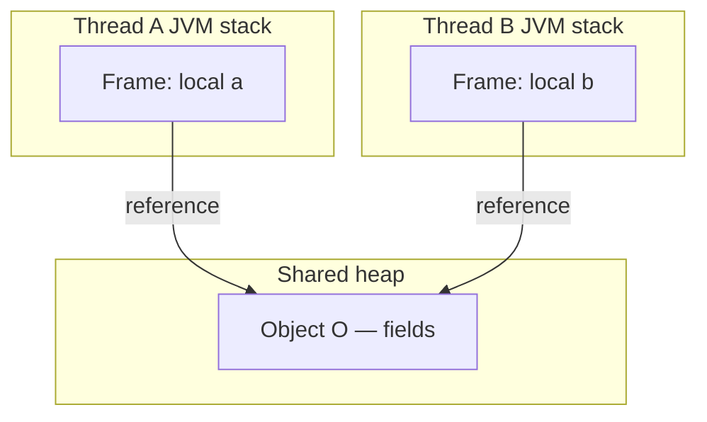
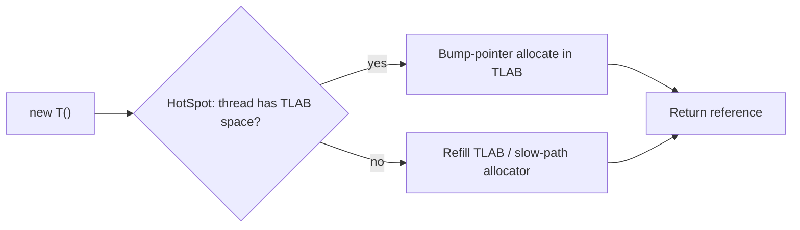

# Stack, Heap, and References

> **Status:** Completed  
> **Module:** 25 — Java Memory Model  
> **Target Java version:** 21  
> **Last reviewed:** 2026-11-11  
> **Chapter profile:** Deep-dive  
> **Depth target:** Levels 3–4 (JVMS areas, reference semantics, JMM prelude)  
> **Examples verified with:** Temurin JDK 21.0.12.1 (javac 21.0.12.1)

**Section policy:** Sections are **conditional unless marked mandatory**. Include a section when it adds meaningful learning value. Do **not** manufacture content to fill headings. For omitted sections, record the reason in the Review Checklist.

| Mandatory for most chapters | Conditional |
| --------------------------- | ----------- |
| Learning objectives | Internal behavior |
| Prerequisites | Performance |
| Why this exists | Security |
| Conceptual explanation | Language comparisons |
| Mechanism and execution flow *(or merge note)* | Advanced examples |
| Terminology | Real-world use cases |
| Examples | Design trade-offs *(strongly encouraged for Technical / Deep-dive)* |
| Common mistakes | Compatibility details |
| Summary and references | — |

**Editorial judgment:** Level 4 on **stack vs heap layout**, **reference identity**, and the **bridge to JMM visibility**. Allocator details (TLAB, compressed oops) are labeled **HotSpot** only. This chapter is the spatial map; Ch.02–03 supply the ordering rules.

## 1. Learning Objectives *(mandatory)*

After completing this chapter, you should be able to:

- Map **local variables** and **reference values** to per-thread **JVM stacks** and **objects/arrays** to the shared **heap**, citing **JVMS** runtime data areas.
- Explain why two threads can hold different stack locals that still **point at the same heap object**.
- Use **`==`** for reference identity and **`equals`** for logical equality, and refuse `==` for `String` content checks.
- Treat **`System.identityHashCode`** as a diagnostic hint (**HotSpot**-shaped behavior), not a durable identity contract or primary key.
- State why a shared heap makes the **Java Memory Model (JMM)** necessary before you reason about cross-thread field reads (Ch.02).

## 2. Prerequisites *(mandatory)*

- **Module 02** — primitives vs references; what a variable of reference type stores.
- **Module 04** — methods, stack frames as call activations (conceptual).
- **Module 24** — threads share the heap; each thread has its own call stack; `start` / `join` as coordination tools.

**Refresher — reference value:** A local of type `String` (or any class/array type) does **not** hold the object’s fields. It holds a **reference**—a value that designates a heap object (or `null`). Assigning `a = b` copies the reference, not a deep clone of the object.

**Refresher — thread:** A `Thread` is a unit of concurrent execution. Locals and the operand stack for that thread’s frames are **not** shared with other threads. Objects allocated with `new` live on the heap and **are** reachable from any thread that obtains a reference.

## 3. Why This Concept Exists *(mandatory)*

Concurrency bugs are often discussed as “visibility” or “races” before the reader has a concrete picture of **where** state lives. Without that picture:

- People assume every variable is “in memory the same way,” so thread-local and shared state blur together.
- People treat `==` as content equality, then wonder why two equal strings are “different objects.”
- People invent folklore (“the CPU flushes caches eventually”) because they never separated **storage location** from **ordering rules**.

This chapter draws the map:

1. **Per-thread stacks** hold frames: locals, operand stack, linkage (**JVMS**).
2. **The heap** holds object instances and arrays (**JVMS**).
3. **References** are the edges from stacks (and from other heap objects) into the heap.
4. When two threads follow references to the **same** object, they share fields—and only the **JLS Chapter 17** memory model defines portable visibility and ordering for those field accesses across threads.

Without steps 1–3, happens-before (Ch.02) feels abstract. Without the JMM, shared-heap intuition alone is not enough for correctness.

## 4. Conceptual Explanation *(mandatory)*

### 4.1 Runtime data areas (JVMS)

The **Java Virtual Machine Specification** describes several runtime data areas. For this module, three matter most:

| Area | Shared across threads? | Typical contents |
|------|------------------------|------------------|
| **JVM stack** (per thread) | No | Frames for method invocations: local variables, operand stack |
| **Heap** | Yes | Class instances and arrays |
| **Method area** | Yes (shared) | Class metadata, runtime constant pool (JVMS naming; implementations may split regions) |

**JVMS §2.5** is the portable vocabulary. Exact physical layout, generation names, and allocator strategies are **implementation** concerns (HotSpot, other JVMs).

**Important separation:**

- **JVMS** tells you that stacks are per-thread and that objects live on the heap.
- **JLS Chapter 17** tells you when a write by one thread becomes visible to a read by another.
- **HotSpot** decides how to allocate quickly (for example TLAB) and how to compress pointers—useful engineering, **not** language law.

### 4.2 Locals, primitives, and references

Inside a stack frame:

- A local of primitive type (`int`, `boolean`, …) holds the **value itself** in that frame’s local variable table (conceptually a stack slot).
- A local of reference type holds a **reference value** (or `null`). The object’s fields live on the **heap**.

```java
int primitiveOnStack = 7;                 // value 7 in this frame
String referenceOnStack = new String("heap-object"); // reference in frame → String on heap
```

Two locals can hold references to **different** heap objects that happen to have equal content, or to the **same** heap object (aliasing).

### 4.3 Allocation with `new`

Evaluating `new T(...)` (or array creation):

1. Allocates storage for a new instance (or array) on the **heap** (**JVMS** / language semantics).
2. Runs instance initialization (constructors / field initializers) on that storage.
3. Yields a **reference** to the new object, which the program typically stores in a local, field, or array slot.

**Who decides the address?** The JVM implementation’s allocator. On **HotSpot**, many allocations are served from a **Thread-Local Allocation Buffer (TLAB)** so threads can bump-allocate without synchronizing on every `new`. That is a **HotSpot performance technique**, not a JLS requirement and not something application code should depend on for correctness.

### 4.4 Identity (`==`) vs equality (`equals`)

| Operator / method | Meaning |
|-------------------|---------|
| **`==` on references** | Same reference value? (same object identity, or both `null`) |
| **`equals`** | Logical equality as defined by the class (default: identity; `String` overrides for content) |

```java
String a = new String("heap-object");
String b = new String("heap-object");
boolean sameRef = (a == b);           // false — two distinct heap objects
boolean equalContent = a.equals(b);   // true — String.equals compares content
```

**String literals** may be **interned** (same pool entry for identical literals in many cases). That makes `==` accidentally “work” for some literal comparisons and fail for `new String(...)`. Never use `==` to mean “same text.”

### 4.5 Why the shared heap needs the JMM

Consider two threads:

- Thread A’s stack: local `a` → object `O` on the heap.
- Thread B’s stack: local `b` → the **same** object `O`.

Both can read and write `O`’s fields. Stacks do **not** isolate those fields. Without happens-before edges (Ch.02), a write by A to a plain field of `O` need not be visible to B in any portable way, and the program may have a **data race**.

So: **separate stacks ≠ separate object state.** Shared reachability through the heap is exactly why Module 25 exists after Module 24’s concurrency tools.

### 4.6 Reachability and lifetime (conceptual bridge)

An object remains on the heap while it is **reachable** from GC roots (static fields, thread stacks, JNI roots, and other JVM-defined roots). When no path reaches it, it becomes eligible for collection (Module 26 / GC material).

Concurrency lesson: a static field or shared cache that retains a reference keeps the object alive **and** potentially visible to every thread that can read that field. Lifetime and visibility meet through reachability, but **GC eligibility ≠ happens-before**. An object can be reachable yet still have racy field reads.

### 4.7 Passing references into methods and lambdas

When you call `process(box)` or capture `box` in a lambda for `new Thread(...)`, you copy the **reference value**, not the object. The callee’s local (or the lambda’s captured variable) aliases the same heap object. That is why “I only mutated a parameter” can still mutate state visible to the caller and to other threads.

## 5. Mechanism and Execution Flow *(mandatory)*

### 5.1 Object graph: two stacks, one heap object



**How to read this diagram:**

1. **Thread A** and **Thread B** each have their own stack frames. Locals `a` and `b` are **not** the same stack slot.
2. Both locals store a reference that designates **object O**.
3. Fields of `O` are therefore **shared mutable state** if either thread writes them.
4. Visibility of those writes across threads is governed by **JLS §17** (happens-before), **not** by “both see the same heap address so they must see the same values immediately.”

### 5.2 Single-threaded demo flow (stack locals + heap object)

Demo: [stack-heap-references-demo](../../examples/jvm/stack-heap-references-demo/).

Execution on one thread still teaches the layout:

1. Enter `main` → new stack frame.
2. `primitiveOnStack = 7` → primitive local in that frame.
3. `new String("heap-object")` → allocate `String` on the **heap**; store the reference in `referenceOnStack`.
4. Print `primitive`, `identityHashCode(reference)`, `==` against another `new String(...)`, and `equals`.

**Verified output (Temurin JDK 21.0.12.1; identity hash varies by run/JVM):**

```text
primitive=7
identityHash=951007336
sameRef=false
equalContent=true
```

**Important lines:**

- `sameRef=false` — two `new String(...)` calls allocate **two** heap objects even when text matches.
- `equalContent=true` — `String.equals` compares content, not identity.
- `identityHash=...` — diagnostic; do **not** treat as a stable database key. Value can differ across runs and JVMs.

### 5.3 Aliasing vs distinct objects (mental trace)

| Step | Code idea | Stack | Heap |
|------|-----------|-------|------|
| 1 | `String x = new String("x");` | `x` → Obj1 | Obj1 content `"x"` |
| 2 | `String y = x;` | `y` → Obj1 (alias) | still one object |
| 3 | `String z = new String("x");` | `z` → Obj2 | Obj2 also content `"x"` |
| 4 | `x == y` | true | same object |
| 5 | `x == z` | false | distinct objects |
| 6 | `x.equals(z)` | true | equal content |

When another thread obtains a reference to Obj1 (via a shared field, queue, or argument), that thread’s **stack** is new, but Obj1’s **fields** are the same storage—subject to JMM.

### 5.4 HotSpot allocation sketch (implementation only)



**Label carefully:** This diagram is **HotSpot** engineering intuition for common `new` paths. Other JVMs may differ. Correctness of concurrent field access never depends on “I allocated in a TLAB.”

### 5.5 From bytecode intuition to the demo (JVMS-shaped)

At the **JVMS** level (simplified):

1. `new` / related instructions allocate and leave a reference on the **operand stack** of the current frame.
2. `astore` / `aastore` / `putfield` / `putstatic` move that reference into a local, array slot, instance field, or static field.
3. Later `aload` / `getfield` / `getstatic` reload references for use.

You do not need to read bytecode to use Java, but this mapping explains why “the local is on the stack” and “the object is on the heap” can both be true at once: the **reference** moves through stack slots; the **object body** does not live in the frame.

**HotSpot** may keep hot locals in CPU registers; that is an optimization that preserves the same Java semantics—not a second memory model.

## 6. Terminology *(mandatory)*

| Term | Meaning |
|------|---------|
| **JVM stack** | Per-thread stack of frames (**JVMS**). |
| **Stack frame** | Activation record for one method invocation: locals, operand stack, control linkage (**JVMS**). |
| **Heap** | Shared area for class instances and arrays (**JVMS**). |
| **Reference** | Value that designates a heap object, or `null`. |
| **Aliasing** | Two or more references designate the same object. |
| **Identity** | Sameness of object; tested with `==` on references. |
| **Equality** | Logical sameness per `equals` (and usually `hashCode` contract). |
| **JMM** | Java Memory Model — **JLS Chapter 17** rules for inter-thread actions and visibility. |
| **TLAB** | Thread-Local Allocation Buffer — **HotSpot** allocator optimization, not a language guarantee. |

## 7. Syntax and Language Rules *(include when language/API surface matters)*

### 7.1 `==` and `equals`

- For **reference types**, `==` is identity (or both `null`).
- Override `equals` (and `hashCode`) when the type has value semantics; keep the contract consistent (Module on objects/equality).
- Prefer `Objects.equals(a, b)` when either side may be `null`.

### 7.2 `System.identityHashCode`

- Returns a hash code for the object as if `Object.hashCode` were not overridden.
- Useful in debug logs to distinguish instances.
- **Not** a unique ID under all conditions; collisions are allowed. Do not use as a primary key.

### 7.3 Escape of `this` (preview for Ch.03)

If a constructor publishes `this` to another thread before the constructor finishes, other threads may observe a **partially initialized** object. That is a **safe publication / this-escape** problem (Ch.03), built on the layout in this chapter.

## 8. Step-by-Step Examples *(mandatory)*

### 8.1 Minimal — stack primitive vs heap object (**Verified**)

From [StackHeapReferencesDemo.java](../../examples/jvm/stack-heap-references-demo/StackHeapReferencesDemo.java):

```java
int primitiveOnStack = 7;
String referenceOnStack = new String("heap-object");
System.out.println("primitive=" + primitiveOnStack);
System.out.println("identityHash=" + System.identityHashCode(referenceOnStack));
```

**Why this way:** Forces a distinct heap `String` (not only a literal) so identity vs content is visible in the next lines.

**Compile and run:**

```bash
javac StackHeapReferencesDemo.java
java StackHeapReferencesDemo
```

### 8.2 Realistic — identity vs content (**Verified**)

```java
System.out.println("sameRef=" + (referenceOnStack == new String("heap-object")));
System.out.println("equalContent=" + referenceOnStack.equals("heap-object"));
```

**Expected (Temurin 21.0.12.1):** `sameRef=false`, `equalContent=true`.

**Incorrect variation:** `if (referenceOnStack == "heap-object")` — may pass for some interned cases and fail when the left side is `new String(...)`. Use `equals`.

### 8.3 Advanced — shared heap across threads (**Illustrative** structure)

```java
class Box {
    int value;
}

Box shared = new Box(); // heap object

Thread t1 = new Thread(() -> { shared.value = 1; });
Thread t2 = new Thread(() -> { System.out.println(shared.value); });
```

**Teaching point:** Both runnables capture the same reference to `shared`. Without synchronization / `volatile` / other HB (Ch.02), the print may observe `0` or `1` with **no portable guarantee**—this chapter only establishes *why* they share storage.

### 8.4 Array references

Arrays are heap objects. `int[] a = new int[3];` stores a reference in the local; elements live on the heap. Passing `a` to another method or thread shares the **array object**, not a copy of the elements (unless you copy explicitly).

```java
int[] buffer = new int[] {1, 2, 3};
Thread worker = new Thread(() -> buffer[0] = 99);
```

Both main and `worker` can touch `buffer[0]`—shared heap array, same JMM rules as object fields (Ch.02). Prefer copying (`Arrays.copyOf`) when an API must not share the backing store.

### 8.5 Literal vs `new String` (**Illustrative** contrast)

```java
String lit = "heap-object";
String neu = new String("heap-object");
// lit == "heap-object" may be true (interning)
// neu == "heap-object" is typically false
// lit.equals(neu) is true
```

Use this only to reinforce **never rely on `==` for content**. Production code: `equals` / `contentEquals` / `Objects.equals`.

## 9. Real-World Use Cases *(conditional)*

- **Debugging “why did both threads change my object?”** — draw stack locals → shared heap reference.
- **DTO / entity identity in logs** — log business keys; use `identityHashCode` only as a secondary diagnostic.
- **Defensive copies** — when an API must not share a mutable array or list with callers, copy before publishing the reference (ties to Ch.03 safe publication of mutable state).
- **Memory leak intuition** — long-lived static or cache references keep heap objects reachable; stacks alone do not “own” object lifetime.

## 10. Internal Behavior *(conditional)*

### 10.1 JVMS (portable)

- Each thread has a **JVM stack**; frames hold locals and an operand stack (**JVMS §2.5–2.6**).
- The **heap** stores all class instances and arrays created by the program.
- OutOfMemoryError can result from exhausted heap (or other areas)—symptom of reachability and sizing, not of JMM visibility rules.

### 10.2 HotSpot (implementation — not universal JVM law)

- **TLAB:** per-thread allocation buffers reduce contention on the allocator.
- **Compressed ordinary object pointers (compressed oops):** on many 64-bit HotSpot configurations, heap references are stored compressed; decoding is an implementation detail.
- **Object header / mark word:** identity hash and locking metadata may live in object headers—HotSpot layout, not application API.
- **Escape analysis / scalar replacement:** the JIT may optimize allocations that never escape a thread; that does **not** change the JLS model you reason with in source code.

Do not teach “locals are always in CPU registers” or “objects are always in RAM at address X” as correctness foundations.

## 11. Edge Cases and Limitations *(strongly encouraged)*

- **String interning** — literals and `String.intern()` can make `==` true for equal content; still use `equals` for content.
- **`null`** — `==` works; calling `equals` on a null receiver throws; prefer null-safe helpers when needed.
- **Value-based classes / identity** — some types discourage identity-sensitive operations; follow their API docs.
- **`identityHashCode` collisions and mutability** — not a unique key; for some objects hash may be computed lazily (**HotSpot** detail).
- **Primitive wrappers** — `Integer` caching for small values can make `==` accidentally true; compare with `equals` or `intValue` as appropriate.
- **Off-heap / FFM** — foreign memory is outside this chapter’s JVMS heap picture; covered in advanced modules.

## 12. Common Mistakes *(mandatory)*

### Incorrect

```java
if (userId == request.getUserId()) { // both Strings from different sources
    // ...
}
```

### Corrected

```java
if (Objects.equals(userId, request.getUserId())) {
    // ...
}
```

### Incorrect

“Each thread has its own stack, so threads cannot interfere with each other’s data.”

### Corrected

Stacks isolate **locals**. Heap objects reachable from multiple threads are shared. Use JMM tools (Ch.02–03) for shared mutable fields.

### Incorrect

Using `System.identityHashCode(obj)` as a primary key in a database or distributed cache.

### Corrected

Use a business key or a generated UUID/sequence. Treat identity hash as a debug aid only.

## 13. Best Practices *(include when guidance adds value)*

- Draw **reference graphs** when reviewing concurrent code: which locals/fields point where?
- Prefer **immutable** or carefully published objects when sharing across threads (Ch.03).
- Keep **mutable** objects confined to one thread unless publication is intentional and safe.
- Document whether an API **retains** a caller-supplied mutable reference or takes ownership/copy.

## 14. Design Trade-offs *(conditional; strongly encouraged)*

| Choice | Benefit | Cost |
|--------|---------|------|
| Share one heap object across threads | Efficiency; single source of truth | Requires JMM discipline; races hurt |
| Defensive copy on publish | Isolation; simpler concurrency | Allocation and copy cost |
| Intern strings aggressively | Memory for duplicates | Contended pool; surprising `==` |
| Rely on HotSpot TLAB knowledge | Helps performance tuning | Irrelevant to correctness; non-portable |

## 15. Performance Considerations *(conditional)*

- Allocation rate and escape analysis matter for throughput (**HotSpot** JIT)—measure with real tools (JFR), do not guess from diagrams.
- Sharing immutable objects avoids copies but still needs **safe publication** of the reference (Ch.03).
- Contended writes to the same object fields cause cache-line traffic on real CPUs—engineering intuition only; correctness still comes from JLS rules.

## 16. Security Considerations *(conditional)*

- Accidentally sharing a mutable array or `byte[]` buffer across trust boundaries can leak or allow tampering—**defensive copies** and clear ownership.
- Relying on `==` for authorization tokens or capability checks is wrong; use constant-time content comparison APIs where appropriate for secrets.

*Detailed threat modeling omitted; note in checklist.*

## 17. Java Version and Compatibility Notes *(conditional)*

- Stack/heap/reference model is long-standing; Java 21 continues the same fundamental picture.
- **Foreign Function & Memory API** (Java 22 finalized path; incubating/preview history) interacts with off-heap memory—do not confuse with the JVMS Java heap in this chapter.
- Compressed oops and TLAB remain **HotSpot** tunables across recent JDKs; flags and defaults can change—consult current HotSpot docs when tuning.

## 18. Related Language Comparisons *(conditional)*

*Omitted.* C++ stack objects vs Java’s “objects always on the heap” mental model is useful trivia but not required to master the JMM path here.

## 19. Revision and Mastery *(Deep-dive)*

**You should already understand:** methods, objects, threads at Module 24 level.

**Common knowledge gaps:**

- Believing stacks somehow replicate object fields per thread.
- Using `==` for `String` / value objects out of habit from interned literals.
- Treating HotSpot allocator lore as a substitute for happens-before.

**Questions you should be able to answer:**

1. If stacks are separate, why can two threads race on a field?
2. What exactly does a reference-type local store?
3. Why can `sameRef` be false while `equalContent` is true in the demo?
4. Which claims about TLAB are HotSpot-only?

**Practical exercise:** Modify the demo to print `referenceOnStack == referenceOnStack.intern()` and explain the result without changing the chapter’s `==` vs `equals` rule for application code.

## 20. Exercises *(include for major chapters)*

### Beginner

Run `StackHeapReferencesDemo`. Explain each printed line in terms of stack vs heap.

### Intermediate

Write a tiny program with two threads that both increment `box.value` without synchronization, then with `synchronized`. Relate results to shared heap storage (full HB treatment is Ch.02).

### Advanced

Sketch (on paper) the object graph for a `List<String>` held in a static field and read by a worker thread. Mark which edges are references and which storage is heap.

## 21. Interview Questions *(conditional)*

- Where do local variables live vs objects created with `new`?
- Difference between `==` and `equals` for objects?
- Why isn’t “each thread has its own stack” enough to prevent data races?

## 22. Solutions *(or link to separate solutions file)*

**Beginner sketch:** `primitive=7` is a local int; `identityHash` identifies one heap `String`; `sameRef=false` because two `new` allocations; `equalContent=true` via `String.equals`.

**Intermediate sketch:** Both threads mutate the same `Box` instance; lost updates / visibility issues appear without coordination; `synchronized` on one monitor serializes access (Module 24 / Ch.02).

## 23. Chapter Summary *(mandatory)*

**JVM stacks** confine per-thread frames and locals. The **heap** holds objects and arrays reachable through **references**. **`==`** tests identity; **`equals`** tests logical equality. **HotSpot** details such as **TLAB** affect how allocation is implemented, not when shared fields become visible. Shared heap reachability is why the **JMM** (next chapters) must define happens-before and safe publication.

## 24. Key Terminology *(optional consolidation)*

See Section 6.

## 25. References and Further Reading *(mandatory)*

- [JVMS §2.5 Runtime Data Areas](https://docs.oracle.com/javase/specs/jvms/se21/html/jvms-2.html#jvms-2.5) — stacks, heap, method area
- [JVMS §2.6 Frames](https://docs.oracle.com/javase/specs/jvms/se21/html/jvms-2.html#jvms-2.6)
- [JLS Chapter 17 Threads and Locks](https://docs.oracle.com/javase/specs/jls/se21/html/jls-17.html) — memory model prelude for Ch.02
- [Java SE `Object.equals`](https://docs.oracle.com/en/java/javase/21/docs/api/java.base/java/lang/Object.html#equals(java.lang.Object))
- [Java SE `System.identityHashCode`](https://docs.oracle.com/en/java/javase/21/docs/api/java.base/java/lang/System.html#identityHashCode(java.lang.Object))

## 26. Next Steps

[02-happens-before-and-visibility.md](02-happens-before-and-visibility.md) — happens-before edges, `volatile`, data races, and why “cache flush” folklore is not the specification.

## Review Checklist

**Mandatory Depth Review:** Level 4 on stack/heap/reference layout and JMM motivation; Level 3 on `==`/`equals` and HotSpot labeling.

- [x] Learning objectives covered
- [x] Prerequisites identified and briefly refreshed
- [x] Chapter profile and depth target recorded and appropriate
- [x] Depth gate passed (definitions; progressive examples; wrong vs right)
- [x] Mandatory Depth Review (Levels 1–4) passed for this topic
- [x] Mechanism and execution flow explained (diagram + step table + demo flow)
- [x] Diagrams explained in prose
- [x] First-appearance concepts explained now (reference, aliasing, TLAB labeled HotSpot)
- [x] Terminology defined before use
- [x] Examples with verification labels; Temurin 21.0.12.1 output preserved
- [x] JVMS vs JLS vs HotSpot distinguished
- [x] References support important claims
- [x] Revision and Mastery included
- [x] Chapter independently readable
- [x] `PROGRESS.md` updated (third deepen pass 2026-11-11)

**Omissions (section → reason):**

- Language comparisons — not required for this JMM prelude
- Security — brief note only; not a security module
