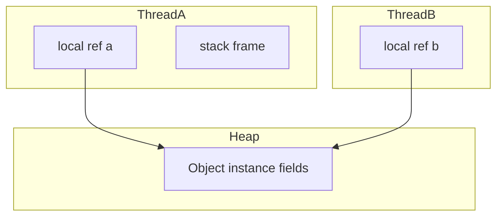

# Stack, Heap, and References

> **Status:** Completed  
> **Module:** 25 — Java Memory Model  
> **Target Java version:** 21  
> **Last reviewed:** 2026-11-11  
> **Chapter profile:** Deep-dive  
> **Depth target:** Levels 3–4 (JVMS areas, reference semantics, JMM prelude)  
> **Examples verified with:** Temurin JDK 21.0.12.1 (javac 21.0.12.1)

## 1. Learning Objectives *(mandatory)*

- Map **locals** and **reference values** to per-thread stacks vs **objects** on the heap (JVMS).
- Use **`==`** vs **`equals`** correctly for references and logical equality.
- Treat **`identityHashCode`** as diagnostic only (HotSpot), not an identity contract.
- Connect shared heap reachability to **why JMM rules exist** (Ch.02).

## 2. Prerequisites *(mandatory)*

- Module **02** references; Module **04** stack frames; Module **24** shared heap.

## 3. Why This Concept Exists *(mandatory)*

Before **happens-before**, you need a picture: each thread has **its own stack** of frames; **object instances** live on the **heap** and are reachable through references. The **JLS Chapter 17** memory model defines which writes become visible across threads operating on that shared heap.

## 4. Conceptual Explanation *(mandatory)*

- **JVMS:** Each thread has a JVM stack; heap holds objects and arrays; method area holds class metadata (JVMS §2).
- **Primitives in locals** live in stack slots conceptually; **references** are values that point at heap objects.
- **`new`** allocates heap storage (JVMS); allocator details are **HotSpot** (TLAB, etc.).
- **`==`** compares reference identity; **`equals`** compares logical value when overridden.

## 5. Mechanism and Execution Flow *(mandatory)*



Two threads with references to the **same** object observe **shared fields**—subject to JMM rules, not automatic freshness.

Demo: [stack-heap-references-demo](../../examples/jvm/stack-heap-references-demo/).

**Verified output (Temurin JDK 21.0.12.1; identity hash varies by run/JVM):**

```text
primitive=7
identityHash=951007336
sameRef=false
equalContent=true
```

Two `new String("...")` with same text → `sameRef=false`, `equals` true.

## 6. Terminology *(mandatory)*

| Term | Meaning |
|------|---------|
| Stack frame | Activation record: locals, operand stack per JVMS |
| Heap object | Instance or array in heap |
| Identity vs equality | `==` vs `equals` |

## 11. Edge Cases and Limitations *(strongly encouraged)*

- String **literals** may be interned—do not use `==` for content.
- `identityHashCode` not stable ID for all objects/contention cases.

## 10. Internal Behavior *(conditional)*

- **JVMS:** Runtime data areas specification.
- **HotSpot:** TLAB, compressed oops—implementation, not language guarantees.

## 19. Revision and Mastery *(Deep-dive)*

**Question:** If stacks are separate, why can two threads race on a field?

## 23. Chapter Summary *(mandatory)*

**Stacks** confine locals; **heap** shares objects; **JMM** governs cross-thread visibility next.

## 25. References and Further Reading *(mandatory)*

- [JVMS §2.5](https://docs.oracle.com/javase/specs/jvms/se21/html/jvms-2.html#jvms-2.5)
- [JLS Chapter 17](https://docs.oracle.com/javase/specs/jls/se21/html/jls-17.html)

## 26. Next Steps

[02-happens-before-and-visibility.md](02-happens-before-and-visibility.md)

## Review Checklist

- [x] Deep-dive; Verified Temurin 21.0.12.1
- [x] JVMS vs HotSpot labeled
