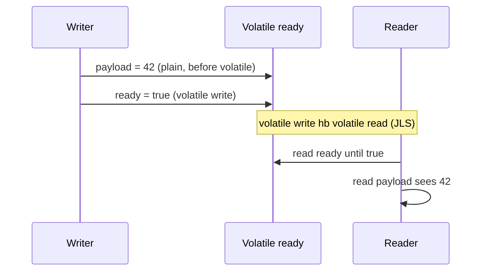

# Happens-Before and Visibility

> **Status:** Completed  
> **Module:** 25 — Java Memory Model  
> **Target Java version:** 21  
> **Last reviewed:** 2026-11-11  
> **Chapter profile:** Deep-dive  
> **Depth target:** Levels 3–4 (JLS §17.4 HB edges, volatile, races)  
> **Examples verified with:** Temurin JDK 21.0.12.1 (javac 21.0.12.1)

## 1. Learning Objectives *(mandatory)*

- State **happens-before** from **JLS §17.4**, not cache folklore.
- Apply **`volatile`**, **`synchronized`**, **`Thread.start`**, **`Thread.join`**, and executor **submit** HB edges.
- Explain why unsynchronized plain-field races have **no well-defined semantics** (JLS).
- Refuse “usually works” as a correctness argument.

## 2. Prerequisites *(mandatory)*

- Module **24** Ch.02 synchronization; this chapter cites **JLS** rules.

## 3. Why This Concept Exists *(mandatory)*

CPUs, caches, and compilers reorder or buffer writes. Without portable rules, another thread might never see your update or might see **partial** construction. **Happens-before** defines when read **r** observes write **w**.

## 4. Conceptual Explanation *(mandatory)*

If action **a** happens-before **b**, then **a's** effects are visible to **b** (and ordering constraints apply as specified).

**Selected HB sources (JLS §17.4.5):**

| Edge | Rule (informal) |
|------|-----------------|
| Monitor | Unlock on *m* hb lock on *m* |
| Volatile | Volatile write hb volatile read of same var |
| Thread start | `start()` hb first action in started thread |
| Thread join | Actions in joined thread hb successful `join` return |
| Transitivity | hb chains compose |

**Not HB:** arbitrary unsynchronized access to the same plain field → **data race**; no portable semantics.

**Do not** teach “flush to main memory” as the spec—the contract is **happens-before**.

## 5. Mechanism and Execution Flow *(mandatory)*

### Volatile publish pattern



Demo: [happens-before-demo](../../examples/jvm/happens-before-demo/).

**Verified output (Temurin JDK 21.0.12.1):**

```text
payload=42
publishDone=true
```

Writer sets `payload` then **`volatile` `ready = true`**. Reader spins until `ready`; HB ensures `payload=42`. Removing `volatile` from `ready` can yield `payload=0` (racy).

## 6. Terminology *(mandatory)*

| Term | Meaning |
|------|---------|
| Happens-before | Partial order in JMM |
| Data race | Conflicting unsynchronized accesses (JLS) |
| Visibility | Observing effects of another thread per HB |

## 11. Edge Cases and Limitations *(strongly encouraged)*

- **Double-checked locking** requires `volatile` on reference field (JLS-correct pattern).
- **`boolean` plain fields** do not get a free pass when racy with other unsynchronized writes.

## 12. Common Mistakes *(mandatory)*

### Incorrect

“CPUs eventually flush—my flag will be seen.”

### Corrected

Establish documented HB (`volatile`, lock, `join`, etc.).

## 10. Internal Behavior *(conditional)*

- **JLS:** Full HB order is specification.
- **HotSpot:** Barrier insertion implements JMM on mainstream platforms—implementation detail.

## 19. Revision and Mastery *(Deep-dive)*

List three HB edges you used in production code.

## 23. Chapter Summary *(mandatory)*

Portable correctness uses **documented happens-before**; `volatile` and monitors are standard tools; races on plain fields are undefined.

## 25. References and Further Reading *(mandatory)*

- [JLS §17.4](https://docs.oracle.com/javase/specs/jls/se21/html/jls-17.html#jls-17.4)

## 26. Next Steps

[03-safe-publication.md](03-safe-publication.md)

## Review Checklist

- [x] Level 4 on HB; JLS cited; Verified demo
- [x] No folk cache-flush theorems
