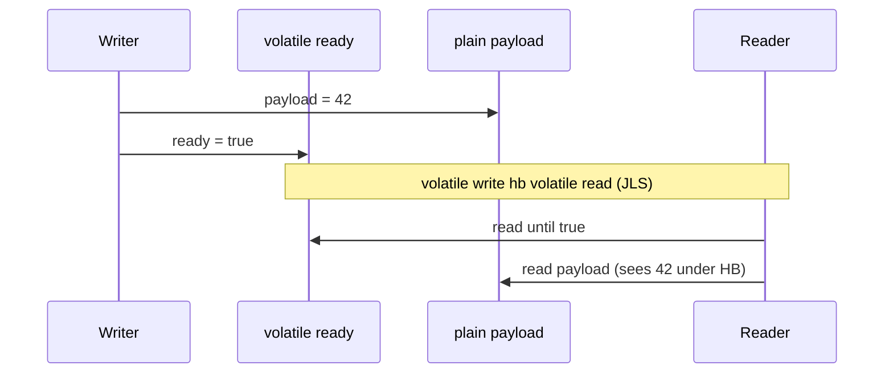

# Happens-Before and Visibility

> **Status:** Completed  
> **Module:** 25 — Java Memory Model  
> **Target Java version:** 21  
> **Last reviewed:** 2026-11-11  
> **Chapter profile:** Deep-dive  
> **Depth target:** Levels 3–4 (JLS §17.4 HB edges, volatile, races)  
> **Examples verified with:** Temurin JDK 21.0.12.1 (javac 21.0.12.1)

**Section policy:** Sections are **conditional unless marked mandatory**. Include a section when it adds meaningful learning value. Do **not** manufacture content to fill headings. For omitted sections, record the reason in the Review Checklist.

| Mandatory for most chapters | Conditional |
| --------------------------- | ----------- |
| Learning objectives | Internal behavior |
| Prerequisites | Performance |
| Why this exists | Security |
| Conceptual explanation | Language comparisons |
| Mechanism and execution flow *(or merge note)* | Advanced examples |
| Terminology | Real-world use cases |
| Examples | Design trade-offs *(strongly encouraged for Technical / Deep-dive)* |
| Common mistakes | Compatibility details |
| Summary and references | — |

**Editorial judgment:** Level 4 on **happens-before**, **volatile publication**, **data races**, and **double-checked locking**. This chapter cites **JLS §17.4**. Barrier insertion and CPU store buffers are **HotSpot / hardware** implementation notes—never a substitute for the specification. Refuse “flush to main memory” as the correctness contract. Pair with Ch.01 (where state lives) and Ch.03 (how to publish whole objects); this chapter owns the **ordering edges**.

## 1. Learning Objectives *(mandatory)*

After completing this chapter, you should be able to:

- State **happens-before** from **JLS §17.4**, including that it is a **partial order** over actions—not a story about caches.
- Apply core **happens-before edges**: program order in a thread, monitor unlock→lock, **volatile** write→read of the same variable, `Thread.start`, successful `Thread.join`, and the usual executor **submit** / task relationships used in practice.
- Walk an **object-graph / step trace** for the volatile publish pattern (payload + ready flag) and explain why the reader may rely on `payload` after seeing `ready == true`.
- Explain why unsynchronized conflicting accesses to a **plain** field constitute a **data race** with **no well-defined semantics** under the JLS.
- Correct double-checked locking with a **`volatile`** instance reference, and explain what goes wrong without it.
- Refuse “it usually works on my laptop” as a correctness argument.

## 2. Prerequisites *(mandatory)*

- **Ch.01** — per-thread stacks, shared heap, references; why shared fields need rules.
- **Module 24 Ch.02** — `synchronized`, atomics, lost updates; this chapter deepens the **visibility / ordering** side that Module 24 introduced.
- Comfort with `Thread.start` / `join` and lambdas for worker tasks.

**Refresher — shared field:** If two threads hold references to the same object (or access the same static field), writes to that field are **inter-thread actions**. Stacks do not isolate those fields (Ch.01).

**Refresher — monitor unlock→lock:** An unlock on monitor *m* **happens-before** a subsequent lock on *m* (**JLS §17.4.5**). Everything done under the lock before unlock is ordered before what the next acquirer does after lock—**for state guarded by that protocol**.

## 3. Why This Concept Exists *(mandatory)*

Real machines and compilers reorder and buffer work:

- Compilers move reads/writes when single-threaded semantics appear preserved.
- CPUs use store buffers and cache coherence protocols.
- JVMs JIT-compile and optimize aggressively (**HotSpot** and others).

If every thread could assume “I wrote it, so every other thread sees it next,” concurrent programs would still break under optimization. The **Java Memory Model** (**JLS Chapter 17**) defines a portable contract: which reads are allowed to observe which writes, and when actions are ordered by **happens-before**.

Without that contract:

- Thread B might never observe Thread A’s write to a plain flag.
- Thread B might observe a **new object reference** but see **default field values** (publication failure—Ch.03).
- Tests on one machine “pass” for years and fail after a JVM upgrade or different core count.

**Happens-before** is how Java answers: when is read *r* guaranteed to observe write *w* (among the allowed behaviors)?

## 4. Conceptual Explanation *(mandatory)*

### 4.1 What happens-before means (JLS)

If action **a** **happens-before** action **b** (written *a* hb *b*):

- *a* is ordered before *b* in the happens-before partial order.
- Visibility consequences follow as specified by the JMM: roughly, effects of *a* that need to be visible to *b* are visible under the rules for that edge type.

Happens-before is **not**:

- A total order of every memory access in the JVM.
- A promise that “caches flush to main memory.”
- A claim about wall-clock time (“a happened earlier on the clock”).

It **is** a **specification** relationship in **JLS §17.4**. Implementations (including HotSpot) must behave as if they respect it—often by inserting memory barriers—but your reasoning tool is the JLS edge list, not barrier folklore.

### 4.2 Intra-thread program order

Within a **single** thread, if action *x* comes before action *y* in program order, then *x* hb *y* (**JLS**). That is why, in one thread, you can write:

```java
payload = 42;
ready = true;
```

and know that *this* thread sees `payload` as 42 after setting `ready`. **Other** threads need an **inter-thread** happens-before edge to the writer’s actions.

### 4.3 Selected inter-thread happens-before edges (JLS §17.4.5)

| Edge | Informal rule (always verify against JLS text) |
|------|------------------------------------------------|
| **Monitor** | Unlock of monitor *m* hb every subsequent lock of *m* |
| **Volatile** | Write to volatile *v* hb every subsequent read of *v* |
| **Thread start** | Call to `start()` hb first action in the started thread |
| **Thread join** | Last action in a thread hb successful return from `join()` on that thread |
| **Transitivity** | If *a* hb *b* and *b* hb *c*, then *a* hb *c* |
| **Program order** | Within a thread, earlier actions hb later actions |

**Executor practical note:** Submitting a task and later observing its completion through documented APIs (`Future.get`, etc.) establishes ordering analogous to hand-off + join-style relationships. Prefer documented concurrent API contracts over inventing edges.

### 4.4 Visibility without folklore

**Correct teaching:** After a volatile write of `ready = true` by the writer, a volatile read by the reader that observes `true` has *write* hb *read*. Combined with program order in the writer (`payload = 42` before `ready = true`) and program order in the reader (read `ready` before read `payload`), **transitivity** gives writer’s `payload` write hb reader’s `payload` read—so the reader may rely on seeing `42` (for that plain `int` payload under this pattern).

**Incorrect teaching:** “`volatile` flushes the CPU cache to RAM so everyone sees it.” That metaphor sometimes matches intuition on some hardware, but it is **not** the JLS contract, and it misleads about partial orders, multiple variables, and what is *not* ordered.

### 4.5 Data races (JLS)

Informally: two accesses to the **same** variable conflict if at least one is a write. If those accesses are from different threads and are **not** ordered by happens-before, you have a **data race**.

For races on **non-volatile** fields, the JLS does **not** give a single predictable outcome. Stale values, surprising reorderings, and “almost correct” behavior under light load are all in play. **“Usually works” is not a specification.**

**Note:** `volatile` variables are treated specially; conflicting accesses to a volatile are ordered by the volatile HB rule when one is a write and a later read observes it as specified—consult JLS for the precise race definition. Do not invent “boolean is atomic so no race” as a free pass for unsynchronized plain `boolean` flags used as publication signals alongside other writes.

### 4.6 `volatile` vs `synchronized` (role split)

| Tool | Primary role in this chapter |
|------|------------------------------|
| **`volatile`** | Visibility / ordering for a variable; publish flag or safely published reference; **not** atomic read-modify-write for `++` |
| **`synchronized`** | Mutual exclusion **and** unlock→lock HB for state guarded by the monitor |

Use Module 24 when the bug is lost updates on `counter++`. Use this chapter when the bug is “reader never saw the flag” or “reader saw flag but not the payload.”

### 4.7 Double-checked locking (preview of the volatile reference)

Classic broken pattern: check a non-volatile `instance` without locking, then synchronize to create, then publish the reference without volatility. Another thread may observe a **non-null** reference to a **partially constructed** object (reordering of writes to fields vs the store of the reference)—especially painful before final-field guarantees and without volatile. The **JLS-correct** DCL pattern uses a **`volatile`** instance field (Section 8.3). Safe publication of constructed state is deepened in Ch.03.

### 4.8 Write order matters as much as volatility

```java
// WRONG order even with volatile ready:
ready = true;   // publishes "go" too early
payload = 42;   // may not be visible to reader who already saw ready
```

```java
// RIGHT order:
payload = 42;   // prepare state first (program order)
ready = true;   // then publish (volatile write)
```

Happens-before chains follow **program order in the writer**. Flipping the assignments breaks the intended chain even if `ready` is `volatile`. This is one of the most common hand-rolled protocol bugs.

### 4.9 What a data race is allowed to look like (intuition, not a catalog)

The JLS does not hand you a list of “permitted wrong outputs.” Practical failure modes people observe under races include:

- A reader looping forever on a plain flag that was set to `true` on another thread.
- A reader seeing the flag `true` but payload still at the default.
- Intermittent failures that vanish under a debugger (timing changes).

Treat these as **symptoms of undefined racy behavior**, not as the complete set of outcomes. The fix is always: establish HB (or eliminate sharing).

## 5. Mechanism and Execution Flow *(mandatory)*

### 5.1 Volatile publish pattern — object / static field graph

Shared statics in the demo:

```text
Class HappensBeforeDemo
  ├── volatile boolean ready     ← publication signal
  └── int payload                ← plain field (data)
```

Writer thread (main) and reader thread both access those statics—**shared heap storage** (Ch.01), ordered only if HB exists.

### 5.2 Step-by-step happens-before chain

Demo: [happens-before-demo](../../examples/jvm/happens-before-demo/).

**Writer (main thread), after `reader.start()`:**

| Step | Action | HB note |
|------|--------|---------|
| W0 | `reader.start()` | start hb first action in reader (**JLS**) |
| W1 | `payload = 42` | plain write; program-ordered before W2 in writer |
| W2 | `ready = true` | **volatile write** |

**Reader thread:**

| Step | Action | HB note |
|------|--------|---------|
| R1 | loop: read `ready` until true | **volatile reads** |
| R2 | when `ready` observed true, read `payload` | program order after successful R1 |

**Chain when reader observes `ready == true`:**

1. W1 hb W2 (program order in writer).
2. W2 hb R1ₛᵤ𝒸𝒸ₑₛₛ (volatile write hb subsequent volatile read of same variable that sees it).
3. R1ₛᵤ𝒸𝒸ₑₛₛ hb R2 (program order in reader).
4. Therefore W1 hb R2 by **transitivity** — reader’s read of `payload` is ordered after writer’s write of `42`.



**How to read this diagram:** The arrow that matters for cross-thread visibility of `payload` is not “ magically flush Pay.” It is the **volatile** edge on `ready`, composed with program order on both sides.

### 5.3 What removing `volatile` does

If `ready` is a plain `boolean`:

- Writer’s `ready = true` and reader’s reads of `ready` can form a **data race**.
- There is **no** volatile HB edge.
- The reader may spin forever seeing `false`, or eventually see `true` while still observing `payload == 0` (or other surprising states)—**no portable guarantee**.

The demo keeps `volatile` so the successful path is well-defined. Do not “prove” races by hoping for a failure on one run; reason from the JLS.

### 5.4 Monitor path (same visibility goal)

Alternative publication:

```java
synchronized (lock) {
    payload = 42;
    ready = true; // need not be volatile if all accesses use same lock
}
// reader:
synchronized (lock) {
    if (ready) {
        use(payload);
    }
}
```

Unlock in writer hb lock in reader (**JLS**). Mutual exclusion also prevents torn check-then-act on richer state. Cost: contention and coarser serialization.

### 5.5 `start` and `join` edges in the demo harness

- `reader.start()` ensures the reader’s first actions happen-after the start call’s synchronization edge.
- `reader.join()` in main ensures that after join returns, main sees the effects of the reader (including its print)—useful for the harness, **orthogonal** to the volatile publish of `payload` to the reader.

**Verified output (Temurin JDK 21.0.12.1):**

```text
payload=42
publishDone=true
```

### 5.6 Transitivity sketch (one picture)


Each arrow is an HB edge (program order or volatile). The path from W1 to R2 is why `payload=42` is reliable in the demo.

### 5.7 Object-graph walkthrough (statics as shared edges)

```text
Thread main (writer)                 Thread reader
─────────────────                    ─────────────
frame locals: (none needed)          frame locals: (none)
     |                                    |
     | getstatic/putstatic                | getstatic
     v                                    v
┌────────────────────────────────────────────┐
│  Class HappensBeforeDemo (metadata + statics)│
│    volatile ready  <── publication edge      │
│    int payload     <── data field            │
└────────────────────────────────────────────┘
```

Both threads reach the **same** static fields through the class. The graph shows **where** state lives (Ch.01). The sequence diagram in §5.2 shows **which edge** makes `payload` trustworthy. Separating “same address” from “happens-before” is the whole point of this module.

### 5.8 Executor-style hand-off (practical HB)

```java
ExecutorService pool = Executors.newSingleThreadExecutor();
Future<?> f = pool.submit(() -> {
    // task body sees submissions ordered per API / JLS thread rules
});
f.get(); // successful get hb: caller sees effects of the task
```

`Future.get` documents that it waits for completion and that actions in the task happen-before a successful return (see API specification). Prefer this over inventing volatile flags for “is the worker done?” when a `Future` already exists.

## 6. Terminology *(mandatory)*

| Term | Meaning |
|------|---------|
| **Happens-before (hb)** | Partial order on actions in the JMM (**JLS §17.4**). |
| **Visibility** | Whether one thread’s read is guaranteed to observe another’s write under HB. |
| **Volatile variable** | Field/array element declared `volatile`; special synchronization semantics in JLS. |
| **Data race** | Conflicting accesses not ordered by happens-before (**JLS** definition). |
| **Publication** | Making a reference or value reachable to other threads. |
| **Program order** | Order of actions in a single thread’s source/execution as used by JLS. |
| **Memory barrier / fence** | **Implementation** technique (CPU/JIT) often used to enforce JMM—**not** the JLS vocabulary you should cite for correctness proofs. |

## 7. Syntax and Language Rules *(include when language/API surface matters)*

### 7.1 Declaring `volatile`

```java
private static volatile boolean ready;
private volatile Config config; // common for safely published immutable configs
```

- Applies to fields (and the JLS rules for volatile array elements when using array volatility carefully—usually prefer `AtomicIntegerArray` / explicit cell designs).
- Does **not** make compound actions atomic: `readyCount++` on a `volatile int` can still lose updates (Module 24).

### 7.2 `synchronized` reminder

```java
synchronized (lock) {
    // critical section
}
```

Unlock hb subsequent lock on the **same** monitor. Wrong lock object ⇒ no edge.

### 7.3 Thread start / join

```java
Thread t = new Thread(task);
t.start();  // start hb actions in t
t.join();   // actions in t hb join return (when join succeeds)
```

## 8. Step-by-Step Examples *(mandatory)*

### 8.1 Minimal — volatile publish (**Verified**)

From [HappensBeforeDemo.java](../../examples/jvm/happens-before-demo/HappensBeforeDemo.java):

```java
private static volatile boolean ready;
private static int payload;

Thread reader = new Thread(() -> {
    while (!ready) {
        // spin until writer publishes
    }
    System.out.println("payload=" + payload);
});

reader.start();
payload = 42;
ready = true;
reader.join();
```

**Important lines:**

- `volatile boolean ready` — publication signal with HB.
- `payload = 42` **before** `ready = true` — program order so HB chains to the payload write.
- Spin loop is a teaching device; production code usually waits with blocking queues, latches, or park/unpark—not tight spins.

**Compile and run:**

```bash
javac HappensBeforeDemo.java
java HappensBeforeDemo
```

**Verified output (Temurin JDK 21.0.12.1):**

```text
payload=42
publishDone=true
```

### 8.2 Realistic — latch-style hand-off (**Illustrative** API shape)

```java
CountDownLatch published = new CountDownLatch(1);
// writer fills data, then:
published.countDown();
// reader:
published.await();
// then read data
```

`CountDownLatch` documents happens-before between `countDown` and successful `await`. Prefer library synchronization for real services; the volatile demo exists to expose the JMM edge nakedly.

### 8.3 Advanced — double-checked locking with `volatile` (**Illustrative** correct shape)

```java
private static volatile Expensive instance;

static Expensive get() {
    Expensive local = instance;
    if (local == null) {
        synchronized (Expensive.class) {
            local = instance;
            if (local == null) {
                instance = local = new Expensive();
            }
        }
    }
    return local;
}
```

**Why `volatile`:** Without it, a thread can see a non-null `instance` while field writes from the constructor have not happened-before that read—observing a half-built object. With `volatile`, the store of the reference is a volatile write; a subsequent volatile read that sees non-null orders constructor effects before the reader uses the object (together with safe construction practices).

**Incorrect variation:** same pattern with a plain (non-volatile) `instance` field—historically a famous concurrency bug class.

**Alternative:** holder class idiom / enum singleton / ordinary synchronized get—often clearer than DCL unless profiling demands it.

### 8.4 Incorrect — racy flag with payload

```java
static boolean ready; // NOT volatile
static int payload;

// writer:
payload = 42;
ready = true;

// reader:
if (ready) {
    use(payload); // NO portable guarantee
}
```

**Why wrong:** Data race on `ready`; no HB to `payload` write.

## 9. Real-World Use Cases *(conditional)*

- **One-shot initialization flags** — `volatile boolean initialized` plus carefully ordered writes, or better: `AtomicBoolean`, latches, or `final` + safe publication (Ch.03).
- **Publishing an immutable config snapshot** — write fields on a new object, then volatile-publish the reference.
- **Stopping a worker** — `volatile boolean running`; still prefer interruption / higher-level cancellation for robust shutdown.
- **Logging “ready for traffic”** after warmup — ensure readiness signal HB-orders setup writes.
- **Hand-off between pipeline stages** — stage A fills a message object, then offers it to a `BlockingQueue`; stage B `take`s it. Queue APIs document happens-before between the successful hand-off actions—prefer that over a custom volatile protocol when a queue already fits the design.
- **Test harnesses** — `join()` after workers so assertions see their writes; never assert on shared plain fields while workers still run without HB.

### 9.1 Mapping symptoms to missing edges

| Symptom | Likely missing piece |
|---------|----------------------|
| Reader never leaves spin on flag | No visibility edge on the flag (`volatile` / lock / etc.) |
| Reader sees flag but stale payload | Flag edge present but payload write not program-ordered before publish, or payload accessed without chaining through that edge |
| Intermittent half-built object | Unsafe publication / missing `volatile` on DCL reference (Ch.03) |
| Counter loses increments | Need atomicity (Module 24), not only volatile visibility |

## 10. Internal Behavior *(conditional)*

### 10.1 JLS (portable)

- Full happens-before rules: **JLS §17.4**.
- Volatile semantics and synchronization actions are specified there—not in CPU manuals.
- Data race semantics: programs with races on plain variables are outside the nice predictable fragment you want in production code.

### 10.2 HotSpot / hardware (implementation — not universal law)

- JITs emit **memory barriers** / use architecture fences so observed behavior matches the JMM on that CPU.
- Store buffers, invalidate queues, and MESI-like protocols explain *why* fences exist—they do **not** redefine Java’s contract.
- Different CPU memory models (x86 TSO vs weaker ARM/RISC-V) change how many barriers HotSpot must emit; **portable code still talks in happens-before**.

Label any “cache flush” explanation as **optional engineering intuition**, never as the rule students memorize for interviews or production reviews.

## 11. Edge Cases and Limitations *(strongly encouraged)*

- **`volatile` does not replace locks** for multi-field invariants or atomic check-then-act on collections.
- **Spin loops** waste CPU; use them only in demos or extremely specialized low-latency code.
- **Plain `boolean` flags** are not a free race exemption when used as publication signals with other writes.
- **64-bit `long`/`double`:** non-volatile writes may be treated as two 32-bit writes in the JLS model historically; prefer `volatile` or atomics when sharing them across threads without other synchronization.
- **Liveness vs safety:** HB gives visibility when edges exist; it does not by itself prevent deadlock or ensure progress.
- **VarHandle** / explicit memory-order modes (advanced) — finer control; out of scope beyond noting they exist for experts (Module outstanding notes).

## 12. Common Mistakes *(mandatory)*

### Incorrect

“CPUs eventually flush caches—my plain flag will be seen.”

### Corrected

Establish a documented happens-before edge (`volatile`, monitor, `join`, concurrent API contract, etc.).

### Incorrect

```java
volatile int count;
count++; // many threads
```

### Corrected

Use `AtomicInteger` or synchronize; `volatile` ≠ atomic compound update.

### Incorrect

Double-checked locking with a non-volatile `instance` field.

### Corrected

Declare `instance` **`volatile`**, or avoid DCL (holder class / synchronized init).

### Incorrect

Synchronizing on write path but reading the same fields with **no** lock and **no** volatile.

### Corrected

Every mutually conflicting access path must participate in the same synchronization policy.

## 13. Best Practices *(include when guidance adds value)*

- Prefer **`java.util.concurrent`** utilities with documented HB over hand-rolled volatile protocols when they fit.
- Keep volatile publish protocols **simple**: write all payload state, then publish one volatile signal/reference.
- Name fields to show role: `ready`, `published`, `closed`—and document who writes them.
- Stress-test on varied hardware; still treat races as bugs even if unreproduced.
- For object graphs, finish construction before publishing the reference (Ch.03).

## 14. Design Trade-offs *(conditional; strongly encouraged)*

| Approach | Pros | Cons |
|----------|------|------|
| Volatile flag + plain payload | Simple HB for one-way publish | Easy to get write order wrong; spins if used as wait |
| `synchronized` on all access | Clear mutual exclusion + HB | Contention; must cover every path |
| `CountDownLatch` / queues | Clear API; blocking wait | Extra allocation; must understand API HB |
| Atomics | Strong single-variable updates | Not a whole-graph freeze |

## 15. Performance Considerations *(conditional)*

- Uncontended volatile reads/writes are typically cheap after JIT on HotSpot; still not free on weak memory hardware.
- Tight spin-wait on a flag burns a core—prefer blocking concurrency utilities.
- Coarse locking may be slower under contention but simpler to prove correct—measure before micro-optimizing with DCL.

## 16. Security Considerations *(conditional)*

- Races can become **TOCTOU** bugs (check then use) in security-sensitive code paths—treat memory-model mistakes as correctness failures that can escalate.
- Do not use racy publication for capability objects or auth state.

*Broader threat modeling omitted; note in checklist.*

## 17. Java Version and Compatibility Notes *(conditional)*

- JMM overhaul (JSR-133) shaped modern `volatile` / final semantics since Java 5; Java 21 continues that model.
- `VarHandle` (Java 9+) offers explicit memory-order modes for advanced libraries.
- Virtual threads (Module 24): still require correct HB for shared heap state; pinning concerns are scheduling/implementation, not a license to race.

## 18. Related Language Comparisons *(conditional)*

*Omitted.* C++ `std::atomic` memory orders and C# volatile differ; do not transfer folklore across languages without checking each memory model.

## 19. Revision and Mastery *(Deep-dive)*

**You should already understand:** shared heap (Ch.01), monitors and atomics at Module 24 level.

**Common knowledge gaps:**

- Cache-flush stories instead of HB edges.
- Assuming `volatile` fixes `++`.
- Forgetting write order: setting the flag **before** writing payload.
- Believing a data race that “hasn’t failed yet” is safe.

**Questions you should be able to answer:**

1. List three happens-before edges you have used in production code (or would use).
2. Walk the transitive HB chain in `HappensBeforeDemo` from `payload = 42` to the reader’s print.
3. Why does DCL need `volatile` on the instance field?
4. What does the JLS say about semantics of a data race on a plain `int`?

**Practical exercise:** Mentally delete `volatile` from the demo and explain which edges disappear—without claiming a specific wrong output as “the” result.

## 20. Exercises *(include for major chapters)*

### Beginner

Run `HappensBeforeDemo`. Annotate each line with which HB edge (if any) it participates in.

### Intermediate

Rewrite the demo to use `synchronized` instead of `volatile` while preserving the same observable prints. Explain the new edges.

### Advanced

Implement correct DCL for a non-trivial object with several fields; write a short comment citing why `volatile` is required. Optionally compare to an initialization-on-demand holder class.

## 21. Interview Questions *(conditional)*

- What is happens-before?
- Does `volatile` guarantee atomicity of `i++`?
- Explain double-checked locking and the role of `volatile`.
- Why is “the CPU will flush the cache” a bad answer?

## 22. Solutions *(or link to separate solutions file)*

**Beginner sketch:** `start` hb reader actions; writer program order `payload` then `ready`; volatile write hb volatile read; reader program order then reads `payload`; `join` hb main’s `publishDone` print.

**Intermediate sketch:** Guard both write and read of `payload`/`ready` with the same monitor; unlock→lock supplies HB; `ready` need not be volatile if never accessed outside the lock.

## 23. Chapter Summary *(mandatory)*

Portable concurrency correctness in Java rests on **documented happens-before** edges from **JLS §17.4**, not on cache-flush folklore. **`volatile`** write→read and **monitor** unlock→lock are standard tools for visibility; **`start`/`join`** and concurrent utilities add more edges. Unsynchronized conflicting accesses to plain fields are **data races** without well-defined semantics. **Double-checked locking** requires a **`volatile`** reference. Next: **safe publication** of object state (Ch.03).

## 24. Key Terminology *(optional consolidation)*

See Section 6.

## 25. References and Further Reading *(mandatory)*

- [JLS §17.4 Memory Model](https://docs.oracle.com/javase/specs/jls/se21/html/jls-17.html#jls-17.4) — happens-before, synchronization orders
- [JLS §17.4.5 Happens-before Order](https://docs.oracle.com/javase/specs/jls/se21/html/jls-17.html#jls-17.4.5)
- [JLS §8.3.1.4 `volatile` Fields](https://docs.oracle.com/javase/specs/jls/se21/html/jls-8.html#jls-8.3.1.4)
- [Java SE `CountDownLatch`](https://docs.oracle.com/en/java/javase/21/docs/api/java.base/java/util/concurrent/CountDownLatch.html) — documented HB for latches
- Module 24 Ch.02 — monitors and atomics complementary material

## 26. Next Steps

[03-safe-publication.md](03-safe-publication.md) — final-field semantics, this-escape, and idioms that publish fully constructed objects.

## Review Checklist

**Mandatory Depth Review:** Level 4 on HB chains, volatile publish, data races, DCL; Level 3 on trade-offs and HotSpot barriers as implementation.

- [x] Learning objectives covered
- [x] Prerequisites identified and briefly refreshed
- [x] Chapter profile and depth target recorded and appropriate
- [x] Depth gate passed (definitions; progressive examples; wrong vs right)
- [x] Mandatory Depth Review (Levels 1–4) passed for this topic
- [x] Mechanism and execution flow with object-graph and step tables
- [x] Diagrams explained in prose
- [x] No folk cache-flush theorems as the contract
- [x] Examples with verification labels; Temurin 21.0.12.1 output preserved
- [x] JLS vs HotSpot distinguished
- [x] References support JMM claims
- [x] Revision and Mastery included
- [x] Chapter independently readable
- [x] `PROGRESS.md` updated (third deepen pass 2026-11-11)

**Omissions (section → reason):**

- Language comparisons — memory models differ; avoided false parallels
- Security — brief TOCTOU note only
