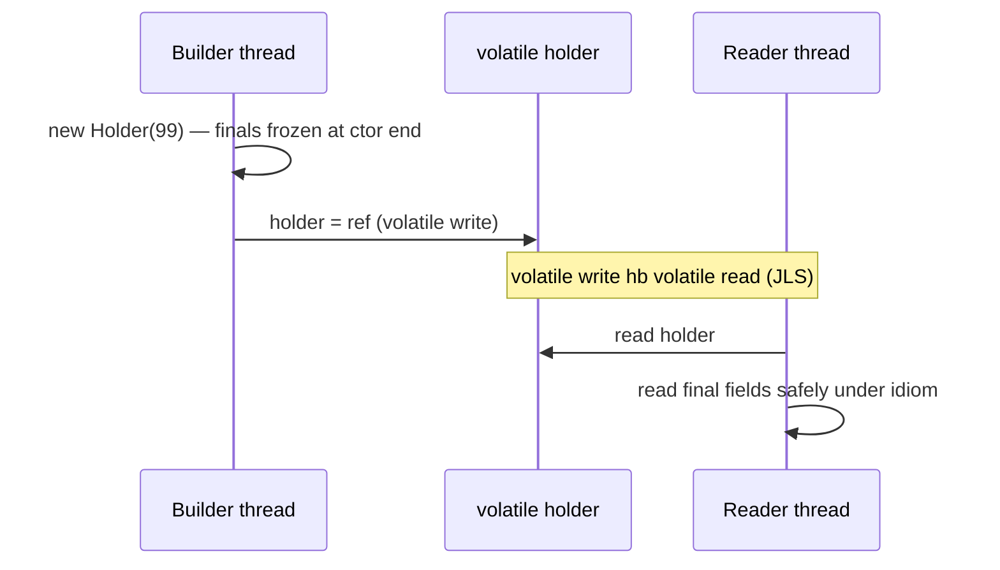
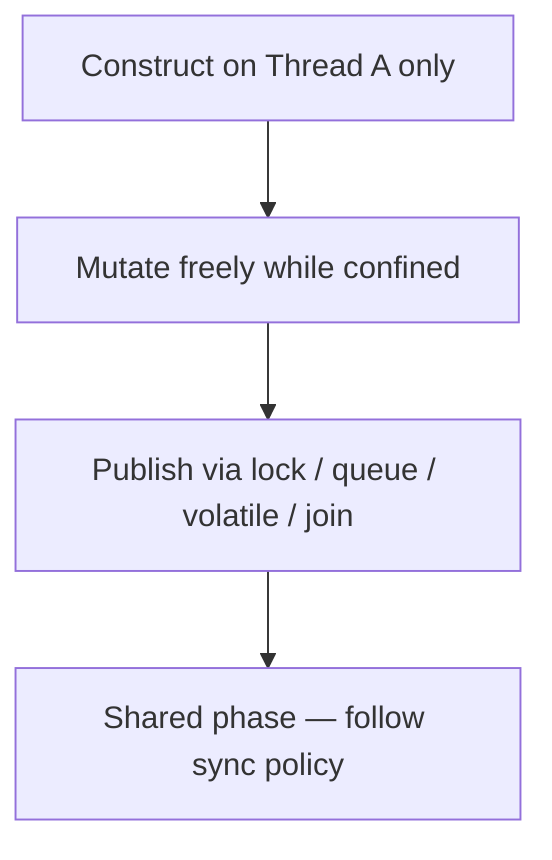

# Safe Publication

> **Status:** Completed  
> **Module:** 25 — Java Memory Model  
> **Target Java version:** 21  
> **Last reviewed:** 2026-11-11  
> **Chapter profile:** Deep-dive  
> **Depth target:** Levels 3–4 (final-field semantics, escape, publication idioms)  
> **Examples verified with:** Temurin JDK 21.0.12.1 (javac 21.0.12.1)

**Section policy:** Sections are **conditional unless marked mandatory**. Include a section when it adds meaningful learning value. Do **not** manufacture content to fill headings. For omitted sections, record the reason in the Review Checklist.

| Mandatory for most chapters | Conditional |
| --------------------------- | ----------- |
| Learning objectives | Internal behavior |
| Prerequisites | Performance |
| Why this exists | Security |
| Conceptual explanation | Language comparisons |
| Mechanism and execution flow *(or merge note)* | Advanced examples |
| Terminology | Real-world use cases |
| Examples | Design trade-offs *(strongly encouraged for Technical / Deep-dive)* |
| Common mistakes | Compatibility details |
| Summary and references | — |

**Editorial judgment:** Level 4 on **final-field safe publication**, **this-escape**, and **unsafe vs safe step traces**. Idioms (`volatile` reference, confinement, static holder) are taught as mechanisms tied to **JLS** happens-before / final-field rules. Barriers remain **HotSpot** implementation detail.

## 1. Learning Objectives *(mandatory)*

After completing this chapter, you should be able to:

- Define **safe publication**: when another thread reads a shared reference, it must observe the object as **fully constructed** (per the publication idiom’s JLS guarantees).
- Apply idioms: **final fields**, **volatile reference** write/read, **thread confinement** until an HB hand-off, and **static initialization / holder class** edges.
- Explain **this-escape** from constructors and why publishing `this` early is dangerous.
- Distinguish publishing an **immutable** object (still needs a safe *reference* hand-off) from publishing a **mutable** object (needs ongoing synchronization or confinement after publication).
- Walk **unsafe** vs **safe** publication step-by-step on a small object graph.

## 2. Prerequisites *(mandatory)*

- **Ch.02** — happens-before, `volatile`, data races; unlock→lock; start/join.
- **Ch.01** — shared heap, references.
- **Module 06** — constructors, initialization order, `final` fields at language level.

**Refresher — construction:** A constructor’s job is to establish invariants before other code uses the instance. If another thread can see the reference **during** construction, those invariants may not hold yet.

**Refresher — volatile publish (Ch.02):** Writing a reference to a `volatile` field, then reading that field in another thread, creates write hb read. Combined with program order, writes that prepared the object before the volatile store become visible to the reader after a successful volatile read.

## 3. Why This Concept Exists *(mandatory)*

A common bug:

1. Thread A constructs `Holder`, writing fields in the constructor.
2. Thread A stores the reference into a shared static or map **without** a happens-before edge to readers.
3. Thread B reads the reference and uses fields.

Under the JMM, for **racy publication** of objects with **non-final** fields, Thread B may observe **default values** (`0`, `null`, `false`) even though A’s constructor “finished” in program order on A. The reference store and the field stores can appear reordered to B.

Even for carefully built objects, **mutable** publication without a policy means B and A can race on later mutations.

Safe publication answers: **how do I hand a reference to another thread so construction (and the intended snapshot) is visible?**

## 4. Conceptual Explanation *(mandatory)*

### 4.1 Definition — safe publication

**Safe publication** means: the act of making a reference available to another thread is paired with JMM mechanisms such that when the consumer **observes** that reference, the writes that initialized the object (and any other writes you intended to publish with it) **happen-before** the consumer’s subsequent reads of that state—according to the idiom used.

It is **not** merely “I assigned a static field.” Assignment alone, if racy, is publication without safety.

### 4.2 Idioms (overview)

| Mechanism | Core idea | Typical use |
|-----------|-----------|-------------|
| **Final fields** | **JLS §17.5** final-field semantics: freeze at end of constructor; properly published object’s finals are visible | Immutable (or final-heavy) value objects |
| **Volatile reference** | Volatile write of the reference hb volatile read | Publishing a newly built immutable snapshot |
| **Synchronized / concurrent hand-off** | Unlock→lock, queue put/take HB, latch, etc. | Mutable objects; richer hand-off |
| **Confinement then join** | Build on one thread; only share after `join` / known HB | Single-thread init then publish |
| **Static initializer / holder class** | Class initialization hb uses of statics initialized there (**JLS**) | Singletons, lazy holder |

### 4.3 Final fields (JLS §17.5) — what they buy you

For a `final` field written in a constructor (and not overwritten elsewhere in ways that break the model):

- The JLS describes a **freeze** action at the end of the constructor.
- If the object is published **after** the constructor completes normally (no this-escape), another thread that obtains a reference through safe means sees the correctly initialized **final** fields.

**Important nuances:**

- Finals help with **initialization visibility** of those fields. They do **not** make a mutable object graph freeze if you store mutable objects in final fields and mutate them later without synchronization.
- `final` on a field holding a `List` only freezes the **reference** to the list, not the list’s contents—unless the list is never mutated (unmodifiable / never leaked mutably).

### 4.4 Immutable vs mutable publication

| Kind of object | Publication need | After publication |
|----------------|------------------|-------------------|
| **Immutable** (all state fixed; no mutation API) | Still need safe **reference** publication | Readers can share freely |
| **Effectively immutable** (not mutated after publish) | Safe publish; discipline not to mutate | Same as immutable if discipline holds |
| **Mutable** | Safe publish **and** a synchronization policy for later reads/writes | Locks, concurrent structure, or confine again |

**Myth:** “Immutable objects don’t need the JMM.”  
**Fact:** Immutability removes *ongoing* mutation races, but the **reference** still must be published safely so readers see initialized state (finals help; volatile/static-init/etc. publish the reference).

### 4.5 This-escape

**This-escape** occurs when a constructor lets the `this` reference become reachable by another thread (or even by code that assumes the object is finished) **before** the constructor completes.

Examples:

- Starting a thread in a constructor that receives `this`.
- Registering `this` as a listener in a constructor.
- Calling an overridable instance method that subclasses (or external code) can use to publish `this`.

Other threads may see **default field values** or torn initialization. Combine with inheritance and the bug becomes nasty.

**Rule of thumb:** Do not publish `this` until construction finishes. Prefer factories: construct fully, then register/start.

### 4.6 Static holder / class initialization

```java
private static class Holder {
    static final Expensive INSTANCE = new Expensive();
}
static Expensive get() { return Holder.INSTANCE; }
```

Class initialization is synchronized by the JVM; **JLS** guarantees that static initializers’ writes happen-before any use of the initialized class’s statics by other threads in the specified sense. This is a clean singleton/lazy idiom without explicit `volatile` in application code.

### 4.7 Enum singleton (related idiom)

```java
enum Service {
    INSTANCE;
    // fields initialized during enum class init
}
```

Enum constants are initialized as part of class initialization. This is a concise singleton form with the same **class-init** visibility story. Prefer it when the singleton is naturally an enum; prefer holder class when you need a named type with richer construction.

### 4.8 Publishing into concurrent collections

```java
ConcurrentHashMap<String, Holder> map = new ConcurrentHashMap<>();
map.put("k", new Holder(99)); // put happens-before a successful get that observes the entry
Holder h = map.get("k");
```

`ConcurrentHashMap` documents happens-before relationships for its operations (see Java SE API). Inserting a fully constructed value is a common **safe publication** channel: build the object, then `put`. Readers that `get` a non-null value can rely on the map’s documented ordering for that hand-off—then still obey any mutability policy on `Holder` itself.

## 5. Mechanism and Execution Flow *(mandatory)*

### 5.1 Unsafe publication — step trace (mutable / non-final illustration)

**Illustrative** broken sketch:

```java
class Broken {
    int value; // NOT final
    static Broken shared; // plain static — racy publish
    Broken(int v) { this.value = v; }
}
// Thread A:
shared = new Broken(99);
// Thread B:
Broken b = shared;
if (b != null) {
    System.out.println(b.value); // may observe 0 under JMM for racy publish
}
```

| Step | Thread A | Thread B | Risk |
|------|----------|----------|------|
| 1 | allocate Broken | | fields default 0 |
| 2 | write `value = 99` in ctor | | |
| 3 | ctor ends | | |
| 4 | `shared = ref` (plain write) | | no HB to B’s reads |
| 5 | | read `shared` | may see null or ref |
| 6 | | read `b.value` | if ref seen, **may still see 0** (racy publication) |

There is **no** happens-before from A’s `value = 99` to B’s read when publication is a plain data race on `shared`.

### 5.2 Safer with final fields — what changes

```java
private static final class Holder {
    final int value;
    Holder(int value) { this.value = value; }
}
```

**JLS §17.5:** After the constructor completes and freezes finals, a thread that sees the reference through a publication that does not allow observing the object mid-construction can rely on seeing `value` correctly initialized **as a final**.

**Caveat for demos:** Publishing the reference itself via a **plain** static still races on the **reference** variable (reader might spin on null). Final-field semantics address **field initialization visibility** once the reference is observed under the conditions the JLS describes—not “races are fine.” Production code often still uses **`volatile`** (or a concurrent structure) for the shared reference.

### 5.3 Demo flow — final holder + reader spin

Demo: [safe-publication-demo](../../examples/jvm/safe-publication-demo/).

Object graph:

```text
static Holder holder  ──►  Holder instance
                              └── final int value = 99
```

| Step | Actor | Action |
|------|-------|--------|
| 1 | main | `reader.start()` — start hb reader actions |
| 2 | reader | spin while `holder == null` |
| 3 | main | `holder = new Holder(99)` — construct (final write + freeze), then publish reference |
| 4 | reader | observes non-null; prints `local.value` |
| 5 | main | `reader.join()`; prints `published=true` |

**Verified output (Temurin JDK 21.0.12.1):**

```text
finalFieldValue=99
published=true
```

**Teaching notes:**

- The demo emphasizes **final-field** initialization of `value`.
- For production cross-thread reference hand-off, prefer `volatile Holder holder` (or a blocking queue / latch) so the **reference** publish has an explicit volatile/monitor HB edge—do not rely on “it worked in the demo” as proof that plain static publication is a complete protocol.
- `join` makes main wait for the reader’s completion for harness determinism; it is not what publishes `holder` to the reader.

### 5.4 Volatile reference publish — mechanism



**How to read this diagram:** Construction completes **before** the volatile store (program order). The volatile edge orders that store before the reader’s load of the reference. Final-field rules strengthen initialization guarantees for `final` state.

### 5.5 Confinement until hand-off



Until publication, only Thread A touches the object—**no** concurrent reads. At publication, choose an HB edge. Afterward, if the object is mutable, every access path needs a policy (Ch.02 / Module 24).

### 5.6 Static holder initialization edge

1. First call to `Holder.INSTANCE` triggers class init of `Holder` (if not yet initialized).
2. JVM runs static initializers under class-init synchronization.
3. Other threads waiting for class init see initialized statics with the JLS class-initialization HB guarantees.

### 5.7 Side-by-side: unsafe vs safe (two-field object)

**Unsafe (illustrative):**

```java
class Pair {
    int a;
    int b;
    static Pair p;
}
// Thread A:
Pair local = new Pair();
local.a = 1;
local.b = 2;
Pair.p = local; // racy publish of non-final fields
// Thread B:
Pair r = Pair.p;
if (r != null) {
    // may see a==0 or b==0 even if A assigned 1 and 2
    use(r.a, r.b);
}
```

**Safe pattern A — finals + volatile reference:**

```java
final class Pair {
    final int a;
    final int b;
    Pair(int a, int b) { this.a = a; this.b = b; }
}
static volatile Pair p;
p = new Pair(1, 2); // construct completely, then volatile publish
```

**Safe pattern B — lock hand-off:**

```java
synchronized (lock) {
    p = new Pair(1, 2); // or mutate then publish under same lock
}
synchronized (lock) {
    Pair r = p;
    if (r != null) use(r.a, r.b);
}
```

**Safe pattern C — confine then join:**

Build `Pair` only on thread A; start no readers until A finishes; share the reference after `A.join()` in the coordinating thread (join HB), or pass via a blocking queue whose API documents HB.

### 5.8 Why “immutable but non-final fields” is fragile

An object with private fields and no setters is **effectively immutable** only if nothing mutates those fields (including reflection tricks and package friends) **and** the reference is published safely. Declaring fields **`final`** additionally opts into **JLS §17.5** initialization guarantees. Prefer `final` (and `record`) for cross-thread value objects unless you have a specific reason not to.

## 6. Terminology *(mandatory)*

| Term | Meaning |
|------|---------|
| **Safe publication** | Handing out a reference with JMM guarantees that initialization (as intended) is visible to consumers. |
| **Unsafe publication** | Sharing a reference without adequate HB / final-field protocol; consumers may see stale/default state. |
| **This-escape** | Letting `this` become reachable before construction completes. |
| **Freeze (final fields)** | JLS notion at end of constructor for final-field semantics (§17.5). |
| **Confinement** | Restricting access to one thread for a period. |
| **Immutable object** | State does not change after construction; still needs safe reference publication. |
| **Holder class** | Nested class whose static init lazily creates a singleton with class-init HB. |

## 7. Syntax and Language Rules *(include when language/API surface matters)*

### 7.1 Final fields

```java
final int value;
final List<String> names; // reference final — contents may still be mutable!
```

Assign finals by end of constructor (definitely assigned rules). For immutable collections, store an unmodifiable copy:

```java
this.names = List.copyOf(names);
```

### 7.2 Volatile reference

```java
private static volatile Holder holder;
holder = new Holder(99); // publish
Holder local = holder;   // consume
```

### 7.3 Avoid publishing in constructors

```java
// Prefer:
static Listener create(...) {
    Listener L = new Listener(...); // fully constructed
    bus.register(L);
    return L;
}
```

## 8. Step-by-Step Examples *(mandatory)*

### 8.1 Minimal — final field holder (**Verified**)

From [SafePublicationDemo.java](../../examples/jvm/safe-publication-demo/SafePublicationDemo.java):

```java
private static Holder holder;

private static final class Holder {
    final int value;
    Holder(int value) { this.value = value; }
}

// reader spins until holder != null, then prints local.value
holder = new Holder(99);
```

**Why this way:** Smallest illustration of final initialization + cross-thread read of `value`.

**Compile and run:**

```bash
javac SafePublicationDemo.java
java SafePublicationDemo
```

**Verified output (Temurin JDK 21.0.12.1):**

```text
finalFieldValue=99
published=true
```

### 8.2 Realistic — volatile reference publish (**Illustrative**)

```java
private static volatile Holder published;

static void publish(int v) {
    published = new Holder(v); // construct, then volatile store
}

static int read() {
    Holder h = published;
    if (h == null) throw new IllegalStateException("not ready");
    return h.value;
}
```

**Important lines:** Assignment to `published` is the volatile write; readers load into a local once to avoid repeated volatile reads when using multiple fields (idiomatic).

### 8.3 Advanced — immutable snapshot vs mutable registry

**Immutable snapshot (safe publish once):**

```java
record Config(int timeoutMs, String mode) {}
private static volatile Config config = new Config(1000, "safe");

void reload(Config next) {
    config = Objects.requireNonNull(next); // publish new immutable snapshot
}
```

**Mutable registry (needs ongoing sync):**

```java
private final Map<String, Service> map = new ConcurrentHashMap<>();
// or synchronize all access to a plain HashMap
```

Publishing the `map` reference once is not enough if you used a plain `HashMap` and mutate it from many threads without synchronization.

### 8.4 Incorrect — this-escape

```java
class Escaping {
    private final int x;
    Escaping(EventBus bus) {
        bus.register(this); // ESCAPE — listeners may run before x is set
        this.x = 1;
    }
}
```

### Corrected

```java
class Safe {
    private final int x;
    private Safe(int x) { this.x = x; }
    static Safe createAndRegister(EventBus bus, int x) {
        Safe s = new Safe(x);
        bus.register(s);
        return s;
    }
}
```

## 9. Real-World Use Cases *(conditional)*

- **Config reloads** — build immutable `Config`, volatile-publish the reference.
- **Singleton services** — holder class or enum singleton with clear init HB.
- **Cache population** — put fully built values into `ConcurrentHashMap` (map’s publication semantics for that entry).
- **Actor / pipeline stages** — confine mutable builders; publish immutable messages via queues (queue HB).

## 10. Internal Behavior *(conditional)*

### 10.1 JLS (portable)

- **§17.5** Final Field Semantics — freeze, guarantees for properly constructed objects.
- **§17.4** Happens-before — volatile, monitors, class initialization relationships.
- **§12.4** Class Initialization — locking and visibility around `<clinit>`.

### 10.2 HotSpot (implementation — not universal law)

- Final-field and volatile guarantees are upheld with barriers / store-store ordering as needed on the CPU.
- Do not cite a specific barrier instruction as the meaning of “safe publication” in application design reviews—cite the idiom and JLS.

## 11. Edge Cases and Limitations *(strongly encouraged)*

- **Final field holding mutable object** — freezing the reference ≠ freezing contents.
- **Clone / deserialization / reflection** — can interact with final fields specially; follow API and JLS notes when doing advanced frameworks.
- **Partial construction via subclasses** — overridable methods in constructors are a this-escape footgun.
- **“It printed 99 in the demo”** — does not prove plain static publication is a complete production protocol for the reference.
- **Unsafe publication bugs** are intermittent—hard to catch in unit tests; prefer idioms that are correct by construction.

## 12. Common Mistakes *(mandatory)*

### Incorrect

```java
static Holder h; // written in one thread, read in another, no HB
h = new Holder(1); // Holder with non-final fields
```

### Corrected

Use `volatile` reference, synchronized publish/consume, concurrent collection hand-off, static holder init, and/or final fields with a real publication story.

### Incorrect

Registering `this` on a shared listener list inside a constructor.

### Corrected

Finish construction, then register (factory method).

### Incorrect

“The object is immutable, so I can assign it to a plain static from a background thread with no further care.”

### Corrected

Immutability helps **after** safe publication of the reference; still publish safely (volatile/static-init/etc.), and prefer finals for state.

## 13. Best Practices *(include when guidance adds value)*

- Prefer **immutable** value objects for cross-thread messages.
- Publish with **one clear idiom** per field; document it.
- Use factories to avoid this-escape.
- Store unmodifiable copies in final collection fields.
- Prefer `java.util.concurrent` structures for mutable shared maps/queues.

## 14. Design Trade-offs *(conditional; strongly encouraged)*

| Idiom | Pros | Cons |
|-------|------|------|
| Final fields + safe ref publish | Strong init guarantees; simple objects | Mutable graphs still hard; discipline on nested mutability |
| Volatile reference | Explicit HB; good for snapshots | Easy to forget; not for multi-field mutable protocols alone |
| Synchronized hand-off | Works for mutable state | Contention; must cover all paths |
| Static holder | Clean lazy singleton | Class-loader / init-order subtleties in complex apps |
| Confinement | Simple mentally | Must not leak references accidentally |

## 15. Performance Considerations *(conditional)*

- Immutable snapshot + volatile publish often beats coarse locking for read-mostly config.
- Defensive `List.copyOf` costs allocation—worth it for correctness at publish boundaries.
- DCL + volatile (Ch.02) is a micro-optimization; holder class is usually clearer and fast enough.

## 16. Security Considerations *(conditional)*

- Leaking partially constructed security-sensitive objects (keys, sessions) via this-escape is a real failure mode.
- Publishing mutable arrays of secrets without copies can allow callers to mutate credentials—defensive copies at trust boundaries.

*Broader threat modeling omitted; note in checklist.*

## 17. Java Version and Compatibility Notes *(conditional)*

- Final-field semantics in the modern JMM date to the JSR-133 era (Java 5+); Java 21 continues them.
- `record` types (Java 16+) encourage immutable publication-friendly carriers; still publish the record reference safely.
- `List.copyOf` / unmodifiable factories are preferred modern APIs for freezing collection contents at the reference boundary.

## 18. Related Language Comparisons *(conditional)*

*Omitted.* Other languages’ “immutable” and “publish” stories differ; stick to JLS idioms here.

## 19. Revision and Mastery *(Deep-dive)*

**You should already understand:** HB and volatile (Ch.02), constructors/`final` (Module 06).

**Common knowledge gaps:**

- Assuming immutability removes the need for safe reference publication.
- This-escape via listeners/threads started in constructors.
- Final reference to a mutable collection treated as a frozen deep object.
- Treating a successful demo run as proof that racy static publication is portable.

**Questions you should be able to answer:**

1. Walk unsafe vs safe publication for a two-field object.
2. Why can `final List<String> items` still be mutated?
3. How does the holder-class singleton get its HB edge?
4. What is this-escape, and how do factories prevent it?

**Practical exercise:** Change the demo’s `Holder.value` to a non-final `int` and explain what portable guarantees you lose for racy publication—even if your machine still prints `99`.

## 20. Exercises *(include for major chapters)*

### Beginner

Run `SafePublicationDemo`. Diagram the static reference and the `Holder` instance; mark the `final` field.

### Intermediate

Add `volatile` to `holder` in a local copy of the demo and explain which HB edge you added. Keep the verified chapter output associated with the stock demo.

### Advanced

Implement a config reload that publishes immutable snapshots via `AtomicReference<Config>` or `volatile Config`. Argue why mutably updating fields of a shared `Config` would be wrong.

## 21. Interview Questions *(conditional)*

- What is safe publication?
- Explain final-field semantics at a high level.
- What is this-escape?
- Does immutability eliminate the need for happens-before?

## 22. Solutions *(or link to separate solutions file)*

**Beginner sketch:** `holder` points at one heap `Holder`; `value` is final and printed as `99` after the reader observes a non-null reference; `published=true` after join.

**Intermediate sketch:** `volatile` on `holder` makes the store a volatile write; reader’s load is a volatile read; write hb read strengthens the reference hand-off explicitly (Ch.02).

## 23. Chapter Summary *(mandatory)*

Sharing object references across threads requires **safe publication**: construction effects must be visible under **JLS** rules. **Final fields**, **volatile references**, **confinement + HB hand-off**, and **static initialization** are standard idioms. Avoid **this-escape**. Immutability helps but does not erase the need to publish the reference safely; mutable objects need an ongoing synchronization policy after publication.

## 24. Key Terminology *(optional consolidation)*

See Section 6.

## 25. References and Further Reading *(mandatory)*

- [JLS §17.5 Final Field Semantics](https://docs.oracle.com/javase/specs/jls/se21/html/jls-17.html#jls-17.5)
- [JLS §17.4 Memory Model](https://docs.oracle.com/javase/specs/jls/se21/html/jls-17.html#jls-17.4)
- [JLS §12.4 Initialization of Classes and Interfaces](https://docs.oracle.com/javase/specs/jls/se21/html/jls-12.html#jls-12.4)
- [Java SE `List.copyOf`](https://docs.oracle.com/en/java/javase/21/docs/api/java.base/java/util/List.html#copyOf(java.util.Collection))
- Goetz et al., *Java Concurrency in Practice* — classic treatment of safe publication idioms (complement the JLS; verify against current specs)

## 26. Next Steps

Module **26** — JVM internals (runtime areas deepen; still distinguish HotSpot from JVMS). Revisit Module **24** when building concurrent services that must publish and mutate shared structures safely.

## Review Checklist

**Mandatory Depth Review:** Level 4 on final-field publication, this-escape, unsafe vs safe traces; Level 3 on idioms and mutable vs immutable.

- [x] Learning objectives covered
- [x] Prerequisites identified and briefly refreshed
- [x] Chapter profile and depth target recorded and appropriate
- [x] Depth gate passed (definitions; progressive examples; wrong vs right)
- [x] Mandatory Depth Review (Levels 1–4) passed for this topic
- [x] Mechanism and execution flow with step tables and diagrams
- [x] Diagrams explained in prose
- [x] First-appearance: safe publication, this-escape, freeze explained in-chapter
- [x] Examples with verification labels; Temurin 21.0.12.1 output preserved
- [x] JLS vs HotSpot distinguished
- [x] References support claims
- [x] Revision and Mastery included
- [x] Chapter independently readable
- [x] `PROGRESS.md` updated (third deepen pass 2026-11-11)

**Omissions (section → reason):**

- Language comparisons — not required
- Security — brief notes only
