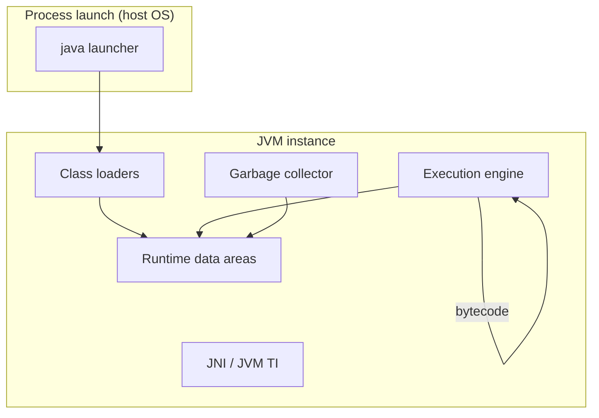
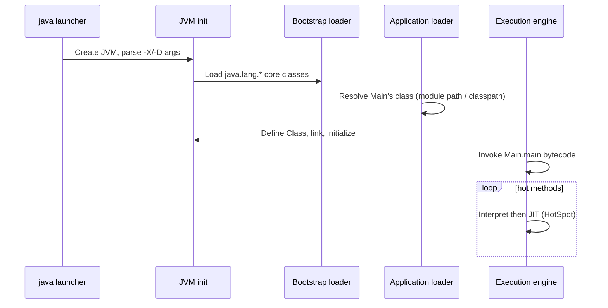

# JVM Architecture

> **Status:** Completed  
> **Module:** 26 — JVM Internals  
> **Target Java version:** 21  
> **Last reviewed:** 2026-11-11  
> **Chapter profile:** Deep-dive  
> **Depth target:** Levels 3–4 (JVMS subsystems, spec vs HotSpot, startup pipeline)  
> **Examples verified with:** Temurin JDK 21.0.12.1 (javac 21.0.12.1)

## 1. Learning Objectives *(mandatory)*

- Name the major **JVM subsystems** at textbook depth: class loading, runtime data areas, execution engine, native interface, and garbage collection.
- Distinguish **JLS** (language), **JVMS** (virtual machine), **Java SE API**, and **HotSpot** (product implementation) when stating facts.
- Trace the **startup and execution pipeline** from `java` launch through class loading, linking, initialization, and bytecode execution.
- Read **RuntimeMXBean** and **ProcessHandle** facts as a first diagnostic step.
- Explain why no single vendor JVM can be treated as the universal definition of “what the JVM does” for every claim.

## 2. Prerequisites *(mandatory)*

- Module **01** — JDK, JRE, JVM terminology, and the `java` / `javac` toolchain.
- Module **00** — compile-time vs run-time execution model.
- Module **25** Ch.01 — stack, heap, and references (refresher below).

**Refresher — three layers readers confuse:**

| Layer | Governs | Example question |
|-------|---------|------------------|
| **JLS** | Source code meaning | Is this program legal Java? |
| **JVMS** | Class files and VM behavior | What must a conforming JVM provide? |
| **HotSpot** | OpenJDK reference VM product | Which GC is default on Temurin 21? |

The **Java SE API** (`java.*`, `javax.*`) is specified separately from both JLS and JVMS; the JDK ships libraries plus tools on top of a JVM product.

## 3. Why This Concept Exists *(mandatory)*

Java’s original pitch combined **write once, run anywhere** with **managed memory** and **portable bytecode**. Source compiles to **class files**; a **Java virtual machine** on each platform interprets or compiles that bytecode to native instructions. Without a clear architecture story, developers treat folklore (“the JVM is just a process”) as spec, or attribute **HotSpot-specific** choices to **all** JVMs.

A principled architecture view lets you:

- Debug **class loading** and **classpath/module path** failures with the right mental model.
- Interpret **OutOfMemoryError**, **StackOverflowError**, and **GC logs** in terms of **runtime data areas**.
- Choose diagnostics (**JMX**, **jcmd**, **JFR**) knowing what the VM exposes vs what the language guarantees.

## 4. Conceptual Explanation *(mandatory)*

### 4.1 What the JVM is (JVMS view)

The **Java Virtual Machine** is an abstract machine specified in the [Java Virtual Machine Specification](https://docs.oracle.com/javase/specs/jvms/html/index.html) (JVMS). It:

- Loads **binary class files** (format defined in JVMS Chapter 4).
- Verifies and links them (JVMS Chapter 5).
- Executes bytecode with defined semantics (JVMS Chapter 6).
- Provides **runtime data areas** (heap, stacks, method area, etc.) with defined roles (JVMS Chapter 2).
- Leaves **automatic storage management** (garbage collection) implementation-defined while preserving memory safety.

**Label:** Subsystem names and data-area requirements below are **JVMS** unless marked **HotSpot**.

### 4.2 What HotSpot adds (product view)

**HotSpot** is Oracle/OpenJDK’s reference **Java Virtual Machine implementation**. On Temurin 21.0.12.1 it typically includes:

- **Tiered JIT** compilation (interpreter → C1 → C2) — Module 28.
- A default **G1** garbage collector selected ergonomically — Module 27.
- **Serviceability** tools: `jcmd`, JFR, attach API — Ch.05.

**Label:** JIT tiers, default GC, and `jcmd` commands are **HotSpot product behavior**, not JVMS mandates. Other JVMs (GraalVM native image, Azul Zing, etc.) differ.

### 4.3 High-level subsystem map

| Subsystem | Responsibility |
|-----------|----------------|
| **Class loader subsystem** | Finding `.class` bytes / modules, defining `Class`, delegation (Ch.02) |
| **Runtime data areas** | Per-thread stacks, shared heap, method area / metaspace, PC registers (Ch.04) |
| **Execution engine** | Interpreter, JIT compilers, runtime stubs (Ch.03, Module 28) |
| **Native method interface (JNI)** | Bridge to C/C++ and host OS |
| **Garbage collector** | Reclaims unreachable heap objects (Module 27) |



**Reading the diagram:** The launcher starts a process whose core is the JVM. Class loaders populate the method area and heap; the execution engine reads bytecode using stack frames; GC operates on the heap; JNI/JVM TI connect to agents and native code.

### 4.4 JDK vs JVM vs JRE (Java 21)

Since JDK 9+, the **JDK** is the downloadable unit: it contains **javac**, libraries, tools, and a **bundled JVM**. The old standalone **JRE** as a consumer-only install is deprecated in naming; production still speaks of “the JVM process” meaning **one running HotSpot (or other) instance** with heap and threads.

### 4.5 Relationship to the Java platform module system (JPMS)

**JVMS Chapter 5** and the Java SE module system (JLS/JEP 220) define how modules resolve at runtime. **HotSpot** uses `jdk.internal.loader` class loaders (Ch.02). Module boundaries affect **encapsulation** and **which packages are readable** — not the bytecode instruction set itself.

## 5. Mechanism and Execution Flow *(mandatory)*

### 5.1 From `java Main` to running user code (Level 4)



1. **Launcher** parses arguments, selects GC/heap flags (**HotSpot**), starts the VM.
2. **Bootstrap** loader loads core classes (`java.lang.Object`, etc.) without a parent `ClassLoader` reference in the API (`null`).
3. **Application** (or custom) loader loads `Main` from module path or classpath (Ch.02).
4. **Linking** verifies bytecode, prepares static fields, resolves symbolic references (lazy resolution permitted by JVMS).
5. **Initialization** runs `<clinit>` when the class is first actively used (JLS 12.4).
6. **Execution engine** runs `main`; HotSpot may **JIT-compile** hot methods (Module 28).
7. **GC** runs concurrently or stop-the-world on allocation pressure (Module 27).

### 5.2 Class file as the contract between compiler and JVM

`javac` emits **class files** conforming to JVMS Chapter 4 (magic `0xCAFEBABE`, constant pool, fields, methods, attributes). The JVM does not require Java source — only valid class bytes (or other JVMS-supported delivery, e.g. **Method Handles** / **invokedynamic** in Ch.03).

### 5.3 Thread of control

Each Java thread maps to a host OS thread in HotSpot’s default configuration (**1:1 model** — **HotSpot implementation detail**). Each Java thread has:

- Its own **JVM stack** (frames for method calls).
- A **program counter** for current bytecode (JVMS).

All threads share the **heap** and **method area** — foundation for the Java Memory Model (Module 25).

### 5.4 Termination

The JVM exits when all **non-daemon** threads end, or when `System.exit` is called (with caveats for shutdown hooks). **HotSpot** may still run finalization and hook threads briefly — behavior documented in `Runtime`/`System` API, not repeated here as universal timing guarantees.

## 6. Terminology *(mandatory)*

| Term | Meaning |
|------|---------|
| **JVMS** | Java Virtual Machine Specification — normative VM behavior |
| **Class file** | Binary format for types, methods, and bytecode |
| **Runtime data area** | JVMS-defined memory regions (heap, stacks, method area, …) |
| **Execution engine** | Component that runs bytecode (interpreter + JIT in HotSpot) |
| **Ergonomic defaults** | HotSpot JVM flags chosen automatically from heap size / OS |
| **Managed runtime** | Automatic heap reclamation; no portable `free()` for Java objects |

## 7. Examples *(mandatory)*

### 7.1 Runtime identity via JMX (Verified)

Demo: [jvm-architecture-demo](../../examples/jvm/jvm-architecture-demo/).

Important lines in `JvmArchitectureDemo`:

- `ManagementFactory.getRuntimeMXBean()` — standard **Java SE API** for VM name, input arguments, uptime.
- `ProcessHandle.current().pid()` — OS process id (**JDK API**); useful for `jcmd <pid>`.

**Verified output (Temurin JDK 21.0.12.1, recorded 2026-11-11):**

```text
jvmName=OpenJDK 64-Bit Server VM
javaVersion=21
pid=13492
inputArgsCount=0
```

| Output line | Teaching point |
|-------------|----------------|
| `jvmName=OpenJDK 64-Bit Server VM` | Product string; includes “Server VM” HotSpot lineage |
| `javaVersion=21` | **Specification version** from `RuntimeMXBean.getSpecVersion()` |
| `pid=…` | Changes every launch — always record live on your machine |
| `inputArgsCount=0` | Non-zero when you pass `-Xmx`, agents, or system properties on command line |

### 7.2 Default collector flag probe (Verified snippet)

**HotSpot only.** Run on Temurin 21.0.12.1:

```text
bool UseG1GC = true {product} {ergonomic}
bool UseZGC = false {product} {default}
bool TieredCompilation = true {pd product} {default}
```

This confirms **G1** and **tiered compilation** on this build; other distributions may differ — always verify locally.

## 8. Common Mistakes *(mandatory)*

### Incorrect

“The JVM specification requires G1 and tiered compilation.”

### Corrected

**JVMS** requires automatic storage management in principle but not a specific collector. **G1** and **tiered compilation** are **HotSpot ergonomic defaults** on this JDK (verified with `-XX:+PrintFlagsFinal`).

### Incorrect

“`javaVersion` from RuntimeMXBean is the same as `java -version` build string.”

### Corrected

`getSpecVersion()` returns the **Java SE specification version** (e.g. `21`). `java -version` prints **vendor build** (e.g. `21.0.12.1+1-LTS` Temurin).

### Incorrect

Treating **Eclipse OpenJ9** or **GraalVM Native Image** behavior as identical to HotSpot without checking.

### Corrected

Label observations by **VM product**. This module’s Verified demos use **Temurin HotSpot 21.0.12.1**.

## 9. Internal Behavior *(conditional — included)*

### 9.1 JVMS vs HotSpot documentation split

| Topic | Authoritative source |
|-------|---------------------|
| Bytecode semantics | JVMS Chapter 6 |
| Class loading/l linking phases | JVMS Chapter 5 |
| `IdentityHashCode` stability | Not guaranteed across GC moves — **JLS/JVMS + API docs** |
| Metaspace vs PermGen | **HotSpot** removed PermGen in Java 8; **JVMS** still says “method area” |

When reading OpenJDK source or HotSpot flags, cite **implementation**. When arguing portability, cite **JVMS/JLS**.

### 9.2 Class Data Sharing (CDS) — HotSpot

**HotSpot** can share read-only class metadata across JVM processes (`-Xshare:auto` default on many builds). Improves startup; does not change language semantics. **JVMS** does not require CDS.

## 10. Performance and Operational Notes *(conditional)*

- **Startup:** dominated by class loading, JIT warmup, and I/O — Module 28.
- **Footprint:** metaspace grows with loaded classes; heap with live objects — Ch.04, Module 27.
- **Containers:** respect cgroup memory limits; `-XX:MaxRAMPercentage` is **HotSpot** ergonomics.

## 11. Security *(conditional)*

The JVM **verifier** rejects illegal bytecode (type safety on the stack). **SecurityManager** is deprecated for removal (JEP 411); modern apps use OS/container isolation and library-level sandboxing. **Agents** (Ch.05) can transform bytecode — privileged deployment concern.

## 12. Design Trade-offs *(encouraged)*

| Design | Benefit | Cost |
|--------|---------|------|
| Bytecode + JIT | Peak performance after warmup | Warmup complexity, harder micro-benchmarking |
| Managed heap | No manual `free`, fewer UAF bugs | GC pauses, tuning needed at scale |
| Specified verifier | Safety on untrusted classes | Verification cost at class load |

## 13. Real-World Use Cases *(conditional)*

- **SRE triage:** map process PID → `jcmd` → thread/GC views (Ch.05).
- **Library authors:** avoid relying on **HotSpot-only** flags in public APIs.
- **Migration:** comparing Java 8 PermGen issues to Java 21 metaspace + G1 defaults.

## 14. Edge Cases and Limitations *(conditional)*

- **Multiple JVMs** on one host: separate heaps; no shared Java heap between processes without external stores.
- **`JNI_OnLoad`:** native libraries can affect VM init order — ordering bugs are platform-specific.
- **Forking:** Unix `fork` with a running JVM is hazardous; prefer `ProcessBuilder` for child **Java** processes.

## 15. Incorrect Implementations and Why They Fail *(conditional)*

### Assuming `null` bootstrap loader means “no loader”

API returns `null` for bootstrap-loaded classes; internally HotSpot still has a bootstrap mechanism. Use **JVMS/API** vocabulary in code comments.

### Reading `Runtime.getRuntime().freeMemory()` as “accurate free heap”

Values are **hints** after GC may have run; use **MemoryMXBean** / GC logs for serious work (Module 27).

## 16. Revision and Mastery *(Deep-dive)*

**Level 4 checks:**

1. Draw the pipeline **load → link → init → execute** and mark where **verification** happens.
2. Given a pause time regression, which subsystems do you inspect first (GC, JIT, locks)?
3. State three facts that are **JVMS-required** vs three that are **HotSpot-only** on Temurin 21.

**Common gaps:**

- Conflating **language** (`javac` errors) with **link-time** (`NoClassDefFoundError`).
- Ignoring **module path** when debugging “class not found” on JDK 17+.

## 17. Chapter Summary *(mandatory)*

The JVM architecture is a **specification-shaped machine** (JVMS) realized by a **product** (HotSpot on Temurin). Class loading feeds runtime data areas; the execution engine runs bytecode with optional JIT; GC manages the heap. Always label whether a claim is **JLS**, **JVMS**, **Java SE API**, or **HotSpot**. Use **RuntimeMXBean** and flag probes on **your** JDK before tuning or comparing vendors.

## 18. Further Reading and References

- JVMS — [Java SE 21 VM Specification](https://docs.oracle.com/javase/specs/jvms/se21/html/index.html)
- JLS — [Java Language Specification](https://docs.oracle.com/javase/specs/jls/se21/html/index.html)
- OpenJDK HotSpot — [Garbage Collection Tuning Guide](https://docs.oracle.com/en/java/javase/21/gctuning/) (**HotSpot**)

## 19. Subsystem Drill *(Level 4)*

For each subsystem below, state **one JVMS guarantee** and **one HotSpot-only detail**:

| Subsystem | JVMS guarantee (example) | HotSpot detail (example) |
|-----------|--------------------------|--------------------------|
| Class loading | Binary compatibility rules | `AppClassLoader` class name |
| Execution | Bytecode semantics | Tiered compilation |
| Memory areas | Existence of heap/stacks | Metaspace implementation |
| GC | Automatic management | G1 default ergonomic |
| Diagnostics | (tooling outside JVMS core) | `jcmd` commands |

### 19.1 Historical note: PermGen

Java 7 and earlier used **PermGen** in heap for class metadata — **OutOfMemoryError: PermGen space** familiar to veterans. Java 8+ HotSpot **metaspace** is native — error message changed; mental model must update for incident runbooks.

### 19.2 Multiple JVM languages

Kotlin, Scala, Clojure compile to **same class file format** — JVM architecture chapter applies; language semantics differ (JLS per language).

## 20. Next Steps

[02-class-loading-and-linking.md](02-class-loading-and-linking.md)

## Review Checklist

**Mandatory Depth Review:** Levels 3–4 — startup pipeline, spec vs product.

- [x] Chapter profile **Deep-dive**
- [x] Mechanism and execution flow (Sections 5.1–5.3) with diagrams
- [x] Demo **Verified** Temurin 21.0.12.1
- [x] JLS/JVMS vs HotSpot labels throughout

**Omissions (section → reason):**

- **Full JNI tutorial** — deferred to native-interop modules on roadmap; JNI named at architecture level only.
- **JFR walkthrough** — Ch.05; no fabricated flight recordings.
