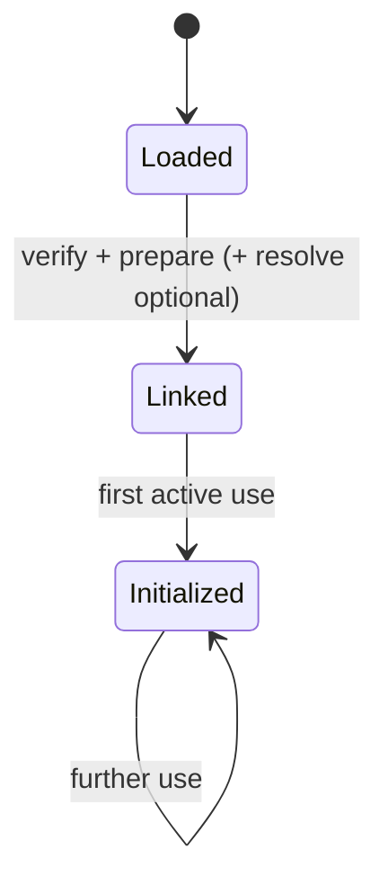
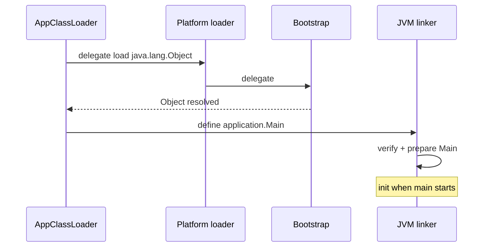

# Class Loading and Linking

> **Status:** Completed  
> **Module:** 26 — JVM Internals  
> **Target Java version:** 21  
> **Last reviewed:** 2026-11-11  
> **Chapter profile:** Deep-dive  
> **Depth target:** Levels 3–4 (JVMS phases, loader delegation, modules, initialization)  
> **Examples verified with:** Temurin JDK 21.0.12.1 (javac 21.0.12.1)

## 1. Learning Objectives *(mandatory)*

- Describe **loading → linking → initialization** per **JVMS Chapter 5** and **JLS 12.4**.
- Identify **bootstrap**, **platform**, and **application** class loaders on modern JDK layouts (**Java SE API** / **HotSpot**).
- Explain **delegation** and why parent-first loading prevents core class spoofing.
- Contrast **`Class.forName`**, **class-loader `loadClass`**, and **compile-time references** for initialization timing.
- Diagnose **`NoClassDefFoundError`**, **`ClassNotFoundException`**, and **`LinkageError`** with the right layer (classpath, module path, linkage).

## 2. Prerequisites *(mandatory)*

- Ch.01 JVM architecture; Module **01** packages and module path basics.
- Module **13** static fields and **`<clinit>`** execution order.

**Refresher — `Class<?>`:** A `Class` instance is the runtime mirror of a type. It is created by **loading** (JVMS); metadata lives in the **method area** (metaspace in HotSpot — Ch.04).

## 3. Why This Concept Exists *(mandatory)*

Bytecode on disk is inert until a class loader **defines** the type in the running VM. **Linking** ensures bytecode is structurally sound and field layouts are prepared before execution. **Initialization** runs static setup exactly once per class in a controlled order.

Without this chapter’s depth, developers:

- Add `Class.forName` “to load the driver” without understanding **initialization**.
- Misconfigure **module path** vs **classpath** and blame “the JVM is broken.”
- Build custom class loaders that break **delegation** and see `LinkageError`.

## 4. Conceptual Explanation *(mandatory)*

### 4.1 Three phases (JVMS)

| Phase | JVMS role | Developer-visible trigger |
|-------|-----------|---------------------------|
| **Loading** | Obtain binary form, create `Class` | Loader finds `.class` / generates bytes |
| **Linking** | Verify, prepare, (optionally) resolve | Between load and init; verify always for new classes |
| **Initialization** | Execute `<clinit>` | First **active use** (JLS 12.4) |

**Label:** Phase names and ordering requirements are **JVMS**. Exact timing of **resolution** may be lazy (**JVMS permitted**).

### 4.2 Loading in detail

**Loading** comprises:

1. Find and parse class bytes (or derive from existing `Class`).
2. Create a **`Class` object** associated with a **defining loader**.
3. Supertypes loaded before subtype (JVMS constraints).

Sources include JARs, modules, `URLClassLoader` URLs, bytecode generators, or **MethodHandles.Lookup.defineClass** (hidden classes — advanced).

### 4.3 Linking sub-phases (Level 4)

1. **Verification** — bytecode type safety (operand stack discipline, branch targets, etc.). Failure → **`VerifyError`** (**JVMS**).
2. **Preparation** — allocate static storage, default-initialize static fields to zero/`null` (no `<clinit>` yet).
3. **Resolution** — replace symbolic references in the constant pool with direct references (classes, fields, methods, method handles). May occur lazily at first use.



### 4.4 Initialization (JLS 12.4)

**Initialization** runs the static initializer for a class or interface. Triggers include (non-exhaustive):

- Creating a new instance of class `C`.
- Invoking a **static method** of `C`.
- Assigning a **static field** of `C` (except `static final` initialized at compile time in some cases).
- **`Class.forName("C", initialize=true, loader)`**.

**Initialization is single-threaded per class** under the JVM’s lock — JLS guarantees no deadlocks only if your static initializers cooperate; circular static init can still deadlock (smell).

### 4.5 Class loader hierarchy (JDK 9+)

| Loader | API visibility | Typical contents |
|--------|----------------|------------------|
| **Bootstrap** | `getClassLoader()` → `null` | `java.base` core (`java.lang.String`, …) |
| **Platform** | `ClassLoader.getPlatformClassLoader()` | JDK modules (`java.sql`, `jdk.compiler`, …) |
| **Application** | context / system loader | Application modules / classpath |

**Label:** Concrete class names like `jdk.internal.loader.ClassLoaders$AppClassLoader` are **HotSpot/JDK implementation**, not JVMS names.

### 4.6 Delegation model

By default, a loader asks its **parent** to load a class first (**parent delegation**). Rationale (security + correctness):

- Core classes always defined by bootstrap with consistent version.
- Application cannot replace `java.lang.String` with a malicious definition on a normal JDK layout.

Custom loaders (OSGi, Spring Boot nested jars, plugins) still usually delegate `java.*` upward.

### 4.7 Modules and readability

**JPMS** adds **module boundaries**: a class in module A cannot access package `com.internal` of module B unless B **exports** or **opens** it. Class loading can succeed for some graphs only after **module resolution** at startup.

Errors:

- **`ClassNotFoundException`** — name not found by loader (often caught).
- **`NoClassDefFoundError`** — present at compile time, missing or failed initialization at runtime.
- **`LinkageError` subclasses** (`IllegalAccessError`, `IncompatibleClassChangeError`, …) — binary incompatibilities.

## 5. Mechanism and Execution Flow *(mandatory)*

### 5.1 Resolving `Main` at launch



1. Launcher requests `Main` from **application** loader.
2. Loader walks parents for `java.*` types.
3. **Define** application `Main` bytes.
4. **Verify** and **prepare**; **resolve** constant pool entries as needed.
5. Before `main` executes, **initialize** `Main` and superclasses per JLS order rules.

### 5.2 `Class.forName` vs `loadClass`

| Call | Typical init? | Loader used |
|------|---------------|-------------|
| `Class.forName("com.app.Foo")` | **Yes** (unless 3-arg overload `initialize=false`) | Uses **caller** class loader |
| `loader.loadClass("com.app.Foo")` | **No** — link only unless already initialized | Explicit loader |

JDBC’s historic `Class.forName("driver")` pattern forces **driver class initialization** to register with `DriverManager` — **library idiom**, not JVMS requirement.

### 5.3 Context class loader

**Java SE API:** `Thread.setContextClassLoader` lets frameworks route I/O and SPI discovery in app servers. Mis-set context loaders cause **`ServiceConfigurationError`** in modular apps — real-world debugging target.

## 6. Terminology *(mandatory)*

| Term | Meaning |
|------|---------|
| **Defining loader** | Loader that created the `Class` instance |
| **Initializing loader** | Loader used to start loading that led to definition |
| **`<clinit>`** | Synthetic static initializer method (JVMS) |
| **Active use** | JLS trigger that causes initialization |
| **Binary compatibility** | JLS Chapter 13 — affects linkage at runtime |

## 7. Examples *(mandatory)*

### 7.1 Loader identity (Verified)

Demo: [class-loading-demo](../../examples/jvm/class-loading-demo/).

**Verified output (Temurin 21.0.12.1, 2026-11-11):**

```text
appLoader=jdk.internal.loader.ClassLoaders$AppClassLoader
stringLoader=null
demoLoaded=true
```

| Line | Meaning |
|------|---------|
| `appLoader=…AppClassLoader` | Demo’s class defined by application loader |
| `stringLoader=null` | **`java.lang.String`** loaded by **bootstrap** (API convention) |
| `demoLoaded=true` | `Class.forName` located demo class on application path |

### 7.2 Initialization order (Illustrative)

```java
class Super {
    static { System.out.println("Super clinit"); }
}
class Sub extends Super {
    static { System.out.println("Sub clinit"); }
}
```

**Compile-verified** snippet; output order on first reference to `Sub`:

```text
Super clinit
Sub clinit
```

Superclass **`<clinit>`** before subclass (**JLS**).

### 7.3 Incorrect custom loader (anti-pattern)

```java
// Illustrative — DO NOT disable delegation for java.* in production
protected Class<?> findClass(String name) throws ClassNotFoundException {
    byte[] b = fetchFromUntrustedSource(name);
    return defineClass(name, b, 0, b.length); // without parent check → spoofing risk
}
```

**Why wrong:** Breaking delegation can define incompatible `java.*` shadows in isolated experiments; on modern JDKs security and module boundaries usually block this, but **plugin architectures** must still delegate core packages.

## 8. Common Mistakes *(mandatory)*

### Incorrect

“`NoClassDefFoundError` means the JAR is missing from compile classpath.”

### Corrected

Often **present on classpath** but **static init failed** (exception in `<clinit>`), or **wrong class loader** in containers. Read **suppressed cause** / earlier exception in logs.

### Incorrect

“Linkage is instant at JVM start for all classes.”

### Corrected

Many classes **load on first use**; large apps pay **cold path** costs at unpredictable times — shows up in startup traces and **AppCDS** planning (**HotSpot**).

## 9. Internal Behavior *(conditional)*

- **Verifier** is separate from `javac` — malformed bytecode from agents/asm can fail at load (**JVMS**).
- **HotSpot** metadata in **metaspace**; class unloading requires loader collectible and no stale `Class` refs (Module 27 reachability).
- **Hidden classes** (JEP 371) — not in module graph the usual way; used by lambdas, frameworks; **JVMS** support with **HotSpot** specifics.

## 10. Performance *(conditional)*

- **Class loading** at startup: thousands of classes in frameworks — use **CDS**, **APM startup** views, **`-Xlog:class+load`** (**HotSpot** logging).
- **Resolution** of many symbolic references on first call sites — shows as one-time spikes.

## 11. Security *(conditional)*

Parent delegation protects core classes. **Deserialization** and **agent instrumentation** can still inject hostile classes — defense is broader (Module 21, agents in Ch.05). **Module encapsulation** blocks deep reflection unless `opens`.

## 12. Design Trade-offs

| Approach | Trade-off |
|----------|-----------|
| Parent delegation | Safer, sometimes slower lookup walks |
| Child-first (some plugins) | Faster plugin overrides; risk if misused |
| Fat JAR repackaging | Single classpath convenience; duplicate classes if shaded wrong |

## 13. Real-World Use Cases

- **Spring Boot launcher:** custom `LaunchedURLClassLoader` for nested JARs.
- **Driver SPI:** `ServiceLoader` + context class loader.
- **Hot reload in IDEs:** swap class bytes via instrumenting agents — dev-only.

## 14. Edge Cases

- **Initialization deadlock:** thread A initializes `X` while `X`’s static block touches `Y`, thread B the reverse — rare, fix static init dependencies.
- **Unicode class names:** legal in JLS; tools and loaders must agree on descriptor forms.

## 15. Revision and Mastery *(Deep-dive)*

1. List five **active uses** that trigger initialization (JLS).
2. Explain why `stringLoader` is `null` but bootstrap still exists.
3. Map a typical **`ClassNotFoundException`** (module missing export) vs **`IllegalAccessError`** (module not readable).

## 16. Chapter Summary *(mandatory)*

Class loading brings bytes into the VM; linking verifies and prepares types; initialization runs **once** under JLS rules. Modern JDKs use **bootstrap / platform / application** loaders with **parent delegation**. Separate **JVMS mechanics** from **JDK class names**. Diagnose errors by phase: not found (load), incompatible (link), failed init (first use).

## 17. Further Reading

- JVMS Chapter 5 — Loading, Linking, Initialization  
- JLS 12.4 — Initialization of Classes and Interfaces  
- `java.lang.ClassLoader` API documentation (Java SE 21)

## 18. Module System and Layers *(JDK 9+ depth)*

### 18.1 Layered class loaders

The **module system** can create **loader layers** at startup. Each resolved module maps to a loader. **ServiceLoader** discovers `META-INF/services` providers across readable modules — failures often trace to **module not reading provider module**.

### 18.2 Unnamed module

Classpath JARs without `module-info` land in **unnamed module** on application loader. Reflective deep access to JDK internals requires **`opens`** in `module-info` of libraries — not a class loading bug per se, but surfaces as `IllegalAccessException` at link/runtime.

### 18.3 `findClass` vs `defineClass`

Custom loaders override `findClass` to locate bytes; `defineClass` is final pathway to install. **`lookup.defineClass`** (Java 9+) restricts who may inject bytecode — security evolution.

### 18.4 Breaking binary compatibility (JLS Ch.13)

Recompiling caller without callee can yield `NoSuchMethodError` at **first invoke** — **link-time resolution** discovers signature mismatch.

### 18.5 Verifier vs `javac`

`javac` typechecks source; **verifier** proves bytecode stack discipline. ASM-generated code can pass `javac` never saw — fails verifier or misbehaves.

### 18.6 Class unloading conditions

Class **`Class` object** collectible when:

- Defining loader collectible  
- No live instances  
- No pending JNI, etc.

Metaspace pressure in reload servers ties here (Module 27).

## 19. Further exercises

1. Trace which loader defines `com.sun.proxy.$Proxy` classes.  
2. Explain `NoClassDefFoundError: Could not initialize class X` after static init exception.

## 20. Next Steps

[03-bytecode-and-execution.md](03-bytecode-and-execution.md)

## Review Checklist

**Mandatory Depth Review:** Levels 3–4 — phases, delegation, initialization triggers.

- [x] Chapter profile **Deep-dive**
- [x] Mechanism flow with diagram (Section 5)
- [x] Demo **Verified** Temurin 21.0.12.1
- [x] JVMS/JLS vs HotSpot loader names labeled

**Omissions:**

- **Custom ClassLoader lab** — assessment module; patterns summarized here.
