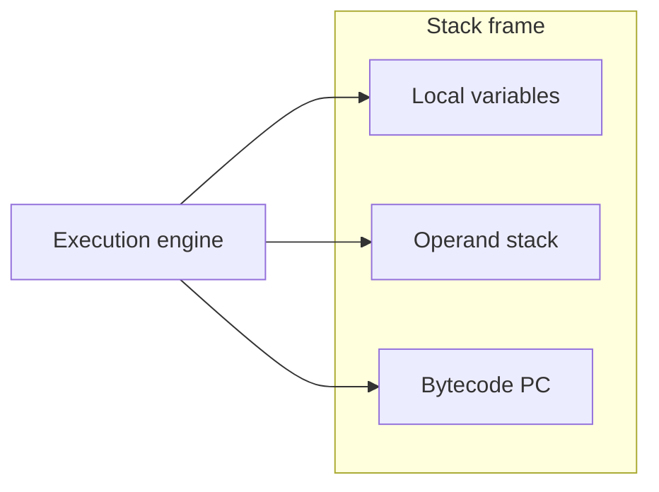

# Bytecode and Execution

> **Status:** Completed  
> **Module:** 26 — JVM Internals  
> **Target Java version:** 21  
> **Last reviewed:** 2026-11-11  
> **Chapter profile:** Deep-dive  
> **Depth target:** Levels 3–4 (class file format, stack machine, opcode trace, invokedynamic)  
> **Examples verified with:** Temurin JDK 21.0.12.1 (`javac` + `javap` + run)

## 1. Learning Objectives *(mandatory)*

- Map **class file structure** (constant pool, methods, attributes) to what `javap` shows (**JVMS Chapter 4**).
- Execute mentally through a **stack machine** model for arithmetic and method calls.
- Read **`javap -c -private`** disassembly for simple and `main` methods on **your** JDK.
- Relate **`invokedynamic`** in modern `javap` output to language features (lambdas, string concat).
- Separate **bytecode semantics** (**JVMS**) from **interpreter/JIT** performance (**HotSpot**).

## 2. Prerequisites *(mandatory)*

- Module **01** `javap` introduction; Module **04** methods and `static` vs instance.
- Ch.02 class loading — verification consumes this bytecode.

## 3. Why This Concept Exists *(mandatory)*

The JVM does not execute Java syntax — it executes **bytecode** with **defined stack semantics**. Developers who can read bytecode:

- Understand **why** exceptions carry stack traces (frames).
- See through **synthetic** methods (`access$`, bridge methods).
- Debug **verify errors** after bytecode transformation (agents, code generators).
- Connect **JIT decisions** (inlining, devirtualization) to hot bytecode shapes (Module 28).

## 4. Conceptual Explanation *(mandatory)*

### 4.1 Class file as JVMS contract

A `.class` file contains:

| Section | Purpose |
|---------|---------|
| Magic + version | Compatibility with JVM version |
| **Constant pool** | UTF-8 strings, class names, literals, method refs |
| Access flags, this/super | Visibility, interfaces |
| **Fields / methods** | Signatures + **Code** attribute holding **bytecode** |
| Attributes | Line numbers, stack map tables (verification), nest mates, records |

`javap -verbose` dumps pool entries; `-c` shows instruction listing.

### 4.2 Execution engine responsibilities (**JVMS**)

The **execution engine** fetches instructions, manipulates **operand stack** and **local variable slots** in the current **stack frame**, and dispatches **method invocations**. Native methods are implementation-dependent bridge points.

**HotSpot** implements the engine with an **interpreter** + **JIT compilers** — faster, not different semantics.

### 4.3 Stack machine model (Level 4)

Each non-abstract, non-native Java method has **max stack** and **max locals** in its `Code` attribute. At each instruction:

- Operands may be **popped** from the operand stack and **pushed** back.
- **Local variables** (`iload_0`, `astore_1`) hold parameters (slot 0 = `this` for instance methods) and temps.



### 4.4 Instruction categories (survey)

| Category | Examples | Role |
|----------|----------|------|
| Load/store | `iload`, `aload`, `istore` | Locals ↔ stack |
| Arithmetic | `iadd`, `lmul` | Integer / long math |
| Conversion | `i2l`, `f2d` | Widening / narrowing |
| Control | `ifeq`, `goto`, tableswitch | Branches |
| Objects | `new`, `dup`, `getfield` | Allocation and field access |
| Invocation | `invokevirtual`, `invokestatic`, `invokedynamic` | Call other methods |
| Return | `ireturn`, `areturn`, `return` | End frame |

**JVMS** defines exact stack effects per opcode.

### 4.5 Method invocation bytecodes

| Opcode | Typical use |
|--------|-------------|
| `invokestatic` | `static` methods |
| `invokespecial` | constructors, `private`, super calls |
| `invokevirtual` | Instance methods on receiver type |
| `invokeinterface` | Interface methods |
| `invokedynamic` | Bootstrap-specified call sites (lambdas, concat, records patterns) |

**Resolution:** constant pool entries become direct calls during **linking/resolution** (Ch.02).

### 4.6 `invokedynamic` and the language

Java compilers emit `invokedynamic` for features that cannot be fixed at compile time to one bytecode signature:

- **String concatenation** (modern `makeConcatWithConstants` bootstrap).
- **Lambda/method references** (`LambdaMetafactory`).
- **Pattern matching / records** infrastructure where applicable.

**JVMS** defines `invokedynamic`; bootstraps are **Java code** running at first execution.

## 5. Mechanism and Execution Flow *(mandatory)*

### 5.1 Tracing `add(int, int)`

For:

```java
public int add(int a, int b) {
    return a + b;
}
```

Bytecode (see Verified section):

1. `iload_1` — push parameter slot 1 (`a`).
2. `iload_2` — push `b`.
3. `iadd` — pop two `int`, push sum.
4. `ireturn` — return top `int`.

### 5.2 Tracing `main` construction path

Typical pattern:

1. `new` + `dup` + `invokespecial <init>` — allocate object, finish construction.
2. `astore` — keep reference in local.
3. `getstatic System.out` — fetch `PrintStream`.
4. `invokevirtual` on business method.
5. **`invokedynamic`** or `String` ops for concatenation.
6. `invokevirtual println`.

### 5.3 Exceptions and frames

When an exception propagates, the JVM **pops frames** until a handler matches in the `Code` attribute exception table (**JVMS**). Stack traces list **Java methods** mapped from frames — why understanding locals/stack clarifies “where did null sneak in.”

## 6. Terminology *(mandatory)*

| Term | Meaning |
|------|---------|
| **Operand stack** | Per-frame stack used by bytecode execution |
| **Local variable array** | Slot array including parameters |
| **Constant pool** | Shared per-class symbols and literals |
| **Stack map table** | Verification type info at branch targets (class files v50+) |
| **Bootstrap method** | Runs to link an `invokedynamic` call site |

## 7. Examples *(mandatory)*

### 7.1 Run program (Verified)

Demo: [bytecode-demo](../../examples/jvm/bytecode-demo/).

**Verified program output (Temurin 21.0.12.1):**

```text
sum=42
```

### 7.2 Disassembly (Verified)

Command: `javap -c -private BytecodeDemo` from demo directory.

**Recorded 2026-11-11 on Temurin 21.0.12.1:**

```text
Compiled from "BytecodeDemo.java"
public class BytecodeDemo {
  public BytecodeDemo();
    Code:
       0: aload_0
       1: invokespecial #1                  // Method java/lang/Object."<init>":()V
       4: return

  public int add(int, int);
    Code:
       0: iload_1
       1: iload_2
       2: iadd
       3: ireturn

  public static void main(java.lang.String[]);
    Code:
       0: new           #7                  // class BytecodeDemo
       3: dup
       4: invokespecial #9                  // Method "<init>":()V
       7: astore_1
       8: getstatic     #10                 // Field java/lang/System.out:Ljava/io/PrintStream;
      11: aload_1
      12: bipush        10
      14: bipush        32
      16: invokevirtual #16                 // Method add:(II)I
      19: invokedynamic #20,  0             // InvokeDynamic #0:makeConcatWithConstants:(I)Ljava/lang/String;
      24: invokevirtual #24                 // Method java/io/PrintStream.println:(Ljava/lang/String;)V
      27: return
}
```

**Line-by-line teaching notes:**

| PC | Instruction | Note |
|----|-------------|------|
| 0–4 | constructor | `invokespecial` on `<init>` — required for every `new` |
| 0–3 in `add` | `iload`, `iadd`, `ireturn` | Minimal stack pattern |
| 19 | `invokedynamic` | **HotSpot/JDK 21** string concat recipe — not all JDK versions identical at bytecode level |
| 16 | `invokevirtual add` | Virtual dispatch even for own method in non-`static` context from `main` |

### 7.3 Opcode effect table (Illustrative)

For `iadd`:

| Before stack (bottom→top) | After |
|----------------------------|-------|
| `…, int a, int b` | `…, int (a+b)` |

Violating stack depth → **VerifyError** at load, not at `javac` time for injected bytes.

## 8. Common Mistakes *(mandatory)*

### Incorrect

“`javap` output is portable across all JDK versions for the same source.”

### Corrected

Language lowering changes (string concat, switch, records) alter bytecode — always record **`javap` on your JDK** when documenting.

### Incorrect

“If it compiles, bytecode is safe to load.”

### Corrected

Agents and bytecode libraries can emit verifiable-but-wrong or unverifiable code — **JVMS verifier** is the gate.

## 9. Internal Behavior *(conditional)*

- **Verifier** uses stack map tables (when present) for faster proof (**JVMS 4.10**).
- **HotSpot interpreter** templates each bytecode; **JIT** may inline `add` and eliminate redundant loads in hot loops (Module 28).
- **Deoptimization:** JIT guards can fail; VM returns to interpreter with preserved semantics (**HotSpot**).

## 10. Performance *(conditional)*

Bytecode shape influences JIT:

- **Monomorphic callsites** inline more easily than megamorphic.
- **Large methods** may not inline into callers due to **HotSpot** size thresholds.

Optimize after profiling flame graphs — not after guessing `javap` beauty.

## 11. Edge Cases

- **`synchronized` methods:** bytecode uses `monitorenter`/`exit` or method flags — ties to Module 24 monitors.
- **`try/finally`:** compiler emits duplicate return paths — larger bytecode, important for verifier.
- **Hidden classes** / lambdas: extra `LambdaMetafactory` spin at first `invokedynamic`.

## 12. Real-World Use Cases

- Inspect **framework proxies** (CGLIB/ByteBuddy) generated method names in traces.
- Compare **Android dex** vs JVM bytecode — separate spec; concepts rhyme.

## 13. Incorrect Implementations

Hand-written bytecode omitting `<init>` after `new` → **`VerifyError`** or runtime failure — constructor **must** run (JLS/JVMS).

## 14. Revision and Mastery *(Deep-dive)*

1. Simulate stack depths through `main` up to `invokevirtual println`.
2. Name opcode used for **super constructor** in subclass ctor.
3. Why does `invokevirtual` appear instead of `invokestatic` for instance `add`?

## 15. Chapter Summary *(mandatory)*

Bytecode is the **JVMS execution language** for a **stack machine**. `javap` connects Java source to opcodes and pool references. Modern JDKs emit **`invokedynamic`** for concat and lambdas. Semantics are **JVMS**; speed is **HotSpot JIT** (Module 28). Record real `javap` when you teach or publish.

## 16. Further Reading

- JVMS Chapter 4 (class file format), Chapter 6 (instruction set)
- `javap` tool documentation — Java SE 21

## 17. Advanced Bytecode Topics *(Level 4)*

### 17.1 Constant pool resolution

Instructions like `invokevirtual #16` index the **constant pool** entry describing class, name, descriptor. First execution may **resolve** entry to a direct pointer — linking work (Ch.02).

### 17.2 `ldc` and strings

`ldc` pushes constants from pool — `String`, `Class`, numeric types. **intern** behavior for computed strings follows JLS string literal rules at compile time; dynamic concat uses **`invokedynamic`**.

### 17.3 `tableswitch` / `lookupswitch`

Compiler emits efficient jump tables for `switch` on ints — reading `javap` shows why dense enums compile differently than sparse cases.

### 17.4 Synchronized blocks

```text
monitorenter
...
monitorexit
```

Exception path duplicates `monitorexit` in `finally` — verifier ensures balanced locks per thread.

### 17.5 `invokeinterface` vs `invokevirtual`

Interfaces use dedicated opcode for historical JVM reasons; **default methods** complicate resolution — still JVMS-defined dispatch at run time.

### 17.6 Stack map frames (since v50)

Class files carry `StackMapTable` for verifier type checking — `javap -v` shows — failure after transform means agent broke maps.

### 17.7 Debugging with `javap -c -v`

Use verbose mode to connect pool indices to UTF-8 strings when teaching `main` disassembly line `#16`.

### 17.8 Computational stack depth exercise

For `add`, max stack = 2, max locals = 3 (`this`, `a`, `b` instance method) — verify against `Code` attribute header in `javap -v`.

## 18. Next Steps

[04-runtime-data-areas.md](04-runtime-data-areas.md)

## Review Checklist

**Mandatory Depth Review:** Levels 3–4 — stack trace through `add` and `main`.

- [x] Chapter profile **Deep-dive**
- [x] Mechanism (Sections 5.1–5.3)
- [x] Real `javap` output recorded Temurin 21.0.12.1
- [x] JVMS vs HotSpot JIT noted

**Omissions:**

- **ASM lab** — roadmap advanced tooling; concepts only.
