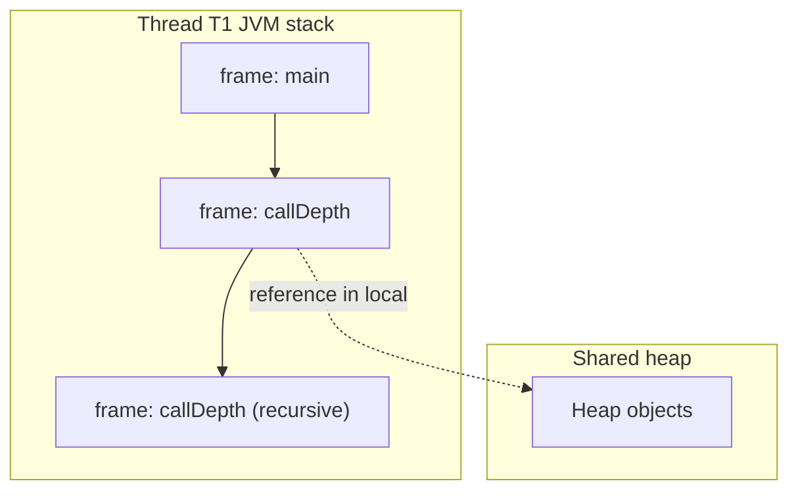

# Runtime Data Areas

> **Status:** Completed  
> **Module:** 26 — JVM Internals  
> **Target Java version:** 21  
> **Last reviewed:** 2026-11-11  
> **Chapter profile:** Deep-dive  
> **Depth target:** Levels 3–4 (JVMS areas, frames, heap vs stack, HotSpot metaspace)  
> **Examples verified with:** Temurin JDK 21.0.12.1 (javac 21.0.12.1)

## 1. Learning Objectives *(mandatory)*

- List **JVMS runtime data areas** and what each stores.
- Explain **stack frames**, **locals**, and **operand stacks** during nested method calls.
- Relate **objects on the heap** to **reference variables** in frames (Module 25 refresher).
- Predict **`StackOverflowError`** vs **`OutOfMemoryError`** sources by area.
- Map **JVMS “method area”** to **HotSpot metaspace** naming without conflating spec and product.

## 2. Prerequisites *(mandatory)*

- Module **25** Ch.01 stack/heap/references; Module **04** recursion.
- Ch.03 bytecode frames.

## 3. Why This Concept Exists *(mandatory)*

Every allocation, variable, and static field lives in a **defined region** of JVM memory. GC (Module 27), thread dumps, and heap dumps assume you know:

- **Stacks are bounded per thread** — unbounded recursion fails fast.
- **Heap is shared** — visibility and races follow JMM rules (Module 25).
- **Class metadata** lives outside the object heap in HotSpot’s **metaspace**.

## 4. Conceptual Explanation *(mandatory)*

### 4.1 JVMS runtime data areas (Level 3)

**Label: JVMS** names below come from Specification Chapter 2.

| Area | Thread scope | Holds |
|------|--------------|-------|
| **PC register** | Per thread | Address of current instruction (abstract); undefined for native methods |
| **JVM stack** | Per thread | **Stack frames** (one per active method) |
| **Native method stack** | Per thread | Native C stack frames (**implementation-dependent**) |
| **Heap** | Shared | All class instances and arrays |
| **Method area** | Shared | Type metadata (classes, constant pool, method code, static fields) |
| **Run-time constant pool** | (logical part of method area) | Per-class pool from class file |

Some JVMs also use **direct memory** (NIO buffers) outside heap — not a JVMS “area” but operational reality.

### 4.2 Stack frames (Level 4)

Each **frame** contains:

- **Local variable array** — parameters and locals (`int` slots, `long`/`double` use two).
- **Operand stack** — bytecode evaluation stack.
- **Reference to constant pool** of the class defining the method.
- **Exception table** for handlers in this method.

Frames are **allocated on thread push** and **destroyed on return** — no explicit free.



### 4.3 Heap and object lifetime

`new` places an object in the **heap** (young generation first in HotSpot generational collectors — **HotSpot detail**). References in stacks, static fields, or other objects keep instances **reachable** for GC (Module 27).

### 4.4 Method area / metaspace (**spec vs HotSpot**)

**JVMS:** **Method area** stores class structures.  
**HotSpot (Java 8+):** class metadata primarily in **native metaspace**; **Java heap PermGen removed**. Developers still say “method area” when speaking JVMS.

Static field values reside with class metadata structures; **objects** referenced by static fields are on the **heap**.

### 4.5 Distinguish errors

| Error | Typical cause |
|-------|----------------|
| `StackOverflowError` | Too deep recursion / huge local frames on **JVM stack** |
| `OutOfMemoryError: Java heap space` | No room for new instances |
| `OutOfMemoryError: Metaspace` | Too many loaded classes / leaks via class loaders (**HotSpot**) |
| `OutOfMemoryError: unable to create native thread` | OS thread/stack limits |

## 5. Mechanism and Execution Flow *(mandatory)*

### 5.1 Recursive `callDepth`

1. Each recursion pushes a frame with its own slot for parameters/locals.
2. Depth *n* means *n* active `callDepth` frames (plus caller frames).
3. When stack capacity exceeded, **throw** `StackOverflowError` before corrupting memory (**JVMS safety**).

### 5.2 `new` in a method

1. Current frame’s bytecode executes `new` — object allocated on heap.
2. Reference may be stored in **local** (`astore`) or operand stack.
3. When frame pops, locals die; object survives if referenced elsewhere.

### 5.3 Thread creation

`new Thread().start()` allocates:

- Host OS thread + **JVM stack** with default **-Xss** (**HotSpot** flag).
- Thread object on **heap**.

Thousands of threads → stack footprint dominates — sizing exercise for services.

## 6. Terminology *(mandatory)*

| Term | Meaning |
|------|---------|
| **Frame** | Activation record for one method invocation |
| **Young/old generation** | **HotSpot** heap subdivisions for generational GC |
| **Metaspace** | **HotSpot** native allocation for class metadata |
| **Escape** | Object reference leaves method scope — affects JIT stack allocation (**HotSpot**, Module 28) |

## 7. Examples *(mandatory)*

### 7.1 Stack depth and heap identity (Verified)

Demo: [runtime-data-areas-demo](../../examples/jvm/runtime-data-areas-demo/).

**Verified output (Temurin 21.0.12.1, 2026-11-11):**

```text
stackDepth=100
heapObjectId=951007336
```

| Line | Teaching point |
|------|----------------|
| `stackDepth=100` | 100 nested frames fit in default **-Xss** on this machine |
| `heapObjectId=…` | `System.identityHashCode` — **not** a stable object address; varies by run/GC |

### 7.2 Provoke stack overflow (Illustrative)

```java
static void infinite() {
    infinite();
}
```

**Expected:** `StackOverflowError` — **JVMS** allows implementation-specific stack depth.

### 7.3 Stack size flag (HotSpot)

`-Xss512k` reduces per-thread stack; more threads fit, shallower recursion allowed — measure before production change.

## 8. Common Mistakes *(mandatory)*

### Incorrect

“Primitives on the stack, objects on the stack too.”

### Corrected

**Object contents** live on **heap**; **reference variables** (locals/fields) are references often held in stack **slots** pointing to heap.

### Incorrect

“`identityHashCode` is the memory address.”

### Corrected

**API documentation:** not guaranteed to be address; may change with GC moves (**HotSpot** moving GC).

## 9. Internal Behavior *(conditional)*

- **HotSpot** default **-Xss** platform-dependent (512k–1M typical on 64-bit).
- **TLAB** (thread-local allocation buffers) — fast path Eden allocation (**HotSpot**).
- **Compressed OOPs** — 32-bit refs in 64-bit heaps under default ergonomics (**HotSpot**).

## 10. Performance *(conditional)*

- Deep stacks → memory × thread count; **virtual threads** (Module on roadmap) reduce **OS** thread count but frames still exist for mounted carriers.
- Large objects may go to **humongous** regions in G1 (**HotSpot**) — affects GC (Module 27).

## 11. Real-World Use Cases

- Tune **-Xss** after `StackOverflowError` in deep XML/JSON recursion — prefer iterative algorithms.
- **Metaspace OOM** in hot-reload dev servers — leak class loaders; fix retention, not only `-XX:MaxMetaspaceSize` bump.

## 12. Design Trade-offs

| Choice | Implication |
|--------|-------------|
| Many threads + default -Xss | High virtual memory reservation |
| Tiny -Xss | Risk earlier `StackOverflowError` |
| Giant heap | Longer GC paths unless low-latency collector |

## 13. Revision and Mastery *(Deep-dive)*

1. Draw one frame’s locals/stack during `add(a,b)`.
2. Where do static fields of `MyClass` live vs instance fields?
3. Which error for class loader leak vs heap leak?

## 14. Chapter Summary *(mandatory)*

**JVMS** partitions runtime state into per-thread stacks and shared heap/method area. Frames tie directly to bytecode execution. **HotSpot** maps method area to **metaspace** and subdivides heap for **G1**. Diagnose failures by **area** first, then tune with evidence.

## 15. Advanced Topics *(Deep-dive extension)*

### 15.1 Frame size and `-Xss` mathematics

Each thread reserves **stack memory** up to **-Xss** (HotSpot). Total reserved stack memory is approximately:

```text
threadCount × -Xss  (+ native overhead per thread)
```

A service with **500 platform threads** at **1 MiB** stack reserves hundreds of MiB before heap objects. **Virtual threads** (Java 21) reduce **OS thread** count but **mounted** work still uses carrier stacks — operational sizing changes, not “zero stack cost.”

### 15.2 Object layout sketch (HotSpot — not JVMS exam detail)

An ordinary object on the heap typically contains:

| Part | Role |
|------|------|
| **Mark word** | Hash, lock state, GC age bits (**HotSpot**) |
| **Klass pointer** | Points to class metadata in metaspace |
| **Fields** | Instance data per class declaration |
| **Padding** | Alignment to 8 bytes on 64-bit |

Arrays store **length** then elements. **JVMS** requires sensible layout constraints; exact packing is **implementation-dependent**.

### 15.3 Where primitives and references live

| Location | Holds |
|----------|---------|
| Operand stack slot | Running computation temporaries |
| Local variable slot | Parameters, locals — `int` in one slot; `long`/`double` in two |
| Object field on heap | Instance/static fields |
| static field storage | With class metadata — references point to heap objects |

### 15.4 Native memory beyond heap

**DirectByteBuffer**, **mmap**d files, **JNI** allocations, and **metaspace** consume **native** memory. Container OOM can kill the pod even when **heap MXBean** shows free space — watch **Native Memory Tracking** (`-XX:NativeMemoryTracking=summary`) in HotSpot diagnostics labs (Ch.05).

### 15.5 Interaction with garbage collection

GC scans **roots** including stack slots of **stopped** threads during STW phases. Concurrent collectors coordinate with mutators using **barriers** — objects may move; references in stacks are updated. This is why **Module 25** forbids treating raw addresses as object identity.

### 15.6 StackOverflowError recovery

`StackOverflowError` is an **Error**, not a routine catch. Some frameworks catch it to return HTTP 500 — acceptable only with **fixed recursion bug** remediation. Never recurse indefinitely expecting recovery.

### 15.7 Comparison with C stack

C stack variables live in the **native** frame for `JNI` or `native` methods — separate from **Java bytecode frames** but same thread. JNI local references are **roots** until deleted — JNI misuse can leak heap objects.

### 15.8 Exercise set (reasoning)

1. **Depth:** If `callDepth(10_000)` throws, is heap exhausted? Explain.
2. **Retention:** Method returns `Object` created locally — if caller stores reference, which area keeps object alive after frame pop?
3. **Metaspace:** Load 10,000 unique classes — which error type first?

### 15.9 Hands-on commands (HotSpot)

```text
java -XX:+PrintFlagsFinal -version 2>&1 | findstr ThreadStackSize
jcmd <pid> VM.native_memory summary
```

Record output locally; values vary by OS and ergonomics.

### 15.10 Chapter cross-links

| Topic | Module |
|-------|--------|
| Happens-before visibility | 25 |
| GC roots on stacks | 27 Ch.01 |
| Escape analysis stack allocation | 28 Ch.01 |

### 15.11 Virtual threads and stack carriers (Java 21)

**Virtual threads** mount on **carrier** platform threads. A deep Java call stack still consumes space on the carrier stack while mounted — unbounded synchronous recursion on virtual threads can still hit limits. Blocking a virtual thread unmounts the stack in the carrier model (**JEP 444** / **HotSpot** implementation) — different from classic “one OS thread one megabyte stack” math, but **runtime data areas** still exist per logical execution.

### 15.12 `OutOfMemoryError: unable to create native thread` drill

When thread factory creates thousands of platform threads:

1. Check **ulimit** / Windows thread limits.  
2. Lower `-Xss` only if stack traces prove shallow and tests pass.  
3. Prefer **virtual threads** for massive I/O concurrency with measured carrier pool sizing.

### 15.13 Method area churn

Frequent **reflection** or **dynamic proxies** create many classes — metaspace grows (not heap young GC). Pair with **class histogram** (`jcmd`) when heap is fine but process RSS climbs.

### 15.14 JVMS quote discipline

When writing runbooks, say “**method area (metaspace in HotSpot)**” on first use — teaches junior readers both vocabularies.

## 16. Further Reading

- JVMS Chapter 2 — Runtime Data Areas  
- Java Tutorials — memory management overview (supplement to spec)

## 17. Next Steps

[05-diagnostics-and-agents.md](05-diagnostics-and-agents.md)

## Review Checklist

- [x] Deep-dive; Mechanism Section 5
- [x] Verified demo Temurin 21.0.12.1
- [x] JVMS vs metaspace labeled

**Omissions:** **NIO direct memory deep dive** — optional GC module cross-link.
