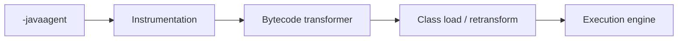

# Diagnostics and Agents

> **Status:** Completed  
> **Module:** 26 — JVM Internals  
> **Target Java version:** 21  
> **Last reviewed:** 2026-11-11  
> **Chapter profile:** Deep-dive  
> **Depth target:** Levels 3–4 (JMX beans, jcmd surface, JFR/agents concepts)  
> **Examples verified with:** Temurin JDK 21.0.12.1 (javac 21.0.12.1)

## 1. Learning Objectives *(mandatory)*

- Query **ThreadMXBean**, **MemoryMXBean**, and **GarbageCollectorMXBean** via **Java SE JMX API**.
- Position **`jcmd`**, **JFR**, and **Java agents** in the **HotSpot serviceability** stack.
- Know **what to record locally** vs what must not be fabricated (full GC logs, flame graphs).
- Relate diagnostics to **Modules 27–28** (GC logs, profiling) without invented artifacts.

## 2. Prerequisites *(mandatory)*

- Ch.01–04; Module **24** threads and deadlocks (dump correlation).

## 3. Why This Concept Exists *(mandatory)*

Production JVM issues need **in-process metrics** and **low-intrusion captures**. The platform exposes **JMX beans** portably; **HotSpot** adds rich **`jcmd`** verbs and **JFR** events. **Agents** attach at startup for bytecode instrumentation.

Shallow docs list tool names; deep docs teach **when each layer answers which question**.

## 4. Conceptual Explanation *(mandatory)*

### 4.1 Layers of observability

| Layer | Portability | Examples |
|-------|-------------|----------|
| **Java SE JMX** | API across compliant VMs | `ThreadMXBean`, `MemoryMXBean` |
| **JDK tools** | JDK builds | `jcmd`, `jstat`, `jhsdb` |
| **JFR** | OpenJDK HotSpot family | `jdk.JavaFlightRecorder`, event types |
| **Agents (JVMS instrument)** | Attach + bytecode transform | `-javaagent`, `Instrumentation` |

**Label:** `jcmd` subcommands and JFR event catalogs are **HotSpot/JDK**-centric unless stated otherwise.

### 4.2 JMX in application code

`ManagementFactory` locates platform beans:

- **RuntimeMXBean** — uptime, input args, name (Ch.01).
- **ThreadMXBean** — counts, optional stack traces, deadlock detection.
- **MemoryMXBean** — heap/non-heap usage.
- **GarbageCollectorMXBean** — collector names, collection counts (Module 27).

Beans are **cheap enough** for health endpoints if polled sensibly; heavy work belongs in profilers.

### 4.3 `jcmd` (HotSpot)

Syntax: `jcmd <pid> <command>`.

Common commands (availability **HotSpot**):

| Command | Purpose |
|---------|---------|
| `help` | List commands for this PID |
| `Thread.print` | Thread dump to stdout |
| `GC.heap_dump` | Write HPROF |
| `JFR.start` / `JFR.dump` | Flight recordings |

Use PID from `ProcessHandle` or OS tools (Ch.01 demo).

### 4.4 Java Flight Recorder (JFR)

**JFR** records events (allocations, GC, method samples) into bounded buffers. Analyze with **JDK Mission Control** or programmatic parsers.

This handbook does **not** embed fake `.jfr` excerpts — labs should record files on your machine.

### 4.5 Java agents

**JVMS** / **Instrumentation API:**

- **`premain`** — JVM start with `-javaagent:jar`.
- **`agentmain`** — attach API after start.

Agents may **retransform** classes (bytecode change) — powerful, security-sensitive.



## 5. Mechanism and Execution Flow *(mandatory)*

### 5.1 Minimal thread snapshot via JMX

1. Obtain `ThreadMXBean`.
2. Read `getThreadCount`, `getPeakThreadCount`.
3. Optionally `dumpAllThreads` for names and states.

Use when logs show thread pool exhaustion — correlate with pool config, not guessed counts.

### 5.2 Escalation path in incidents

1. **MXBean** health in-process.
2. **`jcmd Thread.print`** if deadlocks suspected.
3. **GC logs / JFR** if latency + heap (Module 27–28).
4. **Heap dump** if retention suspected (Module 27 Ch.03).

## 6. Terminology *(mandatory)*

| Term | Meaning |
|------|---------|
| **MBean** | Managed bean exposing attributes/operations |
| **Attach API** | `com.sun.tools.attach` — connect agents to live VM (JDK module) |
| **JVM TI** | Native tooling interface — profilers/native agents |
| **Flight recording** | JFR binary recording |

## 7. Examples *(mandatory)*

### 7.1 Thread MXBean (Verified)

Demo: [diagnostics-demo](../../examples/jvm/diagnostics-demo/).

**Verified output (Temurin 21.0.12.1, 2026-11-11):**

```text
threadCount=7
peakThreadCount=7
threadsListed=7
```

Counts include JVM housekeeping threads (`Reference Handler`, `Finalizer`, `Signal Dispatcher`, …) — **normal** on HotSpot; numbers vary slightly by JDK build and loaded features.

### 7.2 What we do not fabricate

| Artifact | Handbook policy |
|----------|-----------------|
| JFR event table screenshot | Record in lab |
| GC log pause line | Run with `-Xlog:gc*` |
| async-profiler flame graph | Capture locally |

## 8. Common Mistakes *(mandatory)*

### Incorrect

Polling `dumpAllThreads` every second in production at high QPS.

### Corrected

**Observer effect** + allocation pressure — sample at sane intervals or use JFR sampling.

### Incorrect

Assuming `jcmd` exists on every embedded JVM.

### Corrected

Minimal or custom runtimes may strip tools — verify deployment image.

## 9. Security *(conditional)*

JMX remote connectors and attach API can be **attack surfaces** — disable remote JMX without auth in public networks. Agents require **privileged** deployment posture.

## 10. Real-World Use Cases

- Spring Boot Actuator maps many metrics to Micrometer + JMX bridges.
- CI smoke tests assert `threadCount` below threshold after warm-up.

## 11. Revision and Mastery *(Deep-dive)*

1. Which bean for heap vs thread count?
2. Difference between wall-clock thread dump and JFR sample?
3. When is `-javaagent` required vs plain `jcmd`?

## 12. Chapter Summary *(mandatory)*

Start with **JMX** in small programs; escalate to **`jcmd`** and **JFR** on HotSpot with **real captures**. **Agents** transform classes at load — spec-governed, operationally powerful. Never invent diagnostic output in docs or dashboards.

## 13. Extended Serviceability Reference *(Deep-dive)*

### 13.1 MemoryMXBean vs pool beans

`MemoryMXBean.getHeapMemoryUsage()` returns **`used` / `committed` / `max`** for heap summary. Finer detail:

```java
for (var pool : ManagementFactory.getMemoryPoolMXBeans()) {
    // Eden, Survivor, Old, Metaspace pools — names HotSpot-specific
}
```

Use pools to watch **Old gen growth** between young GCs — indicates promotion rate (Module 27).

### 13.2 GarbageCollectorMXBean correlation

Pair `getCollectionCount()` deltas with application events. A spike in **`G1 Young Generation`** collections with flat throughput often means **allocation rate** increase — profile (Module 28 Ch.03) before raising heap.

### 13.3 `jcmd` catalog (representative HotSpot commands)

Run `jcmd <pid> help` on **your** JVM — list varies by version. Common families:

| Command family | Use |
|----------------|-----|
| `Thread.print` | Thread dump |
| `GC.class_histogram` | Object counts by class |
| `VM.flags` | Effective flags |
| `JFR.start` / `JFR.dump` | Flight recording |
| `Compiler.codecache` | JIT code cache pressure |

**Never paste fictional histogram lines** into incident reports.

### 13.4 JFR event categories (conceptual)

| Category | Examples |
|----------|----------|
| JVM runtime | GC, safepoint, class load |
| Method sampling | `jdk.ExecutionSample` |
| Java application | `jdk.JavaMonitorEnter` |
| OS / I/O | Socket reads (where enabled) |

Enable with:

```text
java -XX:StartFlightRecording=duration=60s,filename=app.jfr ...
```

Analyze `app.jfr` in JDK Mission Control — file must be **your** recording.

### 13.5 Java agent lifecycle

1. JVM starts, reads `-javaagent:path.jar=options`.
2. `premain` receives `Instrumentation` instance.
3. Agent registers `ClassFileTransformer`.
4. Each class load/retransform invokes transformer before definition completes (Ch.02 linking).

**Risks:** transformers can break **verification** or create **LinkageError**. Agents require same trust as deploying new application code.

### 13.6 Attach API sketch

Tools like VisualVM attach with **Attach API** (`com.sun.tools.attach`) to load agent dynamically — disabled in hardened images without `jdk.attach.allowAttachSelf` and OS permissions.

### 13.7 Diagnostic questions for production

| Symptom | First probe | Escalation |
|---------|-------------|------------|
| High CPU | JFR execution samples | async-profiler |
| GC pauses | `-Xlog:gc*` | Collector change trial (Module 27) |
| Deadlock | `jcmd Thread.print` | Lock profiling |
| Metaspace growth | pool MXBean + class histogram | Heap dump + loader dominators |

### 13.8 Observability vs guarantees

JMX counters are **best effort**. `Thread.getAllStackTraces()` may miss races. JFR sampling has **safepoint bias** historically — consult JDK 21 release notes when interpreting.

### 13.9 Compliance and PII

Thread dumps and heap dumps contain **stack data and objects** — may include passwords if developers logged secrets. Treat dumps as **confidential**.

### 13.10 Interview depth

**Q:** Why not use `Thread.activeCount()` alone for pool monitoring?  
**A:** Deprecated patterns; use **MXBean** + named factory threads; `activeCount` is coarse and can lie during races.

**Q:** Difference JMX remote vs local?  
**A:** Local `ManagementFactory` in-process; remote requires connector and authentication hardening.

### 13.11 Module integration table

| Need | Tool chapter |
|------|----------------|
| Prove G1 default | 27 Ch.02 flags |
| Prove tiered JIT | 28 Ch.01 flags |
| Benchmark fix | 28 Ch.02 JMH |

## 14. Hands-on Lab Outline *(no fabricated artifacts)*

Complete these on Temurin 21.0.12.1; paste **your** output into notes only.

| Step | Action | Success criterion |
|------|--------|-------------------|
| 1 | Run `diagnostics-demo` | `threadsListed` matches `threadCount` |
| 2 | Note PID; `jcmd <pid> help` | Command list prints |
| 3 | `jcmd <pid> Thread.print` | At least one `main` thread in dump |
| 4 | `jcmd <pid> VM.flags` | Contains `UseG1GC` or chosen collector |
| 5 | Optional `JFR.start duration=30s` | `*.jfr` file created on disk |

### 14.1 Reading a thread dump line (Illustrative format)

Thread dumps name **state** (`RUNNABLE`, `WAITING`, `BLOCKED`) and **stack frames** — correlate `BLOCKED` with lock owner id when investigating deadlocks. Exact format is **HotSpot** text; do not memorize fake lock addresses.

### 14.2 MXBean polling snippet (Compile-verified)

```java
var threads = ManagementFactory.getThreadMXBean();
System.out.println("daemonThreadCount=" + threads.getDaemonThreadCount());
```

Daemon threads do not keep JVM alive — useful when diagnosing shutdown hangs.

### 14.3 Instrumentation limits

`Instrumentation.getAllLoadedClasses()` returns classes currently defined — size correlates with metaspace footprint (agent required). Without agent, use `jcmd GC.class_histogram` for approximate live class counts.

### 14.4 When JMX remote is justified

Behind auth + TLS on admin network for NOC dashboards — never expose unauthenticated JMX to internet. Prefer sidecar metrics exporter pattern in Kubernetes.

### 14.5 Agent signing and supply chain

Treat `javaagent` JARs like application binaries — verify checksum, pin versions, audit transformer code for exfiltration.

### 14.6 Correlation ID discipline

When capturing dumps during incidents, log **request correlation id** alongside **dump filename** — postmortems need user context, not only stacks.

### 14.7 Tooling version skew

JDK Mission Control major version should **match** JDK used to record JFR — mismatch can fail to parse events.

### 14.8 Serviceability agent (SA) footnote

`jhsdb` / SA attaches to core files on supported platforms — disaster recovery when process already crashed; advanced topic beyond MXBean demos.

## 15. Next Steps

Module **27** — Garbage Collection.

## Review Checklist

- [x] Deep-dive; mechanism escalation path
- [x] Verified demo; no fabricated JFR/GC excerpts
- [x] HotSpot vs JMX API labeled
